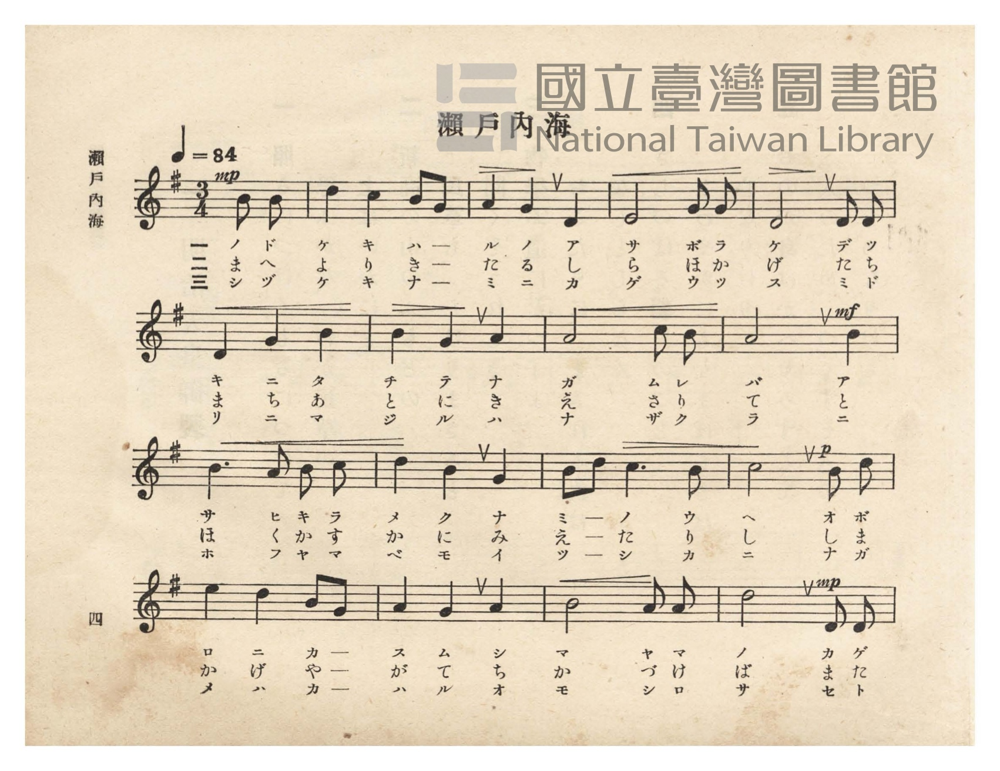
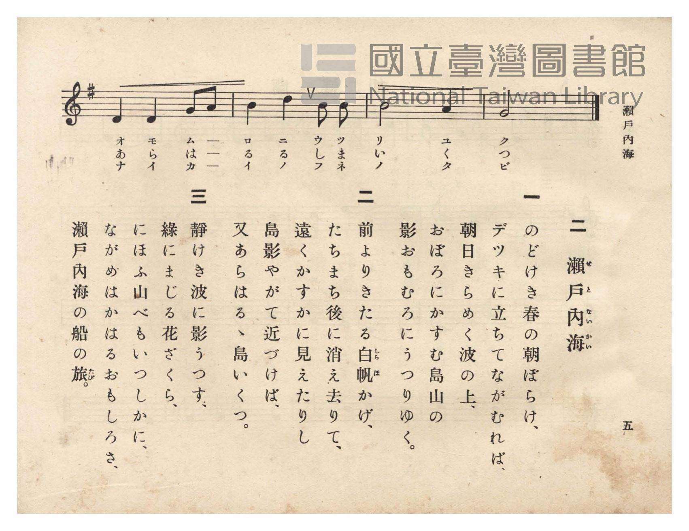

# 瀨戶內海

> Re:Shōka 使用 AI 協助辨識與重建樂譜，可能會有錯誤。歡迎回報。

<audio controls src="seto_naikai.mp3"></audio>

- 詞：文部省唱歌
- 曲：文部省唱歌
- 臺灣總督府《公學校唱歌》第六學年用（昭和十五年，索書號 523.37 4322-4）

## 說明

原書資訊與歌詞全文（對應 P008.jpg–P009.jpg，原書 pp. 4–5）：
調性與拍號：ト長調（G 大調）3/4 拍（弱起 1 拍），速度 ♩=84


## 歌詞

```text
一
のどけき春の朝ぼらけ、
デツキに立ちてながむれば、
朝日きらめく波の上、
おぼろにかすむ島山の
影おもむろにうつりゆく。

二
前よりきたる白帆（しらほ）かげ、
たちまち後に消え去りて、
遠くかすかに見えたりし
島影やがて近づけば、
又あらはるゝ島いくつ。

三
靜けき波に影うつす、
綠にまじる花ざくら、
にほふ山べもいつしかに、
ながめはかはるおもしろさ、
瀨戶內海の船の旅（たび）。
```

## ABC

```abc
X:1
T:瀨戶內海
C:曲：文部省唱歌
M:3/4
L:1/16
Q:1/4=84
K:G
V:V1 name="Piano" snm="Pia"
[V:V1]
!mp! z4 z4 B2 B2 | d4 c4 B2 G2 | A4 G4 D4 | E8 G2 G2 |
w: 1.~ノ ド | ケ キ ハ ー | ル ノ ア | サ ボ ラ
w: 2.~ま へ | よ り き ー | た る し | ら ほ か
w: 3.~シ ヅ | ケ キ ナ ー | ミ ニ カ | ゲ ウ ッ
D8 D2 D2 | D4 G4 B4 | B4 G4 A4 | A8 c2 B2 |
w: 1.~ケ デ ッ | キ ニ タ | チ テ ナ | ガ ム レ
w: 2.~げ た ち | ま ち あ | と に き | え さ り
w: 3.~ス ミ ド | リ ニ マ | ジ ル ハ | ナ ザ ク
!mf! A8 B4 | B6 A2 B2 c2 | d4 B4 G4 | B2 d2 c6 B2 |
w: 1.~バ ア | サ ヒ キ ラ | メ ク ナ | ミ ー ノ ウ
w: 2.~て と | ほ く か す | か に み | え ー た り
w: 3.~ラ ニ | ホ フ ヤ マ | ベ モ イ | ツ ー シ カ
!p! c8 B2 d2 | e4 d4 B2 G2 | A4 G4 A4 | B8 A2 A2 |
w: 1.~ヘ オ ボ | ロ ニ カ ー | ス ム シ | マ ヤ マ
w: 2.~し し ま | か げ や ー | が て ち | か づ け
w: 3.~ニ ナ ガ | メ ハ カ ー | ハ ル オ | モ シ ロ
!mp! d8 D2 D2 | D4 D4 G2 A2 | B4 d4 B2 B2 | B8 A4 |
w: 1.~ノ カ ゲ | オ モ ム ー | ロ ニ ウ ツ | リ ユ
w: 2.~ば ま た | あ ら は ー | る る し ま | い く
w: 3.~サ セ ト | ナ イ カ ー | イ ノ フ ネ | ノ タ
G8 z4 |
w: 1.~ク
w: 2.~つ
w: 3.~ビ
```

## TMD 檔案連結

- [主旋律 TMD 檔案](seto_naikai.tmd) [[在 TMD Studio 編輯](https://tmdlang.github.io/Tmd-TS/#tmd=s7IKdvYPcrWy4qpTUCpJTLdSSM7PyUlNLsnMz7PKzk9PzM7Ojy_OyM9OVIKrKMvPKc1NtUovSkxJjTdDiBfnlxYlp1oVJ2fk5-fEl6RWlCTl52ejy8cXJKanWgUYGFggZAqK8stS8xLzgLoLijLzSlJTwNoRClLLMlNSQdLFyYl58WWpRZlpmakpSE5KLSoGuRhqRUlRYl5xclFmAcgbCFX5RSUZ-UBnF2RUWmVkFpfkF2UmJ-bEZyfmIfmuJCMV6LncxKLMkszcVHTxgpzEZAxBoHVlqTlKXFpaCs8bVjzr2Pa0dfmzrdsVtLS4FG0VLEy47G0V3LlsjPVN7EA6X6yc937PrGfT2l82r3g-p_HplI3P1vaAzXw2exMOmRftu543Ln6-Y-_zuYuf7przuKHraeuap2t3PFuwEKLqcUP38zVrnrauBQo-3bnl-ZQV7_d0PJux9umknqe9jU92TQEKvt_T83zLomezd7yYOV_B1MhYz9hcwcTYyEjX5P2eTiUuLn0tBVtqAS4FBYWnffNBlm1uf7Gi60VHO9CVQK8_bV0B9CDQcU839D5r71QApQS9rIL0Rw2TgUxLEBPoTohWhYICPQUToIwp0IHAkAEZ-mLV_mcNy0HGdfcC_QEUfdzc8XLqdqA40FB3hadLloOZncDgVgCqAdm0Z-MLYHQYQrhAg3peNsx_umuZwqOZK22B0QMy9smOBhD1uHHd48aVjxsnPm7sfTZjKZD7bM7cx417Hjd1ggQbGsGKmtsfN7c8blr7uHH189XdjxsXPm5c9rhx1ePGnsdNDY-beh43boAqBep-Nh1oTC_IgKbGx439zzYvApr6ZEcXzLDGLrD5vUDDHjcCDZsJNOPp5m1PN24EqgMH414gq-txUxPYcIi6tseNSx43AQWBjP7HDU0QP-zqAavvBNrWAZIFWts4_3FT9_OZe5_uaAOGxOPG6WCf7AYGA9iySXBXzAd7Yx-QfLoP6IHVz7YBVXc87dsNNmgZVN3LxgUgCyHuBJGrXywDkkClQHuA6qaDHQB0PdDNTS2gAGlc9mI_MDSBYQAkYcHytB-oA-gfoCPWA933uGkuUM_jRqAGoNlL4P7Z0Qm2c-4caISAgm41ODjA_gc6AWLc821AVwFDBej6GUDjXnQBVUwDmQW0AOY_oPTux41bwcG6ExSYINuAZkyHeAOuDhKLwJhaD5YAOw8S-qCwAwboVJilSFkdGFMvOnaCUsv0VnAwA0NzMyiMgT4BKqU8O0GBgpY-F1dwakm-X2JmdmKmVUBmYl6-Q41BTTXIGgUbCy07MANbTlYAlg_AVP5iYY-CBnKOUNBWMFF4uqH_-foGHXhu1MSiH2g3yOwaBQMFXTCuzi2oVTAGwhoFUyDXBIiNgWbWKBgBWYZAbBoPJGoUzEAUCBqCZcGiIAhkAFEN2FQfwxoFkDgIP27uA-JOoNLHTRtB_Ka1YNF-IN4DEm1eDVUFklsEtuNx01aoqY-b5wDxSrhuiFg7EDfD7DJCsqtxHxDvAKvuAJvXBRbthdnVOB8s2g0WnQ61qxNmbuNuIO4Gq5sEF5sPxAthdhkj2dW0HWhqK4a_uuD-AtvVDLarCeRHkMpNMHOblkH8AGTthPsLaBcopMD5BXe07-oBRzuJ8QyOKFA8GoOdAiJBPFDsQuIYBE3A8Q_jVeemgZIEUAE8VmG-hPhqP8RXzY1gsTao_yE-XQP31QIgXgNWNwHue3A8w-MPFG-gsF4IJpsgJjSuAPPAqQMYgxAxUKxC4mUqOHZBYsvgYiAdiJh63LwK4dbmeVB37QDzIGmuH-p-kJsh7toGxOvBYivh7gfpJxQnOzrJiRNQ2IKiwBgY8JBsB4sWkJwpOBOCxGqgLGCUgDOpKUqMQPLK4-ZJ4NiB5pZmcFgC_YIUJ-D0tQea1yBpECQ6A-77VeD8hhwvu6EhC8ytwJwBLKTBIQ7JP5CYgaYBYMyAzQbnMEjOA4mC8hjEhOngWEaOndlQdwNjsnkJOIZAojPBYqD08bhpCdTdLRCzgTkOYvZqsCjIFRATgHkOmN4IxNHT2bPJiSMzoA2QmEEuDCHZBhJ_IJ4RNP4g2QYYSejF4eNm5IyzGlZIgDM_KItAChSId0FJFeIxRLBAogyqF1iMIEcSJDpARRawmoYXdT1gUVDmgGQsmEpIdCwF4olgsQ1wMVDhOR8lisCJCJxNkNwM4UOyEDDJQNwMijCI-0DF4lrUQrwJWLA2dxAu2KZgRhC4DUm4YIOWbqBoAEUKJMJAGQcRRSB3gqIOBEEVHnIWghQU4EQHLq4g_kSOMVBx3QIWBamFxA4obEG6QZkMBMEVJFK8gAoySPUCbHrAYxxiHqwKAmcKINkCjwVoodQISvxopoLjBFylgbMGcjoC8yGVKDhD9aKlGlhRPRnF1FouLl07BUQbRAHIU-YCAA)]
- [鋼琴伴奏 TMD 檔案](seto_naikai_piano.tmd) [[在 TMD Studio 編輯](https://tmdlang.github.io/Tmd-TS/#tmd=s7IKdvYPcrWy4tLSUnjesOJZx7anrcufbd3-fk_Hy-49zydsebJny9Ol_c87O97v6VTQ0uJStFWwMOGyt1Vw57Ix1jex46pTUHqxct77PbOeTWt_2bzi-ZzGp1M2PlvbowSSeTZ7Ew6ZF-27njcufr5j7_O5i5_umvO4oetp65qna3c8W7AQoupxQ_fzNWuetq4FCj7dueX5lBVANz2bsfbppJ6nvY1Pdk0BCr7f0_N8y6Jns3e8mDlfwdTIWM_YXMHE2MhI1wToWiUuLs-8kqJ8q4DMxLz8IA-HGoOaai4FILCx0LIDM2oUqnMLahVM4xV0IYShghFQ0BjEBWJjIITwQNAIiGuAKiA8AxCPqxbFDh9kO0zQ7YgHWQGigIbEK0QbxoJxDVgIzDONB3GhcgYQ04NTS_L9EjOzEzPxegPkGhAGWwVxNsgDJmBPGAJ5IMeDnA72ZY2CGYgCQUOwLFgUBMEuBNoMMtXHsEYBJA7Cj5v7gLgTqPRx00YQv2ktWLQfiPeARJtXQ1WB5BaB7XjctBVq6uPmOUC8Eq4bItYOxM0wu4yQ7GrcB8Q7wKo7wOZ1gUV7YXY1zgeLdoNFp0Pt6oSZ27gbiLvB6ibBxeYD8UKYXcZIdjVtB5raiuGvLri_wHY1g-1qAvkRpHITzNymZRA_AFk74f4C2gUKKS5o1EDTFSgiQLpBJIgHSU0gEgRNwFEG41XnpoFiEZTAYBEBcxjEIfshDmluBIu1QZ0McdwauEMWAPEasLoJcAeDowYe5KCgBgXPQjDZBDGhcQWYB45QYKBDxEARAQnKqeAIAYktg4uBdCAC93HzKoRbm-dB3bUDzIMkk36o-0FuhrhrGxCvB4uthLsfpB8ejJBcaASkTaCJGxaSIDlTcFIHidVAWcBQBGcFU5RAhKTIx82TwAEKTZPNYO8DrUcKRnAs7oGmaEhMg0RnwB28CpyqkYNyNzQwgHkCmP4eN84EBxIklUICExptwMAEmw1Ox5D0DRIFpWSICdPBEYMcoLOh7gYGfvMScKCCRGeCxUBR-rhpCdTdLRCzgekaYvZqsCjIFRATgCkbmETgwWoGFIQEJnIpAUmciIIPVCiCVEESJ6TERCknHjcjJ8_VsNwDzhWghAjJaRAXghIExC0In0BCGaoXmL-QwxUSgqC8_LgJ4juQaA9YFJQEIckXphISgkuBeCJYbANcDFSqzEcJVXC8gxMjkpshfEhCBcYyxM2gMIa4D1RerEUt3ZqAJU5zB1qOJ6s6QSRUSA4CRy04H0OchhzIoKKnBSwKUgsJUFBwgHSDkjIIggt7pKAE5XBIUfm4cT08kiDmwYpTcNIDki3wgIPm1kZQEkMzFRyM4OIZnACRox7Mh1QI4GTbixbRsDJsMoqpWKo8HLWqARhiq0tB9Si0MjUB8U1AfGzSUJNQTIByIPU0unFwPqh2xq0ZzjEB2Q5xB5gBFILpA4pAVeNqAaA5AWElmU0JXTsFcFtFAchAhHG0D1AFmogRhogxWESZCwA)]

## 分析

```text
================================================================================
📊 TMD Song Profile: [ 瀨戶內海 ]
================================================================================
⏱  Duration:       0:44 (45.0s), 21 measures total
🎼 Key & Tempo:    首調基準 G, != 84.0 BPM, <3/4>
   - 分析範圍：      由實際發聲的音符與和弦推測調性；播放脈絡另行呈現
🎤 人聲音域:    D4 (MIDI 62) – E5 (MIDI 76) [跨度: 14 個半音 / 1.2 個八度, 難度: moderate]
   - 最低音:  D4 in [SetoNaikai #1 @ m.3, 0:05]
   - 最高音: E5 in [SetoNaikai #1 @ m.14, 0:27]
   - 適合: soprano, mezzo-soprano, contralto, tenor, baritone, bass
🏛  結構:      SetoNaikai (45.0s)
⚡ 編曲密度:        Peak 1 軌道同時演奏
🗝  調性診斷：       G 大調（純淨自然大調，未偵測到可信轉調）
   - 風格氣質:    純淨自然大調（陽光明朗、易唱易記，無明顯調外色彩）
   - 轉調歷程:    全曲維持單一推測調性（未偵測到可信轉調）
   - 核心骨幹音:  B, D, A, G, C
   - 調性數值:    G 大調 [相關度: 0.78, 穩定度: Moderate, 自然音純度: 100.0%]
   - 候選調性 (K-S): G 大調 (0.78), B 小調 (0.71), D 大調 (0.70)
   - 五度圈歷程:   +1
   - 各段落調性細節:
     • [SetoNaikai #1]: G 大調 (r: 0.78, 自然音純度: 100.0%)

  [ 五度圈游移軌跡 ]
               C  
         F           [G ]*
      Bb               D  
      Eb               A  
         Ab           E  
            Db       B  
               F# 
     (* = active key center)

  [ 十二半音累積音高分佈 ]
     C  : ████████                   9.2%
     C# :                            0.0%
     D  : ███████████████████████   25.0%
     D# :                            0.0%
     E  : █████                      5.0%
     F  :                            0.0%
     F# :                            0.0%
     G  : ██████████████            15.8%
     G# :                            0.0%
     A  : █████████████████         18.3%
     A# :                            0.0%
     B  : ████████████████████████  26.7%
--------------------------------------------------------------------------------
Assignment 軌道音域：
  - Piano         : D4 – E5 (14 個半音 / 1.2 個八度, 64 個音符)
================================================================================
```


## 原書掃描頁






