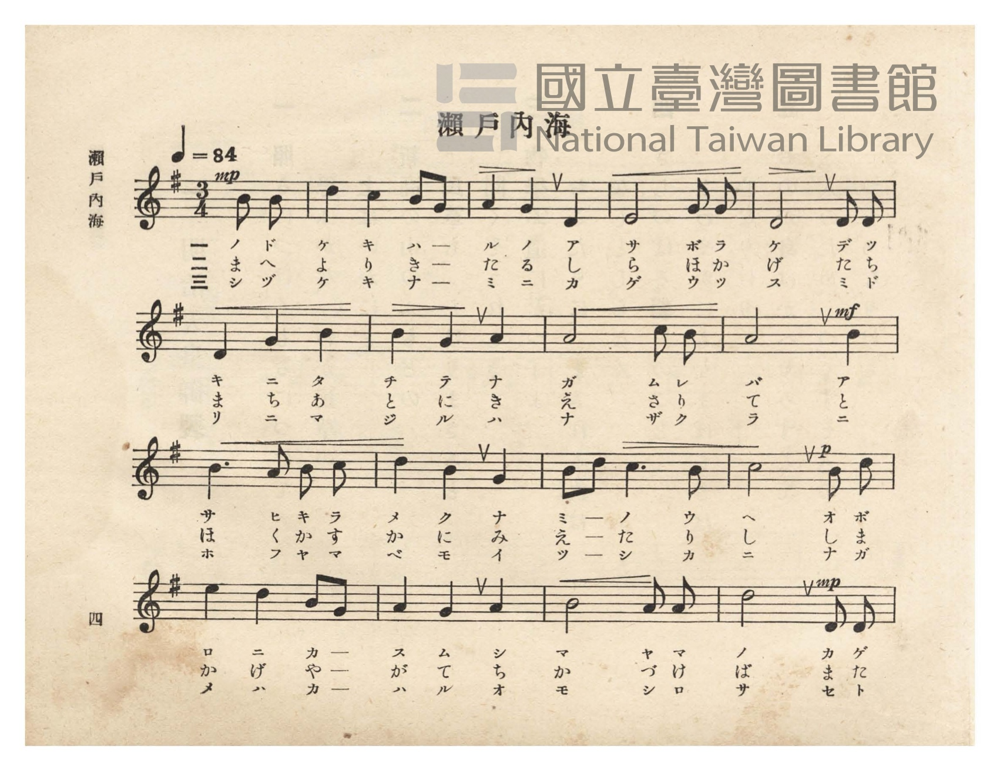
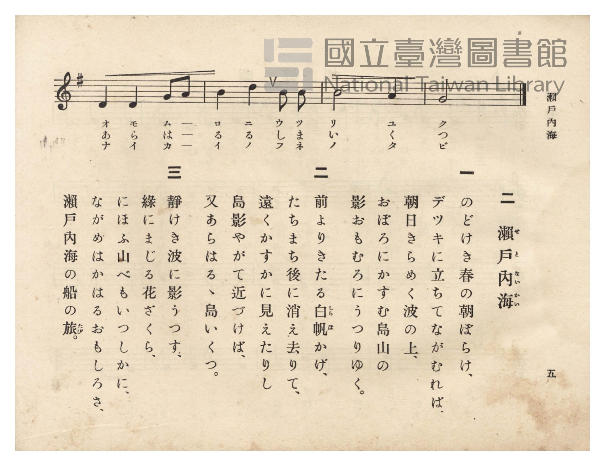

# 瀨戶內海

> Re:Shōka 使用 AI 協助辨識與重建樂譜，可能會有錯誤。歡迎回報。

- **鋼琴伴奏版**：<br><audio controls src="seto_naikai.mp3"></audio>
- **NEUTRINO 歌聲合成版**：<br><audio controls src="seto_naikai_neutrino.mp3"></audio>

- 詞：文部省唱歌
- 曲：文部省唱歌
- 臺灣總督府《公學校唱歌》第六學年用（昭和十五年，索書號 523.37 4322-4）

## 說明

原書資訊與歌詞全文（對應 P008.jpg–P009.jpg，原書 pp. 4–5）：
調性與拍號：ト長調（G 大調）3/4 拍（弱起 1 拍），速度 ♩=84


## 歌詞

```text
一
のどけき春の朝ぼらけ、
デツキに立ちてながむれば、
朝日きらめく波の上、
おぼろにかすむ島山の
影おもむろにうつりゆく。

二
前よりきたる白帆（しらほ）かげ、
たちまち後に消え去りて、
遠くかすかに見えたりし
島影やがて近づけば、
又あらはるゝ島いくつ。

三
靜けき波に影うつす、
綠にまじる花ざくら、
にほふ山べもいつしかに、
ながめはかはるおもしろさ、
瀨戶內海の船の旅（たび）。
```

## ABC

<div class="abc-score" data-abc-src="seto_naikai.abc" aria-label="五線譜載入中"></div>

[下載 ABC 原始檔](seto_naikai.abc)

## TMD 檔案連結

- [主旋律 TMD 檔案](seto_naikai.tmd) [[在 TMD Studio 編輯](https://tmdlang.github.io/Tmd-TS/#tmd=s7IKdvYPcrWy4qpTUCpJTLdSSM7PyUlNLsnMz7PKzk9PzM7Ojy_OyM9OVIKrKMvPKc1NtUovSkxJjTdDiBfnlxYlp1oVJ2fk5-fEl6RWlCTl52ejy8cXJKanWgUYGFggZAqK8stS8xLzgLoLijLzSlJTwNoRClLLMlNSQdLFyYl58WWpRZlpmakpSE5KLSoGuRhqRUlRYl5xclFmAcgbCFX5RSUZ-UBnF2RUWmVkFpfkF2UmJ-bEZyfmIfmuJCMV6LncxKLMkszcVHTxgpzEZAxBoHVlqTnI9mSmZ-ZZ5ebnJZUCw06JS0tL4XnDimcd2562Ln-2dbuClhaXoq2ChQmXva2CO5eNsb6JHUjzi5Xz3u-Z9Wxa-8vmFc_nND6dsvHZ2h6wsc9mb8Ih86J91_PGxc937H0-d_HTXXMeN3Q9bV3zdO2OZwsWQlQ9buh-vmbN09a1QMGnO7c8n7Li_Z6OZzPWPp3U87S38cmuKUDB93t6nm9Z9Gz2jhcz5yuYGhnrGZsrmBgbGemavN_TqcTFpa-lYEstwKWgoPC0bz7Iss3tL1Z0vehoB7oS6PWnrSuAHgQ67umG3mftnQqgJKKXVZD-qGEykGkJYgLdCdGqUFCgp2AClDEFOhAYMiBDX6za_6xhOci47l6gP4Cij5s7Xk7dDhQHGuqu8HTJcjCzExjcCkA1IJv2bHwBjA5DCBdoUM_LhvlPdy1TeDRzpS0wekDGPtnRAKIeN6573LjycePEx429z2YsBXKfzZn7uHHP46ZOkGBDI1hRc_vj5pbHTWsfN65-vrr7cePCx43LHjeuetzY87ip4XFTz-PGDVClQN3PpgON6QUZ0NT4uLH_2eZFQFOf7OiCGdbYBTa_F2jY40agYTOBZjzdvO3pxo1AdeBg3AtkdT1uagIbDlHX9rhxyeMmoCCQ0f-4oQnih109YPWdQNs6QLJAaxvnP27qfj5z79MdbcCQeNw4HeyT3cBgAFs2Ce6K-WBv7AOST_cBPbD62Tag6o6nfbvBBi2DqnvZuABkIcSdIHL1i2VAEqgUaA9Q3XSwA4CuB7q5qQUUII3LXuwHhiYwDIAkLFie9gN1AP0DdMR6oPseN80F6nncCNQANHsJ3D87OsF2zp0DjRBQ0K0GBwfY_0AnQIx7vg3oKmCoAF0_A2jciy6gimkgs4AWwPwHlN79uHErOFh3ggITZBvQjOkQb8DVQWIRGFPrwRJg50FCHxR2wACdCrMUKasDY-pFx05QapneCg5mYGhuBoUx0CdApZRnJyhQ0NLn4gpOLcn3S8zMTsy0CshMzMt3qNE1rKkG2aNgY6FlB2Zgy8oKwAICmMxfLOxR0EDOEgraCiYKTzf0P1_foAPPjppY9AMtB5ldo2CgoAvG1bkFtQrGQFijYArkmgCxMdDMGgUjIMsQiE3jgUSNghmIAkFDsCxYFASBDCCqAZvqY1ijABIH4cfNfUDcCVT6uGkjiN-0FizaD8R7QKLNq6GqQHKLwHY8btoKNfVx8xwgXgnXDRFrB-JmmF1GSHY17gPiHWDVHWDzusCivTC7GueDRbvBotOhdnXCzG3cDcTdYHWT4GLzgXghzC5jJLuatgNNbcXwVxfcX2C7msF2NYH8CFK5CWZu0zKIH4CsnXB_Ae0ChRQ4w-CO9l094GgnMZ7BEQWKR2OwU0AkiAeKXUgcg6AJOP5hvOrcNFCSACqAxyrMlxBf7Yf4qrkRLNYG9T_Ep2vgvloAxGvA6ibAfQ-OZ3j8geINFNYLwWQTxITGFWAeOHUAYxAiBopVSLxMBccuSGwZXAykAxFTj5tXIdzaPA_qrh1gHiTN9UPdD3IzxF3bgHg9WGwl3P0g_YTiZEcnOXECCltQFBgDAx6S7WDRApIzBWdCkFgNlAWMEnAmNUWJEUheedw8CRw70NzSDA5LoF-Q4gScvvZA8xokDYJEZ8B9vwqc35DjZTc0ZIG5FZgzgKU0OMQh-QcSM9A0AIwZsNngHAbJeSBRUB6DmDAdHMvIsTMb6m5gTDYvAccQSHQmWAyUPh43LYG6uwViNjDHQcxeDRYFuQJiAjDPAdMbgTh6Ons2OXFkBrQBEjPIhSEk20DiD8QzgsYfJNsAIwm9OHzcjJxxVsMKCXDmB2URSIEC8S4oqUI8hggWSJRB9QKLEeRIgkQHqMgC1tPwoq4HLArKHJCMBVMJiY6lQDwRLLYBLgYqPOejRBE4EYGzCZKbIXxIFgImGYibQREGcR-oWFyLWog3AQvW5g7CBdsUzAgCNyIJF2zQ0g0UDaBIgUQYKOMgogjkTlDUgSCowkPOQpCCApzowMUVxJ_IMQYqrlvAoiC1kNgBhS1INyiTgSC4gkSKF1BBBqlegG0PeIxDzINVQeBMASRb4LEALZQaQYkfzVRwnICrNHDWQE5HYD6kEgVnqF60VAMrqiejmFrLxaVrp4BohCgAecpcAA)]
- [鋼琴伴奏 TMD 檔案](seto_naikai_piano.tmd) [[在 TMD Studio 編輯](https://tmdlang.github.io/Tmd-TS/#tmd=s7IKdvYPcrWy4qpTUCpJTLdSSM7PyUlNLsnMz7PKzk9PzM7Ojy_OyM9OVIKrKMvPKc1NtTJDiBTnlxYlp-JSD5GNL0hMT7UKMDCw0AUSlgjpgqL8stS8xDygASWJmeWJefHpQIGivPyi-PTUvNSixByE2tSyzJRUkMqCoszcxKLK-JT8ZKBb8kqQXJdaVAxyfEFmYl5-fGJRUWJeeiqqkvyikoz89KLEgoxKq4zM4pL8oszkxJz47MQ8JFeXZAB1WaWmlCYnggJDiUtLS-F5w4pnHdueti5_tnX7-z0dL7v3PJ-w5cmeLU-X9j_v7Hi_p1NBS4tL0VbBwoTL3lbBncvGWN_EDmTii5Xz3u-Z9Wxa-8vmFc_nND6dsvHZ2h6wXc9mb8Ih86J91_PGxc937H0-d_HTXXMeN3Q9bV3zdO2OZwsWQlQ9buh-vmbN09a1QMGnO7c8n7IC6KZnM9Y-ndTztLfxya4pQMH3e3qeb1n0bPaOFzPnK5gaGesZmyuYGBsZ6ZoAXavExeWZV1KUbxUACqsgD4cag5pqLgUgsLHQsgMzahSqcwtqFUzjFXQhhKGCEVDQGMQFYmMghPBA0AiIa4AqIDwDEI-rFsUOH2Q7TNDtiAdZAaKAhsQrRBvGgnENWAjMM40HcaFyBhDTg1NL8v0SM7MTMxHe0DXE9AfIOSAMtgvibpAPTMC-MATyQK4HuR3szRoFMxAFgoZgWbAoCIKdCLQaZKqPYY0CSByEHzf3AXEnUOnjpo0gftNasGg_EO8BiTavhqoCyS0C2_G4aSvU1MfNc4B4JVw3RKwdiJthdhkh2dW4D4h3gFV3gM3rAov2wuxqnA8W7QaLTofa1Qkzt3E3EHeD1U2Ci80H4oUwu4yR7GraDjS1FcNfXXB_ge1qBtvVBPIjSOUmmLlNyyB-ALJ2wv0FtAsUUlzQqIEmLFBEgHSDSBAPkpxAJAiagKMMxqvOTQPFIiiFwSIC5jCIQ_ZDHNLcCBZrgzoZ4rg1cIcsAOI1YHUT4A4GRw08yEFBDQqehWCyCWJC4wowDxyhwECHiIEiAhKUU8ERAhJbBhcD6UAE7uPmVQi3Ns-DumsHmAdJJv1Q94PcDHHXNiBeDxZbCXc_SD88GCHZ0AhIm0ATNywkQXKm4KQOEquBsoChCM4KpiiBCEmRj5sngQMUmiabwd4HWo8UjOBY3ANN0ZCYBonOgDt4FThVIwflbmhgAPMEMP09bpwJDiRIKoUEJjTagIEJNhucjiHpGyQKSskQE6aDIwY5QGdD3Q0M_OYl4EAFic4Ei4Gi9HHTEqi7WyBmA9M1xOzVYFGQKyAmAFM2MInAg9UMKAgJTORSApI4ESUfqFQEqYIkTkiRiVJOPG5GTp6rYbkHnCtACRGS0yAuBCUIiFsQPoGEMlQvMH8hhyskBEF5-XETxHcg0R6wKCgJQpIvTCUkBJcC8USw2Aa4GKhUmY8SquB4BydGJDdD-JCECoxliJtBYQxxH6i8WItaujUBS5zmDrQcT1Z9gkiokBwEjlpwPoY4DTmQQUVPC1gUpBYSoKDgAOkGJWUQBBf2SEEJyuGQovJx43p4JEHMgxWn4KQHJFvgAQfNrY2gJIZmKjgYwcUzOAEiRz2YD6kQwMm2Fy2iYWXYZBRTsdR5oGoVUech6lUDMMRWm4JqUmh1agLim4D42KShJqGYAOVAamp04-B8UP2MWzOcYwKyHeIOMAMoBNMHFIGqxtUGQHMCwkoyGxO6dgrg1ooCkIEI5GgfoAo0ESMMEWOwiDIXAA)]

## 分析

```text
================================================================================
📊 TMD Song Profile: [ 瀨戶內海 ]
================================================================================
⏱  Duration:       0:42 (42.9s), 20 measures total
🎼 Key & Tempo:    首調基準 G, != 84.0 BPM, <3/4>
   - 分析範圍：      由實際發聲的音符與和弦推測調性；播放脈絡另行呈現
🎤 人聲音域:    D4 (MIDI 62) – E5 (MIDI 76) [跨度: 14 個半音 / 1.2 個八度, 難度: moderate]
   - 最低音:  D4 in [SetoNaikai #1 @ m.3, 0:05]
   - 最高音: E5 in [SetoNaikai #1 @ m.14, 0:27]
   - 適合: soprano, mezzo-soprano, contralto, tenor, baritone, bass
🏛  結構:      SetoNaikai (42.9s)
⚡ 編曲密度:        Peak 1 軌道同時演奏
🗝  調性診斷：       G 大調（純淨自然大調，未偵測到可信轉調）
   - 風格氣質:    純淨自然大調（陽光明朗、易唱易記，無明顯調外色彩）
   - 轉調歷程:    全曲維持單一推測調性（未偵測到可信轉調）
   - 核心骨幹音:  B, D, A, G, C
   - 調性數值:    G 大調 [相關度: 0.78, 穩定度: Moderate, 自然音純度: 100.0%]
   - 候選調性 (K-S): G 大調 (0.78), B 小調 (0.71), D 大調 (0.70)
   - 五度圈歷程:   +1
   - 各段落調性細節:
     • [SetoNaikai #1]: G 調性不明確 (r: 0.73, 自然音純度: 100.0%)

  [ 五度圈游移軌跡 ]
               C  
         F           [G ]*
      Bb               D  
      Eb               A  
         Ab           E  
            Db       B  
               F# 
     (* = active key center)

  [ 十二半音累積音高分佈 ]
     C  : ████████                   9.2%
     C# :                            0.0%
     D  : ███████████████████████   25.0%
     D# :                            0.0%
     E  : █████                      5.0%
     F  :                            0.0%
     F# :                            0.0%
     G  : ██████████████            15.8%
     G# :                            0.0%
     A  : █████████████████         18.3%
     A# :                            0.0%
     B  : ████████████████████████  26.7%
--------------------------------------------------------------------------------
Assignment 軌道音域：
  - Piano         : D4 – E5 (14 個半音 / 1.2 個八度, 64 個音符)
================================================================================
```


## 原書掃描頁






