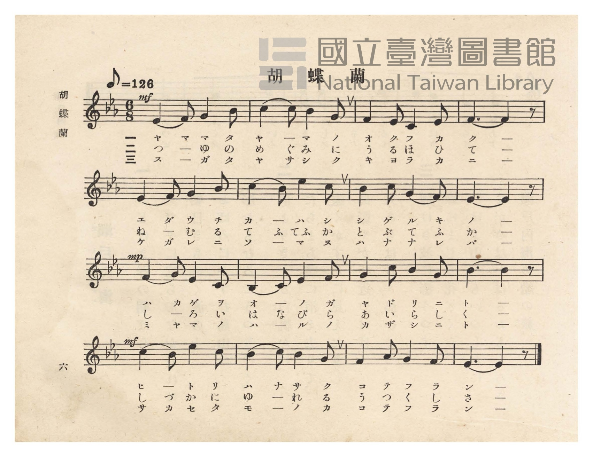
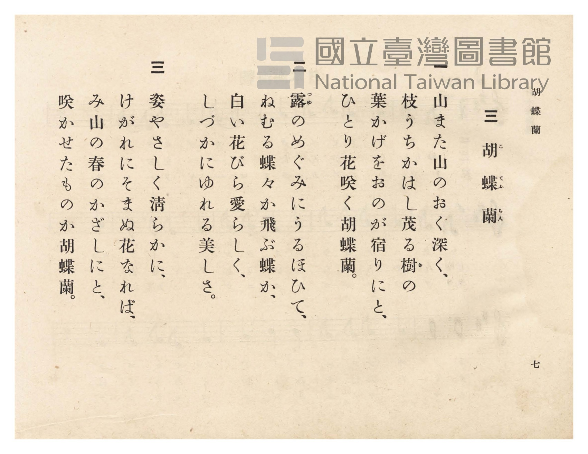

# 胡蝶蘭

> Re:Shōka 使用 AI 協助辨識與重建樂譜，可能會有錯誤。歡迎回報。

- **NEUTRINO 歌聲合成版**：<br><audio controls src="kochoran_neutrino.mp3"></audio>
- **鋼琴伴奏版**：<br><audio controls src="kochoran.mp3"></audio>


- 臺灣總督府《公學校唱歌》第六學年用（昭和十五年，索書號 523.37 4322-4）

## 說明

原書資訊與歌詞全文（對應 P010.jpg–P011.jpg，原書 pp. 6–7）：
調性與拍號：變ホ長調（Eb 大調，3 降記號）6/8 拍，速度 ♪=126（♩.=63）
教材背景：臺灣鄉土特色教材，歌詠生長於臺灣深山老樹枝葉間、潔白如蝶的臺灣白花蝴蝶蘭（胡蝶蘭）。


## 歌詞

```text
一
山また山のおく深く、
枝うちかはし茂る樹（き）の
葉かげをおのが宿りにと、
ひとり花咲く胡蝶蘭。

二
露（つゆ）のめぐみにうるほひて、
ねむる蝶々か飛ぶ蝶か、
白い花びら愛らしく、
しづかにゆれる美しさ。

三
姿やさしく清らかに、
けがれにそまぬ花なれば、
み山の春のかざしにと、
咲かせたものか胡蝶蘭。
```

## ABC

```abc
X:1
T:胡蝶蘭
M:6/8
L:1/16
Q:3/8=42
K:Eb
V:V1 name="Piano" snm="Pia"
[V:V1]
!mf! E4 F2 G4 B2 | c4 c2 B4 G2 | F4 E2 C4 E2 | F6 F4 z2 |
w: 1.~ヤ マ マ タ | ヤ ー マ ノ | オ ク フ カ | ク ー
w: 2.~つ ー ゆ の | め ぐ み に | う る ほ ひ | て ー
w: 3.~ス ー ガ タ | ヤ サ シ ク | キ ヨ ラ カ | ニ ー
E4 F2 G4 B2 | c4 B2 e4 c2 | B4 c2 G4 F2 | E6 E4 z2 |
w: 1.~エ ダ ウ チ | カ ー ハ シ | シ ゲ ル キ | ノ ー
w: 2.~ね ー む る | て ふ てふ か | と ぶ て ふ | か ー
w: 3.~ケ ガ レ ニ | ソ ー マ ヌ | ハ ナ ナ レ | バ ー
!mp! F4 G2 E4 C2 | B,4 C2 E4 F2 | G4 c2 B4 G2 | B6 B4 z2 |
w: 1.~ハ カ ゲ ヲ | オ ー ノ ガ | ヤ ド リ ニ | ト ー
w: 2.~し ー ろ い | は な び ら | あ い ら し | く ー
w: 3.~ミ ヤ マ ノ | ハ ー ル ノ | カ ザ シ ニ | ト ー
!mf! c4 B2 e4 c2 | B4 c2 B4 G2 | F4 A2 G4 F2 | E6 E4 z2 |
w: 1.~ヒ ー ト リ | ハ ナ サ ク | コ テ フ ラ | ン ー
w: 2.~し づ か に | ゆ ー れ る | う つ く し | さ ー
w: 3.~サ カ セ タ | モ ー ノ カ | コ テ フ ラ | ン ー
```

## TMD 檔案連結

- [主旋律 TMD 檔案](kochoran.tmd) [[在 TMD Studio 編輯](https://tmdlang.github.io/Tmd-TS/#tmd=s7IKdvYPcrWy4qpTUCpJTLdSSM7PyUlNLsnMz7PKzk9PzM7Ojy_OyM9OVIKrKMvPKc1NtUovSkxJjTdDiBfnlxYlp1oVJ2fk5-fEl6RWlCTl52ejy8cXJKanWgUYGBogZAqK8stS8xLzgLoLijLzSlJTwNoRClLLMlNSQdLFyYl58WWpRZlpmakpSE5KLSoGuRhqRUlRYl5xclFmAcgbCFX5RSUZ-UBnF2RUWmVkFpfkF2UmJ-bEZyfmIfmuJCMV6Lm8xJLSolR00YKcxLySYiUuLS2FF80LX8zd9mLGWgUtLS5FWwUzYy57WwVXHS4bM30LO5C-F-27njcufr5j7_O5i5_umvO4oetp65qna3c8W7Dw6ZSNz9b2PG7ofr5mzdPWtUDBpzu3PJ-y4v2ejmcz1j6d1PO0t_HJrilAwfd7ep5vWfRs9o4XM-crmBoZ6xmbK5gYGxnpmrzf06nExaWvpWBLLcCloKDwtG8-yLLN7S9WdL3oaAe68sXKeU9bVzyb1g503NMNvc_aOxVAkaeXVZD-qGEykGkIYgLdCdGqUFCgp2AGlDEHOvD9nlkgQ1-s2v-sYTnIuO5eoD-Aoi_WdT1unv1y6nagFNBc1ySFp0uWg9k9xgovZ_a-WDEDrLATGJgKQF1A8ZcN85_uWqbwaOYqW0MjM6CmRzNX6tmaGQMVgex4NnXms7kTXjT3PJu5HmQBOPBftnQ-nTP_eefOF52bIAqABoH9tOD5lPlA659N2wNR-Wz7xqcbN75oaHy2YuezeXNfTOx8OW3yYyB375TnM_c-XdYEjOzns1qgcTpz74uujS_mboGkAKBb4KkB6JrHDU1cIBc92dEADtGNGx837nvcOB_MWPe4setxYz_QOiAJNB_s9HlzHze2PW5c-Lix-3Hj-seN01_0ND1u6gY6BWj040ag7zuBOsEhORHIAiqa9LhpEtgkoHk9T9ftf9wEZK9-3LgCauTjxk0gTlMX0J1PJwHZ_XAXwp23qwdEvZyzCWzJksdNbRB7Hjc1Pm6c8LhxP9jENqBDHjfuBhu4DG762sdNDUAJoImPG1qBLnq5ePbjxm0gLtB1EEXAQHrc2AK0_3Hj5sdNnc9aZgNJoN8Q_gZzloL9sxpo--OmHqCRz_f1gcWnIoIRHL9PlwM92QISBxvxbEcr2DiwXphxE4GBATIF5G5gkAIDfQ3Y_lVgwQ1wdfshUfFsBtByYAACzZgGNhUpAMGBBpQAemv-46YmiDqUMAQqojzLQYGClj4Xl3c-sOAEFlxWAZmJefkONQY11SBLFGwstOzADGx5XQFYggAT2ouFPQoaJgpPN_Q_X9-gA8-gmlg0AK0CGVajUJ2bVqtgqKCrYKRgDCRNgUJmQNoMyNIFitQAxXWB8mbxYArCBSnWVTBQqAGb4WNYo_C4eQlQ5HHzPDAGspr2A9XCRPfARJv7QKJNq8Aq1gP5U8Gs1WDR9WCTQap1FeJhZhsBZRrhpjS1gViN68DqG8HsCaCYBLPApjSCVTR1A1m7waKbwKLLsJltDDJlJ9zsNejubtoKxNuhbgWpXQtWuwKIVyLc3dyNZjb-WNrVQ04sYUaQqYJhHDieasAxZQaWNIIqBUUVWgQ1rQA7sgHIAgXG4-ZGsJdWwyOoH-yl7WBRiKc3AUXB8kCPgzzahzOCIAEDCsQGaPDDAv1xIzAQgUUGkAJxIBJgpzRuQ1ICEkUPR0QcbQQbugYoB44jYIiDRPeipa0esCPB3mjuAmMQaw1YdAJJcbSjk7ycVFALzhjG4NAH5hhg1ICyDZAFib8acCQhshaIBsUkel6CRMVqcBSAXA1Ow5BcA_YvKCJA4YHIYZ1ADJEHh01zB86omg6Pql5w2LeAwx6U94AlJBBvBpvdCRZtgqoA8UGs6WBRkOuwxlPzfLD4EtTcDo0RkLshiQ1SBkASFjANQBIbDnfjjaens2eTXeJhzULIRZ4JoQzVPAnuL5CrQeGPkv6ApQei5ACHanMbrMQDlh8gtSBRPLHUuBSaK6BlG6T0A8ddD9hsSG6ClInAUAfHDCyWQPZgz00Qd4FSF7iEhJZ4i9BSF8RG4txdy8Wla6cAq7kUgGxlLgA)]
- [鋼琴伴奏 TMD 檔案](kochoran_piano.tmd) [[在 TMD Studio 編輯](https://tmdlang.github.io/Tmd-TS/#tmd=s7IKdvYPcrWy4tLSUnjRvPDF3G0vZqx9v6fjZfee5xO2PNmz5enS_uedHe_3dCpoaXEp2iqYGXPZ2yq46nDZmOlb2HHVKSi9aN_1vHHx8x17n89d_HTXnMcNXU9b1zxdu-PZgoVPp2x8trbncUP38zVrnrauBQo-3bnl-ZQVQAuezVj7dFLP097GJ7umAAXf7-l5vmXRs9k7Xsycr2BqZKxnbK5gYmxkpGsCtFqJi8szr6Qo3yogMzEvP8jDocagpppLAQhsLLTswIwahercgloFMwVdBVMFwzggZQYUMwXTINIYyDMC0iZAli6QVaNgCKR1waSBQg1XLYoVPnisMIkHa4RSQHMgDCgFtDMewoLRqCqgdnnnJ2fkFyXmEfBRWi3YgUZgR5sChUD-Q_WQoYIZyFxDKBekGGILyAwfwxqFx81LgCKPm-eBMZDVtB-oFia6Byba3AcSbVoFVrEeyJ8KZq0Gi64HmwxSrasQDzPbCCjTCDelqQ3EalwHVt8IZk8A4v1gFtiURrCKpm4gazdYdBNYdBk2s41BpuyEm70G3d1NW4F4O9StILVrwWpXAPFKhLubu9HMhgYsZphipBnsqQQepk0rwOY2AFkg9z9ubgS7YjU8TPvBrtgOFoW4cxNQFCwPdCvIbX04wxTiF5C_G6AhBgunx41AfzcuA1EgDkQC7JTGbUhKQKLoXkcE60awoWuAcuBgBQYSSHQvWnLoATsS7I3mLjAGsdaARSdgD1Zw9gAlP2NwgAHTJSg3QFiQIK8BhysiAYNoUOCjp1hI6K0GhxrIInBKgaRNsBNBYQfyAiIddwIxRB7sneYOnKE7HR66veDgagEHFyiFP25cBcSbwWZ3gkWboCpAfBBrOlgU5DqsQds8Hyy-BDVPQQMR5G5I-oDkNEhaAEYbJH3gcDdyUUB24YYI2Elwp4AsAgUZSiwDsxUiS4EDorkNVhQAMxZILUgUT8A2LoWmPWimhxQL4ODuAZsNSbOQwgIYUODAhAUsyB7saRbiLlCCABcd0KJgEVqCgNhInLsxCmEcZT568Q4t9zGKezN4cY9aAcDCH6dJ6BUJ7noDYgxuC-EmgxlAc3HUSQizqFKX6dopgKtOBSADFqTRPoaxqHwjNL4xmK_MBQA)]

## 分析

```text
================================================================================
📊 TMD Song Profile: [ 胡蝶蘭 ]
================================================================================
⏱  Duration:       0:45 (45.7s), 16 measures total
🎼 Key & Tempo:    首調基準 E,, != 63.0 BPM, <6/8>
   - 分析範圍：      由實際發聲的音符與和弦推測調性；播放脈絡另行呈現
🎤 人聲音域:    A#3 (MIDI 58) – D#5 (MIDI 75) [跨度: 17 個半音 / 1.4 個八度, 難度: challenging]
   - 最低音:  A#3 in [Kochoran #1 @ m.10, 0:25]
   - 最高音: D#5 in [Kochoran #1 @ m.6, 0:15]
   - 適合: soprano, mezzo-soprano, contralto, tenor, baritone, bass
🏛  結構:      Kochoran (45.7s)
⚡ 編曲密度:        Peak 1 軌道同時演奏
🗝  調性診斷：       D# 大調（純淨自然大調，未偵測到可信轉調）
   - 風格氣質:    純淨自然大調（陽光明朗、易唱易記，無明顯調外色彩）
   - 轉調歷程:    全曲維持單一推測調性（未偵測到可信轉調）
   - 核心骨幹音:  D#, A#, C, F, G
   - 調性數值:    D# 大調 [相關度: 0.86, 穩定度: High, 自然音純度: 100.0%]
   - 候選調性 (K-S): D# 大調 (0.86), A# 大調 (0.74), C 小調 (0.67)
   - 五度圈歷程:   -3
   - 各段落調性細節:
     • [Kochoran #1]: D# 大調 (r: 0.86, 自然音純度: 100.0%)

  [ 五度圈游移軌跡 ]
               C  
         F            G  
      Bb               D  
     [Eb]*              A  
         Ab           E  
            Db       B  
               F# 
     (* = active key center)

  [ 十二半音累積音高分佈 ]
     C  : ████████████████          17.4%
     C# :                            0.0%
     D  :                            0.0%
     D# : ████████████████████████  26.1%
     E  :                            0.0%
     F  : ████████████████          17.4%
     F# :                            0.0%
     G  : ██████████████            15.2%
     G# : █                          1.1%
     A  :                            0.0%
     A# : █████████████████████     22.8%
     B  :                            0.0%
--------------------------------------------------------------------------------
Assignment 軌道音域：
  - Piano         : A#3 – D#5 (17 個半音 / 1.4 個八度, 56 個音符)
================================================================================
```


## 原書掃描頁






