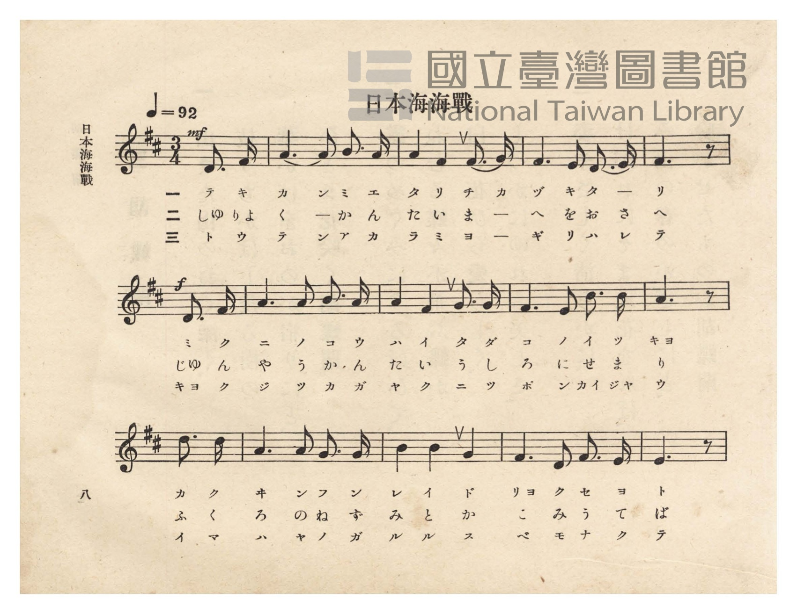
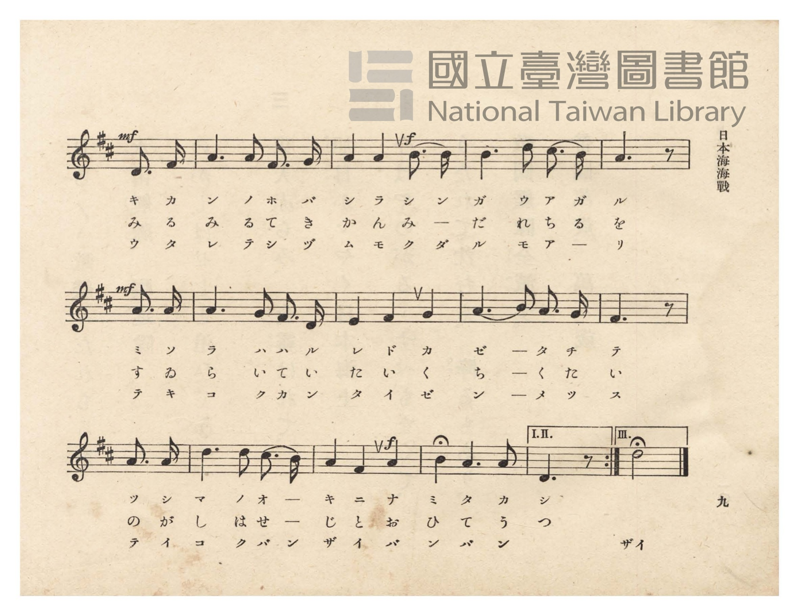
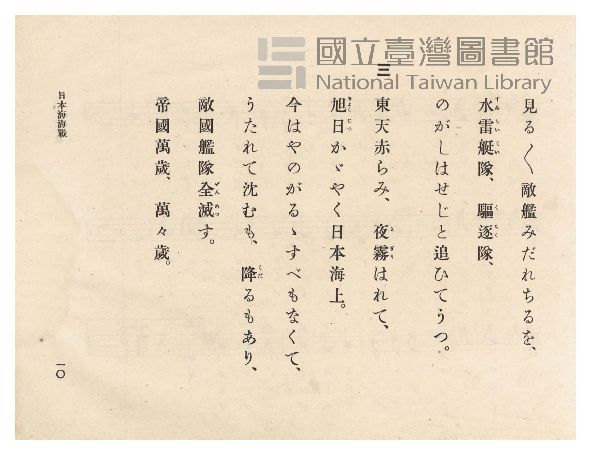
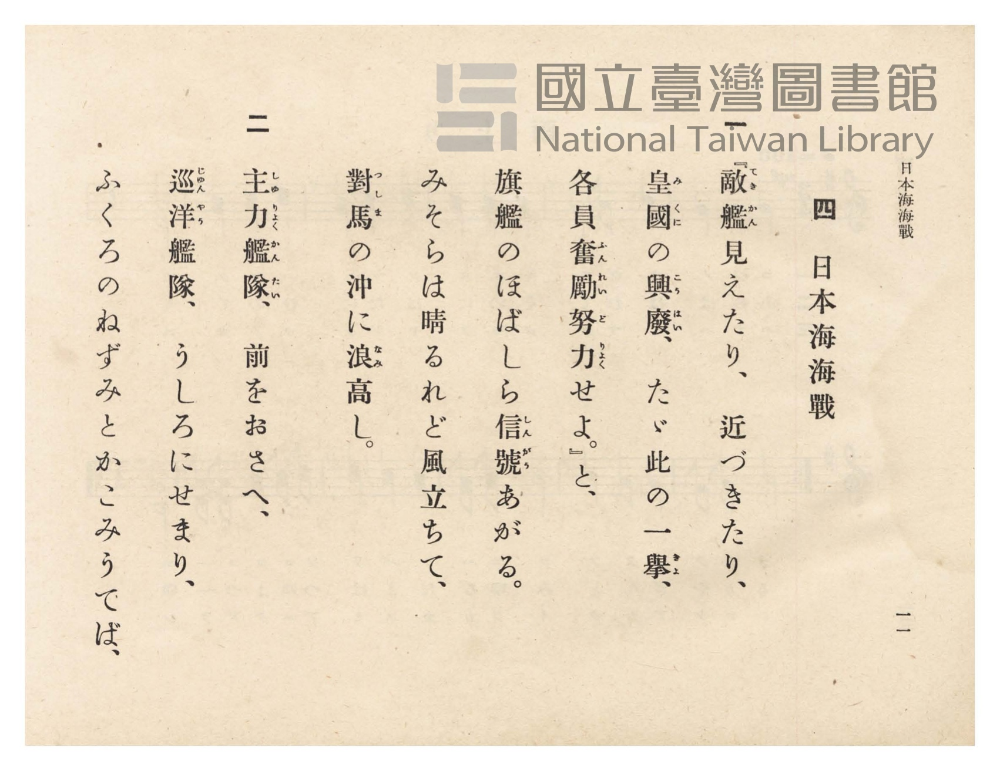

# 日本海海戰

> Re:Shōka 使用 AI 協助辨識與重建樂譜，可能會有錯誤。歡迎回報。

- **NEUTRINO 歌聲合成版**：<br><audio controls src="nihonkai_kaisen_neutrino.mp3"></audio>
- **鋼琴伴奏版**：<br><audio controls src="nihonkai_kaisen.mp3"></audio>


- 詞：文部省唱歌
- 曲：文部省唱歌
- 臺灣總督府《公學校唱歌》第六學年用（昭和十五年，索書號 523.37 4322-4）

## 說明

原書資訊與歌詞全文（對應 P012.jpg–P015.jpg，原書 pp. 8–11）：
調性與拍號：ニ長調（D 大調）3/4 拍（弱起 1 拍），速度 ♩=92
結束小節說明：原譜末小節設有反覆括號「I. II.」（第一、二節結於低音 D4 附點四分音符）
與「III.」（第三節結於高八度 D5 二分音符加延長記號，唱「ザイ」）。


## 歌詞

```text
一
『敵艦（てきかん）見えたり、近づきたり、
皇國（みくに）の興廢（こうはい）、たゞ此の一舉（きよ）、
各員奮勵（ふんれい）努力（どりよく）せよ。』と、
旗艦のほばしら信號（しんがう）あがる。
みそらは晴るれど風立ちて、
對馬（つしま）の沖に浪（なみ）高し。

二
主力艦隊（しゆりよくかんたい）、前をおさへ、
巡洋（じゆんやう）艦隊、うしろにせまり、
ふくろのねずみとかこみうてば、
見る〳〵敵艦みだれちるを、
水雷艇隊（すゐらいていたい）、驅逐（くちく）隊、
のがしはせじと追ひてうつ。

三
東天赤らみ、夜霧（よぎり）はれて、
旭日（きよくじつ）かゞやく日本海上。
今はやのがるゝすべもなくて、
うたれて沈むも、降（くだ）るもあり、
敵國艦隊全滅（ぜんめつ）す。
帝國萬歲、萬々歲。
```

## ABC

```abc
X:1
T:日本海海戰
C:曲：文部省唱歌
M:3/4
L:1/16
Q:1/4=92
K:D
V:V1 name="Piano" snm="Pia"
[V:V1]
!mf! z4 z4 D3 F | A6 A2 B3 A | A4 F4 F3 G | F6 E2 D3 E |
w: 1.~テ キ | カ ン ミ エ | タ リ チ カ | ヅ キ タ ー
w: 2.~しゆ りよ | く ー か ん | た い ま ー | へ を お さ
w: 3.~ト ウ | テ ン ア カ | ラ ミ ヨ ー | ギ リ ハ レ
!f! F6 z2 D3 F | A6 A2 B3 A | A4 F4 G3 G | F6 E2 d3 d |
w: 1.~リ ミ ク | ニ ノ コ ウ | ハ イ タ ダ | コ ノ イ ツ
w: 2.~へ じゆ ん | や う か ん | た い う し | ろ に せ ま
w: 3.~テ キヨ ク | ジ ツ カ ガ | ヤ ク ニ ツ | ポ ン カイ ジヤ
B6 z2 d3 d | A6 A2 G3 G | B4 B4 G4 | F6 D2 F3 E |
w: 1.~キヨ カ ク | ヰ ン フ ン | レ イ ド | リヨ ク セ ヨ
w: 2.~り ふ く | ろ の ね ず | み と か | こ み う て
w: 3.~ウ イ マ | ハ ヤ ノ ガ | ル ル ス | ベ モ ナ ク
!mf! E6 z2 D3 F | A6 A2 F3 G | !f! A4 A4 B3 B | B6 d2 c3 B |
w: 1.~ト キ カ | ン ノ ホ バ | シ ラ シ ン | ガ ウ ア ガ
w: 2.~ば み る | み る て き | か ん み ー | だ れ ち る
w: 3.~テ ウ タ | レ テ シ ヅ | ム モ ク ダ | ル モ ア ー
!mf! A6 z2 A3 A | A6 G2 F3 D | E4 F4 G4 | A6 B2 A3 G |
w: 1.~ル ミ ソ | ラ ハ ハ ル | レ ド カ | ゼ ー タ チ
w: 2.~を す ゐ | ら い て い | た い く | ち ー く た
w: 3.~リ テ キ | コ ク カ ン | タ イ ゼ | ン ー メ ツ
F6 z2 A3 A | d6 d2 c3 B | !f! A4 F4 A4 | B4 A6 A2 |
w: 1.~テ ツ シ | マ ノ オ ー | キ ニ ナ | ミ タ カ
w: 2.~い の が | し は せ ー | じ と お | ひ て う
w: 3.~ス テ イ | コ ク バ ン | ザ イ バ | ン バ ン
D6 z2 z4 |
w: 1.~シ
w: 2.~つ
w: 3.~ザイ
```

## TMD 檔案連結

- [主旋律 TMD 檔案](nihonkai_kaisen.tmd) [[在 TMD Studio 編輯](https://tmdlang.github.io/Tmd-TS/#tmd=s7IKdvYPcrWy4qpTUCpJTLdSSM7PyUlNLsnMz7PKzk9PzM7Ojy_OyM9OVIKrKMvPKc1NtUovSkxJjTdDiBfnlxYlp1oVJ2fk5-fEl6RWlCTl52ejy8cXJKanWgUYGBohZAqK8stS8xLzgLoLijLzSlJTwNoRClLLMlNSQdLFyYl58WWpRZlpmakpSE5KLSoGuRhqRUlRYl5xclFmAcgbCFX5RSUZ-UBnF2RUWmVkFpfkF2UmJ-bEZyfmIfmuJCMV6LnczJzMksSiSnTxgpzE5FQlLi0thWfTlz6bs-bZ1u0g1LFBQUuLS9FWwdKIy95WwYXLxljfxA6k98XKee_3zHo2rf1l84rncxqfTtn4bG0P2NRnszfhkHnRvut54-LnO_Y-n7v46a45jxu6nrauebp2x7MFCyGqHjd0P1-z5mnrWqDg051bnk9Z8X5Px7MZa59O6nna2_hk1xSg4Ps9Pc-3LHo2e8eLmfMVTI2M9YzNFUyMjYx0Td7v6VTi4tLXUrClFuBSUFB42jcfZNnm9hcrul50tANdCfT609YVQA8CHfd0Q--z9k4FULTrZRWkP2qYDGSagphAd0K0KhQU6ClYAGUMDYEuBAYNyNQXq_Y_a1gOMq-7F-gRoOjj5u6XU7cDxYGmuig8XbIczOwEhrcCUA3Iqj0bX2zdrmAI4QIN6nnZMP_prmUKj2autAXGD9DU51snPJs7_-mG_ufrG16sWvVsRh_QYKArXqyd82zOaqj4irXP5nQ-7e99saztWfcaoOWPG3o89RQ8PfUeN4DsAcbAkx0NjxuA4d0DVA8yc9qeJ3v7Xs7frOBiovByZsvL3fOezp79tKMNKPR8zTKgY8Be6mgHmYRqTifchJerZzxtXQ1yr4upAtBouPanXQue7t4G8vuKGeCg6AEmBqBJj5u2PW5aAjar83FDExfIDqDDQNTjhr5nU7e-6ARa3fG4cdnjxt7Hjd2PmyYDVb5Y1v24ESg4_3FTF9APL_ZPfNy4FKwAKgIOp1ntT-d0gzXvf9zY_7hxNciOxnUvOjqe7l4EFp_8uLHtceP6x40tYOsbwfrnPVu7BKgM6IoXHcAIACrrfdzUAVEATisTWp5OXvh06bqn3VvB0luBjnrc1AMx5WnXqqdds8HiK0FuaQIy-sEWzwaxG5oeNwCdsgJq1rPp04EeBNr2uHH348YNjxunP27qfLJ_ITiIgDqBXKAbgUa3gY1oArGbukEBBQogkL_mAjUAvfBs5haQBMgVK18uWvF8NTCAFoJCDermDb0vl60BGwn02_THjfsgYfFs0zRguDzbugostQpoIlAcGIkgNbDY2NUDiZTdQH8BHftyVhfMaW1wD0JiBhR8sKB82gkMtUmPG7seN0593LgD5o7tC59tgcTJDLB-YMC1QHwHMRocCcA4AZoOjM3VoFBr3IeIU1BgA20DyQGDbO3jxlngQFgBsh8Um0A2UDMwQDdANYBSCijANj9u2ApJTWBFC8AhtRAcZJNgcbFhy8vZ2190tsN8OPNx0wRw6AJdCNQGJBHee7my9WXDBLAyoOeBIQ2KY4j7Ie4EOg9oAzCkgakL6AdgiK54sX_v48ZNYLOAjgQmelhyB-esZ3M3Pl2y8sXWJWAr94OCcMmcl3OWg-wAhXEfMBTAkbYe7HZYzD6bvhZYmMOTKdg5QMuWgJUCfTcPHMD98AL_yQ6gG8HJ58luYNwADQNKgx0LCou5IF837nzcBExpwNQANAtmD9jNwNwBsvrZJqCTGkCKgAExE1QMgJUuANkJMgWouQkRZ8BgB-ZDSPSCitTdrWANc8CRD4xtiFNnQl31dMdckOoJa56t3QTK2hPWPG5oBbPB0pQX91CgoKXPxeWXmZGfl52Y6Z2YWZyaZxWQmZiX71BjUFMNskrBxtBMyw7MwlbdKECK0BcLexQ0kEttBW0FE2B-A5XCOvAqQxOLfqADQGbXKBgo6IIhjK7OTasFmgViGgOlTaHCIAhim0FZCBljFNoEKAMTAUEjIIaYZoQmA7KwGtkusIN8DGsU4qEqYPTj5jYI3bQWaMbjptVIpjxu3gwm50NVrACr2A-XXQVnNUJVrAapaG5FNgNoLoiE6HrcvAesAqYT5hKEHethbjXC4lZw0QRVCCqfQGY19qO4eA9YXTdU0WSwCojZIPEWOGsfsnsad6C4eBJYRRdU5VQMFWAXg4s5hDUQRxtjC-AOqKplYK9D9KAEcNMiqApI8K2Ey8Id3rwC2blN61DMAAXm42ZIMDxuXoNhC9i5TWvhhoDDGH_q39UDTv0kJnfi07MJlMSSnuPATCBVA9UPgaAUjSQHT8_AdhdKYPSBfQgKVkSQw1IIsD0CZ8HSYwM4QCHqUc2AqH3c3AJWAQ8-5DCFZBbURAssdpENawTFBDEJEpqWGqeDretFMQNkD7CygfL2gVVAkieSaxq3QuX7kVLj4yaUpA30DLK7IWkFESjr4eqg7oV4vnkuihmQNLsaHkJNO0BmgOxahhFCsECcRzDJ7eikRpJDJCxY4oHREBldtCQHKiAhfFARCkqAMAguQlHKa6Q0twEzQJqnwnkgFWtgsog019wJdwIw06KmJ0jYP27aDVUKLmqhJQdyeK6FqgaWFEgprhfZpEZQ6QBsQkF5s8ApDl5oN8JshaVJsHMaJ6OYAFKNSJHgTNSI7GVIeoNmoaZu5PQGz2wQf4A8D8lQiPQGq2KQWE07EW5pnoliAqhsfNwMLYxBOQ1r6QZJeaBsTSCdAXs-mOnMmOR0hqiQYTIwGlTtQtKcGVoRBi6-zOFSyEbCExtEEFhkIiU2LIVTM7QsaJ4Aznfb4bLwugMqBk2OwJBHMgMcWohaBzVW4GEKr5L3Iqc1eEqCyIHSECiFgHmNveCUAktXoNIOyoKlFWh1uwDFjB6wioVwE0HuBVXBKK5phKQKYMMdJbWh-AucLhA-bwX7C2YXJCVBzICUc9DCH8Xn0PQGCxuczRWkRhOhqnQKpekNVHJB0pshUhmFWpWCcg6yHlC6g_DRK1lQUsOWymApB-JvUC5GtCkg7RJ4kQYvyBDNRVCcgZpeCBPADTF4NduIPd-C6yNInCGXZzDzwXLgOhKRxsA1EtYaFFbygOQhqQnFLVB5kF6QCuRaGpLCIK0qYIcJpf5EyX3QUhpaf0LzFrxsRWpewMICM_-C3dIMTe3QxgWs9EOECyx9AetVAuVZ61py0he0KQWBOAomWKoBlWgwMUSJhl4iAs1EEgGlMlivBzmVzUMJC0hDC5K7YG3btXBZeDkCLf0hoQmPeXi4Q3igOEEuC2FhCWuHI5dh05F1NoLjFNa6gpZQM-CyiPoSyRWNm-CiyG0eSJ0JkoelBByuwJWygOU5xBWQlLUNLotoREBUoKYshChMNyQsQCNwOB1Sy8Wla6eA2lFWAIoocwEA)]
- [鋼琴伴奏 TMD 檔案](nihonkai_kaisen_piano.tmd) [[在 TMD Studio 編輯](https://tmdlang.github.io/Tmd-TS/#tmd=s7IKdvYPcrWy4tLSUng2femzOWuebd0OQh0b3u_peNm95_mELU_2bHm6tP95Z8f7PZ0KWlpcirYKlkZc9rYKLlw2xvomdlx1CkovVs57v2fWs2ntL5tXPJ_T-HTKxmdre5RAMs9mb8Ih86J91_PGxc937H0-d_HTXXMeN3Q9bV3zdO2OZwsWQlQ9buh-vmbN09a1QMGnO7c8n7IC6KZnM9Y-ndTztLfxya4pQMH3e3qeb1n0bPaOFzPnK5gaGesZmyuYGBsZ6ZoAXavExeWZV1KUbxWQmZiXH-ThUGNQU82lAAQ2hmZadmBWjYKBgi4Ywujq3LRaBVMw0xQobRgHFQdBMMcczDQDykFU6SoYw7TCdeoCZc2gLJgIjA00E0kEZC3M6hquWhQn-yA72QTJxSAINCZeIdowVsE0Ph7BAVI1CibxYMFo0_hYiAxYPchwv8yM_LzsxEzvxMzi1DwyAgbidGMkz8O8BfEuKMjQgwVCmwBlYCIgaAQKTygLVQZkISgo4XaBHeRjWKMQD1UBox83t0HoprVAMx43rUYy5XHzZjA5H6piBVjFfrjsKjirEapiNUhFcyuyGUBzQSRE1-PmPWAVMJ0wlyDsWA9zqxEWtzZOf9wEc27X46YOkFmN_Sgu3gNW1w1VNBmsAmI2SLwFztqH7J7GHSgungRW0QVVORVDBdjFjTMQbgFaA3G0MbYA7oCqWgb2OkQPSgA3LYKqgATfSrgs3OHNK5Cd27QOxQxQYD5uhgTD4-Y1GLaAndu0Fm4IOIyhKZT4JGgCJbEkQUj-BlKIHAuCoESIJAdPgo-bIdEDc38f2FGgkECEEixSHzctgbNgSagBHAYQ9ahmQNQ-bm4Bq4D7GDkYIOkbNZ09boKlC7BcIyjwiElD0OhvnA62rhfFDJA9jxtnQ3n7wCogKQrJNY1bofL9SAnocRNKagR6BtndkOhFBMp6uDqoeyGeb56LYgYkma2Gh1DTDpAZILuWYYQQLBDn4U4liLQAi28YDZEBldDIqQRUDEH4oIIKlGZgEFxQoZSKSMlkA6YfmqfCeSAVa2CyiGTS3Al3AjBroCYBSHA9btoNVQou0KD5EzkI1kJVA_MjUiLpRTapEZQHHzdCVTbOAicSeNHYCLMVlozAzmmcjGICSDUiEYHTfSOylyFJBJrqm7qRkwg8f0D8AfI8JA8gkgisIEdiNe1EuKV5JooJoBLocTO0yANlDqxlCCSxgHIizqSBqKlgMjAaVB9Bkgmo4kcuKHC0CUAQnj7gzQmk9IGlCGiG5rjmCeDUvR0uCy9UoWLQFAQMLCQzwB5EFMeoAQkPBnhdtRc5ecAjHyIHinZQpIJ5jb3gyIUlBVCZAmXBohdaDy1AMaMHrGIh3ESQe0F1E4prGiER-bgJ6GOkBILiL3BUInzeCvYXzC5I5EPMgJQm0CIWxefQJAILG5z1OFJrAlsSAZUPkCRiiFQSoNYxoPSJrAeUVCB89NoHlDqwJQxYZEOcCsoriPoRUsfCCw54cYFo-oCCGdSMQJgAblTA659G7LkDXFBDghm51ICZD5YDVx6IZAEuqrFWLbD8DZKHJAAUt0DlQXpBKpCrL0iigLQQHjf2oFQsKBkGWhZCKxZodoCXYEj1LiwsMLMc2C3N0AQKrXVhZQwiXGBJAljhwJIEfbsEiIQxD8X5kEYDJA3DmlZr4bLw3AotFiEBAI8seFBBeKBgRC5xYN6HNQORS4rpyDobwdEAaylAy4EZcFlERYLkisZNcFHk-htSmYDkYZGHwxW4EgOw1IS4ApIYtsFlEbUrRAVqYkCIwnRDwmIbQiOmQ3B0pYjrsIEwdg68KwfpsEGTGxaFJjCFIB3QPh9WXRCFIDLaBNgbBBOonUWQCYStAxsC1I7fjXADgQy4E1FMw6KJlP6rrp0CuH-sAGSgRkC0D1A3FlEjrKLGYFFlLgA)]

## 分析

```text
================================================================================
📊 TMD Song Profile: [ 日本海海戰 ]
================================================================================
⏱  Duration:       0:48 (48.9s), 25 measures total
🎼 Key & Tempo:    首調基準 D, != 92.0 BPM, <3/4>
   - 分析範圍：      由實際發聲的音符與和弦推測調性；播放脈絡另行呈現
🎤 人聲音域:    D4 (MIDI 62) – D5 (MIDI 74) [跨度: 12 個半音 / 1.0 個八度, 難度: easy]
   - 最低音:  D4 in [NihonkaiKaisen #1 @ m.1, 0:01]
   - 最高音: D5 in [NihonkaiKaisen #1 @ m.8, 0:15]
   - 適合: soprano, mezzo-soprano, contralto, tenor, baritone, bass
🏛  結構:      NihonkaiKaisen (48.9s)
⚡ 編曲密度:        Peak 1 軌道同時演奏
🗝  調性診斷：       D 大調（純淨自然大調，未偵測到可信轉調）
   - 風格氣質:    純淨自然大調（陽光明朗、易唱易記，無明顯調外色彩）
   - 轉調歷程:    全曲維持單一推測調性（未偵測到可信轉調）
   - 核心骨幹音:  A, F#, D, B, G
   - 調性數值:    D 大調 [相關度: 0.78, 穩定度: Moderate, 自然音純度: 100.0%]
   - 候選調性 (K-S): D 大調 (0.78), F# 小調 (0.75), A 大調 (0.72)
   - 五度圈歷程:   +2
   - 各段落調性細節:
     • [NihonkaiKaisen #1]: D 大調 (r: 0.78, 自然音純度: 100.0%)

  [ 五度圈游移軌跡 ]
               C  
         F            G  
      Bb              [D ]*
      Eb               A  
         Ab           E  
            Db       B  
               F# 
     (* = active key center)

  [ 十二半音累積音高分佈 ]
     C  :                            0.0%
     C# : ██                         2.2%
     D  : ██████████                14.1%
     D# :                            0.0%
     E  : ████                       5.8%
     F  :                            0.0%
     F# : ███████████████           22.1%
     G  : █████                      7.6%
     G# :                            0.0%
     A  : ████████████████████████  34.4%
     A# :                            0.0%
     B  : ██████████                13.8%
--------------------------------------------------------------------------------
Assignment 軌道音域：
  - Piano         : D4 – D5 (12 個半音 / 1.0 個八度, 86 個音符)
================================================================================
```


## 原書掃描頁










