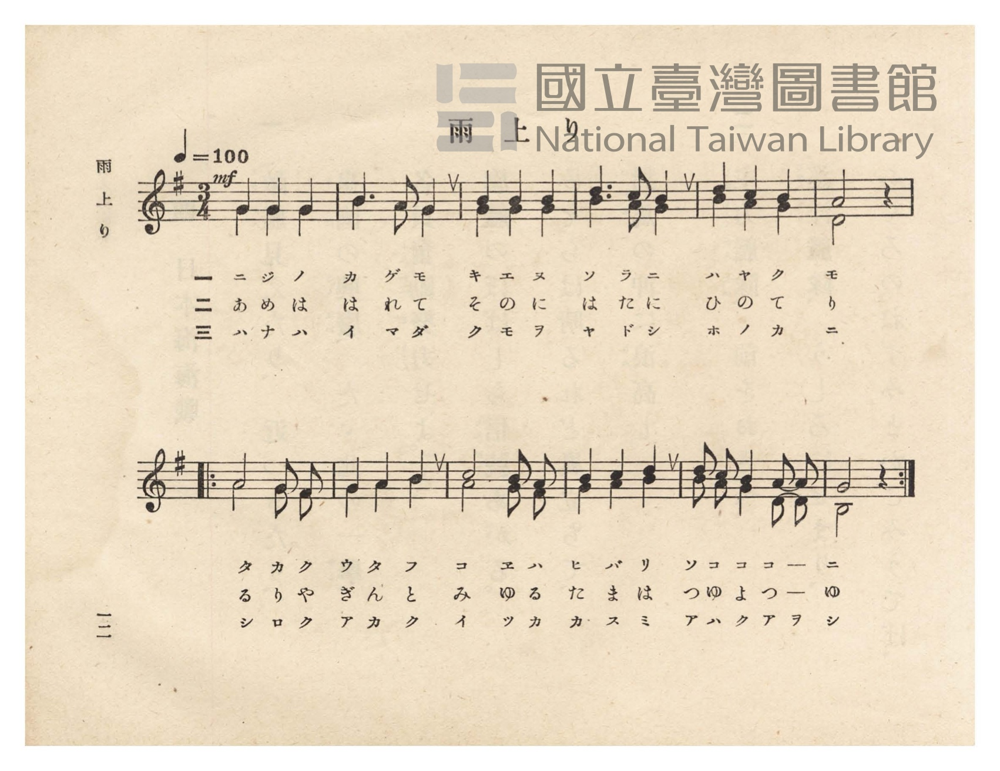
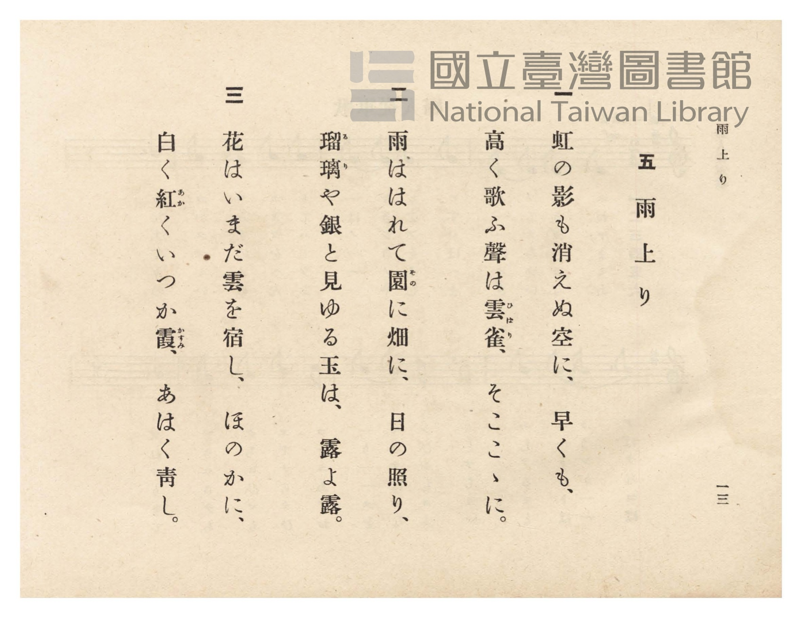

# 雨上り

> Re:Shōka 使用 AI 協助辨識與重建樂譜，可能會有錯誤。歡迎回報。

<audio controls src="ameagari.mp3"></audio>

- 詞：白上貞利（小學唱歌五十曲集）
- 臺灣總督府《公學校唱歌》第六學年用（昭和十五年，索書號 523.37 4322-4）

## 說明

原書資訊與歌詞全文（對應 P016.jpg–P017.jpg，原書 pp. 12–13，二部合唱）：
調性與拍號：ト長調（G 大調）3/4 拍，速度 ♩=100
曲式結構：全曲 12 小節（前 6 小節＋後 6 小節附反覆記號 `|: ... :|`），
第 1–2 小節與第 7–8 小節為齊唱，第 3–6 小節與第 9–12 小節為二部合唱。


## 跨冊／重複收錄參照

> 同曲（二部合唱曲〈雨上り〉；《公學校唱歌》與《新定兒童唱歌》第六學年共用教材）

- **[同曲]** 《新定兒童唱歌》尋常科第六學年用（2020.006.0847.0006）：[**〈雨上り〉**](../../../shintei_jido_shoka/grade_6_2020.006.0847.0006/1_08_ameagari/index.md)（`G` / `3/4` — [原始 TMD](../../../shintei_jido_shoka/grade_6_2020.006.0847.0006/1_08_ameagari/ameagari.tmd)）
- 總表：[跨冊重複與同名歌曲總索引](../../../duplicate_songs.md)

## 歌詞

```text
一
虹の影も消えぬ空に、早くも、
高く歌ふ聲は雲雀（ひばり）、そここゝに。

二
雨ははれて園（その）に畑に、日の照り、
瑠璃（るり）や銀と見ゆる玉は、露よ露。

三
花はいまだ雲を宿し、ほのかに、
白く紅（あか）くいつか霞（かすみ）、あはく青し。
```

## ABC

```abc
X:1
T:雨上り
M:3/4
L:1/16
Q:1/4=100
K:G
V:V1 name="Alto" snm="Alt"
V:V2 name="Soprano" snm="Sop"
[V:V1]
!mf! G4 G4 G4 | B6 A2 G4 | G4 G4 G4 | B6 A2 G4 |
B4 A4 G4 | D8 z4 | A8 G2 F2 | G4 A4 B4 |
A8 G2 F2 | G4 A4 B4 | B2 A2 G4 D2 D2 | B,8 z4 |
[V:V2]
!mf! G4 G4 G4 | B6 A2 G4 | B4 B4 B4 | d6 c2 B4 |
w: 1.~ニ ジ ノ | カ ゲ モ | キ エ ヌ | ソ ラ ニ
w: 2.~あ め は | は れ て | そ の に | は た に
w: 3.~ハ ナ ハ | イ マ ダ | ク モ ヲ | ヤ ド シ
d4 c4 B4 | A8 z4 | A8 G2 F2 | G4 A4 B4 |
w: 1.~ハ ヤ ク | モ | タ カ ク | ウ タ フ
w: 2.~ひ の て | り | る り や | ぎ ん と
w: 3.~ホ ノ カ | ニ | シ ロ ク | ア カ ク
c8 B2 A2 | B4 c4 d4 | d2 c2 B4 A2 A2 | G8 z4 |
w: 1.~コ エ ハ | ヒ バ リ | ソ コ コ コ ー | ニ
w: 2.~み ゆ る | た ま は | つ ゆ よ つ ー | ゆ
w: 3.~イ ツ カ | カ ス ミ | ア ハ ク ア ヲ | シ
```

## TMD 檔案連結

- [主旋律 TMD 檔案](ameagari.tmd) [[在 TMD Studio 編輯](https://tmdlang.github.io/Tmd-TS/#tmd=s7IKdvYPcrWy4qpTUCpJTLdSSM7PyUlNLsnMz7PKzk9PzM7Ojy_OyM9OVIKrKMvPKc1NtUovSkxJjTdDiBfnlxYlp1oVJ2fk5-fEl6RWlCTl52ejy8cXJKanWgUYGCLpLCjKL0vNS8wD6i4oyswrSU0Ba0coSC3LTEkFSRcnJ-bFl6UWZaZlpqYgOSm1qBjkYqgVJUWJecXJRZkFIG8gVOUXlWTkA51dkFFplZFZXJJflJmcmBOfnZiH5LuSjFSg5_ISS0qLUtFFy1MTgYwiJS4tLYWXs1c82dH1uKlLQUuLS9FWwdDAgMveVsGdy8ZY38QOpPHFynnv98x6PnMvUN2LTfOedqx8v6fj6Yb-p2t3PJ2y8dnanie7pjztbXw2e9PL2W3v93SCbXvRvut54-LnO_Y-n7v46a45jxu6nrauAep4tmAhRNPjhu7na9Y8bV0LMmbnludTVgBNfTZj7dNJPUDDQEbu3PJ-T8_zLYuezd7xYuZ8BVMjYz1jcwUTYyMjXROwNVz6Wgq21AJcCgoKT_vmgyzb3P5iRdeLjnagK4F-f9q64tm0drCXe5-1dyqAolwvqyD9UcNkINMcxAS6E6JVoaBAT8HQCChlaAwUfLKr52XziqcTOoBeBroYGIogW16s2v-sYTnI_O5eoMeAoo-bO15O3Q4UB9rirvB0yXIwsxMYAQpANUCDXjbMf7prmcKjmSttQfEDNAQY2k_39D_fOuHZ8m6gCSBHzt4EtFoBGDHP1zeAnNvZq2AG53Y_3dcD576c2fK0v_fFsrYXK2aAgjahxkpBT09PwaomAezMHpANwNhRMAT6BGYk0MEgIXOgkAVU6HnTrpd7u8Ce6wHJGQPlYHZAlVuCwgJmBFA9cpA8bmjiAtn0ZEcDOFxm7nzcuO7p3o2Pm5qebet43AhEa56v3PW4cfXjhsZn01c-buwHSgHZINUvV88A8kEJqXHri8ZNjxvXvwQlQJDPH4O4G4BJGugZoOrHjXMfN04GoSYgA2gW1NZdYG8C0z9QLwg1AY1a9nTOJLAJQJXrQNobVz-fOhHmgqVAweety4EmQx3xfOKC55OaQRqauqH2NbW87Gp43LjixTKgSBtQ_Hkf0JT1QA0v52x63NQBIuH-7gT7u2sj2AUtjxv3PW5cAPTG46ZJT9ftf9w4Hez63UBbHzd2QxwBtnXmXqDXn29pBbu0CSgHdmk_2IglQO7LOcAcC5QC6pn5uBGUlMAGAVUCrel_OXcS2OgmkFmUZxwoUNDS5-JyzE1NTE8syrQKzi8All35DjUGNdUgaxRsLLTswAxseRaU1oCJ4MXCHgUNWPrRgWc0TSwagJaBDKtRqM5Nq1UwVNCF4xoFYyCpq2CExIPhGgVTsJwJEs8ELmcEltNVMADxwMb7GNYoPG7uBvIfN-0Akc19YJWPm1aDVT5u2gQUWwQVWwsWWQFW1wMV2wtR17wSag7IvH6wyBKw6vVQMZAZIBiPsNsIKN7YBFbVCCIboWrBNEi0B8heBhWbC1axDkyC3IakrnE-ktgmJHVQvcCSH8NuY4Q7QbIQNkgtyNUg_jwgboCKgeyB-OBxM8h8kF6Yuk6g_Hao2Gx4CELCDxa2CLvxJ5BdPTgSiA6o4H6xdg5asYY33cAi21DBPB7IBaUVkBAkJYDSBAgaA8UgKQgkAkotoDQDST1GYDmQPixppmk_VBzkU1AIgcRA4Q2Redw8FRp2m-HqVoBDGRQmk8AqJoDJVVB1e8FqIerBrOY9WMIPnm6aYOKg2AUWSeC4h4T8ZHDcg1IpSAzhzjawLpDYfLCKfWASluaWQFV0gEWBPIj9QDGsaQcc55AUsBbuf3AKAcc8PN1D0xNIXQtYDpa3HjftBIuC3ALRCwodaFoD8zaBxWH2QOyvRSqBHHNKyCl-IPXTkx3dwDoFyKBWKUSohAKlPQjPFOQVRJIiKkuQ52i8WQCvJChfgESAbgUiIB_VzcBo0LVTgMWEApCtzAUA)]
- [鋼琴伴奏 TMD 檔案](ameagari_piano.tmd) [[在 TMD Studio 編輯](https://tmdlang.github.io/Tmd-TS/#tmd=s7IKdvYPcrWy4tLSUng5e8WTHV2Pm7re7-l42b3n-YQtT_Zsebq0_3lnx_s9nQpaWlyKtgqGBgZc9rYK7lw2xvomdlx1CkovVs57v2fW85l7gZpfbJr3tGMlUP_TDf1P1-54OmXjs7U9T3ZNedrb-Gz2ppez24AGKYE1te963rj4-Y69z-cufrprzuOGrqeta4A6ni1YCNH0uKH7-Zo1T1vXgozZueX5lBVAU5_NWPt0Ug_QMJCRO7e839PzfMuiZ7N3vJg5X8HUyFjP2FzBxNjISNcEbA2XZ15JUb5VQGZiXn6Qh0ONQU01lwIQ2Fho2YEZNQrVuQW1CkbaJgq6YGiobaxgHq9tBJQBMXWhUsbapkCyBkyDRCBypiCFYAIoE69tCDXDAKSUqxbFdh9k201QbTeNj1eINo2PhRBAi4FcQyAPiOEckBo4xwBivGNuamJ6YlEmAf-l1SqAXAbDQKeCXWkE5UG8gkxCvAlWA_cqTAwSHDAxsN-RPQ2y08ewRuFxczeQ_7hpB4hs7gMrfty0GqzycdMmoNgiqNhasMgKsLoeqNheiLrmlVBzQOb1g0WWgFWvh4qBzADBeITdRkDxxiawqkYQ2QhVC6ZBoj1A9jKo2FywinVgEuQ2JHWN85HENiGpg-pt6sK02xjhTpAshA1SC3I1iD8PiBugYiB7ID543AwyH6QXpq4TKL8dKjYbHoKQ8IOFLcJuaETDIsIQmH5B0QpkgoQgEUWLBA6P66b9UHGQC0E-A4mBwgki87h5KtTPm-HqVoBDB-SXSWAVE8DkKqi6vWC1EPVgVvMeLP6Gx3cTTBwUK4-bWsBxBgmxyeA4A6UukBjCnW1gXSCx-WAV-8AkLK0sgaroAIsCeRD7gWJY4xwcV5CYWwv3PzhmwTEGT6_QdABS1wKWg-WJx007waIgt0D0gkIHmkbAvE1gcZg9EPsxSgAcZQy24oQIDqjEAVKgTA4tnkDFDsRILCUWpnIscngKM107BXBxqQBkwLwV7QOUR-EbofGNwXxlLgA)]

## 分析

```text
================================================================================
📊 TMD Song Profile: [ 雨上り ]
================================================================================
⏱  Duration:       0:21 (21.6s), 12 measures total
🎼 Key & Tempo:    首調基準 G, != 100.0 BPM, <3/4>
   - 分析範圍：      由實際發聲的音符與和弦推測調性；播放脈絡另行呈現
🎤 人聲音域:    F#4 (MIDI 66) – D5 (MIDI 74) [跨度: 8 個半音 / 0.7 個八度, 難度: easy]
   - 最低音:  F#4 in [Ameagari #1 @ m.7, 0:12]
   - 最高音: D5 in [Ameagari #1 @ m.4, 0:05]
   - 適合: soprano, mezzo-soprano, contralto, tenor, baritone, bass
🏛  結構:      Ameagari (21.6s)
⚡ 編曲密度:        Peak 2 軌道同時演奏
🗝  調性診斷：       G 大調（純淨自然大調，未偵測到可信轉調）
   - 風格氣質:    純淨自然大調（陽光明朗、易唱易記，無明顯調外色彩）
   - 轉調歷程:    全曲維持單一推測調性（未偵測到可信轉調）
   - 核心骨幹音:  G, B, A, D, C
   - 調性數值:    G 大調 [相關度: 0.78, 穩定度: High, 自然音純度: 100.0%]
   - 候選調性 (K-S): G 大調 (0.78), B 小調 (0.54), D 大調 (0.50)
   - 五度圈歷程:   +1
   - 各段落調性細節:
     • [Ameagari #1]: G 大調 (r: 0.78, 自然音純度: 100.0%)

  [ 五度圈游移軌跡 ]
               C  
         F           [G ]*
      Bb               D  
      Eb               A  
         Ab           E  
            Db       B  
               F# 
     (* = active key center)

  [ 十二半音累積音高分佈 ]
     C  : ██████                     7.4%
     C# :                            0.0%
     D  : ████████                  10.3%
     D# :                            0.0%
     E  :                            0.0%
     F  :                            0.0%
     F# : ██                         2.2%
     G  : ████████████████████████  30.1%
     G# :                            0.0%
     A  : ██████████████████        22.8%
     A# :                            0.0%
     B  : ██████████████████████    27.2%
--------------------------------------------------------------------------------
Assignment 軌道音域：
  - Alto          : B3 – B4 (12 個半音 / 1.0 個八度, 34 個音符)
  - Soprano       : F#4 – D5 (8 個半音 / 0.7 個八度, 34 個音符)
================================================================================
```


## 原書掃描頁






