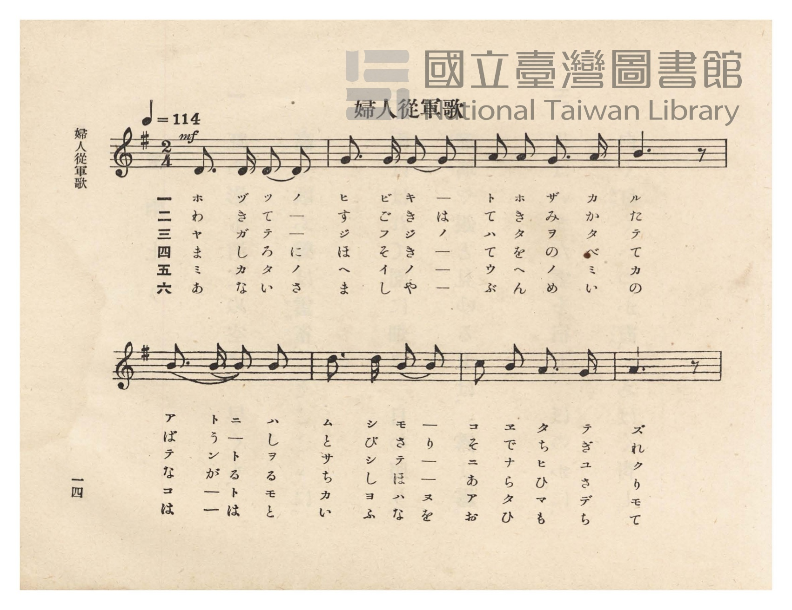
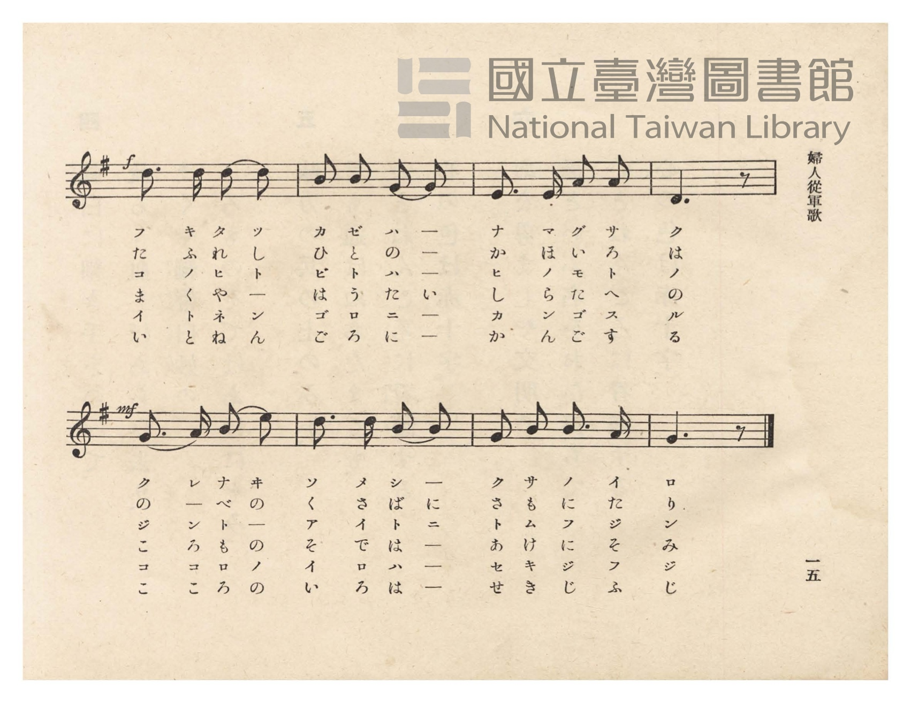
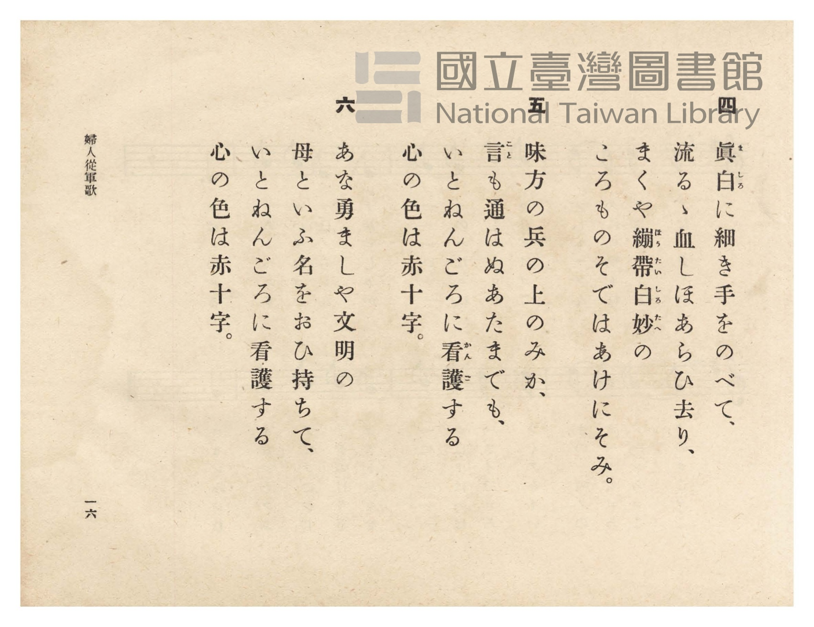
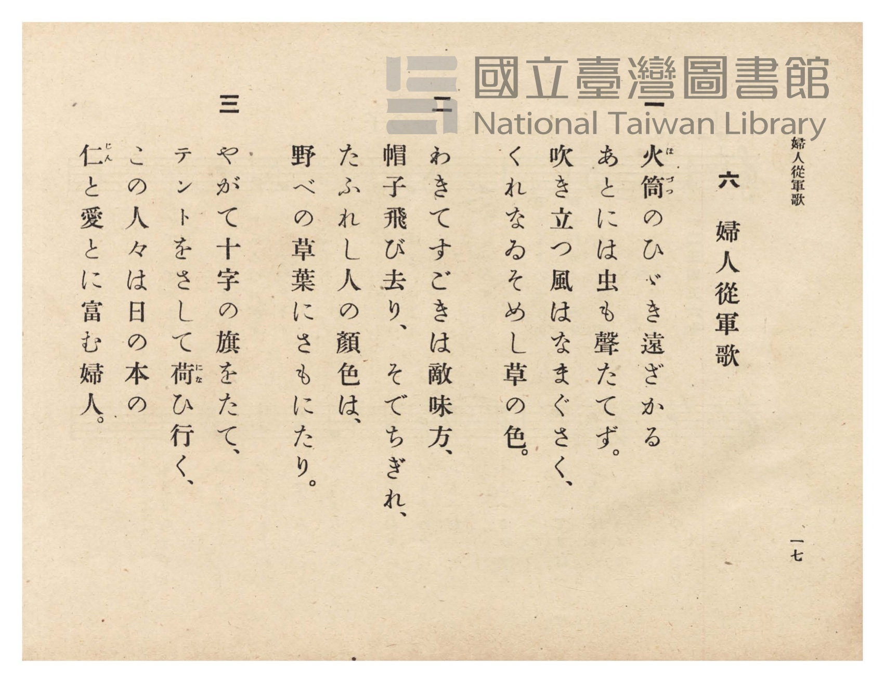

# 婦人從軍歌

> Re:Shōka 使用 AI 協助辨識與重建樂譜，可能會有錯誤。歡迎回報。

- **鋼琴伴奏版**：<br><audio controls src="fujin_jugunka.mp3"></audio>
- **NEUTRINO 歌聲合成版**：<br><audio controls src="fujin_jugunka_neutrino.mp3"></audio>

- 詞：加藤義清
- 曲：奧好義
- 臺灣總督府《公學校唱歌》第六學年用（昭和十五年，索書號 523.37 4322-4）

## 說明

原書資訊與歌詞全文（對應 P018.jpg–P021.jpg，原書 pp. 14–17）：
調性與拍號：ト長調（G 大調，1 升記號）2/4 拍，速度 ♩=114
作詞：加藤義清／作曲：奧好義


## 歌詞

```text
一
火筒（ほづつ）のひゞき遠ざかる
あとには虫も聲たてず。
吹き立つ風はなまぐさく、
くれなゐそめし草の色。

二
わきてすごきは敵味方、
帽子飛び去り、そでちぎれ、
たふれし人の顏色は、
野べの草葉にさもにたり。

三
やがて十字の旗をたて、
テントをさして荷（にな）ひ行く、
この人々は日の本の
仁（じん）と愛とに富む婦人。

四
眞白（ましろ）に細き手をのべて、
流るゝ血しほあらひ去り、
まくや繃帶（ほうたい）白妙（しろたへ）の
ころものそではあけにそみ。

五
味方の兵の上のみか、
言（こと）も通はぬあたまでも、
いとねんごろに看護（かんご）する
心の色は赤十字。

六
あな勇ましや文明の
母といふ名をおひ持ちて、
いとねんごろに看護する
心の色は赤十字。
```

## ABC

<div class="abc-score" data-abc-src="fujin_jugunka.abc" aria-label="五線譜載入中"></div>

[下載 ABC 原始檔](fujin_jugunka.abc)

## TMD 檔案連結

- [主旋律 TMD 檔案](fujin_jugunka.tmd) [[在 TMD Studio 編輯](https://tmdlang.github.io/Tmd-TS/#tmd=s7IKdvYPcrWy4qpTUCpJTLdSSM7PyUlNLsnMz7PKzk9PzM7Ojy_OyM9OVIKrKMvPKc1NtUovSkxJjTdDiBfnlxYlp1oVJ2fk5-fEl6RWlCTl52ejy8cXJKanWgUYGFogZAqK8stS8xLzgLoLijLzSlJTwNoRClLLMlNSQdLFyYl58WWpRZlpmakpSE5KLSoGuRhqRUlRYl5xclFmAcgbCFX5RSUZ-UBnF2RUWmVkFpfkF2UmJ-bEZyfmIfmuJCMV6LnczJzMksSiSnTxIqDTkovyi4uRTc1Mz8yzyk3NzMpE8rWWlsLTlcue7Nr1dN-8F7t7n63tUdDS4lK0VTA0NOGyt1Vw57Ix0jexAxnzYuW893tmPe1a8GL6kuf7Vj7b0Qo2_dnsTSDhpcufLt0LFAaLvWjf9bxx8fMde5_PXfx015zHDV1PW9c8Xbvj2YKFT6dsBFryuKH7-Zo1T1vXAgWf7tzyfMqK93s6ns1Y-3RSz9Pexie7pgAF3-_peb5l0bPZO17MnK9gamSsZ2yuYGJsZKRr8n5PpxIXl76Wgi21AJeCgsLTvvkgyza3v1jR9aKjHehKoI-ftq54Nq0d6LinG3qftXcqgFKEXlZB-qOGyQEGRoYgJtCdEK0KBQV6CoYmQClDc6ATgaECMvbFqv3PGpaDDOzuBfoEKPq4uePl1O1AcaCx7gpPlywHM3sMFZ72Au2eAVbUCQx1BaAOoPjLhvlPdy1TeDRzpS0oUoBGPtk7BzMy3u_pB4qjxQYXWPmOBhD1vHH187WTgHY-btz9uHHp48YlQGseN6573LjpcdO8x429LxsXPG6c9rix-3FTN0jD48amx40rHjeufty4_sXM1Y-bml4AlTbOf9y47HHjrMcNTeBQm7ATqPX56m6geS8XAVWvf9y46nHjvseNEx43Tn3c2P-4oRFiWP_jph6QXBNQYu7jpsbHjdNf9IIc8KJzE8gwsFN39YAVN_UDDQXbM_Nx4xQwe_2zqVufTtz8bNpOqIlPd-x9unbCy8WzHzduftq3-3FTF1ACZHTj8seNCx839oHsg1kOdPRWsP3TgWkdaOfLhf0ga4Guhah42d73uBHok3VAJ72YCHQV0NNTgT4GM-aDzYa6cEcnxIUtjxuBxi0DJtena6cDNT6bPv1x0yRo8ECtbW573LwZGN1gCWBgANUte9G7HRwHQHNXgSNg04uFQIMQ4TQZaBjIkQ2tIE9PB0bUumdz1gBJsPW7G8G6ZzxumgzWveJZCzAAQLH0dH3P46YGSG6Gufbp7NngqJ8z7_nMvWCNwIgBuhOYrkB-fL5lAzBsn3UCYxzoQGBKAIYAzPHPtjYC08HjprkvFjaAXQ5MNE2Pm0AOhoc2xMFAI4Fx2_J8Z_PTHdtg6asNHBItQHuANj9dNhMsDrIZLL4DkvRgHgaKgoIa6ABI7AHTEJA7ERxIQJH9iOQxBewrSDJoXPe0dSsosHZ0gfXuByVdiKNerGgAWwgMS2DJ0gk0_WXDLLC5wIAEGg10AtDVy0G2wnwBjE9gKK4FhisoxYHcufr5nO4XayGxBQwIkDjY2TOh-ePp_mZo6gXmj61LoCkBFvKta-F5aNXT7nZYyLcAi5NnM4CJDez5Z-uB9gCtBVq-9ekEYCgAowHomU3PeoApGZiG4SkJt_OIcA9QjvIiEgoUtPS5uNxKszLzvErTS_OyE60CMhPz8h1qDGqqQRYp2BiaadmBWdgKaAVgsQ8sj4BJXkHDROHphv7n6xt04KWqJhYNQPtAhtUoVOem1SqYxivoAiGQgrJ0gTKGYNoQSoNEjIAkCENEjIAixlA5EDQAqQGb6mNYA8yls8Gij5tbgbgFyu4D6nncPAnKmwzM8GvhpgNzNFgUpO9x0zaImqbVYJnVSPaAXAi1xwgo19QPUdnYC8TLEKY1zoSKTwHLQdjrwTIgVRAxYPKGynSDZeZjt8cY5IYlUBetAZVACHuadkB9MxWJDfEnyGWPm0A2PG7eBNW9HywD049mjwnIDfugLpoOVA1zNzgUGndDeXPhPoL4FOyfJlCoAlMqVM1OuAwWe0xBboD4FRTCEDci3D0DKrMELILwKdgesCxMHGQKSAZH_JiB3NAEddEqUH6DsqeCXYfsU4gMxD-guAdmSTDZCFXTApaB-A7ZHvx5YlcPOXkCOVWD2DUKpmC2KVwGkhdAPBANyhEQERhEywtNi6Ch1QHE3VB2PzisF0DDejuQDVEFCevNYNEVYBIWO21gmV3YwxqUFxo3QEOrDah6Dzx0QTIgk0C8zeDQh9jZBZaZCxZfDiYXQlWB00FTD3abwLkBkoKBFTE030LSOEjXViQfIeUTsL8fN3eBSVgJsAysYz12e8C5YRXURT1AddCQA9IgGZhbgakHmjMgqQeU3oA1KlgOmusg6Q3oX6z2gHIDOLxBLtqD5J9FSGn7cfMKaI4GsXvAMqD4guXveVCZdrBfYTGJZhM4P0B8C7YJxgbGDkgGlju2IvwNzNUgGXCogX0DrFyhqhbiyOEEaolOzBxhSbiWAFUSYDtMoTQorEHpH4QRNYQZpPoAUrC6Aph3YFUKCKJXErCkuBYpmYOzOjjYHzeBEjEs2CHJCBKJoAB_3ARK7pAEhycZgTMGtLADBS00WcMyBjhQwdkDUbyAxKGJDZi0IBEDKYwREYhhDyhbwJNRH1Ii7wC7G1ycQas4ZP_AVIF0gBMUWA1IBlb0otmDUkn0w4tOUIKCVRKgAgBEwnwNKTynQ3hAf0BkgA1GqI8wi1VExoBWe-CiCxQCkEwPktkCZq8Fk5DQgsQDLMMAiwaImqadUB_hqyZgiR-YzRpBZoL0TQa7bgrU1SBZmAlIMQRUBVUDrvJBLoC5BmEP3kwBbM-TlSlATSdYWwiUD8zA1mPWFSA1sLwCaTfBcgwIotcVsPIB1M6AlJagZA6S2QuVWQguXREBDtIByQbwehkYbaAAhwQkRoCDswS0pQAuh0ARBMkAIBlYiwrYooHXKJAWCCi7QkogWFSAkhKeshWcKWCtIlhdASk50RMXUhKCZhNQ3YgoInaAZSAZDMMecKYAZTFoAoe6EeRHWB0H4i9Hyr7wuqJxIop_5oJlIIURhj3IdQWQhiV_UKgj-2ctaiZvAmdKcFsXub2ICBsMe8BZAuofIA1L_jD_QDMLOCsj-wfcdoa2bKGtOGCRB5KB8JDtqeXi0rVTQO50KAD5ylwA)]
- [鋼琴伴奏 TMD 檔案](fujin_jugunka_piano.tmd) [[在 TMD Studio 編輯](https://tmdlang.github.io/Tmd-TS/#tmd=s7IKdvYPcrWy4tLSUni6ctmTXbue7pv3Ynfvs7U97_d0vOze83zClid7tjxd2v-8s-P9nk4FLS0uRVsFQ0MTLntbBXcuGyN9EzuuOgWlFyvnvd8z62nXghfTlzzft_LZjlYlkPCz2ZtAwkuXP126FygMFnvRvut54-LnO_Y-n7v46a45jxu6nrauebp2x7MFC59O2Qi0-XFD9_M1a562rgUKPt255fmUFUC3PJux9umknqe9jU92TQEKvt_T83zLomezd7yYOV_B1MhYz9hcwcTYyEjXBOhKJS4uz7ySonyrgMzEvPwgD4cag5pqLgUgsDE007IDs2oUqnPTahUMFXSB0EjBGEiaAXGNgilYxBQsAoI1YDUgHkTECCoCgwYgNVy1KFb6IFtpgmZjvIJZfDzIkHiFaMNYkI1AbrRpPIgJFDOAmOZWmpWZ51WaXpqXnUiEP0zjIc6Oh7FgDtcFkjDn1gAdD_IASAzmFZg3EV4BmepjWKPwuHk2WPRxcysQt0DZfUA9j5snQXmTFR43rYWb_ri5AywK0ve4aRtETdNqsMxqJHtALoTaYwSUa-qHqGzsBeJlCNMaZ0LFp4DlIOz1YBmQKojY48b9UJlusMx87PYYg9ywBOqiNUB2G8Keph1Q30xFYkP8CXLZ4yaQDY-bN0F17wfLwPSj2WMCcsM-qIumA1XD3A0OhcbdUN5cuI8gPgX7pwkUqo8b10HV7ITLYLHHFOQGiF9BIQxxI8LdM6AyS8AiCJ-C7QHLwsRBpoBkcMSPGcgNTVAXrQJiaDponAp2HbJPITIQ_4Di_nHTZDDZCFXTApaB-A7ZHmgyRk6IIDa2nAhKuiAeiAYlYogIDKIl36ZFUA92AHE3lN0PDp4F0ODZDmRDVEGCZzNYdAWYhAVoG1hmF_bgASXfxg1QD7YBVe-BBwhIBmQSiLcZHGAQO7vAMnPB4svB5EKoKnDUNfVgtwmcgCGJ7nEz0DxwVoMkS5CurUg-QkraYH8_bu4Ck7BMuwysYz12e8AJeBXURT1AddCQA9IgGZhbgREOTcyQCAclkcdNnWA5aEaBJBGgf7HaA0rA4PAGuWgPkn8WISXHx80roJkQxO4By4DiC5Yl50Fl2sF-hcUkmk3gJAzxLdgmGBsYOyAZWILeivA3MCOCZMChBvbN4yZYFliII1PCymJQUQwWNoXSoOCBVR6IctgMUkgDKViJDKoGkExFL4phqWctUsoEZyhwSD1uAqU7WEhBYh4S7qAwetwESqGQNIIn5sFpGVqkgEIDmhJhaRkcDuAUjcjEIHFo-gCmBkhYQoo8RJhj2ANKyfCY70NKlx1gd4MLDWhFguwfmCqQDnAaAKsBycAKODR7UIrifngBBUoDsKIYlGdBJMzXkCJqOoQH9AdE5nEjqFLAXngh0jK0cgGXNqAQgORTkMwWMHstmISEFiQeYGkcmJshapp2Qn2ErzCGpVdgzmgEmQnSNxnsuilQV4NkYSYgxRBQFVQNuGIFuQDmGoQ9tGgbIUpkWC4EVcCQMgmUMkEye6EyC8FlGCKMQDogKRdeYQFDGhRGEL9jhBE4FUOrUHBuB4UpJM2CZGBNDWBVDy-3IVUzKIdB8jks9ECxj6cEA6djWHMBViJDyif09IAU69CUDaqBELl6B1gGkicw7AGnY1CugKZJqBtBfoTVJCD-cqQcBy-RGyei-GcuWAZSfmDYg1wiA2lYigWFOrJ_1qLmyyZwPgI3ApEbUoiwwbAHnIqh_gHSsBQL8w80fYNzH7J_wI1KaJMP2rwBllIgGQgP2R6s7Wd8jXLUJjiuZjlEA1wBikpImx7EQqgE1QaYqkEqjbAoJqFzoGunAO5tKAAZyB6N9gHqwRAzwiJmjEXMBIuYKRYxM7CYMhcA)]

## 分析

```text
================================================================================
📊 TMD Song Profile: [ 婦人從軍歌 ]
================================================================================
⏱  Duration:       0:16 (16.8s), 16 measures total
🎼 Key & Tempo:    首調基準 G, != 114.0 BPM, <2/4>
   - 分析範圍：      由實際發聲的音符與和弦推測調性；播放脈絡另行呈現
🎤 人聲音域:    D4 (MIDI 62) – E5 (MIDI 76) [跨度: 14 個半音 / 1.2 個八度, 難度: moderate]
   - 最低音:  D4 in [FujinJugunka #1 @ m.1, 0:00]
   - 最高音: E5 in [FujinJugunka #1 @ m.13, 0:13]
   - 適合: soprano, mezzo-soprano, contralto, tenor, baritone, bass
🏛  結構:      FujinJugunka (16.8s)
⚡ 編曲密度:        Peak 1 軌道同時演奏
🗝  調性診斷：       G 大調（純淨自然大調，未偵測到可信轉調）
   - 風格氣質:    純淨自然大調（陽光明朗、易唱易記，無明顯調外色彩）
   - 轉調歷程:    全曲維持單一推測調性（未偵測到可信轉調）
   - 核心骨幹音:  B, D, G, A, E
   - 調性數值:    G 大調 [相關度: 0.79, 穩定度: Moderate, 自然音純度: 100.0%]
   - 候選調性 (K-S): G 大調 (0.79), B 小調 (0.75), D 大調 (0.72)
   - 五度圈歷程:   +1
   - 各段落調性細節:
     • [FujinJugunka #1]: G 大調 (r: 0.79, 自然音純度: 100.0%)

  [ 五度圈游移軌跡 ]
               C  
         F           [G ]*
      Bb               D  
      Eb               A  
         Ab           E  
            Db       B  
               F# 
     (* = active key center)

  [ 十二半音累積音高分佈 ]
     C  :                            0.0%
     C# :                            0.0%
     D  : █████████████████████     25.0%
     D# :                            0.0%
     E  : ████                       5.0%
     F  :                            0.0%
     F# :                            0.0%
     G  : ███████████████████       22.5%
     G# :                            0.0%
     A  : ███████████████           18.3%
     A# :                            0.0%
     B  : ████████████████████████  29.2%
--------------------------------------------------------------------------------
Assignment 軌道音域：
  - Piano         : D4 – E5 (14 個半音 / 1.2 個八度, 44 個音符)
================================================================================
```


## 原書掃描頁










