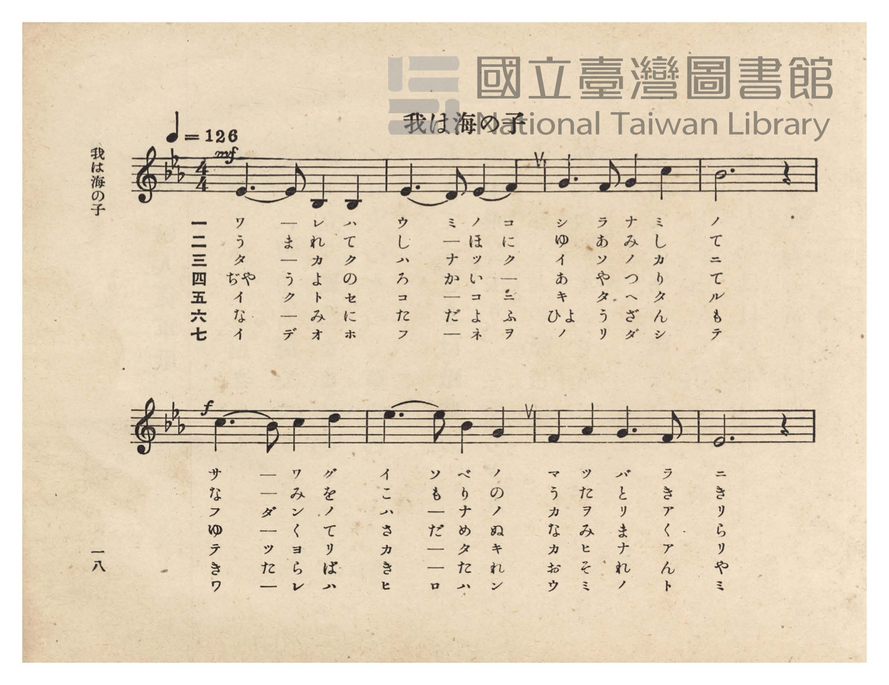
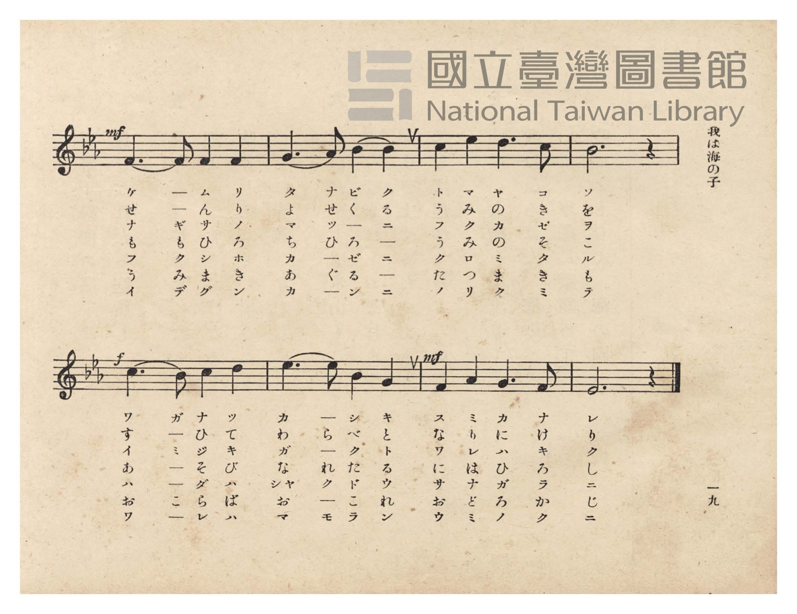
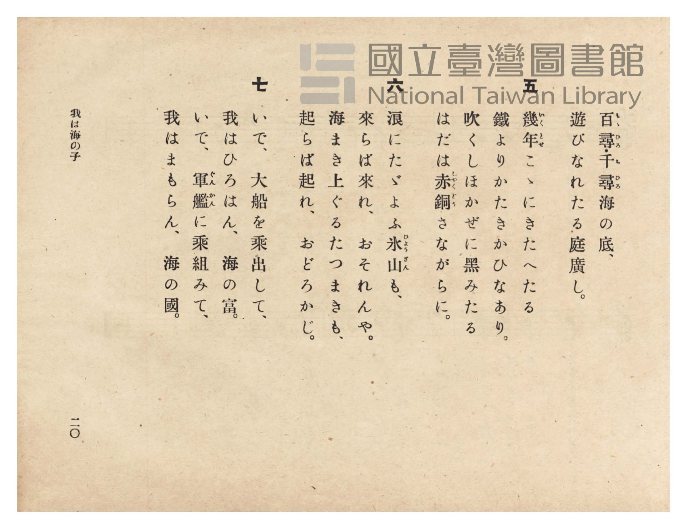
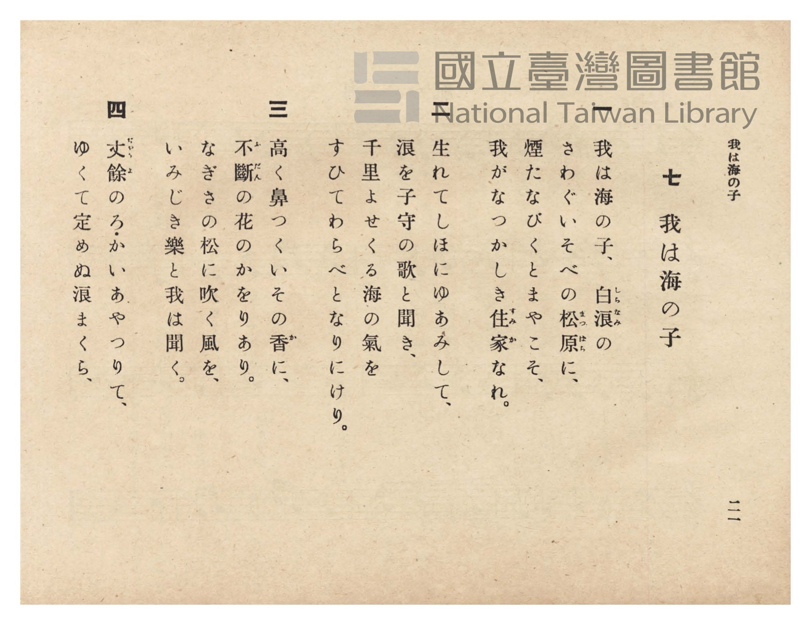

# 我は海の子

> Re:Shōka 使用 AI 協助辨識與重建樂譜，可能會有錯誤。歡迎回報。

- **鋼琴伴奏版**：<br><audio controls src="ware_wa_umi_no_ko.mp3"></audio>
- **NEUTRINO 歌聲合成版**：<br><audio controls src="ware_wa_umi_no_ko_neutrino.mp3"></audio>

- 臺灣總督府《公學校唱歌》第六學年用（昭和十五年，索書號 523.37 4322-4）

## 說明

原書資訊與歌詞全文（對應 P022.jpg–P025.jpg，原書 pp. 18–21）：
調性與拍號：變ホ長調（Eb 大調，3 降記號）4/4 拍，速度 ♩=126


## 歌詞

```text
一
我は海の子、白浪（しらなみ）の
さわぐいそべの松原（まつばら）に、
煙たなびくとまやこそ、
我がなつかしき住家（すみか）なれ。

二
生れてしほにゆあみして、
浪を子守の歌と聞き、
千里よせくる海の氣を
すひてわらべとなりにけり。

三
高く鼻つくいその香（か）に、
不斷（ふだん）の花のかをりあり。
なぎさの松に吹く風を、
いみじき樂と我は聞く。

四
丈餘（ぢゃうよ）のろ・かいあやつりて、
ゆくて定めぬ浪まくら、
百尋（もゝひろ）千尋（ちひろ）海の底、
遊びなれたる庭廣し。

五
幾年（いくとせ）こゝにきたへたる
鐵よりかたきかひなあり。
吹くしほかぜに黒みたる
はだは赤銅（しゃくどう）さながらに。

六
浪にたゞよふ氷山（ひょうざん）も、
來らば來れ、おそれんや。
海まき上ぐるたつまきも、
起らば起れ、おどろかじ。

七
いで、大船を乘出して、
我はひろはん、海の富。
いで、軍艦（ぐんかん）に乘組みて、
我はまもらん、海の國。
```

## ABC

<div class="abc-score" data-abc-src="ware_wa_umi_no_ko.abc" aria-label="五線譜載入中"></div>

[下載 ABC 原始檔](ware_wa_umi_no_ko.abc)

## TMD 檔案連結

- [主旋律 TMD 檔案](ware_wa_umi_no_ko.tmd) [[在 TMD Studio 編輯](https://tmdlang.github.io/Tmd-TS/#tmd=s7IKdvYPcrWy4qpTUCpJTLdSSM7PyUlNLsnMz7PKzk9PzM7Ojy_OyM9OVIKrKMvPKc1NtUovSkxJjTdDiBfnlxYlp1oVJ2fk5-fEl6RWlCTl52ejy8cXJKanWgUYGBkhZAqK8stS8xLzgLoLijLzSlJTwNoRClLLMlNSQdLFyYl58WWpRZlpmakpSE5KLSoGuRhqRUlRYl5xclFmAcgbCFX5RSUZ-UBnF2RUWmVkFpfkF2UmJ-bEZyfmIfmuJCMV6Lm8xJLSolR00eJUDIW5iUWZJZm5SEqBpqZn5lnl5ucllQJDTolLS0vhWcfEx43rn23d_rhx3dO1ExS0tLgUbRUMjcy47G0VXHW4bEz0TexAJrxo3_W8cfHzHXufz138dNecxw1dT1vXPF2749mChU-nbHy2tudxQ_fzNWuetq4FCj7dueX5lBXv93Q8m7H26aSep72NT3ZNAQq-39PzfMuiZ7N3vJg5X8HUyFjP2FzBxNjISNfk_Z5OJS4ufS0FW2oBLgUFhad980GWbW5_saLrRUc70JUvVs572rri2bR2oOOebuh91t6pAIpxvayC9EcNk4FMUxAT6E6IVoWCAj0FQwuglJEh0Inv98wCGfti1f5nDctBBnb3An0CFH2xrutx8-yXU7cDpYAmuyYpPF2yHMzuMVZ4ObP3xYoZYIWdwOBUAOoCir9smP901zKFRzNX2oKCG2Tukx0NIAotTh43ND6fuffZ1lVAgx83Tn_c1Pm4cdXjRqDZQMY6kIbHjVMfN_U_bpzwuLHlcePcx407gRLP5u4D-gGsZ9_jxiWPGzcAdYL1rAaaCNL2vHXm48b5YMM2P24E6l8BUtoENGIyyBSIIrBjesCKgGZ0gxzQ2Ptkb__TddvAZgON2A8UBxu86nETMBk0Qfyyqwdsx5T5IMHGZWCNu0GWN7U9bmwC6wKKLINZsxWoeRLQt0_XAQ1dB0pPjSteNM4DWgZV8bS3-WV7z-MmoPRskGubuiEh9GzDYqBOSDAAHbMJZCYwMEChBAwGoJeABneB7G2cCGLAnLejE0S9XD0DaNbLPUCHAX0HDAJI-K17uWwm2HcQf8EC7MmO3mfTtoMltj5uXPC4aTIkDl50bQSSoNBpmgS2rAlqE9hRwJDrA8UQOEqAhj2dAHRX_8tFK0CqIQaD7QUGCNAxvc9WAANnBSQNgAOgH-bmp7NnQ1zR8XLJDLArFj1uan7c2AYMFIhDHjf1Pm4G-gUYTUADga4AkkvALoKFMzj0gf5c9nTdrMdNjY8b14BCHpRCwEEGTRgz9z3dAPR6x-MmoBnA8NgENBhoAzAKoOKNC-GC0HS6aypU88tGoHXA9ARODMDk1dT9dNfap7sXg6IbnjamgP2zcx-4TAAaB3QnJP3NBntkMthWYJT1ghPoDog5YNMnbAUlAZCXgJ4EygFVABnAWAf6AinYIYEMS3RAFXOA5r3cPQkczDDDgCEMikZgOG9d8rKrFZa_gEEK1LkSGLBgxwBjDmg2MOVBUgI0LlrXwpItyJ1AE-eBk-bWZxu2P924EWwUMIDaQbHTOA2aUoChCU1I-4BxBjRuA5gBzDPAiAD6aC6I3QT0fAvUF-CwBcZN75MdQOkJQGeD_QxMqiBBhHkvgOrA5oEZcPNWgtIDyPMzEMm-GZ7elgOVgUqpjp3AhPhk54yn7btQsyQ4CULiGcQAOqyhERrb68H5HNmkF7t7X3QuA_sb6E5gAQLMDJDssRpo9vOtkASObjawuAFGGjBkkMye0w01m_I6AAoUtPS5uMITi1LDE0NzM_3yvfOtAjIT8_IdagxqqkE2KdhYaNmBGdhqIAVgvQYsml8s7FHQMFF4uqH_-foGHXi1oYlFA9A-kGE1CtW5abUKhgq6QGioYBoPpMBEDVTMPB7MMAILGYOFjMC0KVjEDCwCgQYgEbCpPoY1Co-b14NFHzfvAeI1YFY_WM_jpmVQmflA3AdiNW2GymyHyqwE4i6oGrAMWB0Mgh0IsckIKNfYBtHVuA9oQg-YBbIBJDMd4YbG3WCZ1VCbYHqagHg_mAVSC9IDcR2GTcYgXSCVUPOaQCY9bgL5EuQ-kN9AMl1A3IIs07QEItO0F-5bqBuau7HbZAJyBajghDqxDailA8xaBzWyFyrTDUrdUAdBHN8EtawFyAZZDCxv8HvLFNmJ64EmgW1qAgUWSAYUMTAPg9gQR4Nk1kL17AeKzYCyIN4CeQ-LTWYgV6xCmAcNdmhgNIIiGsRfAPftVqgMqJRCBEXjNLBlk6HOgHgYwzJzJG81twPZIIuBDSCoE6cinNEMCszHzZugMpB09rh5FRA3gG0CpUmQDCTFINuEPz_u6iErPwKzIyRXmYJpc7DthnFgISAFyneg_FcDzpMgFogGZV5YlsWaG5tAgQnzMShlPm7aAA1B5PQ5E6wGFAYgH88D8yAJbAJU_0p8KRecGzGiuGkSxLxGUJyB-MA8B06W8AQNzsGQJACsYyGqGnvBMpCkjjU3wmOxAYghiRPmclhuBPkWUo5AZSC5FhzboDiGuGcRWA-EhzU3wkoLsJ9AZiNKGKgbwMm2EcwClXWwcIAl8n1QVf1gN3RitwmUFaGp7HFzMxCDQgLiLpjLYVkREq6gLIjwEyiUIb4l6CdwVoSELCjUIS4CVs5Ql0NlwL4Fxwm4VAXJQGJtLlwMkhNBbgClEhz5EHdNAHYziL8WKgaJR5B5oPCFlP6IPNkB1gMpKIjPhzs6MfOhMXH1IiRrGYFp5CrQBJwNEVUgOHuCcqoukFsDlsCVDzcihcUCMAsWv7C6BVSDgHIKom4BF4fQ3AjLrZvBevZiD3VwPgSVdbD0AjEPWhWAi1dQPM6GpeYmaKEOzYeQNAvKm_B8CM7DuPIhLM2tg5YzqCUIpAyBlBnwigqcdyE-hKfspj1gGVDexJUPYdUbqNYG52FwVQhy-UKoazdBxRBVIjY_zUUqj7DnQ2i-BlWJ4BoAXneg5EOQHYgqEewbYFqGpVyQ_v0Eq0RYSwRYkYLLCUj-A8lAfds4ARpDCD9BSkpwBQ8vWyDxRGx9CMrriNyG5CdoSQr1E6TFAk6jEP9B_IYoqYjOh8C-IVn5kOj6EJ5jia4UYQVT0xp4NQFqc6FHMjj64YXtTmgQICVcoF6QaaCiDVdmBFWsUPMgCRdWgTRBqypgEQwcDgDLgIp9eAUCrSihNjVOBOuBZDismREeyaBifQeKyyHug_gJklRBBQEsHJCLZoguWJLGkRlhyRPsJ3CV0AhNTrAmALCKgFUgsAIGXFU1gu0DhwMkC4NkIE117JkRuToHN8rgXYntj5sXQ40BNV7B9Ri47gBJQsoicADCPY-3_QLOj9DSDFg6oNeLUBmwhyElKmq9uBLqHYj-brAMqGmMIz_iqRdh5eYisIuRcyqWehHoc-x-quXi0rVTQOlWKgAFlLkA)]
- [鋼琴伴奏 TMD 檔案](ware_wa_umi_no_ko_piano.tmd) [[在 TMD Studio 編輯](https://tmdlang.github.io/Tmd-TS/#tmd=s7IKdvYPcrWy4tLSUnjWMfFx4_pnW7c_blz3dO2E93s6XnbveT5hy5M9W54u7X_e2fF-T6eClhaXoq2CoZEZl72tgqsOl42JvokdV52C0ov2Xc8bFz_fsff53MVPd8153ND1tHXN07U7ni1Y-HTKxmdrex43dD9fs-Zp61qg4NOdW55PWQG04dmMtU8n9TztbXyyawpQ8P2enudbFj2bvePFzPkKpkbGesbmCibGRka6JkC7lbi4PPNKivKtAjIT8_KDPBxqDGqquRSAwMZCyw7MqFGoTqtVMFPQBUJTMG0OxDUKhnFgISBlCqSMwWLVuUClRlAuiAbKg5SCWRBoAFLIVYtirw-yvSYo9prEK0SbxMeCaNN4kFFAviGQD6OhdprGA_mmQD6IYYSm0ABiYXhiUWp4Ymhupl--NwEPg4yEONoQZC3Q4yAC5hHzeDAD5L8asE9BbBANCogaaFAh-xZkqo9hjcLj5vVg0cfNe4B4DZjVD9bzuGkZVGY-EPeBWE2boTLboTIrgbgLqgYsA1YHg2AHQmwyAso1tkF0Ne4DmtADZoFsAMlMR7ihcTdYZjXUJpieJiDeD2aB1IL0QFyHYZMxSBdIJdS8JpBJj5tAvgS5D-Q3kEwXELcgyzQtgcg07YX7FuqG5m7sNpmAXLHocVMz1IltQC0dYNY6qJG9UJluIAZbBnQQxPFNUMtagGyQxY-bQMGIx1umyE5cDzQJbFMTKLBAMqCIgXkYxIY4GiSzFqpnP1BsBpQF8RbIe1hsMgO5YhXCPGiwQwOjERTRIP4CuG-3QmU2PW5qRwRF4zSwZZOhzoB4GMMycyRvNbcD2SCLHzfPhjpxKsIZzaDAfNy8CSoDSWePm1cBcQPYJlCaBMlAUgyyTSSXGcQUF_AM1ATyP8yRoMT0uGkD1NPISWomWA3I2SBHzgPzIGliAlT_SnyJDZyBMGKlaRLEvEZQMIP4wGwCTknwNAjOdJBYe9y4AqKqsRcsA0mdWDMQPOAbgBiSnmAuh2UgkG8hWR8qA8lo4AgCRQvEPYvAeiA8rBkIlsHBfgKZjSgUoG4Ap7RGMAtUPMHCAZYu90FV9YPd0IndJlDugSaMx83NQAwKCYi7YC6H5R5IuIJyDcJPoFCG-Jagn8C5BxKyoFCHuOhxIzRFwGTAvgXHCbggBMlAYm0uXAySeUBuAKUSHFkHd-ENdjOIvxYqBolHkHmg8IUU2Ihs1AHWA8nb2LIOrBIF5QkQjVzRmIBzDqKiAecoUObSBXJrwBK4ss5GJOcvALNgUQIrwUHlNChxI0pwcKEDzUCwDLYZrGcv9oACZx1QiQKLYoh50AIXXIiBgn42LAE2QYtOaNaBJDNQdoJnHXC2w5V1YMlkHbRoQM30kGwPyebw6gCc3SA-hCfGpj1gGVB2wpV1YJUIqG4EZztwhQNy-UKoazdBxRAVDzY_zUUqQrBnHWhWBFU84HIWXkKjZB2QHYiKB-wbYPKDJTaQ_v0EKx5YfQ-srsBZG5JlQDJQ3zZOgMYQwk-Qwg1cjcKLA0g8EVvrgLInIoMg-Qla-EH9BGkXgNMoxH8QvyEKF2xZh_otVYy2W9MaeGEMaoygxws4xuBF2k6oq5HSGlAvyDRQAYIr_4CqL6h5kLQGK6aboBUCsKB73Ag2G1zNwItpaHUEtalxIlgPJI9gzT_weAEVnjtQXA5xH8RPkNQFyruwcEAuACG6YKkQR_6BpSiwn8AFbyM0BcAqWmBBDCumYWUCuEJoBNsHDgdIrgPJQNqw2PMPcqUJbq3A29jbHzcvhhoDatWBawtwCQ2ShBQf4ACEex5vKwGchaAFEDBDo9c-UBmwhyGFIGrtsxLqHYj-brAMqM2IIwvhqX1gRd0isIuRMxeW2gfoc-x-wt5DwtU1A_eQoF0seOcL3OsC8aAUtu4aUocO1C9D5FvCPT2CnTwkt6GoRTgOh2MIGEjdfqiunQK476sAZKCEeLSPYSwWQSNsgsbYBE2wCZpiEzTDJmgOFlTmAgA)]

## 分析

```text
================================================================================
📊 TMD Song Profile: [ 我は海の子 ]
================================================================================
⏱  Duration:       0:30 (30.5s), 16 measures total
🎼 Key & Tempo:    首調基準 E,, != 126.0 BPM, <4/4>
   - 分析範圍：      由實際發聲的音符與和弦推測調性；播放脈絡另行呈現
🎤 人聲音域:    A#3 (MIDI 58) – D#5 (MIDI 75) [跨度: 17 個半音 / 1.4 個八度, 難度: challenging]
   - 最低音:  A#3 in [WareWaUmiNoKo #1 @ m.1, 0:00]
   - 最高音: D#5 in [WareWaUmiNoKo #1 @ m.6, 0:09]
   - 適合: soprano, mezzo-soprano, contralto, tenor, baritone, bass
🏛  結構:      WareWaUmiNoKo (30.5s)
⚡ 編曲密度:        Peak 1 軌道同時演奏
🗝  調性診斷：       D# 大調（純淨自然大調，未偵測到可信轉調）
   - 風格氣質:    純淨自然大調（陽光明朗、易唱易記，無明顯調外色彩）
   - 轉調歷程:    全曲維持單一推測調性（未偵測到可信轉調）
   - 核心骨幹音:  D#, A#, F, C, G
   - 調性數值:    D# 大調 [相關度: 0.86, 穩定度: Moderate, 自然音純度: 100.0%]
   - 候選調性 (K-S): D# 大調 (0.86), A# 大調 (0.75), C 小調 (0.70)
   - 五度圈歷程:   -3
   - 各段落調性細節:
     • [WareWaUmiNoKo #1]: D# 大調 (r: 0.86, 自然音純度: 100.0%)

  [ 五度圈游移軌跡 ]
               C  
         F            G  
      Bb               D  
     [Eb]*              A  
         Ab           E  
            Db       B  
               F# 
     (* = active key center)

  [ 十二半音累積音高分佈 ]
     C  : ██████████████            15.8%
     C# :                            0.0%
     D  : ██████                     6.7%
     D# : ████████████████████████  27.5%
     E  :                            0.0%
     F  : ███████████████           17.5%
     F# :                            0.0%
     G  : ████████████              13.3%
     G# : █                          0.8%
     A  :                            0.0%
     A# : ████████████████          18.3%
     B  :                            0.0%
--------------------------------------------------------------------------------
Assignment 軌道音域：
  - Piano         : A#3 – D#5 (17 個半音 / 1.4 個八度, 52 個音符)
================================================================================
```


## 原書掃描頁










