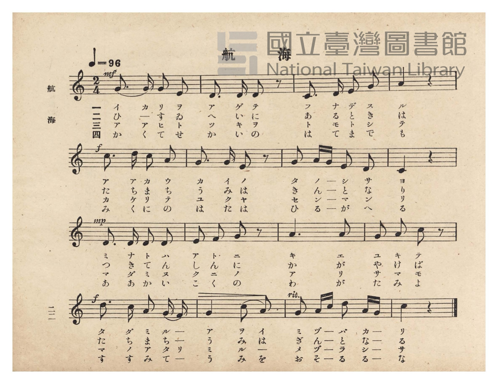
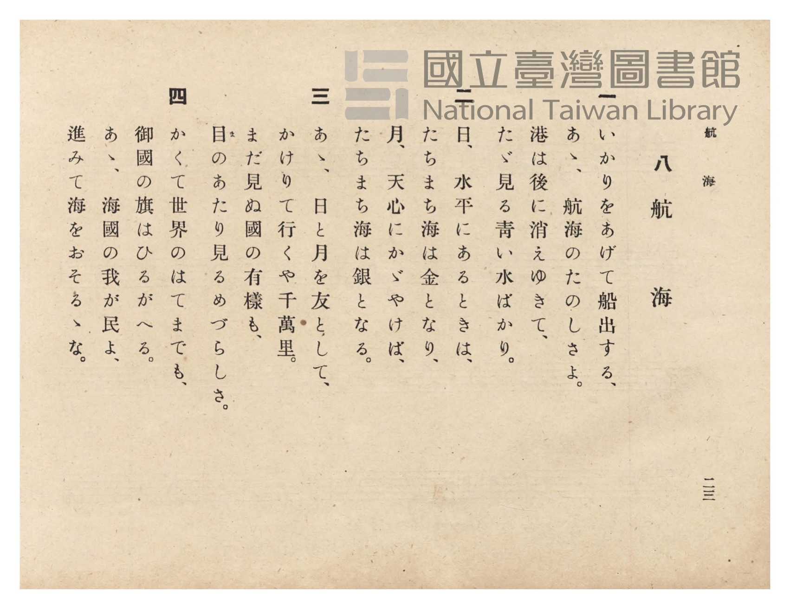

# 航海

> Re:Shōka 使用 AI 協助辨識與重建樂譜，可能會有錯誤。歡迎回報。

- **鋼琴伴奏版**：<br><audio controls src="kokai.mp3"></audio>
- **NEUTRINO 歌聲合成版**：<br><audio controls src="kokai_neutrino.mp3"></audio>

- 臺灣總督府《公學校唱歌》第六學年用（昭和十五年，索書號 523.37 4322-4）

## 說明

原書資訊與歌詞全文（對應 P026.jpg–P027.jpg，原書 pp. 22–23）：
調性與拍號：ハ長調（C 大調，無升降記號）2/4 拍，速度 ♩=96


## 歌詞

```text
一
いかりをあげて船出する、
あゝ、航海のたのしさよ。
港は後に消えゆきて、
たゞ見る青い水ばかり。

二
日、水平にあるときは、
たちまち海は金となり、
月、天心にかゞやけば、
たちまち海は銀となる。

三
あゝ、日と月を友として、
かけりて行くや千萬里。
まだ見ぬ國の有様（ありさま）も、
目（ま）のあたり見るめづらしさ。

四
かくて世界のはてまでも、
御國の旗はひるがへる。
あゝ、海國の我が民よ、
進みて海をおそるゝな。
```

## ABC

<div class="abc-score" data-abc-src="kokai.abc" aria-label="五線譜載入中"></div>

[下載 ABC 原始檔](kokai.abc)

## TMD 檔案連結

- [主旋律 TMD 檔案](kokai.tmd) [[在 TMD Studio 編輯](https://tmdlang.github.io/Tmd-TS/#tmd=s7IKdvYPcrWy4qpTUCpJTLdSSM7PyUlNLsnMz7PKzk9PzM7Ojy_OyM9OVIKrKMvPKc1NtUovSkxJjTdDiBfnlxYlp1oVJ2fk5-fEl6RWlCTl52ejy8cXJKanWgUYGCHpLCjKL0vNS8wD6i4oyswrSU0Ba0coSC3LTEkFSRcnJ-bFl6UWZaZlpqYgOSm1qBjkYqgVJUWJecXJRZkFIG8gVOUXlWTkA51dkFFplZFZXJJflJmcmBOfnZiH5LuSjFSg5_ISS0qLUtFFi1MxFOYmFmWWZOZiKAU6oSw1B9nuzPTMPKuSxExgaIJCtDwxPjcxMy8nMQ_oDy0thRcdq55t3a6gpcWlaKtgacZlb6vgzGVjpG9iBzLjRfuu542Ln-_Y-3zu4qe75jxu6Hrauubp2h3PFix8OmXjs7U9jxu6n69Z87R1LVDw6c4tz6eseL-n49mMtU8n9TztbXyyawpQ8P2enudbFj2bvePFzPkKpkbGesbmCibGRka6Ju_3dCpxcelrKdhSC3ApKCg87ZsPsmxz-4sVXS862oGufLFy3tPWFc-mtQMd93RD77P2TgVQStDLKkh_1DAZyDQHMYHuhGhVKCjQUzAyAkoZGQOd-H7PLJCxL1btf9awHGRgdy_QJ0DRx839L6duB4oDjXVWeLpkOZjZ87xl4dPe9pcze1-smAFW2AkMTgWgLqDcy4b5T3ctU3g0c6UtMLBBxj7Z0QCiHje2PG7sftzU9bhp0uPGpseNQHLZi46dT9t3PW6c-bip-3FDI0Rd0-OmuUAOJOIeN6573DgfTE5_3Dj1cVPH44YmkLpnO9Y_blz_dF_P48bVz7Z1PG7seNzU9rixF2gq3KT5j5vmvVgGtLT75VygdS3PNmx53LgB6gygMWDn7eoBGzd9KVAbUMHTnZuBJoJd0f24cQXYxPVIJjYufNy4D0iC3bb-ZftEsKJVYBPBip7NATqx8emSlU_3N4NNAto273ET0PdApRtwm9TVADMJGBRQt-3oRAkSkCMbV4AsaJr0tB_iPGCoIDwMFJoIcgkwZBcCA6YfaO3T3uYXE9a8bAemZHC4ge1cAAqVxjVP5wDJdc_mdD5bPgMYxWB7gJqnAtUAI_VxUxPU4Oez14GlwaKgqABGHzBsuyBh-7ip8XHj0sdNQClwFEEd_3T2bLij-oEuerJj2vOpQEcBtQNjbhnYHcsRdjzdtxDqnOlAU4AqNoEjAKhhBzREUEJi63ao6g5gqPY82wD0NijYQYpeNmx63LgfaAUoYEGJDeiluWB3zgUFL8QkynMiFCho6XNxeQML8kyrgMzEvHyHGoOaapANCjaGZlp2YBa2AkABWKwAswYwnhQ0TBSebuh_vr5BB55rNbFoAFoEMqxGoTo3rVbBVEEXCE3BtDEQ1ygYgUWMwLQBWMQQKgKSB6mrUTADi0DkQbAGbKSPYY3C46YlYJHHTasVHjevArGaN4H1PG5aBJXZBBRrA7LiIeLNUyHizV1A3A5WsRMqsxpqPkglkj1GQLlGkKkgXXuA7JlgXRMguhp3QGQaW4AYZALUnsYmqP3dQPYKsIpeqMx67PYYI7t6EdCuSWAbO6Cua4HKrIX6EeYfkDxIHUgHiP24aTtUBuRrLPaYgNzQDXV1PxAvA7NmQ10HkwH5Zx2SfyCuBqkG5gIwazk0pCE-RbYHfwLa1UNWAgKmH8M4sAVGcRAWKGHUwBMVKMFAkhBIxAwqAkpYsESFPQkhBTkwGYFYoAAByUASBCiRPW7uQwRF035wgPdBkgM4uB83bYUGOiiqcSWi-dAgXAgPwoXQwIVEFbAEgAY0LNBBSeZx02RowoMkI1AyB7miC7tN4GQEc_lGeLYA2QByH8hvIJn1QDYo88D8tBusajPEpuZ5UB5ED8gEXAkJFBawhAQOPXCiQU4w89H8BEq84GwB9lMPWA0oE4FcAUl8xCelHZ3klUUFtSglDySRgJKLCRCDkg8kIcFKHhBEJDYQC5z-wIoQKakZGr_gogWcFZv7of4CpTGYGMiPsFBfi2TB4yZQ_MLiCCKHVHQhpSNooQdMHdDMC0whkLCdDuehFkawcIXoA4U5yHZQkQKsfMHkBlR7QKkInApAbmiA-u1xM0wnKD4hPkHNGZC8BLUHnG5AoqC8AUtTIBVI9oDTELSoBNIQl4IKH4i7IT4BhSJKYdQEEsHwDzh_QVIksGKF24M3BQErfHILI2ApBLIemBJACcIUmHRgZRE0eSCnGKAAWD2oWAIWRxCt2MsjaI5CCnVQ5bYHJXwhVQCk-oOlvMfNrdDcC6qaIFUiWBeu_IuzTILqg5ZK8DAF52KQOCjGMUslmBsx8zBmigKWnZA8AfQtyH2I3APxry6oBQ71G6iMRPhtJVjXdrhtoLSFq2wCVdQgt82E-wBYeWH3WxOosgWJg0pVYNMLWraDUyO0rALJYoZkLReXrp0CuC2lAGQocwEA)]
- [鋼琴伴奏 TMD 檔案](kokai_piano.tmd) [[在 TMD Studio 編輯](https://tmdlang.github.io/Tmd-TS/#tmd=s7IKdvYPcrWy4qpTUCpJTLdSSM7PyUlNLsnMz7PKzk9PzM7Ojy_OyM9OVIKrKMvPKc1NtTJDiBTnlxYlp-JSD5GNL0hMT7UKMDAy0wUS5gjpgqL8stS8xDygASWJmeWJefHpQIGivPyi-PTUvNSixByE2tSyzJRUkMqCoszcxKLK-JT8ZKBb8kqQXJdaVAxyfEFmYl5-fGJRUWJeeiqqkvyikoz89KLEgoxKq4zM4pL8oszkxJz47MQ8JFeXZAB1WaWmlCYnggJDiUtLS-FFx6pnW7e_39PxsnvP8wlbnuzZ8nRp__POjvd7OhW0tLgUbRUszbjsbRWcuWyM9E3sQGa9aN_1vHHx8x17n89d_HTXnMcNXU9b1zxdu-PZgoVPp2x8trbncUP38zVrnrauBQo-3bnl-ZQVQPOfzVj7dFLP097GJ7umAAXf7-l5vmXRs9k7Xsycr2BqZKxnbK5gYmxkpGsCtFmJi8szr6Qo3yoA5OMgD4cag5pqLgUgsDE007IDs2oUqtNqFYziFHSB0DBOwQxImSqYAMVNwUJgQV2wMETIDCQAVm8G5NdApEHQAErXcNWi2OuDbK8JqrXxCqbx8SBD4hXMYAy4iAHEKG9gkskk4IVcoGEQ95qCaWOwc43AIkZgGuQ6oKlQEZA8SF0N2GOorgcZ6WNYo_C4aQlY5HHTaoXHzatArOZNYD2PmxZBZTYBxdqArHiIePNUiHhzFxC3g1XshMqshpoPUolkjxFQrhFkKkjXHiB7JljXBIiuxh0QmcYWIAaZALWnsQlqfzeQvQKsohcqsx67PcbIrl4EtGsS2MYOqOtaoDJroX6E-QckD1IH0gFiP27aDpUB-RqLPSYgN3RDXd0PxMvArNlQ18FkQP5Zh-QfiKtBqh837gOzlkNDGuJTZHuQ0g807QFTI1oiBcUuKI4hsQ5JthARUFqApQPssY4USsCYB7FAfgDJQOIQlC4eN_chXN-0HxxGfZAYBIfQ46at0HACxQ6ueJ8P9fVCuK8XQsMDErqPG_dDwwYWTqBYftw0GZpWIDEPSpkgV3Rhtwkc8zCXb4SnZJANIPeB_AaSWQ9kg9I7zE-7wao2Q2xqngflQfSATMAV96CwgMU9OPTA8Ywcx_PR_ARKb-CUDPZTD1gNKN2DXAFJL9hiP7cAWHyAxSD5GxKvoBg2AWJQjEPiHpa_QRC5EIOWa2BFiMhvhkYJOAODE3xzP9QpoGQBEwM5CxZQa5EseNwEihJYsELkkAoIpKiHFi3ACIVmEWCkQoJjOpyHmuVhQQHRBwomkO2gjPu4cSKY3IBqDyjiwREHckMD1G-Pm2E6QVEA8QlqYoYkf6g94KgGiYKSMywZgFQg2QOOdmiBBKQhLgVlcYi7IT4BhSJKlm8CiWD4B5wlIInocRMorCH20KymQuR6aLpFCihQqb8HJUggZSOkXoAllsfNrdA8AiqzIXUFWBeuXIIz50P1QfM-PBjAeQUkDookzLwPcyNmTsFMBMASCpKMgb4FuQ-R4CH-1VV4sqMB6jdQSYTw20qwru1w20DJAVcJAKrBQG6bCfcBsFTH7rcmUC0EEgeVXY8b50JLUHACgpYIIFnMkERtFuBqYYBaBcB2RLRhLChFAJsV0abxICZczATSyECqUJDaIRAl6A0SpOIHh4nRJlARVKOJauvo2imAW04KQAbYg9E-QGMRHCNkjjEyB2gpkKPMBQA)]

## 分析

```text
================================================================================
📊 TMD Song Profile: [ 航海 ]
================================================================================
⏱  Duration:       0:20 (20.0s), 16 measures total
🎼 Key & Tempo:    首調基準 C, != 96.0 BPM, <2/4>
   - 分析範圍：      由實際發聲的音符與和弦推測調性；播放脈絡另行呈現
🎤 人聲音域:    C4 (MIDI 60) – D5 (MIDI 74) [跨度: 14 個半音 / 1.2 個八度, 難度: moderate]
   - 最低音:  C4 in [Kokai #1 @ m.3, 0:02]
   - 最高音: D5 in [Kokai #1 @ m.5, 0:05]
   - 適合: soprano, mezzo-soprano, contralto, tenor, baritone, bass
🏛  結構:      Kokai (20.0s)
⚡ 編曲密度:        Peak 1 軌道同時演奏
🗝  調性診斷：       G 調性不明確（純淨自然大調，未偵測到可信轉調）
   - 風格氣質:    純淨自然大調（陽光明朗、易唱易記，無明顯調外色彩）
   - 轉調歷程:    全曲維持單一推測調性（未偵測到可信轉調）
   - 核心骨幹音:  G, D, A, C, E
   - 調性數值:    G 調性不明確 [相關度: 0.78, 穩定度: Ambiguous, 自然音純度: 97.2%]
   - 候選調性 (K-S): G 大調 (0.78), C 大調 (0.76), A 小調 (0.63)
   - 五度圈歷程:   +1
   - 各段落調性細節:
     • [Kokai #1]: G 調性不明確 (r: 0.78, 自然音純度: 97.2%, 調外音: F)

  [ 五度圈游移軌跡 ]
               C  
         F           [G ]*
      Bb               D  
      Eb               A  
         Ab           E  
            Db       B  
               F# 
     (* = active key center)

  [ 十二半音累積音高分佈 ]
     C  : ████████████████████      20.4%
     C# :                            0.0%
     D  : ████████████████████      21.3%
     D# :                            0.0%
     E  : █████████                  9.3%
     F  : ███                        2.8%
     F# :                            0.0%
     G  : ████████████████████████  25.0%
     G# :                            0.0%
     A  : ████████████████████      21.3%
     A# :                            0.0%
     B  :                            0.0%
--------------------------------------------------------------------------------
Assignment 軌道音域：
  - Piano         : C4 – D5 (14 個半音 / 1.2 個八度, 52 個音符)
================================================================================
```


## 原書掃描頁






