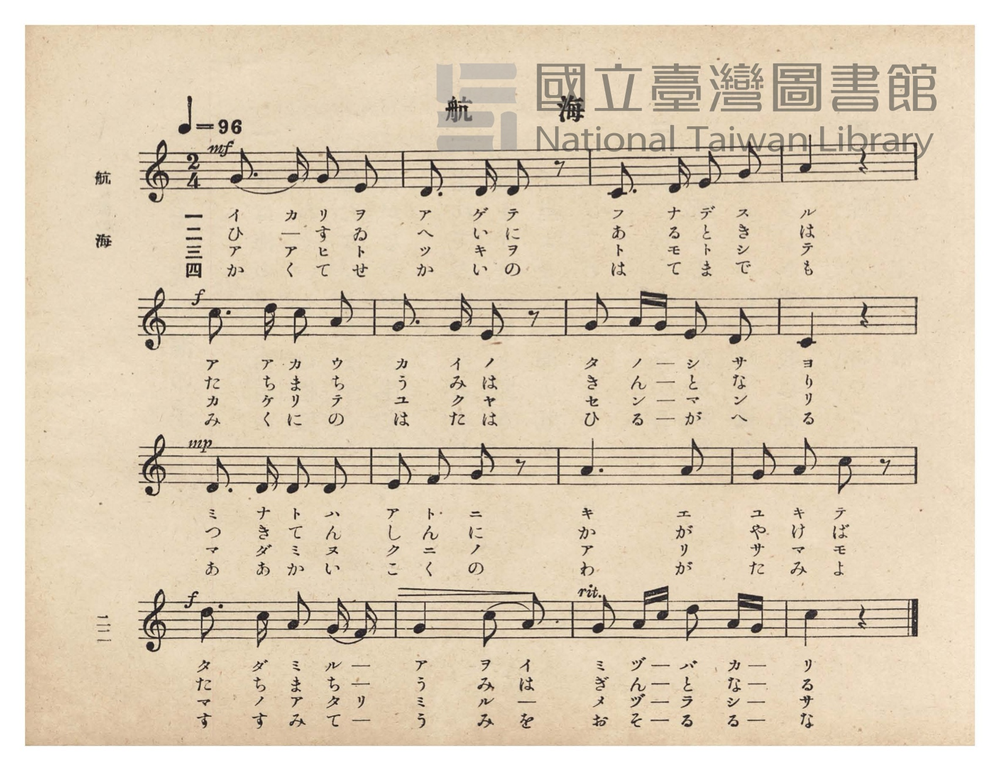
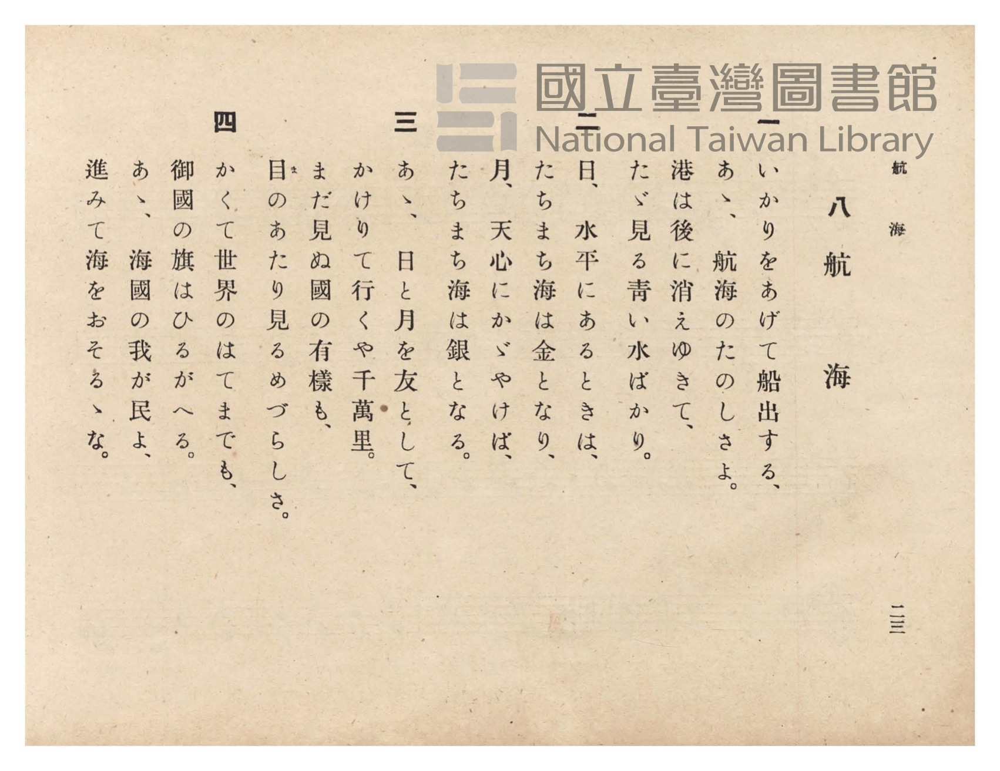

# 航海

> Re:Shōka 使用 AI 協助辨識與重建樂譜，可能會有錯誤。歡迎回報。

<audio controls src="kokai.mp3"></audio>

- 臺灣總督府《公學校唱歌》第六學年用（昭和十五年，索書號 523.37 4322-4）

## 說明

原書資訊與歌詞全文（對應 P026.jpg–P027.jpg，原書 pp. 22–23）：
調性與拍號：ハ長調（C 大調，無升降記號）2/4 拍，速度 ♩=96


## 跨冊／重複收錄參照

> 同曲＋同名異曲（《公學校唱歌》第六學年與《新定兒童唱歌》第四學年〈航海〉「今日船出して…」為同曲；《新定兒童唱歌》第五學年與《共益商社唱歌教科書》卷一為同名異曲）

- **[同名異曲]** 《共益商社唱歌教科書》卷一・生徒用（明治38年／1905）：[**〈航海〉**](../../../kyoeki_shoka/kan_1_854862/18_kokai/index.md)（`G` / `4/4` — [原始 TMD](../../../kyoeki_shoka/kan_1_854862/18_kokai/kokai.tmd)）
- **[同曲]** 《新定兒童唱歌》尋常科第四學年用（2020.006.0847.0004）：[**〈航海〉**](../../../shintei_jido_shoka/grade_4_2020.006.0847.0004/4_10_kokai/index.md)（`C` / `2/4` — [原始 TMD](../../../shintei_jido_shoka/grade_4_2020.006.0847.0004/4_10_kokai/kokai.tmd)）
- **[同名異曲]** 《新定兒童唱歌》尋常科第五學年用（2020.006.0847.0005）：[**〈航海〉**](../../../shintei_jido_shoka/grade_5_2020.006.0847.0005/2_05_kokai/index.md)（`F` / `3/4` — [原始 TMD](../../../shintei_jido_shoka/grade_5_2020.006.0847.0005/2_05_kokai/kokai.tmd)）
- 總表：[跨冊重複與同名歌曲總索引](../../../duplicate_songs.md)

## 歌詞

```text
一
いかりをあげて船出する、
あゝ、航海のたのしさよ。
港は後に消えゆきて、
たゞ見る青い水ばかり。

二
日、水平にあるときは、
たちまち海は金となり、
月、天心にかゞやけば、
たちまち海は銀となる。

三
あゝ、日と月を友として、
かけりて行くや千萬里。
まだ見ぬ國の有様（ありさま）も、
目（ま）のあたり見るめづらしさ。

四
かくて世界のはてまでも、
御國の旗はひるがへる。
あゝ、海國の我が民よ、
進みて海をおそるゝな。
```

## ABC

```abc
X:1
T:航海
M:2/4
L:1/16
Q:1/4=96
K:C
V:V1 name="Piano" snm="Pia"
[V:V1]
!mf! G3 G G2 E2 | D3 D D2 z2 | C3 D E2 G2 | A4 z4 |
w: 1.~イ カ リ ヲ | ア ゲ テ | フ ナ デ ス | ル
w: 2.~ひ ー す ゐ | へ い に | あ る と き | は
w: 3.~ア ア ヒ ト | ツ キ ヲ | ト モ ト シ | テ
w: 4.~か く て せ | か い の | は て ま で | も
!f! c3 d c2 A2 | G3 G E2 z2 | G2 A G E2 D2 | C4 z4 |
w: 1.~ア ア カ ウ | カ イ ノ | タ ノ ー シ サ | ヨ
w: 2.~た ち ま ち | う み は | き ん ー と な | り
w: 3.~カ ケ リ テ | ユ ク ヤ | セ ン ー マ ン | リ
w: 4.~み く に の | は た は | ひ る ー が へ | る
!mp! D3 D D2 D2 | E2 F2 G2 z2 | A6 A2 | G2 A2 c2 z2 |
w: 1.~ミ ナ ト ハ | ア ト ニ | キ エ | ユ キ テ
w: 2.~つ き て ん | し ん に | か が | や け ば
w: 3.~マ ダ ミ ヌ | ク ニ ノ | ア リ | サ マ モ
w: 4.~あ あ か い | こ く の | わ が | た み よ
!f! d3 c A2 G F | G4 c2 A2 | G2 A c d2 A G | c4 z4 |
w: 1.~タ ダ ミ ル ー | ア ヲ イ | ミ ヅ ー バ カ ー | リ
w: 2.~た ち ま ち ー | う み は | ぎ ん ー と な ー | る
w: 3.~マ ノ ア タ リ | ミ ル 一 | メ ヅ ー ラ シ ー | サ
w: 4.~す す み て ー | う み を | お そ ー る る ー | な
```

## TMD 檔案連結

- [主旋律 TMD 檔案](kokai.tmd) [[在 TMD Studio 編輯](https://tmdlang.github.io/Tmd-TS/#tmd=s7IKdvYPcrWy4qpTUCpJTLdSSM7PyUlNLsnMz7PKzk9PzM7Ojy_OyM9OVIKrKMvPKc1NtUovSkxJjTdDiBfnlxYlp1oVJ2fk5-fEl6RWlCTl52ejy8cXJKanWgUYGCHpLCjKL0vNS8wD6i4oyswrSU0Ba0coSC3LTEkFSRcnJ-bFl6UWZaZlpqYgOSm1qBjkYqgVJUWJecXJRZkFIG8gVOUXlWTkA51dkFFplZFZXJJflJmcmBOfnZiH5LuSjFSg5_ISS0qLUtFFi1MxFOYmFmWWZOZiKAU6oSw1R4lLS0vhRceqZ1u3K2hpcSnaKliacdnbKjhz2Rjpm9iB9Lxo3_W8cfHzHXufz138dNecxw1dT1vXPF2749mChU-nbHy2tudxQ_fzNWuetq4FCj7dueX5lBXv93Q8m7H26aSep72NT3ZNAQq-39PzfMuiZ7N3vJg5X8HUyFjP2FzBxNjISNfk_Z5OJS4ufS0FW2oBLgUFhad980GWbW5_saLrRUc70JUvVs572rri2bR2oOOebuh91t6pAIpjvayC9EcNk4FMcxAT6E6IVoWCAj0FIyOglJEx0Inv98wCGfti1f5nDctBBnb3An0CFH3c3P9y6nagONBYZ4WnS5aDmT3PWxY-7W1_ObP3xYoZYIWdwOBUAOoCyr1smP901zKFRzNX2gIDG2Tskx0NIOpxY8vjxu7HTV2PmyY9bmx63Agkl73o2Pm0fdfjxpmPm7ofNzRC1DU9bpoL5EAi7nHjuseN88Hk9MeNUx83dTxuaAKpe7Zj_ePG9U_39TxuXP1sW8fjxo7HTW2PG3uBpsJNmv-4ad6LZUBLu1_OBVrX8mzDlseNG6DOABoDdt6uHrBx05cCtQEVPN25GWgi2BXdjxtXgE1cj2Ri48LHjfuAJNht61-2TwQrWgU2Eazo2RygExufLln5dH8z2CSgbfMeNwF9D1S6AbdJXQ0wk4BBAXXbjk6UIAE5snEFyIKmSU_7Ic4DhgrCw0ChiSCXAEN2ITBg-oHWPu1tfjFhzct2YEoGhxvYzgWgUGlc83QOkFz3bE7ns-UzgFEMtgeoeSpQDTBSHzc1QQ1-PnsdWBosCooKYPQBw7YLEraPmxofNy593ASUAkcR1PFPZ8-GO6of6KInO6Y9nwp0FFA7MOaWgd2xHGHH030Loc6ZDjQFqGITOAKAGnZAQwQlJLZuh6ruAIZqz7MNQG-Dgh2k6GXDpseN-4FWgAIWlNiAXpoLdudcUPBCTKI8J0KBgpY-F5c3sIjOtArITMzLd6gxqKkG2aBgY2imZQdmYSsAFIDFCjBrAONJQcNE4emG_ufrG3TguVYTiwagRSDDahSqc9NqFUwVdIHQFEwbA3GNghFYxAhMG4BFDKEiIHmQuhoFM7AIRB4Ea8BG-hjWKDxuWgIWedy0WuFx8yoQq3kTWM_jpkVQmU1AsTYgKx4i3jwVIt7cBcTtYBU7oTKroeaDVCLZYwSUawSZCtK1B8ieCdY1AaKrcQdEprEFiEEmQO1pbILa3w1krwCr6IXKrMdujzGyqxcB7ZoEtrED6roWqMxaqB9h_gHJg9SBdIDYj5u2Q2VAvsZijwnIDd1QV_cD8TIwazbUdTAZkH_WIfkH4mqQamAuALOWQ0Ma4lNke_AnoF09ZCUgYPoxjANbYBQHYYESRg08UYESDCQJgUTMoCKghAVLVNiTEFKQA5MRiAUKEJAMJEGAEtnj5j5EUDTtBwd4HyQ5gIP7cdNWaKCDohpXIpoPDcKF8CBcCA1cSFQBSwBoQMMCHZRkHjdNhiY8SDICJXOQK7qw2wRORjCXb4RnC5ANIPeB_AaSWQ9kgzIPzE-7wao2Q2xqngflQfSATMCVkEBhAUtI4NADJxrkBDMfzU-gxAvOFmA_9YDVgDIRyBWQxEd8UtrRSV5ZVFCLUvJAEgkouZgAMSj5QBISrOQBQURiA7HA6Q-sCJGSmqHxCy5awFmxuR_qL1Aag4mB_AgL9bVIFjxuAsUvLI4gckhFF1I6ghZ6wNQBzbzAFAIJ2-lwHmphBAtXiD5QmINsBxUpwMoXTG5AtQeUisCpAOSGBqjfHjfDdILiE-IT1JwByUtQe8DpBiQKyhuwNAVSgWQPOA1Bi0ogDXEpqPCBuBviE1AoohRGTSARDP-A8xckRQIrVrg9eFMQsMIntzAClkIg64EpAZQgTIFJB1YWQZMHcooBCoDVg4olYHEE0Yq9PILmKKRQB1Vue1DCF1IFQKo_WMp73NwKzb2gqglSJYJ14cq_OMskqD5oqQQPU3AuBomDYhyzVIK5ETMPY6YoYNkJyRNA34Lch8g9EP_qglrgUL-BykiE31aCdW2H2wZKW7jKJlBFDXLbTLgPgJUXdr81gSpbkDioVAU2vaBlOzg1QssqkCxmSNZycenaKYDbUgpAhjIXAA)]
- [鋼琴伴奏 TMD 檔案](kokai_piano.tmd) [[在 TMD Studio 編輯](https://tmdlang.github.io/Tmd-TS/#tmd=s7IKdvYPcrWy4tLSUnjRserZ1u3v93S87N7zfMKWJ3u2PF3a_7yz4_2eTgUtLS5FWwVLMy57WwVnLhsjfRM7rjoFpRftu543Ln6-Y-_zuYuf7przuKHraeuap2t3PFuw8OmUjc_W9jxu6H6-Zs3T1rVAwac7tzyfsgJo_rMZa59O6nna2_hk1xSg4Ps9Pc-3LHo2e8eLmfMVTI2M9YzNFUyMjYx0TYA2K3FxeeaVFOVbBWQm5uUHeTjUGNRUcykAgY2hmZYdmFWjUJ1Wq2AUp6ALhIZxCmZAylTBBChuChYCC-qChSFCZiABsHozIL8GIg2CBlC6hqsWxV4fZHtNUK2NVzCNjwcZEq9gBmPARQwgRnnnZydmEvBCLtAwiHtNwbQx2LlGYBEjMA1yHdBUqAhIHqSuBuwxVNeDjPQxrFF43LQELPK4abXC4-ZVIFbzJrCex02LoDKbgGJtQFY8RLx5KkS8uQuI28EqdkJlVkPNB6lEsscIKNcIMhWkaw-QPROsawJEV-MOiExjCxCDTIDa09gEtb8byF4BVtELlVmP3R5jZFcvAto1CWxjB9R1LVCZtVA_wvwDkgepA-kAsR83bYfKgHyNxR4TkBu6oa7uB-JlYNZsqOtgMiD_rEPyD8TVINWPG_eBWcuhIQ3xKbI9SOkHmvaAqREtkYJiFxTHkFiHJFuICCgtwNIB9lhHCiVgzINYID-AZCBxCEoXj5v7EK5v2g8Ooz5IDIJD6HHTVmg4gWIHV7zPh_p6IdzXC6HhAQndx437oWEDCydQLD9umgxNK5CYB6VMkCu6sNsEjnmYyzfCUzLIBpD7QH4DyawHskHpHean3WBVmyE2Nc-D8iB6QCbgintQWMDiHhx64HhGjuP5aH4CpTdwSgb7qQesBpTuQa6ApBdssZ9bACw-wGKQ_A2JV1AMmwAxKMYhcQ_L3yCIXIhByzWwIkTkN0OjBJyBwQm-uR_qFFCygImBnAULqLVIFjxuAkUJLFghckgFBFLUQ4sWYIRCswgwUiHBMR3OQ83ysKCA6AMFE8h2UMZ93DgRTG5AtQcU8eCIA7mhAeq3x80wnaAogPgENTFDkj_UHnBUg0RByRmWDEAqkOwBRzu0QALSEJeCsjjE3RCfgEIRJcs3gUQw_APOEpBE9LgJFNYQe2hWUyFyPTTdIgUUqNTfgxIkkLIRUi_AEsvj5lZoHgGV2ZC6AqwLVy7BmfOh-qB5Hx4M4LwCEgdFEmbeh7kRM6dgJgJgCQVJxkDfgtyHSPAQ_-oqPNnRAPUbqCRC-G0lWNd2uG2g5ICrBADVYCC3zYT7AFiqY_dbE6gWAomDyq7HjXOhJSg4AUFLBJAsZkiiNgtwtTBArQJgOyLaMBaUIoDNimjTeBATLmYCaWQgVShI7RCIEvQGCVLxg8PEaBOoCKrRRLV1dO0UwC0nBSAD7MFoH6CxCI4RMscYmQO0FMhR5gIA)]

## 分析

```text
================================================================================
📊 TMD Song Profile: [ 航海 ]
================================================================================
⏱  Duration:       0:20 (20.0s), 16 measures total
🎼 Key & Tempo:    首調基準 C, != 96.0 BPM, <2/4>
   - 分析範圍：      由實際發聲的音符與和弦推測調性；播放脈絡另行呈現
🎤 人聲音域:    C4 (MIDI 60) – D5 (MIDI 74) [跨度: 14 個半音 / 1.2 個八度, 難度: moderate]
   - 最低音:  C4 in [Kokai #1 @ m.3, 0:02]
   - 最高音: D5 in [Kokai #1 @ m.5, 0:05]
   - 適合: soprano, mezzo-soprano, contralto, tenor, baritone, bass
🏛  結構:      Kokai (20.0s)
⚡ 編曲密度:        Peak 1 軌道同時演奏
🗝  調性診斷：       G 調性不明確（純淨自然大調，未偵測到可信轉調）
   - 風格氣質:    純淨自然大調（陽光明朗、易唱易記，無明顯調外色彩）
   - 轉調歷程:    全曲維持單一推測調性（未偵測到可信轉調）
   - 核心骨幹音:  G, D, A, C, E
   - 調性數值:    G 調性不明確 [相關度: 0.78, 穩定度: Ambiguous, 自然音純度: 97.2%]
   - 候選調性 (K-S): G 大調 (0.78), C 大調 (0.76), A 小調 (0.63)
   - 五度圈歷程:   +1
   - 各段落調性細節:
     • [Kokai #1]: G 調性不明確 (r: 0.78, 自然音純度: 97.2%, 調外音: F)

  [ 五度圈游移軌跡 ]
               C  
         F           [G ]*
      Bb               D  
      Eb               A  
         Ab           E  
            Db       B  
               F# 
     (* = active key center)

  [ 十二半音累積音高分佈 ]
     C  : ████████████████████      20.4%
     C# :                            0.0%
     D  : ████████████████████      21.3%
     D# :                            0.0%
     E  : █████████                  9.3%
     F  : ███                        2.8%
     F# :                            0.0%
     G  : ████████████████████████  25.0%
     G# :                            0.0%
     A  : ████████████████████      21.3%
     A# :                            0.0%
     B  :                            0.0%
--------------------------------------------------------------------------------
Assignment 軌道音域：
  - Piano         : C4 – D5 (14 個半音 / 1.2 個八度, 52 個音符)
================================================================================
```


## 原書掃描頁






