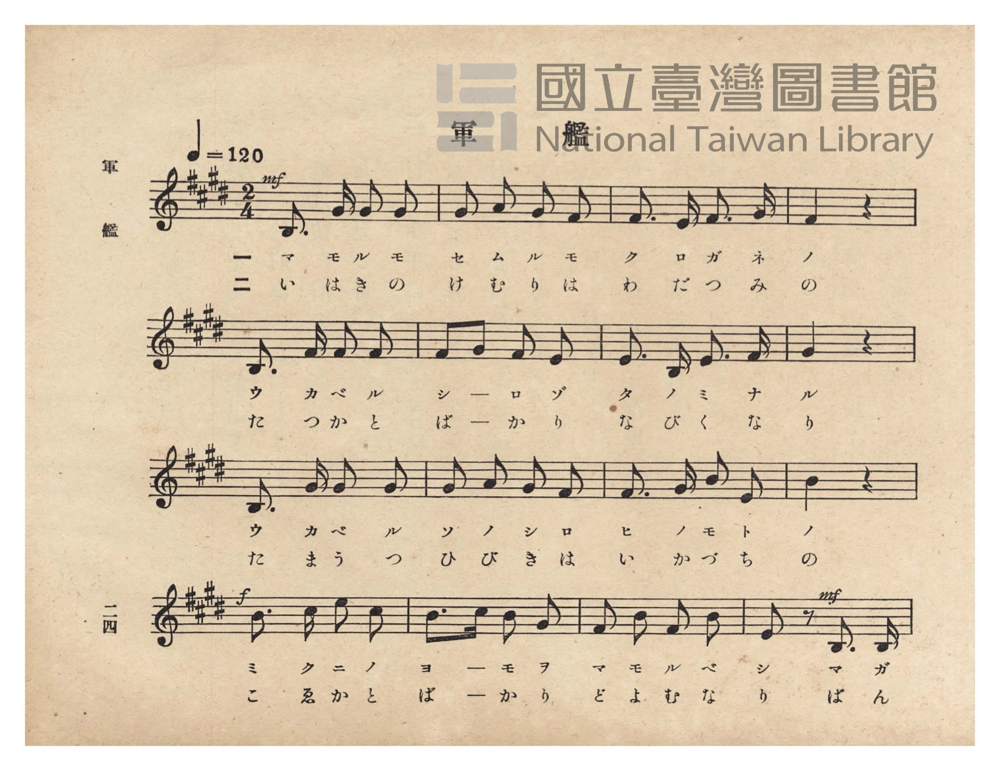
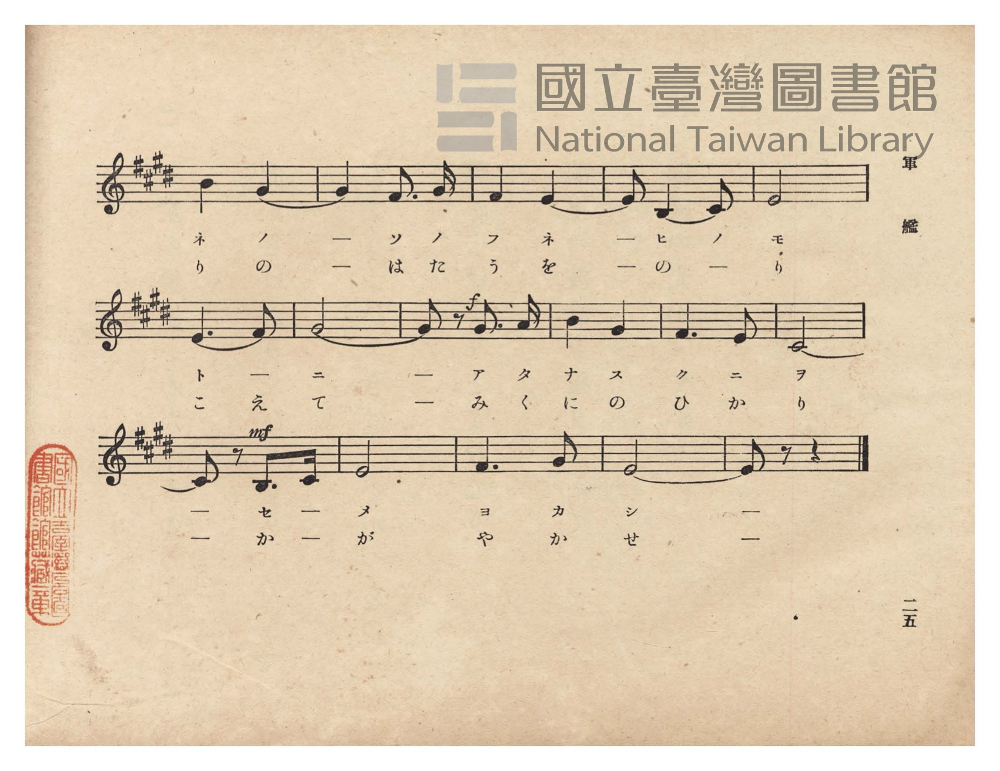
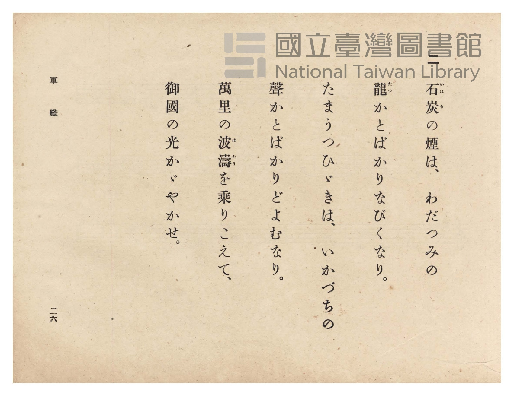
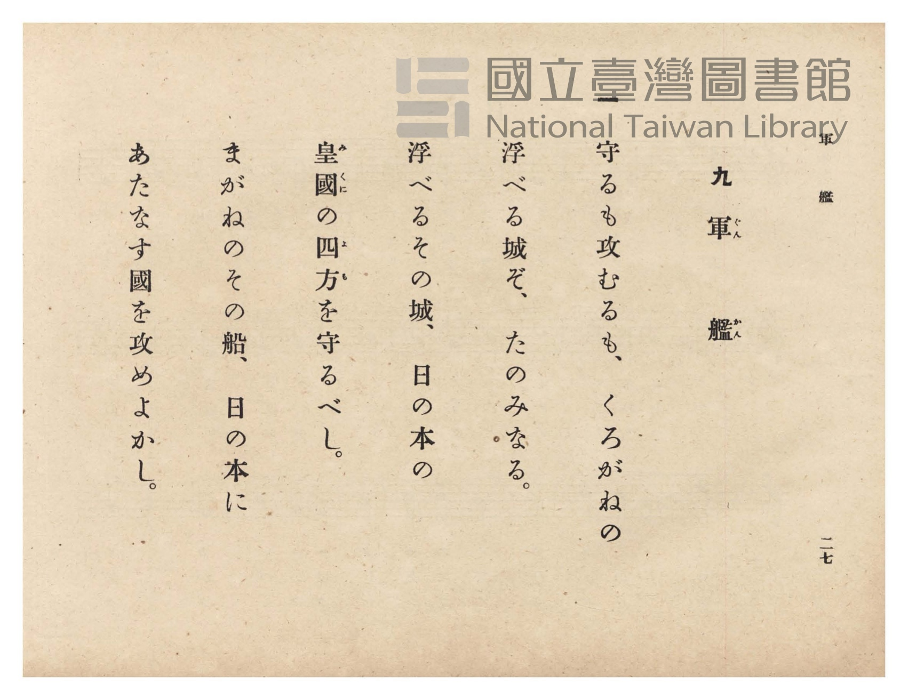

# 軍艦

> Re:Shōka 使用 AI 協助辨識與重建樂譜，可能會有錯誤。歡迎回報。

- **鋼琴伴奏版**：<br><audio controls src="gunkan.mp3"></audio>
- **NEUTRINO 歌聲合成版**：<br><audio controls src="gunkan_neutrino.mp3"></audio>

- 詞：鳥山啓
- 曲：山田源一郎
- 臺灣總督府《公學校唱歌》第六學年用（昭和十五年，索書號 523.37 4322-4）

## 說明

原書資訊與歌詞全文（對應 P028.jpg–P031.jpg，原書 pp. 24–27）：
調性與拍號：ホ長調（E 大調，4 升記號）2/4 拍，速度 ♩=120
作詞：鳥山啓／作曲：山田源一郎


## 歌詞

```text
一
守るも攻むるも、くろがねの
浮べる城ぞ、たのみなる。
浮べるその城、日の本の
皇國（みくに）の四方（よも）を守るべし。
まがねのその船、日の本に
あたなす國を攻めよかし。

二
石炭（いはき）の煙は、わだつみの
龍（たつ）かとばかりなびくなり。
たまうつひゞきは、いかづちの
聲かとばかりどよむなり。
萬里の波濤（はたう）を乘りこえて、
御國の光かゞやかせ。
```

## ABC

```abc
X:1
T:軍艦
C:曲：山田源一郎
M:2/4
L:1/16
Q:1/4=120
K:E
V:V1 name="Piano" snm="Pia"
[V:V1]
!mf! B,3 G G2 G2 | G2 A2 G2 F2 | F3 E F3 G | F4 z4 |
w: 1.~マ モ ル モ | セ ム ル モ | ク ロ ガ ネ | ノ
w: 2.~い は き の | け む り は | わ だ つ み | の
B,3 F F2 F2 | F2 G2 F2 E2 | E3 B, E3 F | G4 z4 |
w: 1.~ウ カ ベ ル | シ ー ロ ゾ | タ ノ ミ ナ | ル
w: 2.~た つ か と | ば ー か り | な び く な | り
B,3 G G2 G2 | G2 A2 G2 F2 | F3 G B2 E2 | B4 z4 |
w: 1.~ウ カ ベ ル | ソ ノ シ ロ | ヒ ノ モ ト | ノ
w: 2.~た ま う つ | ひ び き は | い か づ ち | の
!f! B3 c e2 c2 | B3 c B2 G2 | F2 B2 F2 B2 | !mf! E2 z2 B,3 B, |
w: 1.~ミ ク ニ ノ | ヨ ー モ ヲ | マ モ ル ベ | シ マ ガ
w: 2.~こ ゑ か と | ば ー か り | ど よ む な | り ば ん
B4 G4- | G4 F3 G | F4 E4- | E2 B,4 C2 |
w: 1.~ネ ノ | _ ソ ノ | フ ネ | _ ヒ ノ
w: 2.~り の | _ は た | う を | _ の ー
E8 | E6 F2 | G8- | !f! G2 z2 G3 A |
w: 1.~モ | ト ー | ニ | _ ア タ
w: 2.~り | こ え | て | _ み く
B4 G4 | F6 E2 | C8- | !mf! C2 z2 B,3 C |
w: 1.~ナ ス | ク ニ | ヲ | _ セ ー
w: 2.~に の | ひ か | り | _ か ー
E8 | F6 G2 | E8- | E2 z2 z4 |
w: 1.~メ | ヨ カ | シ | _
w: 2.~が | や か | せ | _
```

## TMD 檔案連結

- [主旋律 TMD 檔案](gunkan.tmd) [[在 TMD Studio 編輯](https://tmdlang.github.io/Tmd-TS/#tmd=s7IKdvYPcrWy4qpTUCpJTLdSSM7PyUlNLsnMz7PKzk9PzM7Ojy_OyM9OVIKrKMvPKc1NtUovSkxJjTdDiBfnlxYlp1oVJ2fk5-fEl6RWlCTl52ejy8cXJKanWgUYGFkgZAqK8stS8xLzgLoLijLzSlJTwNoRClLLMlNSQdLFyYl58WWpRZlpmakpSE5KLSoGuRhqRUlRYl5xclFmAcgbCFX5RSUZ-UBnF2RUWmVkFpfkF2UmJ-bEZyfmIfmuJCMV6LnczJzMksSiSgzxxKLMkszcVHTxvMQyJLVAg9Mz86xyUzOzMpECQktL4cXu3hedyxS0tLgUbRUMjQy47G0VXLlsjPRN7EC6X6yc937PrJeblz7duPHp1MlgE5_N3gQUAwo8n7Lh2a4JT3Y0vGzuA8u8aN_1vHHx8x17n89d_HTXnMcNXU9b1zxdu-PZgoVPp2x8trbncUP38zVrnrauBQo-3bnl-ZQV7_d0PJux9umknqe9jU92TQEKvt_T83zLomezd7yYOV_B1MhYz9hcwcTYyEjX5P2eTiUuLn0tBVtqAS4FBYWnffNBlm1uf7Gi60VHO9CVQE8_bV3xbFo70HFPN_Q-a-9UACUPvayC9EcNkwMMjA1BTKA7IVoVCgr0FIxMgFJG5kAnAsMGZOyLVfufNSwHGdjdC_QJUPRx8-yXU7cDxYHGuio8XbIczOwxUXjaC7R7BlhRJzDgFYA6gOIvG-Y_3bVM4dHMlbageAEa-WTvHLT4eL-nHyiINUK4wDp2NIC9uK7jcVP346amZ1N2P25qgLAfNzQ-bux_3NT7uLHncePax43rQEqfbV33uHEnUMXT-X2PG-eBFc0Hyj1u3P-4cRVIZ0MTirrHjXOB0iDVDY3Ppi8Fsp_NWQM17Pms9qdzuoHeBevuf9y4GuhDkOrZs59N2wkSbwKiJpBg0ySoI4GGNk6HWvK4cR_ccRB7XnTsRLVnNURdE9iVqx43zgRaCDQM7NFGkPGNQCPB5oHDY1cP2F3zNz9vWgt2V8vjxvWPG4HhDXLX89aZIC7Qz01Axy543LgE7HCwX17uAyoCagBaswSsGmjuiseNG0CMpi6w3ZvBfgQGUhfc_UDVQC-0gU3a9LhpHtAqqA0gm4FGAD2yEGrDC6AKdFNXgkOoAcXUFxPWvGwHhsq6Z5sXPdsPdAzQVUA_AK1qg4Tkk50zwJonP24ESi0D2gZOBPsWgsIGGPqtYNcDHdMEccNsqMGU5ycoUNDS5-JyL80DFmRWAZmJefkONQY11SArFGwMzbTswCxs-VgBWDoA0-yLhT0KGsB8saH_-foGHXjm08SiAWgTyLAaherctFoF03gFXSA0BkIQqQsUB5EmUJ4RWARE6ioYQmljuIiuggGUrgGb6WNYo_C4eR5Y5HHzIiBeDWWBTHnctBvMWwAmUWXWQ_WsBbLXQNm9IJnmPqgNEHfCbTICyjW2QFQ2rgfiXjBrHcS8xokgXlMDmOyCqoHY1A_VswCIl0DZ-8F6QHpRbcIf6rt6yAl1aIAbgYMQEbywwDYEi4BIXZBSCMMIGis4QrxpGcQfTauB4TUTHrogme1g3h5o2ILU7IPK7IeGch8Qz4eyu8AhDtKLK8ShKoEhB8wHYNYKaIhvQNgEkQGHO0hmFVTPZiCGhf4qsBtAKkgJ8R2dFIQ4MUncWMEUHgcgFukBvhcaqCBZSOCDgh0UrJOQAhyU7B83d0Bl8CVxWIDvA-I2aNBDgnUTNFBBJCTxQ5M4PFt0A_FSMGshVIbEJA6sdcgqWEDlCth8MwXDODCFCFAzMA2JBlCgg3gwGpLwQQGOXDYBKeTiBRoiwCLjcTM4oYHDDyQDSoqQRAgLYVAYwYokmBik4AHFGiyDgKyBF1vA4gc5_CdDRSdiTfBQ29AS_EowDxS70CIInAVgCR5sG0x302TCxcwUcByYIseBJeFED41hWLFRA6UhgY1aiEMKGZgaaKgDYwrEgJVFCIgcF6B0B0vV6PZA8gJEDqR2KlwtTBdELSxnIMckKKaw2AmKEXihgUjNSHaC8wCIng-OCVCOgbgFZgfUTrheSJGFbC7CTvx5o3UtOF7MSIsX5NCElDywGILbCybBmQCYByCyJlhjFBZ_IAgps8BRhiXgwJEFSpDwgIJ5G5yFMK0HJ9ImSDSA6gqQSnjAN-2Eq4XV3DBTQaaB1IIyHhZ3IGUpqI5GaCHYCClSsboDWD9D1PaDVcLqJ-QEACkOEaZC3UFqpD7Z0UxOZgOZjF5qAaMCS95BiTNIIYipBmYcZs2DiBpQUwoSjaDgBpXvqGbASkNogABrKkR5hz2YMWsfRARAEgnUtsYeTNuaIHUOWvA3zibCtlouLl07BUjbVwHIUuYCAA)]
- [鋼琴伴奏 TMD 檔案](gunkan_piano.tmd) [[在 TMD Studio 編輯](https://tmdlang.github.io/Tmd-TS/#tmd=s7IKdvYPcrWy4tLSUnixu_dF57L3ezpedu95PmHLkz1bni7tf97Z8X5Pp4KWFpeirYKhkQGXva2CK5eNkb6JHVedgtKLlfPe75n1cvPSpxs3Pp06WQkk9mz2JqAYUOD5lA3Pdk14sqPhZXMfWOZF-67njYuf79j7fO7ip7vmPG7oetq65unaHc8WLHw6ZeOztT2PG7qfr1nztHUtUPDpzi3Pp6wAOufZjLVPJ_U87W18smsKUPD9np7nWxY9m73jxcz5CqZGxnrG5gomxkZGuiZAhypxcXnmlRTlWwVkJublB3k41BjUVHMpAIGNoZmWHZhVo1Cdm1arYKigiwJrFIyQeMZgEUw1INIAisEiXLUoVvogW2mCZmO8QrRhLJBnGg9kmcaDmHAxIMMAYpp7aV52Yh4RPjCNhzoV5FiIg0GkCZQH8g7MU4ZQ2hjJmwgvgMz0MaxReNw8DyzyuHkREK-GskCmPG7aDeYtAJOoMuuhetYC2Wug7F6QTHMf1AaIO-E2GQHlGlsgKhvXA3EvmLUOYl7jRBCvqQFMdkHVQGzqh-pZAMRLoOz9YD0gvag2QQMKGkZGYF8jQgQWPqAIhkUzUCmEYQQNSByB1LQMYnXTaqAXZ8IDBCSzHczbAw0OkJp9UJn90IDpA-L5UHYXOJBAenEFElQl0LOPG7vBrBXQQNqAsAkiAw4qkMwqqJ7NQAwLsFVgN4BU4AskYhKSsYIpPNhALNLDaC80HECykPAChRQoJCYhhREocT1u7oDK4EtIsDDaB8Rt0NCChMQmaDiASEgSgyYkeOLrBuKlYNZCqAzOhFQNynBgITMFwzgwhQgDMzANCTlQOIF4MBqSvEBhhJxpgRRyvoN6ApiXHjeDoxPsZZAMKMIhUQ0LFJC3YHkVJgbJkaCAhiVDkDXw_AzMl8hBNhkqOhFrsoLahpasVoJ5oAiB5k1wQoMlK7BtMN1Nk5GSFjQcYfkJUoJCchlEHFEgwUpbiBpoQAEDF8TAUhYjBR8odmFpB90eSIqDyIHUToWrhemCqIWlP-TABwUuFjtBgQjPTYg0g2QnOKWB6PngwAOlS4hbYHZA7YTrheRlZHMRdkKDEjkAIFkSFqhwpWASnNSAKQ0ia4I1EpCrOkhmBocyFr-CwxcU7XC_wVwKTqiY1oOTQhMk5EDlHkglPKyadsLVwioOmKkg00BqQckbizuQEi5URyO0dGiElDVY3QGsHiBq-8EqYWUtcpxBygmEqVB34I4HEAc9OwNDD1trgbwWBSzcEaEJqnwhIQ8KIVBZhWoGrJiA-gFY6iIKAuwhg1mSIsIMEq9Q2xp7MG1rgpSfaCHWOJsI29DaN0Q1l4AMUIsJpd0EYoLaS7AKDEUCqAGzZQXNRFgNBWtANRKUg4DCJihGoTbcoAkAVpLjNRwuAlOD0IIqDjYYYjeaxWARM5ALzOJzESaARBAuIbaRqWunAG61KgAZkAiJ9gEqQeIZgXnKXAA)]

## 分析

```text
================================================================================
📊 TMD Song Profile: [ 軍艦 ]
================================================================================
⏱  Duration:       0:32 (32.0s), 32 measures total
🎼 Key & Tempo:    首調基準 E, != 120.0 BPM, <2/4>
   - 分析範圍：      由實際發聲的音符與和弦推測調性；播放脈絡另行呈現
🎤 人聲音域:    B3 (MIDI 59) – E5 (MIDI 76) [跨度: 17 個半音 / 1.4 個八度, 難度: challenging]
   - 最低音:  B3 in [Gunkan #1 @ m.1, 0:00]
   - 最高音: E5 in [Gunkan #1 @ m.13, 0:12]
   - 適合: soprano, mezzo-soprano, contralto, tenor, baritone, bass
🏛  結構:      Gunkan (32.0s)
⚡ 編曲密度:        Peak 1 軌道同時演奏
🗝  調性診斷：       E 大調（純淨自然大調，未偵測到可信轉調）
   - 風格氣質:    純淨自然大調（陽光明朗、易唱易記，無明顯調外色彩）
   - 轉調歷程:    全曲維持單一推測調性（未偵測到可信轉調）
   - 核心骨幹音:  G#, E, F#, B, C#
   - 調性數值:    E 大調 [相關度: 0.81, 穩定度: Moderate, 自然音純度: 100.0%]
   - 候選調性 (K-S): E 大調 (0.81), B 大調 (0.72), G# 小調 (0.64)
   - 五度圈歷程:   +4
   - 各段落調性細節:
     • [Gunkan #1]: E 大調 (r: 0.81, 自然音純度: 100.0%)

  [ 五度圈游移軌跡 ]
               C  
         F            G  
      Bb               D  
      Eb               A  
         Ab          [E ]*
            Db       B  
               F# 
     (* = active key center)

  [ 十二半音累積音高分佈 ]
     C  :                            0.0%
     C# : ███████                    7.3%
     D  :                            0.0%
     D# :                            0.0%
     E  : ████████████████████████  23.7%
     F  :                            0.0%
     F# : ██████████████████████    22.4%
     G  :                            0.0%
     G# : ████████████████████████  24.1%
     A  : ██                         2.2%
     A# :                            0.0%
     B  : ████████████████████      20.3%
--------------------------------------------------------------------------------
Assignment 軌道音域：
  - Piano         : B3 – E5 (17 個半音 / 1.4 個八度, 79 個音符)
================================================================================
```


## 原書掃描頁










