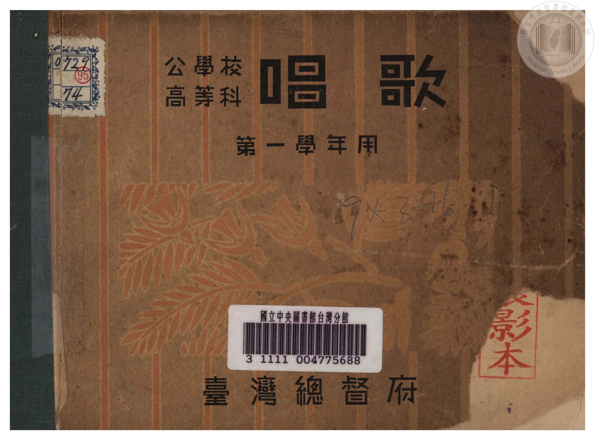
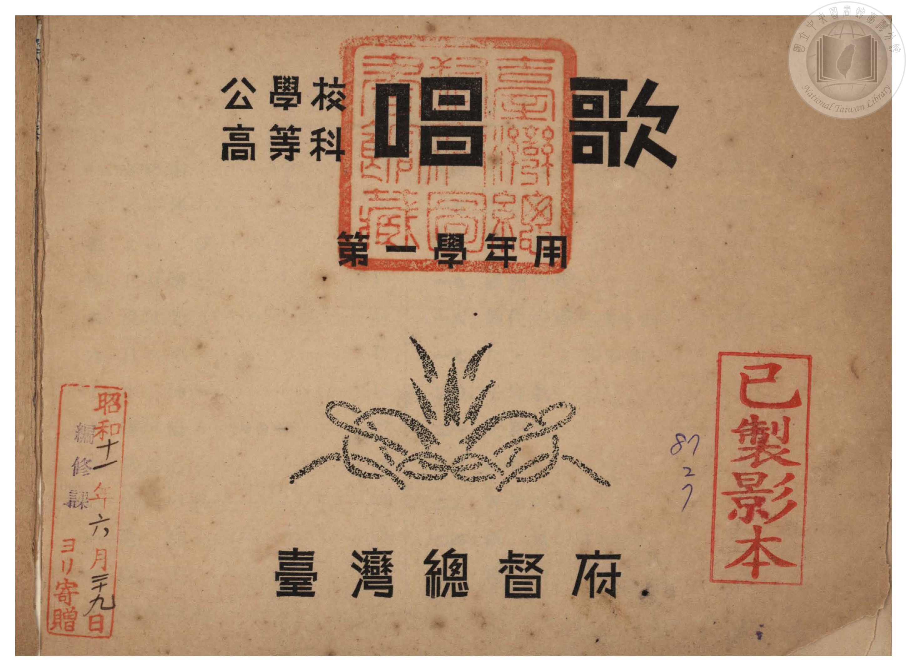
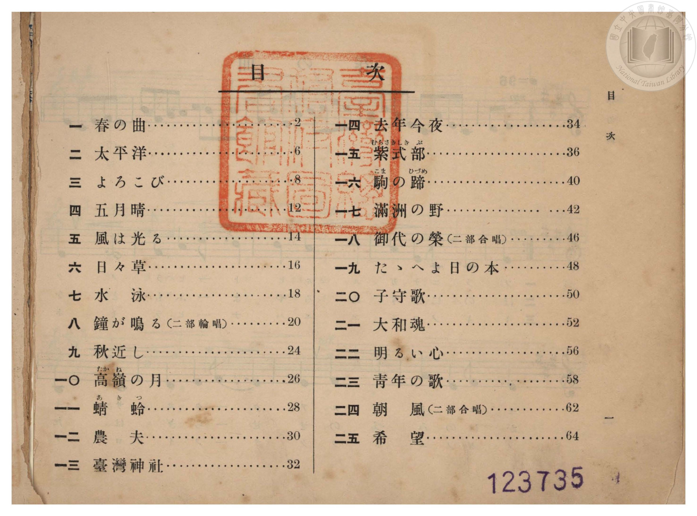

# 書訊與卷首／卷末掃描頁 — 《公學校唱歌》 高等科 第一學年用（國臺圖 0729 74）

本頁收錄本冊之封面、扉頁、目次（もくろく）、樂典大要、版權頁與封底等原書掃描圖檔（共 3 頁）。

### P001.jpg

本冊封面（右頁），題「公學校高等科唱歌　第一學年用　臺灣總督府」，左上貼有舊藏圖書分類籤「0729 74」，下方貼有國立臺灣圖書館條碼籤「3 1111 004775688」，右下蓋有「已製影本」紅印。

### P002.jpg

扉頁，題「公學校高等科唱歌　第一學年用　臺灣總督府」，上方蓋有「臺灣總督府圖書館藏」方形大印，左下蓋有「昭和十一年六月二十九日　編修課ヨリ寄贈」藏書印，右下蓋有「已製影本」紅印。

### P003.jpg

目次頁（原書第 1 頁）：列出「一　春の曲」至「二五　希望」共 25 首曲名與頁碼（含二部輪唱〈八　鐘が鳴る〉及二部合唱〈一八　御代の榮〉、〈二四　朝風〉）。

