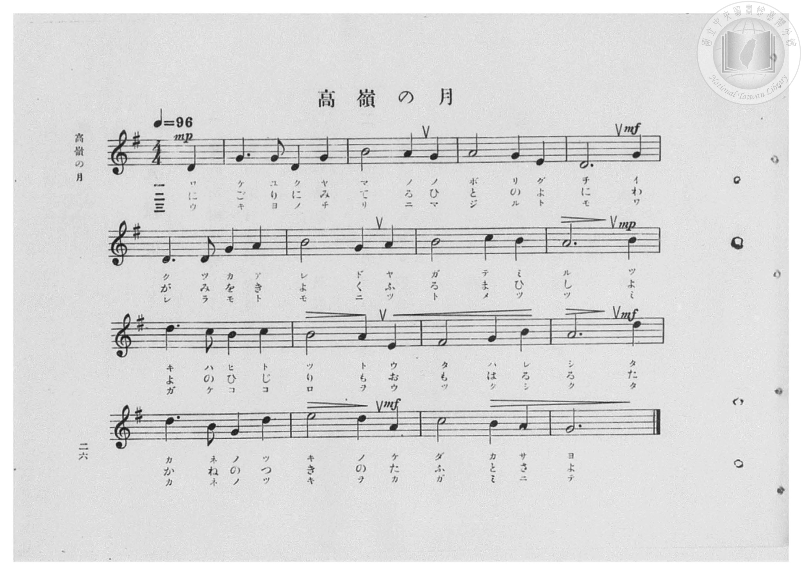
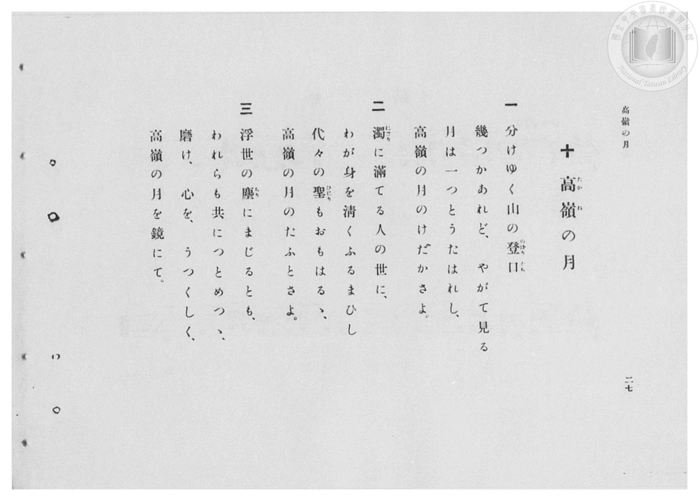

# 高嶺の月

> Re:Shōka 使用 AI 協助辨識與重建樂譜，可能會有錯誤。歡迎回報。

- **鋼琴伴奏版**：<br><audio controls src="takane_no_tsuki.mp3"></audio>
- **NEUTRINO 歌聲合成版**：<br><audio controls src="takane_no_tsuki_neutrino.mp3"></audio>

- 臺灣總督府《公學校高等科唱歌》第一學年用（昭和十一年，索書號 0729 74）

## 說明

原書資訊與歌詞全文（對應 P028.jpg–P029.jpg，原書 pp. 26–27）：
調性與拍號：ト長調（G 大調，1 升記號）4/4 拍（弱起 1 拍），速度 ♩=96
原曲出處：文部省《新訂高等小學唱歌（第一學年用）》（昭和十年／1935 年 3 月發行，第 17 曲）。


## 歌詞

```text
一
分けゆく山の登口（のぼりぐち）
幾つかあれど、やがて見る
月は一つとうたはれし、
高嶺（たかね）の月のけだかさよ。

二
濁（にごり）に滿てる人の世に、
わが身を清くふるまひし
代々の聖（ひじり）もおもはるゝ、
高嶺の月のたふとさよ。

三
浮世の塵（ちり）にまじるとも、
われらも共につとめつゝ、
磨け、心を、うつくしく、
高嶺の月を鏡にて。
```

## ABC

<div class="abc-score" data-abc-src="takane_no_tsuki.abc" aria-label="五線譜載入中"></div>

[下載 ABC 原始檔](takane_no_tsuki.abc)

## TMD 檔案連結

- [主旋律 TMD 檔案](takane_no_tsuki.tmd) [[在 TMD Studio 編輯](https://tmdlang.github.io/Tmd-TS/#tmd=s7IKdvYPcrWy4qpTUCpJTLdSSM7PyUlNLsnMz7PKzk9PzM7Ojy_OyM9OVIKrKMvPKc1NBcqW5McbIoSL80uLklOtipMz8vNz4ktSK0qS8vOz0eXjCxLTU60CDIwsEDIFRfllqXmJeUDdBUWZeSWpKWDtCAWpZZkpqSDp4uTEvPiy1KLMtMzUFCQXpRYVgxwMtaKkKDGvOLkoswDkC4Sq_KKSjPz0osSCjEqrjMzikvyizOTEnPjsxDwkz5VkpAL9lpdYUlqUii6ak5iXAnRBAYZESWZuanx-WnxKYiW6VGpuProrMtMz86xy8_OSSoEBiyFRkphZDvRkflpaZnJmYo4Sl5aWwsvVM55u2_W4cd2zOR0KWlpcirYKlmZc9rYK7lw2JvomdiAzXrTvet64-PmOvc_nLn66a87jhq6nrWuert3xbMFCoPbnazufL5_4dMrGZ2t7Hjd0P1-z5smOBqDs051bnk9Z8X5Px7MZa59O6nna2wgS37nl_Z6e51sWPZu948XM-QoG5kaWCuYm7_d0KnFx6Wsp2FILcCkoKDztmw-yZnP7ixVdLzrage57sXLe09YVz6a1A531dEPvs_ZOBVB60csqSH_UMBnItAQxgS6EaFUoKNBTMDIDShmZA534fs8skLEvVu1_1rAcZGB3L9APQNHHzR0vp24HigONdVd4umQ5mNljqPC0F2j3DLCiTmBoKgB1gGzes_HF1u0KhhAu0Nielw3zn-5apvBo5kpbYOjDnL7pafuuFzOnAi0Auvhl84rncxqBYf9s2oYXK5ogAf90Qz8opMFhDzQYI-w7gRGCHAPg4O83tDQ2VQAyFYwVgLH-fOaeFwuBunuAuhUMzRWA9oI1NnGBHAI0D-yejrbHjRMfNwHJ_qcbNwLTy_OZu5_2LwYaDmQ_btzzuKnrceOEx40LgXrBGnbue9y45HFj9-PGpsdNPY8bVz5uaHzc1PK4Eche9mJZ9-OmbpA6oAMeN64H2gJWveJxI9CG-UARsJ7pQD0gRZBECrYLKAc0ci3IheA0C7Z94uPGBWDxqY-bOuAu39UDtmB_I1jj6seNU4COBGtc_Wz3fqArgE54sguU9p_smAZSALHscVM_0JEvdq1-3DTp2Y5WoIcfN24FKn3cCPTRJqCjwIbvXvy4ASi37kXjNLDxQIkZUOObmh43doFJoC-A_pyL4gskZwP9shXsZxRn7wCH37OtEFete7pwK9iChXDHgx0CtAzoohUgaxDOBoZZE8j-p63AGAKqA4doUyOIAXfF88VACycCOU_3NwN9CIoVUJgDlQL9OR1EYnFt06SX_QvBRi4DuRMoTXkOhQIFLX0urpBEYFGZ6pcfUlyanWkVkJmYl-9Qo2tYUw2ySsHGQssOzMBWQChAEj0wCStoIGcsBW0FEwVg_ni-vkEHnsk1segH2g8yu0bBQEEXjqtzC2oVTOOBrBqgcbpAaAjhgjg1wIwDEtJVMIKLgFgQZboKZhB9YPUwWJ2bVgtRCrbNx7BGASQNw4-b14P1PG7aCFb-uHkZkA0Se9y8BCLTPA9q1OPmPjgJEp8DF18FIps2QMUbkax_3AQ2BWK3EZrdjashOhqnQNV2QcUeN-6HyiyDm9MNFt8EFV8BE29cB5btgIqDdCPs7kfYbYxmdxPIZJC_10L9sALuP5D7Qf4A-QoiB7YbHA4gHTvg4mC3NkPtbl6EbDckXME5C3fy2dUDTj4kphdo_AIpULyCEgAiYWCKmAAxiI1IKpBkAUxnYGF4soBEO8jpLUA22GtNIC-BvLYG7q1OMAlNGk0I8TYwOR-qHiUagOYhJwFgIQcRB0YyMIODWb1Q80BBCZEDRR2wmIKKgyIAIr4PTMKSwXRkeyCJAB7dMFc_bl4JjRzMqIJFLdiFUHmI-EIUcRCN8A_YlwSidkcnWVELtsEEHDOgiEPN8dD8bQ7L36DIxha1wBwPMgg5amGpvB-IwUEODwqY1yAiiHwByoEwPSASFJgg8e0oQQ7Op4iohUYgKFdCIglYYUD1dcH1NIHFQXyQOIgH0QMudcBRjRzlEDlIkMOjFprwQKXW46bNYBaIBPkH4lOQi8H2w_yD8CekdAP7A5HoUf2DN2qfzp5NftQagyMNHDsKZlBbQTxwpEEyLijeIUphWRlSEUAgqJJAjlhITnvc3AsvvqBpFhrlIBGwOLiABwVEA9yzkDwOzWPAAhBhCzihIeVYSGQA2z-wArcRWgKAcy4syuERBc25EHGQucCmBtRVsByGZgs4UonxCyRSoRUHUvkDsheSm0F-AZVGqLbUcnHp2img1PcKQAFlLgA)]
- [鋼琴伴奏 TMD 檔案](takane_no_tsuki_piano.tmd) [[在 TMD Studio 編輯](https://tmdlang.github.io/Tmd-TS/#tmd=s7IKdvYPcrWy4qpTUCpJTLdSSM7PyUlNLsnMz7PKzk9PzM7Ojy_OyM9OVIKrKMvPKc1NBcqW5McbIoSL80uLklOtipMz8vNz4ktSK0qS8vOz0eXjCxLTU60CDIwsEDIFRfllqXmJeUDdBUWZeSWpKWDtCAWpZZkpqSDp4uTEvPiy1KLMtMzUFCQXpRYVgxxckJmYlx-fWFSUmJeempuah2QEkqBVYmZ8YnJyfm5BYl4mqqr8opKM_PSixIKMSquMzOKS_KLM5MSc-OzEPCT_l2QAjbHKSywpLUpFF81JzEsBOrIAQ6IEaFN8flp8SmIlulRqbj4ouJFdkZmemWeVm5-XVAoMewyJksTMcmA45KelZSZnJuYocWlpKbxcPePptl2PG9c9m9Pxfk_Hy-49zydsebJny9Ol_c87gSKdClpaXIq2CpZmXPa2Cu5cNib6JnYgg1-073reuPj5jr3P5y5-umvO44aup61rnq7d8WzBQqCZz9d2Pl8-8emUjc_W9jxu6H6-Zs2THQ1A2ac7tzyfsgJo0bMZa59O6nna2wgS37nl_Z6e51sWPZu948XM-QoG5kaWCuYmQMuVuLg880qK8q0CQDEU5OFQo2tYU82lAAQ2Flp2YEaNgoGCLhxX5xbUKpgCGTVgUlfBWMEQSEJEzMAiEJ4RWMQEKmIMFwGphkGQgTVctSiO8EFxhAmSIyCwBuIEw3iFaMNYGAW0CMgwAfNN4-Ox8BHqgUaArAxJBKaeVL_8kOLS7ExS_R-P5BVDCBfEqQH7EwRBfoWIgFgQZboKZhB9YPUwWJ2bBvQNOCBAtvkY1iiApGH4cfN6sJ7HTRvByh83LwOyQWKPm5dAZJrnQY163NwHJ0Hic-Diq0Bk0waoeCOS9Y-bwKZA7DZCs7txNURH4xSo2i6o2OPG_VCZZXBzusHim6DiK2DijevAsh1QcZBuhN39CLuN0exuApkM8vdaqB9WwP0Hcj_IHyBfQeTAdoPDAaRjB1wc7NZmqN3Ni5DthoQrFzSKoVECpEBRAUmpsLjEFAGlahAbEbuQmAQmDbAwPCYhMQWyrQXIBrumCeQKkGvWwF3SCSahsdmEEG8Dk_Oh6lFCDmgecqw9buyBiAPj5XHTJDCrF2oeyPcQOVBoP27cChUHhRlEfB-YhMXcdGR7IPEGjyGYqx83r4SGJ2bowmID7EKoPER8IYo4iEb4B-xLeGyABU3AgQkKa9R8Bc1F5rBcBIofbLEBzFfgYgkpNmBpqR-IwaEEdz3MNRARROoDpXOYHhAJ8j9IfDtKKIFzAyI2oGEOSvuQcH3cOAOqrwuupwksDuKDxEE8iB5w3gbHDnIsQeQgoQSPDWhaAZUNj5s2g1kgEuQfiE9BLgbbD_MPwp-QMgTsD0Q6RfUPSmzgKufB4Ux8YY-IC0h6ftzcC8_X0JQBjSWQCFgcXPKB3N4Adx8kJ0FTMrBkQNgCThtI-QISfo8b18JKokZoPgPnD1gswcMWmj8g4iBzHzdOhboKlo7RbAHHAzF-gcQDtERFyuUgeyF5BuQXUJ5HtQV7XUVmNQllgOpEIBNU7gEFTOPBKszAFSVcBMSAVE5AYXgxiVCOXq-i8IHVL6r5ENMgLoKZBtUEpIDKUdyG5hS48_E6DneTAFIWENcu0LVTALdGFIAMlHCP9gGqwxQ0wiZoDBZU5gIA)]

## 分析

```text
================================================================================
📊 TMD Song Profile: [ 高嶺の月 ]
================================================================================
⏱  Duration:       0:40 (40.0s), 16 measures total
🎼 Key & Tempo:    首調基準 G, != 96.0 BPM, <4/4>
   - 分析範圍：      由實際發聲的音符與和弦推測調性；播放脈絡另行呈現
🎤 人聲音域:    D4 (MIDI 62) – E5 (MIDI 76) [跨度: 14 個半音 / 1.2 個八度, 難度: moderate]
   - 最低音:  D4 in [TakaneNoTsuki #1 @ m.1, 0:01]
   - 最高音: E5 in [TakaneNoTsuki #1 @ m.15, 0:35]
   - 適合: soprano, mezzo-soprano, contralto, tenor, baritone, bass
🏛  結構:      TakaneNoTsuki (40.0s)
⚡ 編曲密度:        Peak 1 軌道同時演奏
🗝  調性診斷：       G 大調（純淨自然大調，未偵測到可信轉調）
   - 風格氣質:    純淨自然大調（陽光明朗、易唱易記，無明顯調外色彩）
   - 轉調歷程:    全曲維持單一推測調性（未偵測到可信轉調）
   - 核心骨幹音:  A, B, D, G, C
   - 調性數值:    G 大調 [相關度: 0.83, 穩定度: Moderate, 自然音純度: 100.0%]
   - 候選調性 (K-S): G 大調 (0.83), D 大調 (0.76), B 小調 (0.64)
   - 五度圈歷程:   +2
   - 各段落調性細節:
     • [TakaneNoTsuki #1]: D 調性不明確 (r: 0.78, 自然音純度: 92.6%, 調外音: C)

  [ 五度圈游移軌跡 ]
               C  
         F            G  
      Bb              [D ]*
      Eb               A  
         Ab           E  
            Db       B  
               F# 
     (* = active key center)

  [ 十二半音累積音高分佈 ]
     C  : ████████                   7.0%
     C# :                            0.0%
     D  : ██████████████████████    20.3%
     D# :                            0.0%
     E  : ███████                    6.2%
     F  :                            0.0%
     F# : ███                        3.1%
     G  : ██████████████████████    20.3%
     G# :                            0.0%
     A  : ████████████████████████  21.9%
     A# :                            0.0%
     B  : ███████████████████████   21.1%
--------------------------------------------------------------------------------
Assignment 軌道音域：
  - Piano         : D4 – E5 (14 個半音 / 1.2 個八度, 48 個音符)
================================================================================
```


## 原書掃描頁






