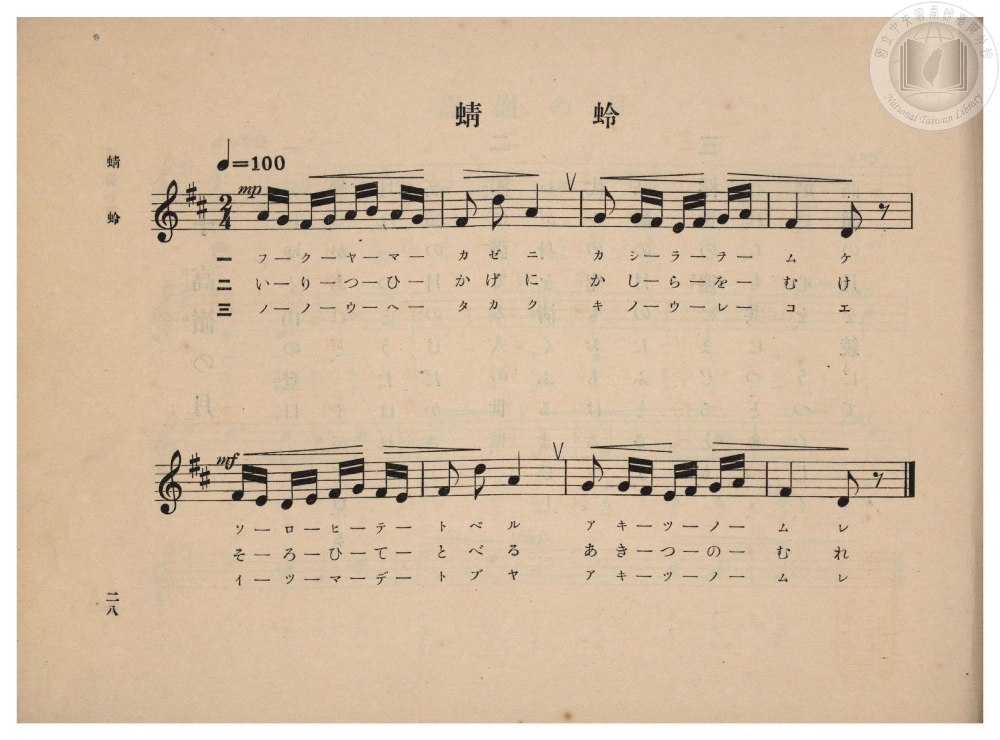
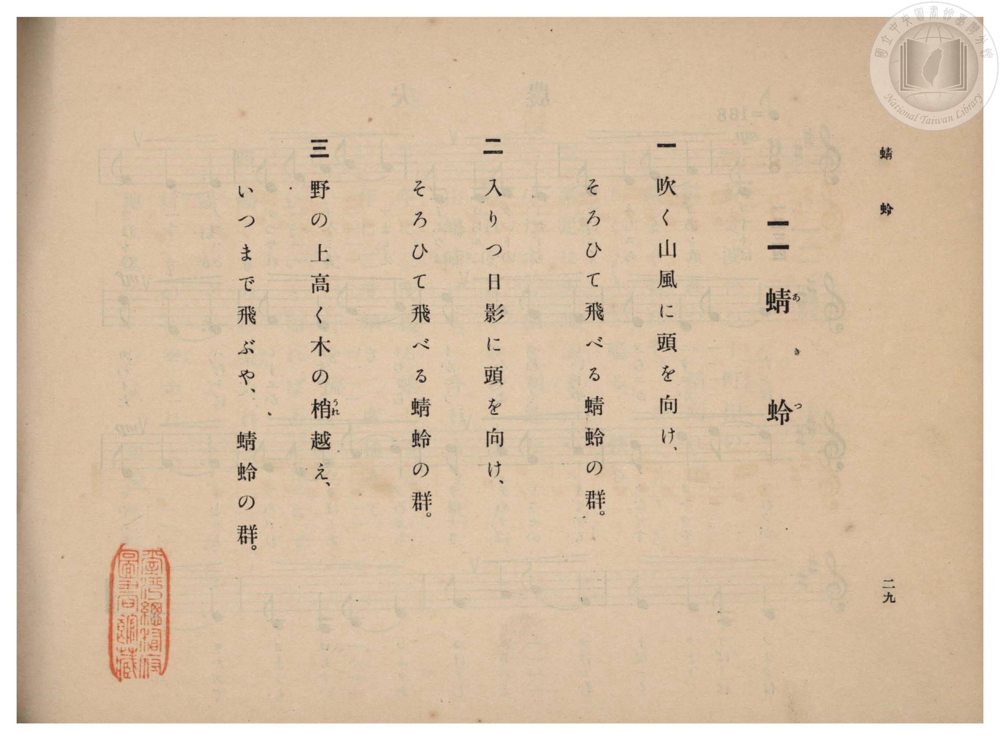

# 蜻蛉

> Re:Shōka 使用 AI 協助辨識與重建樂譜，可能會有錯誤。歡迎回報。

- **鋼琴伴奏版**：<br><audio controls src="akitsu.mp3"></audio>

- 臺灣總督府《公學校高等科唱歌》第一學年用（昭和十一年，索書號 0729 74）

## 說明

原書資訊與歌詞全文（對應 P030.jpg–P031.jpg，原書 pp. 28–29）：
調性與拍號：ニ長調（D 大調，2 升記號）2/4 拍，速度 ♩=100
標題讀音：原書歌詞頁（P031.jpg）標註振假名為「蜻（あき）蛉（つ）」。


## 歌詞

```text
一
吹く山風に頭を向け、
そろひて飛べる蜻蛉の群。

二
入りつ日影に頭を向け、
そろひて飛べる蜻蛉の群。

三
野の上高く木の梢（うれ）越え、
いつまで飛ぶや、蜻蛉の群。
```

## ABC

<div class="abc-score" data-abc-src="akitsu.abc" aria-label="五線譜載入中"></div>

[下載 ABC 原始檔](akitsu.abc)

## TMD 檔案連結

- [主旋律 TMD 檔案](akitsu.tmd) [[在 TMD Studio 編輯](https://tmdlang.github.io/Tmd-TS/#tmd=s7IKdvYPcrWy4qpTUCpJTLdSSM7PyUlNLsnMz7PKzk9PzM7Ojy_OyM9OVIKrKMvPKc1NBcqW5McbIoSL80uLklOtipMz8vNz4ktSK0qS8vOz0eXjCxLTU60CDIwNEDIFRfllqXmJeUDdBUWZeSWpKWDtCAWpZZkpqSDp4uTEvPiy1KLMtMzUFCQXpRYVgxwMtaKkKDGvOLkoswDkC4Sq_KKSjPz0osSCjEqrjMzikvyizOTEnPjsxDwkz5VkpAL9lpiXmZuYgy6al1hSWpSKLlqcmlicn1eMbE9memaeVUliZjnQtflpaZnJmSDDtLQUXszZ_WJ2p4KWFpeirYKhgQGXva2CC5eNkb6JHUj7i_ZdzxsXP9-x9_ncxU93zXnc0PW0dc3TtTueLVj4cvWM52s7ny-f-HTKxmdrex43dD9fs-bJjgag7NOdW55PWfF-T8ezGWufTup52tsIEt-55f2enudbFj2bvePFzPkKBuZGlgrmJu_3dCpxcelrKdhSC3ApKCg87ZsPsmZz-4sVXS862oHue7Fy3tPWFc-mtQOd9XRD77P2TgVQnOtlFaQ_apgMZBqCmEAXQrQqFBToKRhZAKWMLIFOfL9nFsjYF6v2P2tYDjKwuxfoB6Do4-bul1O3A8WBxrooPF2yHMzsMVJ42gu0ewZYUScwNBWAOoDiLxvmP921TOHRzJW2oMAGGvlsxcyXC3terGt4OX8z0DyI7RD3vlzQCDQV4bROoNoXK3Y_61n_tLH96YTe5027Hjf0AGMQqOpxY9PjRqANncDYBHOXANmPG3ofNzRxgawBRgA4XCbsfNzY_3TjxpeLVjxuXP1ywdrHTZOeTpj4uHHi44ZGkIrHjXMfN_U-btz0uHHZy8WzHzfufNzUDUkljxvXPd-3BG7irh6wia1LHzd1Ae17Nn3p070bKTV0RyeIetneBxR_sqMLmMiA7n02B-jYdc8WLQL7rO1xUw_Io9uAtnbALWgBOuFx477HjcvBFmx73NQClEO3A6iU8gQGBQpa-lxcjtmZJcWlVgGZiXn5DjUGNdUgKxRsDM207MAsbAlbAZJRXizsUdAwUXi6of_5-gYdeGrUxKIBaBPIsBqF6tyCWgVTBRMFYyA2VTADs2uAPF0FwzggYQrEIFgDFNYFKzOCKoUoAkFDIDYAqQGb6WNYo_C4eSoQ71F43LQeQjcvgdLzwDRQRdNqoI7HTXtAZHM33BaY-Hao-pVQehNMX_MCqNrHTRuBZDzCXiOgbGML1N4uCN0ItbcRrr8RZNfjxklgEmQX1F6o-HSo_k4oPQnu3gaYvY0TUe01BrmqD-pOKN20DMqfAde_H-xmiO_WI_l3LTgE0PWtgevbDPfvCri9-FPCrh7yUkIaLVJC016oj9ZCaUiIPm5ug8doBzgEZoJJpBhpWgT2NUwfNGahIYWSEoChhZkS5kJDtBclBQDLC3hKAIUnsOQA24KUAhubwOIwfbAUtA4zJTT1YKaEJlhKh7kXkuIfN7ej-XcamFxCoX9rubh07RQghYYCkKXMBQA)]
- [鋼琴伴奏 TMD 檔案](akitsu_piano.tmd) [[在 TMD Studio 編輯](https://tmdlang.github.io/Tmd-TS/#tmd=s7IKdvYPcrWy4qpTUCpJTLdSSM7PyUlNLsnMz7PKzk9PzM7Ojy_OyM9OVIKrKMvPKc1NBcqW5McbIoSL80uLklOtipMz8vNz4ktSK0qS8vOz0eXjCxLTU60CDIwNEDIFRfllqXmJeUDdBUWZeSWpKWDtCAWpZZkpqSDp4uTEvPiy1KLMtMzUFCQXpRYVgxxckJmYlx-fWFSUmJeempuah2QEkqBVYmZ8YnJyfm5BYl4mqqr8opKM_PSixIKMSquMzOKS_KLM5MSc-OzEPCT_l2QAjbEC6U3MQRfNSywpLUpFFy1OTSzOzytGticzPTPPqiQxsxzoofy0tMzkTJBhWloKL-bsfjG78_2ejpfde55P2PJkz5anS_ufd3a839OpoKXFpWirYGhgwGVvq-DCZWOkb2IHMvNF-67njYuf79j7fO7ip7vmPG7oetq65unaHc8WLHy5esbztZ3Pl098OmXjs7U9jxu6n69Z82RHA1D26c4tz6esANr0bMbap5N6nvY2gsR3bnm_p-f5lkXPZu94MXO-goG5kaWCuQnQdiUuLs-8kqJ8qwBQKAd5ONQY1FRzKQCBjaGZlh2YVaNQnVtQq2CqYKJgDMSmCmZgdg2Qp6tgGAckTIEYBGuAwrpgZUZQpRBFIGgIxAYgNVy1KHb6INtpgWqlYbyCaXw8jKoBMaINY2FUDVjUCCIZbRoPEkGoMIDY5JidWVJcSk_vgcz0MaxReNw8FYj3KDxuWg-hm5dA6XlgGqiiaTVQx-OmPSCyuRtuC0x8O1T9Sii9CaaveQFU7eOmjUAyHmGvEVC2sQVqbxeEboTa2wjX3wiy63HjJDAJsgtqL1R8OlR_J5SeBHdvA8zexomo9hqDXNUHdSeUbloG5c-A698PdjPEd-uR_LsWHALo-tbA9W2G-3cF3F545KXRIvKa9kIdsRZKQwLhcXMbPBI6wI6eCSaRArFpEdihMH3QyIB6DiXygB7EjLy50EDoRYm0x42QQAGpAAXB48adYFuQEk1jE1gcpg8W6eswI6-pBzPymmCJE-ZeSCJ93NyO5t9pYHIJhf5Fy5m0LASQkgkVyhNdOwVw4aUAZEB8EO0DVIDEM0LhGYN5ylwA)]

## 分析

```text
================================================================================
📊 TMD Song Profile: [ 蜻蛉 ]
================================================================================
⏱  Duration:       0:09 (9.6s), 8 measures total
🎼 Key & Tempo:    首調基準 D, != 100.0 BPM, <2/4>
   - 分析範圍：      由實際發聲的音符與和弦推測調性；播放脈絡另行呈現
🎤 人聲音域:    D4 (MIDI 62) – D5 (MIDI 74) [跨度: 12 個半音 / 1.0 個八度, 難度: easy]
   - 最低音:  D4 in [Akitsu #1 @ m.4, 0:04]
   - 最高音: D5 in [Akitsu #1 @ m.2, 0:01]
   - 適合: soprano, mezzo-soprano, contralto, tenor, baritone, bass
🏛  結構:      Akitsu (9.6s)
⚡ 編曲密度:        Peak 1 軌道同時演奏
🗝  調性診斷：       D 大調（純淨自然大調，未偵測到可信轉調）
   - 風格氣質:    純淨自然大調（陽光明朗、易唱易記，無明顯調外色彩）
   - 轉調歷程:    全曲維持單一推測調性（未偵測到可信轉調）
   - 核心骨幹音:  F#, A, G, D, E
   - 調性數值:    D 大調 [相關度: 0.73, 穩定度: Moderate, 自然音純度: 100.0%]
   - 候選調性 (K-S): D 大調 (0.73), F# 小調 (0.65), G 大調 (0.44)
   - 五度圈歷程:   +2
   - 各段落調性細節:
     • [Akitsu #1]: D 大調 (r: 0.73, 自然音純度: 100.0%)

  [ 五度圈游移軌跡 ]
               C  
         F            G  
      Bb              [D ]*
      Eb               A  
         Ab           E  
            Db       B  
               F# 
     (* = active key center)

  [ 十二半音累積音高分佈 ]
     C  :                            0.0%
     C# :                            0.0%
     D  : ███████████               13.3%
     D# :                            0.0%
     E  : ███                        3.3%
     F  :                            0.0%
     F# : ████████████████████████  30.0%
     G  : ███████████████████       23.3%
     G# :                            0.0%
     A  : █████████████████████     26.7%
     A# :                            0.0%
     B  : ███                        3.3%
--------------------------------------------------------------------------------
Assignment 軌道音域：
  - Piano         : D4 – D5 (12 個半音 / 1.0 個八度, 40 個音符)
================================================================================
```


## 原書掃描頁






