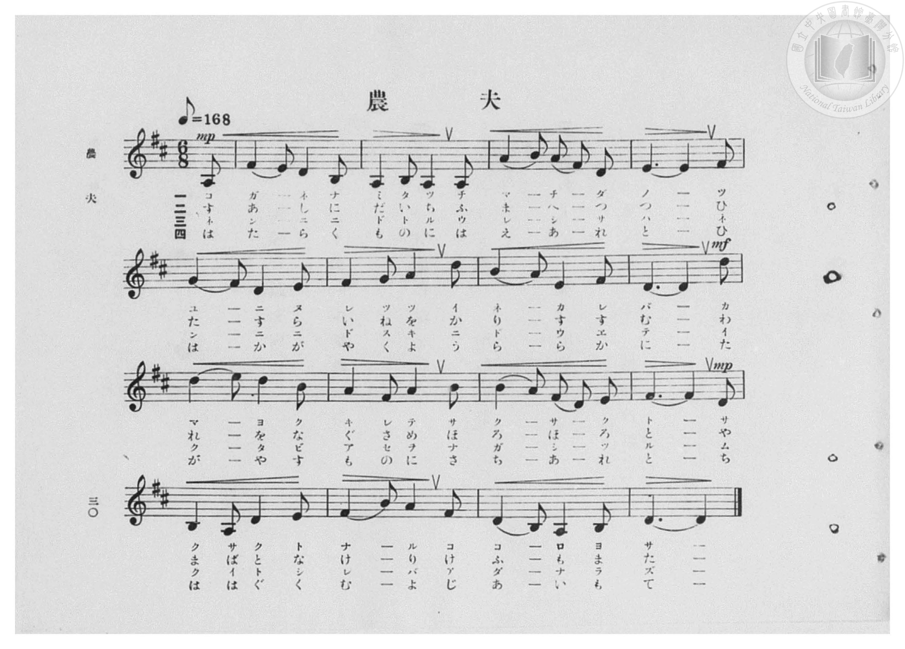
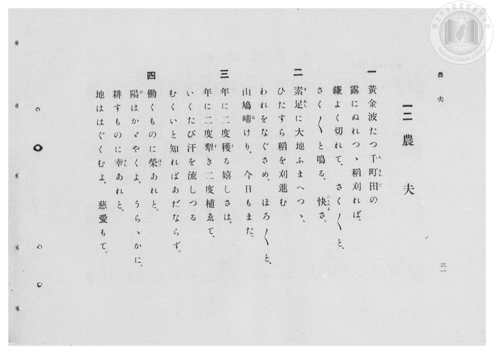

# 農夫

> Re:Shōka 使用 AI 協助辨識與重建樂譜，可能會有錯誤。歡迎回報。

- **鋼琴伴奏版**：<br><audio controls src="nofu.mp3"></audio>
- **NEUTRINO 歌聲合成版**：<br><audio controls src="nofu_neutrino.mp3"></audio>

- 臺灣總督府《公學校高等科唱歌》第一學年用（昭和十一年，索書號 0729 74）

## 說明

原書資訊與歌詞全文（對應 P032.jpg–P033.jpg，原書 pp. 30–31，第 12 首）：
調性與拍號：ニ長調（D 大調，2 升記號）6/8 拍（弱起 1 拍），速度 ♪=168（♩=84）
教材背景：臺灣公學校高等科鄉土農業教材，第三節特別歌詠臺灣一年兩熟之雙期稻作
（「年に二度穫る嬉しさは、年に二度犁き二度植ゑて」），第二節並描繪赤足踩踏大地收割稻穀時
山鳩（やまばと）「ほろ〳〵と」啼鳴相伴之農村景致。


## 歌詞

```text
一
黄金波たつ千町田（ちまちだ）の
露にぬれつゝ、稻刈れば、
鎌よく切れて、さく〳〵と、
さく〳〵と鳴る、快（こころよ）さ。

二
素足（すあし）に大地ふまへつゝ、
ひたすら稻を刈進む
われをなぐさめ、ほろ〳〵と、
山鳩啼（な）けり、今日もまた。

三
年に二度穫（と）る嬉しさは、
年に二度犁（す）き二度植ゑて、
いくたび汗を流しつる
むくいと知ればあだならず。

四
働くものに榮（はえ）あれと、
陽（ひ）はかゞやくよ、うらゝかに。
耕すものに幸（さち）あれと、
地ははぐくむよ、慈愛もて。
```

## ABC

<div class="abc-score" data-abc-src="nofu.abc" aria-label="五線譜載入中"></div>

[下載 ABC 原始檔](nofu.abc)

## TMD 檔案連結

- [主旋律 TMD 檔案](nofu.tmd) [[在 TMD Studio 編輯](https://tmdlang.github.io/Tmd-TS/#tmd=s7IKdvYPcrWy4qpTUCpJTLdSSM7PyUlNLsnMz7PKzk9PzM7Ojy_OyM9OVIKrKMvPKc1NBcqW5McbIoSL80uLklOtipMz8vNz4ktSK0qS8vOz0eXjCxLTU60CDIyNcMoYI2QKivLLUvMS84DmFhRl5pWkpoANRihILctMSQVJFycn5sWXpRZlpmWmpiC5NbWoGOQVqBUlRYl5xclFmQUg_yFU5ReVZOSnFyUWZFRaZWQWl-QXZSYn5sRnJ-YhebskIxXo67zEktKiVHTR_OTk0oJEVEMhMsWpicX5ecXowgU5iclIpgAtTM_MsypJzCwHeiM_LS0zOTMxR4lLS0vhxb5NT5esVtDS4lK0VbAw4bK3VXDhsjHTt7AD6X7Rvut54-LnO_Y-n7v46a45jxu6nrauebp2x7MFC1-unvF8befz5ROfTtn4bG3P44bu52vWPNnRAJR9unPL8ykr3u_peDZj7dNJPU97G0HiO7e839PzfMuiZ7N3vJg5X8HA3MhSwdzk_Z5OJS4ufS0FW2oBLgUFhad980HWbG5_saLrRUc70H0vVs572rri2bR2oLOebuh91t6pAEolelkF6Y8aJoOSBYgJdCFEq0JBgZ6CsQFQytgQ5Ow1axQMjRReLpsGdO_7PbNAdrxYtf9Zw3KQ6d29QA8BRR83d7-cuh0oDrTDReHpkuVgZo-RwtNeoENmgBV1AoNWAagD5Iw9G19s3a5gCOECje152TD_6a5lCo9mrrI1NLMAKnk0c6WtBSiMQBY-mzrz2dwJL5p7ns1cD7QNEjeY8fGypfPpnPnAeH22dC1EC8QDT3Z0Pl_f8Lxz59OOpeAAWQAxARI3T1tXPm-b_2Rn98vZM5_Nmf98xe4ne-eAbAW64nFDD1DF48bVT3b1AN33fOXqx03dT9d0Pm6c_rhx6uPG9Y8bGlEUdDU-buyFsJ8t6X3cNPFx47LHDVBPgpyyqwfolCc7lj3r73--c9WLrUtebNv8YsfKFzv6gaH2dM6GZ1O2Pe3cBHTE85UNz2Y2gaN048aXm1eCXNPU8rhx3-PGDY8bgWmsE-i4x427Hzf1Pm7Y_LhhK1AQaNPTqXtebt7yfPaOJ3u2AP0ECoy5E4HB9qJ9y-OGJi6QeUBvg6iXu1tetk98tnnR48b5jxuXPO1tfj5l1_MpG0AWNS4EWwQkF4AsalwH1jBnE9CjjxvXPG4CWrzkcdNcoO-BLn3aAXQZUGQDkAtW19fzuAloRv_TjnawBDAEgMECDK5-JJeClaKJAl0ODF9QmO5fDXbGZBACerCpA-yMqXAv7OoBUc-3LAAGH1jlzMeNTcBYAStbDQnKx41AM4G-2AF3LMRKoC-AHp75uKkT6PjHTZOA7n_ZsOlxEzhUHjf1g9zcNOlx46rHjRNAdjY1gt2PFtJgwyBRAwxzsBtWgW2f-LipCyj9ZHfXs-lLHzcBXQV0w3xE4INTNFqqAmsHxylG8sJQ3dUI8TDYMsy0BvUkMKX0g_25-dnG6UDvPNsK9ALQVGBIdEP82QBWAVS34vl8oDvBEQgKwwUgnzcBzZ4Fc_PT2bPBVHMvSAvIR-uAznm2bB3YIesfN0JipwlsCCxoXs7cC5beBJYDKup-3DQPnIKBRgAzFtA5bSBrgBEDlAKmK6BloLKlAehvYNxALXm6cwfYFKDgQiyWgGMZaDYQAaMKaHADxOxnrR3PWmaDTQEGCdhgyotXKFDQ0ufi8stPK7UKyEzMy3eo0TWsqQbZoGBjoWUHZmAr1BUglcSLhT0KGtDyT1vBROHphn5ggaADL5I1segEWggytUbBAA6rcwtqFUzjgWLGCroKRsCiVFfBDMQFioFZYBqswBQkACSNgYpqgEp1odBYoQZsrI9hjUI8HD5u2gxU9bhpDVDF4-Y9QNwLZnWBRJvng9hN-4GsFrBoI1h0HlxtI5RuAIv3we0CqYfaZoRiW-NMkMrGJpgJjdNBrMbVYNEFYHYLEC8Es7aCRffB1e6A0kvA4ksQtjVugtlmjGIb0C8gd22Gu7cbzOoGi3aC2R1AvBrsy2VgUXg4NG2H0mBXNPcj-Q1oKsQ2E1S_rQe7CxxmYJ1gGxr7weEL9nHjOrBfQSyI2g6435qgenrA4ivQ_IY_le3qAacyEhOXCThNgBKSETRZmYDTjmEckGsGSk3gxANMNmBFEFidm1YLVgFPSo-bl6EFL9gL0IAERiYk6TSBIw2auEAeBQcDUBVIdALCu0BxRMJBCkxgwgHJdoKDB2xi41ogfxKYBY7Qpi5UtZCk1tSAZDYwKuDJBG-yaNoJxGsxEgvI3WDfNq0Ai7YhmQ30HzxRgKIX5haw2Y3gMGmCuLsfyAJHfGMbWBRhNiTBgG0EJxNYEphPMAns6CQnCQAjEhj7cRDaDFp2GENLEFgiAKURWAqBJQJgYQQsXJDSAKJIACXdx03g5A0NwTXQkIJmJaAczL9boTRYNTArIkITqBKRCoCZAqYDEt-rwCEESjXAmgIo2ghm7QabDk9hQD5ED7gQQM5SwHhASgdI7tkPZk0Gm7MIrBJkxiawKLhARBSTsOIBVNBBixBY8bAAJSUg3A6JfUiqRC8OpoLdCC72CBQHCwmlBWDtTU5aANYh4AoEuUAAVSOIEgBWy4DrHUSRYICcECCBCYpYaLB2gIMHnjWhZS2kzkFkQEhCAWcqoF6YyUB7kIoCcD3QuAEaHLBEMBEevGA7gHyQKMgMiCgkoPfBS2Y0kxEJAJiBIUkQFLWIAgzkOnBCAyYIkCioOIGIQvy0EuzmXZgmI4oBIAlLrJC6AG4GtBiYgVYnQgrMJrAoqLhBmFzLxaVrpwBqjET7GMYqANnKXAA)]
- [鋼琴伴奏 TMD 檔案](nofu_piano.tmd) [[在 TMD Studio 編輯](https://tmdlang.github.io/Tmd-TS/#tmd=s7IKdvYPcrWy4qpTUCpJTLdSSM7PyUlNLsnMz7PKzk9PzM7Ojy_OyM9OVIKrKMvPKc1NBcqW5McbIoSL80uLklOtipMz8vNz4ktSK0qS8vOz0eXjCxLTU60CDIyNcMoYI2QKivLLUvMS84DmFhRl5pWkpoANRihILctMSQVJFycn5sWXpRZlpmWmpiC5NbWoGOSVgszEvPz4xKKixLz01NzUPCQjkAStEjPjE5OT83MLEvMyUVXlF5Vk5KcXJRZkVFplZBaX5BdlJifmxGcn5iGFTEkG0BirvMSS0qJUdNH85OTSgkRQuKLLFKcmFufnFaMLF-QkJiOZArQwPTPPqiQxsxzo0_y0tMzkzMQcJS4tLYUX-zY9XbL6_Z6Ol917nk_Y8mTPlqdL-593drzf06mgpcWlaKtgYcJlb6vgwmVjpm9hBzLyRfuu542Ln-_Y-3zu4qe75jxu6Hrauubp2h3PFix8uXrG87Wdz5dPfDpl47O1PY8bup-vWfNkRwNQ9unOLc-nrABa9GzG2qeTep72NoLEd255v6fn-ZZFz2bveDFzvoKBuZGlgrkJ0HIlLi6__LRSqwBQ4Ad5ONToGtZUcykAgY2Flh2Yoa-lYIsOFCD2vVjYo6DxdM_GF1u3K2grmCg83dD_fH2DjgIo7ehlFaRrYtGppQ82tUbBAA6rcwtqFUzjgWLGCroKRgqGQNIMxAWKgVlgGqzAFCQAJI2BimqASnWh0FihBmysj2GNQjwcPm7aDFT1uGkNUMXj5j1A3AtmdYFEm-eD2E37gawWsGgjWHQeXG0jlG4Ai_fB7QKph9pmhGJb40yQysYmmAmN00GsxtVg0QVgdgsQLwSztoJF98HV7oDSS8DiSxC2NW6C2WaMYhvQLyB3bYa7txvM6gaLdoLZHUC8GuzLZWBReDg0bYfSYFc09yP5DWgqxDYTVL-tB7sLHGZgnWAbGvvB4Qv2ceM6sF9BLIjaDrjfmqB6esDiK9D8hj-V7eoBpzISE5cJOE2AEpIRNFmZgNOOYRyQawZKTeDEA0w2YEUQWJ2bVgtWAU9Kj5uXoQUv2AvQgARGJiTpNIEjDZq4QB4FBwNQFUh0AsK7QHFEwkEKTGDCAcl2goMHbGLjWiB_EpgFjtCmLlS1kKTW1IBkNjAq4MkEb7Jo2gnEazESC8jdYN82rQCLtiGZDfQfPFGAohfmFrDZjeAwaYK4ux_IAkd8YxtYFGE2JMGAbQQnE1gSmE8wCezoJCcJACMSGPtxENoMWnYYQ0sQWCIApRFYCoElAmBhBCxckNIAokgAJd3HTeDkDQ3BNdCQgmYloBzMv1uhNFg1MCsiQhOoEpEKgJkCpgMS36vAIQRKNY8bpwJFG8Gs3WDT4SkMyIfoARcCyFkKGA9I6QDJPfvBrMlgcxaBVYLM2AQWBReIiGISVjyACjpoEQIrHhagpASE2yGxD0mV6MXBVLAbwcUegeJgIaG08HT2bHLSArAOAVcgyAUCqBpBlACwWgZc7yCKBAPkhAAJTFDEQoO1Axw88KwJLWshdQ4iA0ISCjhTAfXCTAbag1QUgOuBxg3Q4IAlgonw4AXbAeSDREFmQEQhAb0PXjKjmYxIAMAMDEmCoKhFFGAg14ETGjBBgERBxQlEFOKnlWA378I0GVEMAElYYoXUBXAzoMXADLQ6EVJgNoFFQcUNwuRa5LaID662CKLlgaUlAYwuBUNwTBrCaVAzIl7BCMxDsAirA5sGT42IqghuLUI5wghUQ0HOAaoApikjXFZj2gIp7RDFGFStCVA_kG2C6XSQLQhZrG7BsAWajxD1JX79GLbg8A0kwwAjUtdOARSX0T6GsQpwthES2xiJbQJmK3MBAA)]

## 分析

```text
================================================================================
📊 TMD Song Profile: [ 農夫 ]
================================================================================
⏱  Duration:       0:34 (34.3s), 16 measures total
🎼 Key & Tempo:    首調基準 D, != 84.0 BPM, <6/8>
   - 分析範圍：      由實際發聲的音符與和弦推測調性；播放脈絡另行呈現
🎤 人聲音域:    A3 (MIDI 57) – E5 (MIDI 76) [跨度: 19 個半音 / 1.6 個八度, 難度: challenging]
   - 最低音:  A3 in [Nofu[L1] #1 @ m.1, 0:01]
   - 最高音: E5 in [Nofu[L1] #1 @ m.10, 0:20]
   - 適合: soprano, mezzo-soprano, contralto, tenor, baritone, bass
🏛  結構:      Nofu[L1] (34.3s)
⚡ 編曲密度:        Peak 1 軌道同時演奏
🗝  調性診斷：       D 大調（純淨自然大調，未偵測到可信轉調）
   - 風格氣質:    純淨自然大調（陽光明朗、易唱易記，無明顯調外色彩）
   - 轉調歷程:    全曲維持單一推測調性（未偵測到可信轉調）
   - 核心骨幹音:  D, A, F#, B, E
   - 調性數值:    D 大調 [相關度: 0.93, 穩定度: High, 自然音純度: 100.0%]
   - 候選調性 (K-S): D 大調 (0.93), B 小調 (0.68), A 大調 (0.68)
   - 五度圈歷程:   +2
   - 各段落調性細節:
     • [Nofu[L1] #1]: D 大調 (r: 0.90, 自然音純度: 100.0%)

  [ 五度圈游移軌跡 ]
               C  
         F            G  
      Bb              [D ]*
      Eb               A  
         Ab           E  
            Db       B  
               F# 
     (* = active key center)

  [ 十二半音累積音高分佈 ]
     C  :                            0.0%
     C# :                            0.0%
     D  : ████████████████████████  28.1%
     D# :                            0.0%
     E  : ███████████               12.5%
     F  :                            0.0%
     F# : ████████████████          18.7%
     G  : ███                        3.1%
     G# :                            0.0%
     A  : ████████████████████      22.9%
     A# :                            0.0%
     B  : ████████████              14.6%
--------------------------------------------------------------------------------
Assignment 軌道音域：
  - Piano         : A3 – E5 (19 個半音 / 1.6 個八度, 58 個音符)
================================================================================
```


## 原書掃描頁






