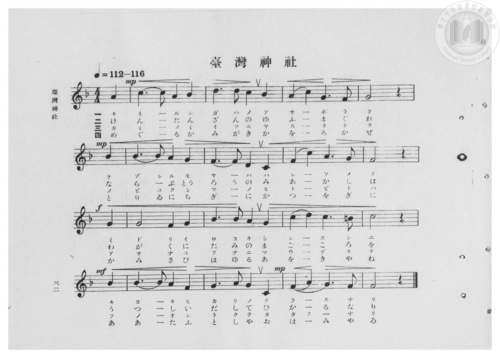
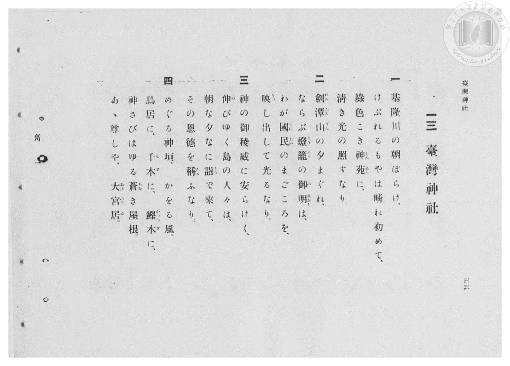

# 臺灣神社

> Re:Shōka 使用 AI 協助辨識與重建樂譜，可能會有錯誤。歡迎回報。

- **鋼琴伴奏版**：<br><audio controls src="taiwan_jinja.mp3"></audio>
- **NEUTRINO 歌聲合成版**：<br><audio controls src="taiwan_jinja_neutrino.mp3"></audio>

- 臺灣總督府《公學校高等科唱歌》第一學年用（昭和十一年，索書號 0729 74）

## 說明

原書資訊與歌詞全文（對應 P034.jpg–P035.jpg，原書 pp. 32–33，第 13 首）：
調性與拍號：ヘ長調（F 大調，1 降記號）4/4 拍（弱起 1 拍），速度 ♩=112–116
教材背景：臺灣總督府殖民地官社題材唱歌，歌詠位於臺北圓山劍潭山畔、俯瞰基隆河（基隆川）之臺灣神社。
註：第一段第三句「神苑」於 P035.jpg 歌詞頁振假名作「しんゑん」，P034.jpg 樂譜下片假名印作「シンーエン」。


## 歌詞

```text
一
基隆川（きいるんがは）の朝ぼらけ、
けぶれるもやは晴れ初めて、
綠色（みどりいろ）こき神苑（しんゑん）に、
清き光の照らすなり

二
劍潭山（けんたんざん）の夕まぐれ、
ならぶ燈籠（とうろう）の御明（みあかし）は、
わが國民（くにたみ）のまごころを、
映（うつ）し出して光るなり。

三
神の御稜威（みいつ）に安らけく、
伸びゆく島の人々は、
朝な夕なに詣（まう）で來て、
その恩德を稱（たた）ふなり。

四
めぐる神垣（かみがき）、かをる風。
鳥居に、千木（ちぎ）に、鰹木（かつをぎ）に、
神さびはゆる蒼（あを）き屋根。
あゝ、尊しや、大宮居（おほみやゐ）。
```

## ABC

<div class="abc-score" data-abc-src="taiwan_jinja.abc" aria-label="五線譜載入中"></div>

[下載 ABC 原始檔](taiwan_jinja.abc)

## TMD 檔案連結

- [主旋律 TMD 檔案](taiwan_jinja.tmd) [[在 TMD Studio 編輯](https://tmdlang.github.io/Tmd-TS/#tmd=s7IKdvYPcrWy4qpTUCpJTLdSSM7PyUlNLsnMz7PKzk9PzM7Ojy_OyM9OVIKrKMvPKc1NBcqW5McbIoSL80uLklOtipMz8vNz4ktSK0qS8vOz0eXjCxLTU60CDIxNcMqYImQKivLLUvMS84DmFhRl5pWkpoANRihILctMSQVJFycn5sWXpRZlpmWmpiC5NbWoGOQVqBUlRYl5xclFmQUg_yFU5ReVZOSnFyUWZFRaZWQWl-QXZSYn5sRnJ-YhebskIxXo66LUnMx0FM0Q8YKcxORUdMHM3AKgixJzkG0C6s6zKknMLAe6Nz8tLTMZLK-lpfCifdfzxsXPl857vmSfgpYWl6KtgqGhEZe9rYIbl42JvokdyBCooh17n89d_HTXnMcNXU9b1zxdu-PZgoUvV894vrbz-fKJT6dsfLa253FD9_M1a57saADKPt255fmUFe_3dDybsfbppJ6nvY0g8Z1b3u_peb5l0bPZO17MnK9gYG5kqWBu8n5PpxIXl76Wgi21AJeCgsLTvvkgaza3v1jR9aKjHei-FyvnPW1d8WxaO9BZTzf0PmvvVAClCr2sgvRHDZNByQDEBLoQolWhoEBPwdgIKGVsDHL2mjUKhsYKL5dNA7r3_Z5ZIDterNr_rGE5yPTuXqCHgKKPm2e8nLodKA60w03h6ZLlYGaPocLLmb0vVswAK-oEBq0CUAfIGXs2vti6XcEQwgUa2_OyYf7TXcsUHs1caQuMC6DlhoZmIKueTZ35bO6EF809z2auB9qDFivP1k17tmHi0zkbnq6bAYzMlwt7gIohsQI0E-z3BU_29j6btgeo8WnP9KdzJj_duPFpV--zvWuBjOdTpzxuaHyyf_3zeRuezt_1clbbs02bQc4Ds59unwt025Od3cjp5XFDEzgEVuwGugYS7c_WbQUzOp_2L33c0ANU96J74uMGkK2ggAaHrgIkHl4uaHzWs_5pY_vTCb1P9gITVc_jxumPmyY_bpoIIhuAgdEDixuFZyuaXqyd82RH9_POdoiWp70boLqatj9u3vy4ec_jphUgRkMvyF0ghwHdA04FCB90PG7sfdzY8ripG2RFI9BGYEB2Pm5c92zO3MeNQBOAbKBzG0HaQKzGbY-bgBYAVTc9bmoBqn42cwtQ5GnH3MdNjY8bl0GVPt-24EXnJrDx-x83rnzc1AW2BBSdjxuB9vRCwgGsAOFFsOxqqBHPdrQC1T1tBTnmeetysEtmPm5cBTQL4pddPWC_wKILbBY4oBrng8lpMBPXPV0y9XHjvseNE0Buh_kFaBBQbtvz9o7nGxeANa943NgGdCOQhGrbt_DZjD6YJ5oeN3YDHQuWWg8zpakfGGZP53QD0xlYHZC7GmR_IzB9g4wAWzsF5GWguU2TYF6bAbGw7XHjErC66U_bd4EConEZyL_A0AV7ExFrneAwXToP4qjnK-Y8XdEIcxcwEiCGrH66DqgXHF9Ad0BserJnx-PGzY-bgDb1P928Daj_ya5djxuAIQvzAjieV4FDaBXQjBcrF4MNBjobEgrLn-wDaobF6-NGoOp1zxpXPt23Heif5ysgwQ70MCgLP27ciuryp7NnQ4IJmDSAgd8N9MLTeRALgH4EOh6Y3sBpogGoAJimJgHVvFy0ApqNXm5e-nQj0KmgFPG0t_nZHFDR-bhx4eNGYKRAU8rLDTth4kATl4CMQJKFBxvQd5tBfgYGRFP3i0l7wBqAKXgSWGnv043dzxbshFoLlpgLsnMDMNUCU2cLiL1k-dN164DOAesEiu8GuR8o1TQB7H6wTsrLaChQ0NLn4goBV05emXlZiVYBmYl5-Q41uoY11SCLFGwstOzADGwVhAKk5HmxsEdBA7ksVdBWMFF4uqH_-foGHXghr4lFP9B2kNk1CgYKunBcnVtQq2AMZNQomAJJXSAJ4pmARczAImZgGYgISA7EMwLLGAJFICwkw8AKwTb5GNYoxAN5MPy4aS3YkMdNS8BagGUZEK8GszZDZdZAZfqBuA-sZxFUZitUB4icA1W1EiyzEeoEiB0gHtR-IzT7GydCzZqMsL9xPlgXSAQo0zgNIgPkA3MEmNUGlUGyv3EfRFXjBLBpPcj2N65C2G-M7n-QX4E6mkF2wvwP9iVYBDlkWoC4G8wCiYBkdiL5fyXUlRvBMuuR7QebB7XfBN3-RqhfJiDsbwLb0ggiQTL7oT7rAeJeZJmmSQj7wXogciA9kNiA-X8F2H78yXhXDzgZk5huQSkLlBBBiRCU7GqACRCSDM1AVpuCCIgYKImCVIHUwVRBk2haLUQvPIU-bobGefMaeGqEpjlw2MPiqR_MApEgGVA6hYXGXqiqhWAZUHpBxAY4XuGpEViQI0xs3AYJL2CZDA1iUICDhNpgiQ8cHaAgbkJYB44QED0dLIMS-U1g58ET3-NmWEJfBk0mwEYE1APzkLwGSYKgCAbJdCDsguvvAMuATEfYBQ4keEID1g8QtU0TgK4CB2PjQqjrQebDPA2RgSU3UADDghFkP0iuDywDUodIVGD1BBLVjk5yEhWs_AIlEkiiwkxmoOQEKgshJaSJOrywhBV7wESFWuw9boZENMh3oAIBkrFB4qAiEMTfDC0OETECKgJhYQHKRCDeZrAMJMZRClFEkgJmVahNjeAkCg45kDi0kAGmIVhqAhVbIJkpCJsaoTEMTHuwTI4IdXC6RKQmcBEMcRcorkGpCuLyqXBRWKEFSl0gHSAVsLTUDrVpLWY2AWchpLQELYZAbgCZDazmoS6HpHZQoQwruEA5A614AhdcIFUtYD2QEIf5Cawef0oCtm8oLZ5AqQmWtozBNLhuRCqiYKkLUosiF1EgjJySYGkBVFiDUwwsp4KrE0gKg-VhaEkCriBgaQlUcUBiByQDSo2w0AC7BiklIRV3wNIFFFot0HBfAI2N6UAMjtPGTVAZSHyjVgurwK6DlAcYNoHLJaQSoQmcP2ANAHDpAzJrPZANsuNxE7QMBNOQtAaxj6CfwCkJFN8wP4GrenBFDpKBhivIT8CUAmKBXAyS2Y3wE6xChKQlYNmGblMtF5eunQJSq04ByFXmAgA)]
- [鋼琴伴奏 TMD 檔案](taiwan_jinja_piano.tmd) [[在 TMD Studio 編輯](https://tmdlang.github.io/Tmd-TS/#tmd=s7IKdvYPcrWy4qpTUCpJTLdSSM7PyUlNLsnMz7PKzk9PzM7Ojy_OyM9OVIKrKMvPKc1NBcqW5McbIoSL80uLklOtipMz8vNz4ktSK0qS8vOz0eXjCxLTU60CDIxNcMqYImQKivLLUvMS84DmFhRl5pWkpoANRihILctMSQVJFycn5sWXpRZlpmWmpiC5NbWoGOSVgszEvPz4xKKixLz01NzUPCQjkAStEjPjE5OT83MLEvMyUVXlF5Vk5KcXJRZkVFplZBaX5BdlJifmxGcn5iGFTEkG0BirotSczHSgpejiBTmJyanogpm5BUBHJ-Yg2wTUnWdVkphZDvRSflpaZjJYXktL4UX7rueNi58vnfd8yb73ezpedu95PmHLkz1bni7tf97Z8X5Pp4KWFpeirYKhoRGXva2CG5eNib6JHchkqM4de5_PXfx015zHDV1PW9c8Xbvj2YKFL1fPeL628_nyiU-nbHy2tudxQ_fzNWue7GgAyj7dueX5lBVAm57NWPt0Us_T3kaQ-M4t7_f0PN-y6NnsHS9mzlcwMDeyVDA3AdquxMXlmVdSlG8VAArtIA-HGl3DmmouBSCwsdCyAzNqFAwUdOG4OregVsEEyKgBk7pA0hhIGoJFjMAixmDaNB4sBJIAKYBIGUJFQBBmYg1XLYorfFBcYYLkCgisgbohXiHaJFbBEEgZxgIFTeOBLNP4WAQDaBVEEiRiAsRwAbAxIGtDwFHmlZmXlUhiEID8BLQU7BNTMA8SKGZgETOwDEQEJAfiIUIAwkIPT7BNPoY1CqCAg-HHTWvBhjxuWgLW8rh5DxCvBrM2Q2XWQGX6gbgPrGcRVGYrVAeInANVtRIssxHqBIgdIB7UfiM0-xsnQs2ajLC_cT5YF0gEKNM4DSID5D9uXAdmtUFlkOxv3AdR1TgBbFoPsv2NqxD2G6P7H-RXoI5mkJ0w_4N9CRZBDpkWIO4Gs0AiIJmdSP5fCXXlRrDMemT7weZB7TdBt78R6pcJCPubwLY0gkiQzH6oz3qAuBdZpmkSwn6wHogcSA8kNmD-XwG2H5rUkLMVKKXAcoyhghlINVK-AqUqkCqQOtR8VZ1WC9ELT1SPm6HR1LwGnoCgyQQcXLCg7QezQCRIBpS0YB7YC1W1ECwDimJEAIKjAp6AHjd1Ikxs3Abx4uNGaKpoAoURSKgNll7AIQgKlSaEdeAwBNHTwTIo8dUEdh48vTxuhqXNZdCYfdy0HeqBeUheg6QaUJyAZDoQdsH1d4BlQKYj7AIHEjxtPG7qgqhtmgB0FTgYGxdCXQ8yH-ZpiAwshYACGBaMIPtBcn1gGZA6RDoAq4elA1gpAYpXSDrATBmgFAAqcSDlkIk6vEiCFS7AdIBauDxuhsQNyEGgbAfJPiBxUEED4m-GFjqIQAQVNDDng5IqiLcZLAOJJJSiCpEKgBkCalMjOFWBPQsSh2ZlYLTDEgCocADJTEHY1AiNFGBygWUlRECBkxIiAYALOoi7QNEDSggQl0-Fi8KKBlCCAOkAqYBFfzvUprWYKRuc6pGiH5rZQW4Amf24EVoIQxMoqOiDFQ-gxIxWCICLB5CqFrAeSIjD_ARWj60QwKxbwZUGCRUsIvJh0QcqxcCRDMsP4HIWkihgOQWaX8ElJyz6QSUqJEBBMqAEBPMA2DVIkY9UqADzMMiDLdCgWgANwOlADI6Gxk1QGUgUoZaXq8Cug-Q6DJvAuR8p3zWBkzSsZgTncZBZ64FskB2Pm6AlDZiGJA-IfQT9BI58UBTB_ASuA8E1HEgGGq4gPwEjF8QCuRgksxvhJ1hNAYl-YAmCbhO2FgmRzSFoywZIARtGwPQDbx2BuRgNIXgjCdIUgiY6uCaQNFwXSAeQCeejyyMbAap44GbDFWIxGCgEYhvhMgdcclGjiadrpwBuXCoAGUiBG-0DVIQuZIQpZIwpBHQSUEiZCwA)]

## 分析

```text
================================================================================
📊 TMD Song Profile: [ 臺灣神社 ]
================================================================================
⏱  Duration:       0:34 (34.3s), 16 measures total
🎼 Key & Tempo:    首調基準 F, != 112.0 BPM, <4/4>
   - 分析範圍：      由實際發聲的音符與和弦推測調性；播放脈絡另行呈現
🎤 人聲音域:    C4 (MIDI 60) – D5 (MIDI 74) [跨度: 14 個半音 / 1.2 個八度, 難度: moderate]
   - 最低音:  C4 in [TaiwanJinja #1 @ m.7, 0:14]
   - 最高音: D5 in [TaiwanJinja #1 @ m.3, 0:04]
   - 適合: soprano, mezzo-soprano, contralto, tenor, baritone, bass
🏛  結構:      TaiwanJinja (34.3s)
⚡ 編曲密度:        Peak 1 軌道同時演奏
🗝  調性診斷：       F 大調（純淨自然大調，未偵測到可信轉調）
   - 風格氣質:    純淨自然大調（陽光明朗、易唱易記，無明顯調外色彩）
   - 轉調歷程:    全曲維持單一推測調性（未偵測到可信轉調）
   - 核心骨幹音:  G, C, F, A#, A
   - 調性數值:    F 大調 [相關度: 0.80, 穩定度: High, 自然音純度: 99.2%]
   - 候選調性 (K-S): F 大調 (0.80), G 小調 (0.66), C 大調 (0.65)
   - 五度圈歷程:   -1
   - 各段落調性細節:
     • [TaiwanJinja #1]: F 大調 (r: 0.76, 自然音純度: 99.1%, 調外音: B)

  [ 五度圈游移軌跡 ]
               C  
        [F ]*          G  
      Bb               D  
      Eb               A  
         Ab           E  
            Db       B  
               F# 
     (* = active key center)

  [ 十二半音累積音高分佈 ]
     C  : ████████████████████      19.2%
     C# :                            0.0%
     D  : ███████                    6.7%
     D# :                            0.0%
     E  :                            0.0%
     F  : ███████████████████       18.3%
     F# :                            0.0%
     G  : ████████████████████████  23.3%
     G# :                            0.0%
     A  : ███████████████           15.0%
     A# : █████████████████         16.7%
     B  : █                          0.8%
--------------------------------------------------------------------------------
Assignment 軌道音域：
  - Piano         : C4 – D5 (14 個半音 / 1.2 個八度, 55 個音符)
================================================================================
```


## 原書掃描頁






