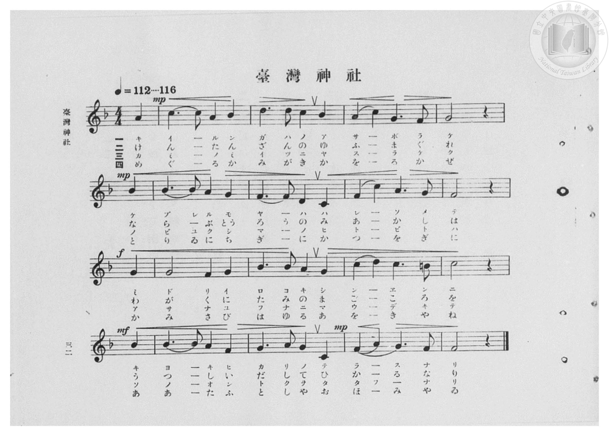
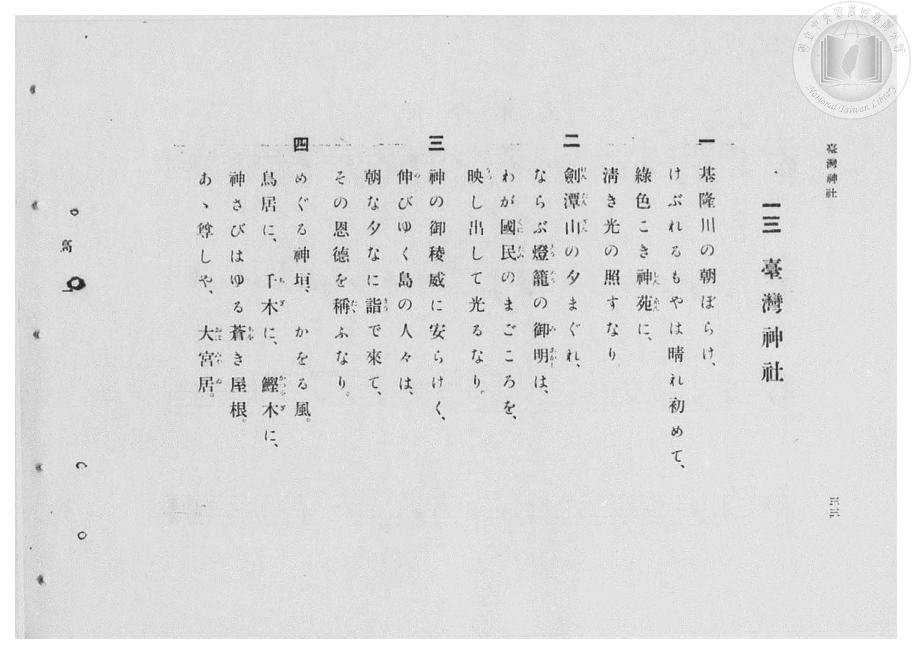

# 臺灣神社

> Re:Shōka 使用 AI 協助辨識與重建樂譜，可能會有錯誤。歡迎[回報](https://github.com/TMDLang/reshoka/issues)。

- **鋼琴伴奏版**：<br><audio controls src="taiwan_jinja.mp3"></audio>
- **NEUTRINO 歌聲合成版**：<br><audio controls src="taiwan_jinja_neutrino.mp3"></audio>

- 臺灣總督府《公學校高等科唱歌》第一學年用（昭和十一年，索書號 0729 74）

## 說明

原書資訊與歌詞全文（對應 P034.jpg–P035.jpg，原書 pp. 32–33，第 13 首）：
調性與拍號：ヘ長調（F 大調，1 降記號）4/4 拍（弱起 1 拍），速度 ♩=112–116
教材背景：臺灣總督府殖民地官社題材唱歌，歌詠位於臺北圓山劍潭山畔、俯瞰基隆河（基隆川）之臺灣神社。
註：第一段第三句「神苑」於 P035.jpg 歌詞頁振假名作「しんゑん」，P034.jpg 樂譜下片假名印作「シンーエン」。


## 歌詞

```text
一
基隆川（きいるんがは）の朝ぼらけ、
けぶれるもやは晴れ初めて、
綠色（みどりいろ）こき神苑（しんゑん）に、
清き光の照らすなり

二
劍潭山（けんたんざん）の夕まぐれ、
ならぶ燈籠（とうろう）の御明（みあかし）は、
わが國民（くにたみ）のまごころを、
映（うつ）し出して光るなり。

三
神の御稜威（みいつ）に安らけく、
伸びゆく島の人々は、
朝な夕なに詣（まう）で來て、
その恩德を稱（たた）ふなり。

四
めぐる神垣（かみがき）、かをる風。
鳥居に、千木（ちぎ）に、鰹木（かつをぎ）に、
神さびはゆる蒼（あを）き屋根。
あゝ、尊しや、大宮居（おほみやゐ）。
```

## ABC

<div class="abc-score" data-abc-src="taiwan_jinja.abc" aria-label="五線譜載入中"></div>

[下載 ABC 原始檔](taiwan_jinja.abc)

## TMD 檔案連結

- [主旋律 TMD 檔案](taiwan_jinja.tmd) [[在 TMD Studio 編輯](https://tmdlang.github.io/Tmd-TS/#tmd=s7IKdvYPcrWy4qpTUCpJTLdSSM7PyUlNLsnMz7PKzk9PzM7Ojy_OyM9OVIKrKMvPKc1NBcqW5McbIoSL80uLklOtipMz8vNz4ktSK0qS8vOz0eXjCxLTU60CDIxNcMqYImQKivLLUvMS84DmFhRl5pWkpoANRihILctMSQVJFycn5sWXpRZlpmWmpiC5NbWoGOQVqBUlRYl5xclFmQUg_yFU5ReVZOSnFyUWZFRaZWQWl-QXZSYn5sRnJ-YhebskIxXo66LUnMx0FM0Q8YKcxORUdMHM3AKgixJzkG0C6s6zKs0DObsE6lgtLYUX7bueNy5-vnTe8yX7FLS0uBRtFQwNjbjsbRXcuGxM9E3sQCZAFe3Y-3zu4qe75jxu6Hrauubp2h3PFix8uXrG87Wdz5dPfDpl47O1PY8bup-vWfNkRwNQ9unOLc-nrHi_p-PZjLVPJ_U87W0Eie_c8n5Pz_Mti57N3vFi5nwFA3MjSwVzk_d7OpW4uPS1FGypBbgUFBSe9s0HWbO5_cWKrhcd7UD3vVg572nrimfT2oHOerqh91l7pwIoSehlFaQ_apgMSgMgJtCFEK0KBQV6CsZGQCljY5Cz16xRMDRWeLlsGtC97_fMAtnxYtX-Zw3LQaZ39wI9BBR93Dzj5dTtQHGgHW4KT5csBzN7DBVezux9sWIGWFEnMGgVgDpAztiz8cXW7QqGEC7Q2J6XDfOf7lqm8GjmSltgXAAtNzQ0A1n1bOrMZ3MnvGjueTZzPdAetFh5tm7asw0Tn87Z8HTdDGBkvlzYA1QMiRWgmWC_L3iyt_fZtD1AjU97pj-dM_npxo1Pu3qf7V0LZDyfOuVxQ-OT_eufz9vwdP6ul7Panm3aDHIemP10-1yg257s7EZOL48bmsAhsGI30DWQaH-2biuY0fm0f-njhh6guhfdEx83gGwFBTQ4dBUg8fByQeOznvVPG9ufTuh9sheYqHoeN05_3DT5cdNEENkADIweWNwoPFvR9GLtnCc7up93tkO0PO3dANXVtP1x8-bHzXseN60AMRp6Qe4COQzoHnAqQPig43Fj7-PGlsdN3SArGoE2AgOy83Hjumdz5j5uBJoAZAOd2wjSBmI1bnvcBLQAqLrpcVMLUPWzmVuAIk875j5uanzcuAyq9Pm2BS86N4GN3_-4ceXjpi6wJaDofNwItKcXEg5gBQgvgmVXQ414tqMVqO5pK8gxz1uXg10y83HjKqBZEL_s6gH7BRZdYLPAAdU4H0xOg5m47umSqY8b9z1unAByO8wvQIOActuet3c837gArHnF48Y2oBuBJFTbvoXPZvTBPNH0uLEb6Fiw1HqYKU39wDB7OqcbmM7A6oDc1SD7G4HpG2QE2NopIC8DzW2aBPPaDIiFbY8bl4DVTX_avgsUEI3LQP4Fhi7Ym4hY6wSH6dJ5EEc9XzHn6YpGmLuAkQAxZPXTdUC94PgCugNi05M9Ox43bn7cBLSp_-nmbUD9T3btetwADFmYF8DxvAocQquAZrxYuRhsMNDZkFBY_mQfUDMsXh83AlWve9a48um-7UD_PF8BCXagh0FZ-HHjVlSXP509GxJMwKQBDPxuoBeezoNYAPQj0PHA9AZOEw1ABcA0NQmo5uWiFdBs9HLz0qcbgU4FpYinvc3P5oCKzseNCx83AiMFmlJebtgJEweauARkBJIsPNiAvtsM8jMwIJq6X0zaA9YATMGTwEp7n27sfrZgJ9RasMRckJ0bgKkWmDpbQOwly5-uWwd0DlgnUHw3yP1AqaYJYPeDdVJeRkOBgpY-F1dIYmZ5Yp5XZl5WolVAZmJevkONrmFNNcgiBRsLLTswA1sFoQApeV4s7FHQQC5LFbQVTBSebuh_vr5BB17Ia2LRD7QdZHaNgoGCLhxX5xbUKhgDGTUKpkBSF0iCeCZgETOwiBlYBiICkgPxjMAyhkARCAvJMLBCsE0-hjUK8UAeDD9uWgs25HHTErAWYFkGxKvBrM1QmTVQmX4g7gPrWQSV2QrVASLnQFWtBMtshDoBYgeIB7XfCM3-xolQsyYj7G-cD9YFEgHKNE6DyAD5wBwBZrVBZZDsb9wHUdU4AWxaD7L9jasQ9huj-x_kV6COZpCdMP-DfQkWQQ6ZFiDuBrNAIiCZnUj-Xwl15UawzHpk-8HmQe03Qbe_EeqXCQj7m8C2NIJIkMx-qM96gLgXWaZpEsJ-sB6IHEgPJDZg_l8Bth9_Mt7VA07GJKZbUMoCJURQIgQluxpgAoQkQzOQ1aYgAiIGSqIgVSB1MFXQJJpWC9ELT6GPm6Fx3rwGnhqhaQ4c9rB46gezQCRIBpROYaGxF6pqIVgGlF4QsQGOV3hqBBbkCBMbt0HCC1gmQ4MYFOAgoTZY4gNHByiImxDWgSMERE8Hy6BEfhPYefDE97gZltCXQZMJsBEB9cA8JK9BkiAogkEyHQi74Po7wDIg0xF2gQMJntCA9QNEbdMEoKvAwdi4EOp6kPkwT0NkYMkNFMCwYATZD5LrA8uA1CESFVg9gUS1o5OcRAUrv0CJBJKoMJMZKDmBykJICWmiDi8sYcUeMFGhFnuPmyERDfIdqECAZGyQOKgIBPE3Q4tDRIyAikBYWIAyEYi3GSwDiXGUQhSRpIBZFWpTIziJgkMOJA4tZIBpCJaaQMUWSGYKwqZGaAwD0x4skyNCHZwuEakJXARD3AWKa1Cqgrh8KlwUVmiBUhdIB0gFLC21Q21ai5lNwFkIKS1BiyGQG0BmA6t5qMshqR1UKMMKLlDOQCuewAUXSFULWA8kxGF-AqvHn5KA7RtKiydQaoKlLWMwDa4bkYooWOqC1KLIRRQII6ckWFoAFdbgFAPLqeDqBJLCYHkYWpKAKwhYWgJVHJDYAcmAUiMsNMCuQUpJSMUdsHQBhVYLNNwXQGNjOhCD47RxE1QGEt-o1cIqsOsg5QGGTeByCalEaALnD1gDAFz6gMxaD2SD7HjcBC0DwTQkrUHsI-gncEoCxTfMT-CqHlyRg2Sg4QryEzClgFggF4NkdiP8BKsQIWkJWLah21TLxaVrp4DUqlMAcpW5AA)]
- [鋼琴伴奏 TMD 檔案](taiwan_jinja_piano.tmd) [[在 TMD Studio 編輯](https://tmdlang.github.io/Tmd-TS/#tmd=s7IKdvYPcrWy4qpTUCpJTLdSSM7PyUlNLsnMz7PKzk9PzM7Ojy_OyM9OVIKrKMvPKc1NBcqW5McbIoSL80uLklOtipMz8vNz4ktSK0qS8vOz0eXjCxLTU60CDIxNcMqYImQKivLLUvMS84DmFhRl5pWkpoANRihILctMSQVJFycn5sWXpRZlpmWmpiC5NbWoGOSVgszEvPz4xKKixLz01NzUPCQjkAStEjPjE5OT83MLEvMyUVXlF5Vk5KcXJRZkVFplZBaX5BdlJifmxGcn5iGFTEkG0BirotSczHSgpejiBTmJyanogpm5BUBHJ-Yg2wTUnWdVkphZDvRSflpaZjJYXktL4UX7rueNi58vnfd8yb73ezpedu95PmHLkz1bni7tf97Z8X5Pp4KWFpeirYKhoRGXva2CG5eNib6JHchkqM4de5_PXfx015zHDV1PW9c8Xbvj2YKFL1fPeL628_nyiU-nbHy2tudxQ_fzNWue7GgAyj7dueX5lBVAm57NWPt0Us_T3kaQ-M4t7_f0PN-y6NnsHS9mzlcwMDeyVDA3AdquxMXlmVdSlG8VAArtIA-HGl3DmmouBSCwsdCyAzNqFAwUdOG4OregVsEEyKgBk7pA0hhIGoJFjMAixmDaNB4sBJIAKYBIGUJFQBBmYg1XLYorfFBcYYLkCgisgbohXiHaJFbBEEgZxgIFTeOBLNP4WAQDaBVEEiRiAsRwAbAxIGtDwFHmlZmXlUhiEID8BLQU7BNTMA8SKGZgETOwDEQEJAfiIUIAwkIPT7BNPoY1CqCAg-HHTWvBhjxuWgLW8rh5DxCvBrM2Q2XWQGX6gbgPrGcRVGYrVAeInANVtRIssxHqBIgdIB7UfiM0-xsnQs2ajLC_cT5YF0gEKNM4DSID5D9uXAdmtUFlkOxv3AdR1TgBbFoPsv2NqxD2G6P7H-RXoI5mkJ0w_4N9CRZBDpkWIO4Gs0AiIJmdSP5fCXXlRrDMemT7weZB7TdBt78R6pcJCPubwLY0gkiQzH6oz3qAuBdZpmkSwn6wHogcSA8kNmD-XwG2H5rUkLMVKKXAcoyhghlINVK-AqUqkCqQOtR8VZ1WC9ELT1SPm6HR1LwGnoCgyQQcXLCg7QezQCRIBpS0YB7YC1W1ECwDimJEAIKjAp6AHjd1Ikxs3Abx4uNGaKpoAoURSKgNll7AIQgKlSaEdeAwBNHTwTIo8dUEdh48vTxuhqXNZdCYfdy0HeqBeUheg6QaUJyAZDoQdsH1d4BlQKYj7AIHEjxtPG7qgroLmNoawcHYuBDqepD5ME9DZGApBBTAsGAE2Q-S6wPLgNQh0gFYPSwdwEoJULxC0gFmygClAFCJAymHTNThRRKscAGmA9TC5XEzJG5ADgJlO0j2AYmDChoQfzO00EEEIqiggTkflFRBvM1gGUgkoRRViFQAzBBQmxrBqQrsWZA4NCsDox2WAECFA0hmCsKmRmikAJMLLCshAgqclBAJAFzQQdwFih5QQoC4fCpcFFY0gBIESAdIBSz626E2rcVM2eBUjxT90MwOcgPI7MeN0EIYmkBBRR-seAAlZrRCAFw8gFS1gPVAQhzmJ7B6bIUAZt0KrjRIqGARkQ-LPlApBo5kWH4Al7OQRAHLKdD8Ci45YdEPKlEhAQqSASUgmAfArkGKfKRCBZiHITkGElQLoAE4HYjB0dC4CSoDiSLU8nIV2HWQXIdhEzj3I-W7JnCShtWM4DwOMms9kA2y43ETtKQB05DkAbGPoJ_AkQ-KIpifwHUguIYDyUDDFeQnYOSCWCAXg2R2I_wEqymg0Q9Sh2oTthYJkc0haMsGSAEbRsD0A28dgbkYDSF4IwnSFIImOrgmkDRcF0gHkAnno8sjGwGqeOBmwxViMRgoBGIb4TIHXHJRo4mna6cAblwqABlIgRvtA1SELmSEKWSMKQR0ElBImQsA)]

## 分析

```text
================================================================================
📊 TMD Song Profile: [ 臺灣神社 ]
================================================================================
⏱  Duration:       0:34 (34.3s), 16 measures total
🎼 Key & Tempo:    首調基準 F, != 112.0 BPM, <4/4>
   - 分析範圍：      由實際發聲的音符與和弦推測調性；播放脈絡另行呈現
🎤 人聲音域:    C4 (MIDI 60) – D5 (MIDI 74) [跨度: 14 個半音 / 1.2 個八度, 難度: moderate]
   - 最低音:  C4 in [TaiwanJinja #1 @ m.7, 0:14]
   - 最高音: D5 in [TaiwanJinja #1 @ m.3, 0:04]
   - 適合: soprano, mezzo-soprano, contralto, tenor, baritone, bass
🏛  結構:      TaiwanJinja (34.3s)
⚡ 編曲密度:        Peak 1 軌道同時演奏
🗝  調性診斷：       F 大調（純淨自然大調，未偵測到可信轉調）
   - 風格氣質:    純淨自然大調（陽光明朗、易唱易記，無明顯調外色彩）
   - 轉調歷程:    全曲維持單一推測調性（未偵測到可信轉調）
   - 核心骨幹音:  G, C, F, A#, A
   - 調性數值:    F 大調 [相關度: 0.80, 穩定度: High, 自然音純度: 99.2%]
   - 候選調性 (K-S): F 大調 (0.80), G 小調 (0.66), C 大調 (0.65)
   - 五度圈歷程:   -1
   - 各段落調性細節:
     • [TaiwanJinja #1]: F 大調 (r: 0.76, 自然音純度: 99.1%, 調外音: B)

  [ 五度圈游移軌跡 ]
               C  
        [F ]*          G  
      Bb               D  
      Eb               A  
         Ab           E  
            Db       B  
               F# 
     (* = active key center)

  [ 十二半音累積音高分佈 ]
     C  : ████████████████████      19.2%
     C# :                            0.0%
     D  : ███████                    6.7%
     D# :                            0.0%
     E  :                            0.0%
     F  : ███████████████████       18.3%
     F# :                            0.0%
     G  : ████████████████████████  23.3%
     G# :                            0.0%
     A  : ███████████████           15.0%
     A# : █████████████████         16.7%
     B  : █                          0.8%
--------------------------------------------------------------------------------
Assignment 軌道音域：
  - Piano         : C4 – D5 (14 個半音 / 1.2 個八度, 55 個音符)
================================================================================
```


## 原書掃描頁






