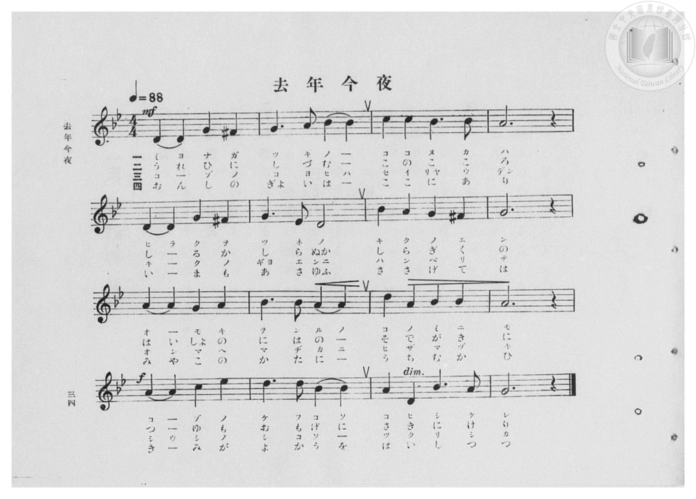
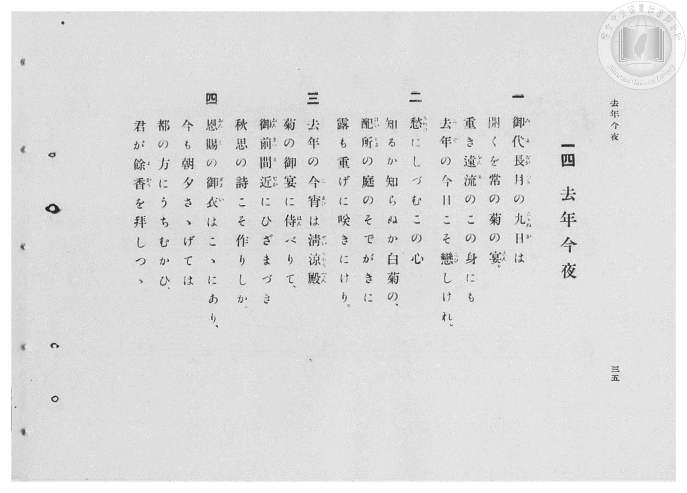

# 去年今夜

> Re:Shōka 使用 AI 協助辨識與重建樂譜，可能會有錯誤。歡迎回報。

- **鋼琴伴奏版**：<br><audio controls src="kyonen_konya.mp3"></audio>

- 出處：東京音樂學校編《中學唱歌》（明治三十四年），大和田建樹作詞、小山作之助作曲
- 臺灣總督府《公學校高等科唱歌》第一學年用（昭和十一年，索書號 0729 74）

## 說明

原書資訊與歌詞全文（對應 P036.jpg–P037.jpg，原書 pp. 34–35，第 14 首）：
調性與拍號：ト短調（G 和聲小調，2 降記號）4/4 拍，速度 ♩=88
典故背景：取材自菅原道真左遷大宰府時所作漢詩〈九月十日〉（「去年今夜侍清涼，秋思詩篇獨斷腸。恩賜御衣今在此，捧持每日拜餘香」）。


## 歌詞

```text
一
御代（みよ）長月（ながつき）の九日（こゝぬか）は
開くを常の菊の宴（えん）。
重き遠流（ゑんる）のこの身にも
去年（こぞ）の今日こそ戀（こひ）しけれ。

二
愁（うれひ）にしづむこの心
知るか知らぬか白菊の、
配所（はいしょ）の庭のそでがきに
露も重げに咲きにけり。

三
去年の今宵（こよひ）は清涼殿（せいりゃうでん）
菊の御宴に侍（はん）べりて、
御前（ごぜん）間近（まぢか）にひざまづき
秋思の詩こそ作りしか。

四
恩賜（おんし）の御衣（ぎょい）はこゝにあり、
今も朝夕さゝげては
都の方にうちむかひ、
君が餘香（よかう）を拜しつゝ。
```

## ABC

<div class="abc-score" data-abc-src="kyonen_konya.abc" aria-label="五線譜載入中"></div>

[下載 ABC 原始檔](kyonen_konya.abc)

## TMD 檔案連結

- [主旋律 TMD 檔案](kyonen_konya.tmd) [[在 TMD Studio 編輯](https://tmdlang.github.io/Tmd-TS/#tmd=s7IKdvYPcrWy4qpTUCpJTLdSSM7PyUlNLsnMz7PKzk9PzM7Ojy_OyM9OVIKrKMvPKc1NBcqW5McbIoSL80uLklOtipMz8vNz4ktSK0qS8vOz0eXjCxLTU60CDIzNcMqYI2QKivLLUvMS84DmFhRl5pWkpoANRihILctMSQVJFycn5sWXpRZlpmWmpiC5NbWoGOQVqBUlRYl5xclFmQUg_yFU5ReVZOSnFyUWZFRaZWQWl-QXZSYn5sRnJ-YhebskIxXoa4h0JbpwSWZuanx-WnxKIoZUcWpicX5eMbpwam4-uiMy0zPzrHJTM7MykYJPS0vhad_upzu3PNnd9XTJHAUtLS5FWwULCy57WwUnHa7s1EpbBfdcLhsTfRM7kFlP23e9mDn1_Z5Zz-ZufLJrzcv5m5-taHq6dsezBQufb1_xuKHryY61QO7TKRufre153ND9fk_Hsxl9zzbtfrKj82lv49PZs4F2vd_T-X5Pz9Mly59O6nk-ZcPT3buerdj5ZO-cFyvnPW5ofLqh_-nGjUDuk53dT7tWAhnPZm8Ce-RF-67njYuf79j7fO7ip7vmAG172roGYvnL1TOer-18vnwi3Obna9Y82dEAcsvOLc-nrAA7ZC3QQqArQOIgV_Q837Lo2ewdL2bOVzAwN7JUMDcBukyJi0tfS8GWWoBLQQEYwvNB1mxuf7Gi60VHO9B9QJ8-bV3xbFo70FlPN_Q-a-9UACVavayC9EcNk0GpFMQEBRJYq0JBgZ6CsQlQytgU5Ow1axQMTRReLpsGDslZIDterNr_rGE5yPTuXqCHgKKPmzuez18LFAfa4a4A9PmLxk3AsAUL9BgpvJzZ-2LFDLDSTmDsKgD1AcVfNsx_umuZwqOZK22BiQDk9tYdz6a2vmjueTZzPdDQp_3Tns2d8KJ91Yv-VqDbXjZOfj5n_tPty142bgfF57oNwHh5NrPpWWcDKN72LHqxcuXjho4nO-c-m9MBDPln05c-bgA6ueNxA9BriHT3ZF_vsx2tz7btAfluefezhrlAjc_Xtz_vBQbS9hetOx43ND1rXPli85yn-xa-WLgYpGvOimdrlwDVP-td_qyn8dn6fqDhz7rnvFwy4-WymY8bgL7pBOriAnkCGOFgv-xb-GT3YpDtjfsfN3UAFbycuh3oMLDIqseNPY8blzxuBGtsXAdy8_SlYKnJj5vmPm5c87gRmJyBUutBZr2c1v24sf9x06SnO3YAVb_o7wKST9cBUxVQQ8fjpslQ60FK23uBpr5sXPBsayNIumkiUPpxE8SwdSDjgfp3rX7cuPpxE1gDJGSgVjfOg7pndxco9EAic591NMBkN4Flpz9uBBoKTPZQ_-7qAVHPWsD2NbaBpKAqgdYAFS993NQAsfjp_maQ0ufzgUJAH3WDGUB1IN8-n7kX4i9grgR7pLUXGLFgI9c_bmwBmdQETMEg1z3dtRbsF2A4LQcHJNDLq8F65mwC-gocBJOAQk8nbYLIgR3chYigToTHIZ59um4rLPCBJMTx6yGJ5Nk6UJp-3Dgb5AigIU3NID8CLQaHOjg3QKJj30JgjAAtAyYvqKsh8dK4E6StcRnUXyB1nRAVUx43zoEoejlt8ov9E8GC-x43LoJFPtDhQB9MAwsCY6MXHHjgFAuKRWBqB0cQMPGDbQAGdTfMj8CyDxwp4GQMNhfocqDi6dAQBCdssHgfMFiBXoN4GZb8gBY3gUMM7GRgAAGD9dmcuU-XTH3cOBWsAhi-y2Cps3kv0Mhn03aC9QHDZiE4woERvAnm5wnA0OuBZBZwogTaC5RuA1naNAmYj8COXwIyGJKKKS8KoUBBS5-Ly7syPy81zzs_rzLRKiAzMS_focagphpkj4KNhZYdmIGtGFaAFOsvFvYoaJgoAIuz5-sbdOBlpyYWDUDbQIbVKFTnptUqGMcr6EIIMxBhGq8OJGsgHF0F83gFQyAFwjUKRkAShEE8EFkDkgYxIdAApAhstI9hjcLj5vlA_uPmFWCyC0Q2rQEb87i5Baz-cdNaILsPLL8HItO0GSwOJpt7oKpWg_X0I9kEshVqkxFQrrENrA6kHhidYHI1xLzG6RAzGpcC5RuQbWqcDBZfByZBbAgNckMvdpuM4e4Dm_G4aR-YDXI_TAbi38fNk8AskItBMrvBqpeAxVY9bgYxQALLwN5qf9wM0YlhnwnIlZBwg7gV5BeIi0EyoCwBdXYLEK_H4jkICQoKEN0EdgzIQFTL8KesXT3kpCz8icokHiIHgjXg1AROR9iUYk9ZkPBdCQ4biMdBsY6Uspp7oTEDsQKU0hBqwSmuCZQuQTpwhD44XYFDHBrb3eBABJFI6aqpE8gGVQwIqyCagBIg5WCrGqEJARx1uBIW2IFQqxDOBMmsg-QhiJuB7n3cjGQbOJFBPPG4eSaYXAWVAWUKXMkKFExQ2xrBybipCepGEA0SnQoUA5aSW5E8NhUqASLBMdC4DCoDcjApiWpHJzmJCpxIECkFzIIkH1BhhJAFJj8YE1F24SupmkBBBg2O5kXg4ABFBygQN0KCAxjAj5tBGQk1v8NKL0hJB00bYBNwpShw1EKCH9xWADNgWRqWU9fDCiZ4fp4LFl8OJiHFXC-KHuxpagvYKxBvQZw7D-pEaCwDi1aIs-E2QbJW0za46sfNrVAPg4IEV3raD9YF8RaiYAXJQNLq48b5ULci_AQutBsXgnWCi2Z45gJlZhKSE7AZQVbtB6z8EIkGVK-ZgO0HJR5g4YWedqpzC6CVJSTFAQXxl1J46gpYqgJlMkiNtxcqA9EDiYTt0EjaCI4YUN2JK1VB6haITZC6EJadIcU9iA_Ls7CaEZKPQckIkfAm4qgiEEkK5CZQ1QVzH8JPMNcCcwrYN4gkBU4W0EINlNMgekF6cCRecJICuwxaRIGTFzjhg3R1QF3bDUtETSCfYeQuqKolYBlIpYtsUy0Xl66dAlKrSwHIVeYCAA)]
- [鋼琴伴奏 TMD 檔案](kyonen_konya_piano.tmd) [[在 TMD Studio 編輯](https://tmdlang.github.io/Tmd-TS/#tmd=s7IKdvYPcrWy4qpTUCpJTLdSSM7PyUlNLsnMz7PKzk9PzM7Ojy_OyM9OVIKrKMvPKc1NBcqW5McbIoSL80uLklOtipMz8vNz4ktSK0qS8vOz0eXjCxLTU60CDIzNcMqYI2QKivLLUvMS84DmFhRl5pWkpoANRihILctMSQVJFycn5sWXpRZlpmWmpiC5NbWoGOSVgszEvPz4xKKixLz01NzUPCQjkAStEjPjE5OT83MLEvMyUVXlF5Vk5KcXJRZkVFplZBaX5BdlJifmxGcn5iGFTEkG0BiodCW6cAnQxPj8tPiURAyp4tTE4vy8YnTh1Nx8UDwgOyIzPTPPKjc1MysTKYS1tBSe9u1-unPLk91dT5fMeb-n42X3nucTtjzZs-Xp0v7nnR3v93QqaGlxKdoqWFhw2dsqOOlwZadW2iq453LZmOib2IEseNq-68XMqe_3zHo2d-OTXWtezt_8bEXT07U7ni1Y-Hz7iscNXU92rAVyn07Z-Gxtz-OGbqAtz2b0Pdu0-8mOzqe9jU9nzwY6AGjR-z09T5csfzqp5_mUDU9373q2YueTvXNerJz3uKHx6Yb-pxs3ArlPdnY_7VoJZDybvQnsuxftu543Ln6-Y-_zuYuf7poDtO1p6xqI5S9Xz3i-tvP58olwm5-vWfNkRwPILTu3PJ-yAuyQtUALga4AiYNc0fN8y6Jns3e8mDlfwcDcyFLB3AToMiUuLs-8kqJ8qwBQYgjycKgxqKnmUgACGwstOzCjRqE6t6BWwTheQRdCmIEI03h1IFkD4egqmMRD5ECwRsEQSJrjUgqBBiAhrloU632QrTdBtx5kQzzQECgDZB6QMoFykYSwKYsGkrmxELYBxGLvyvy81Dzv_LzKRDy-19dSgITti4U9Clr6cCelEQoRoP9BwQDCNQpGQBKEQTwQWQMJHtTAABntY1ij8Lh5PpD_uHkFmOwCkU1rwMY8bm4Bq3_ctBbI7gPL74HING0Gi4PJ5h6oqtVgPf1INoFshdpkBJRrbAOrA6l_3LgJTK6GmNc4HWJG41KgfAOyTY2TweLrwCSIDaFBbujFbpMx3H1gMx437QOzQe6HyUD8-7h5EpgFcjFIZjdY9RKw2KrHzSAGSGAZ2Fvtj5shOjHsMwG5EhJuELeC_AJxMUim73FTO9TZLUC8HovnICQoKEB0E9gxIANRLUNOILt6UBIITXILIoFAgmkl2IsQ94MiDymBNPdCAxhiBSjBINSCE04TKHmBdOAIRHDyAAccNNK6wWEBIpGSR1MnkL0GIgy1CqIJKAFSDraqERqf4BjAlT7ADoRahXAmSGYdJCtA3Ax07-NmJNvAaQXiicfNM8HkKqgMKG3jSh2gYILa1ghOjU1NUDeCaJDoVKBY2-PGrUgemwqVAJHgGGhcBpUBORh32tjRiZI2wHGNiHAwC5IKQEUDQhaYimBMREmCr9xoAvkc6qvmRWBfgUIVFBYbIb4ChtPjZlCyRs19sLIEUu5AoxhsAq6EAY4hSCg2TofkJ0QGg-Wb9bBiAp675oLFl4NJSKHTi6IHe9LYAvYKxFsQ586DOhEaWcCCDuJsuE2QHNK0Da76cXMr1MOgIMGVLPaDdUG8hSjmQDKQJPe4cT7UrQg_gYvQxoVgneCCEp5HQHkSZ6oANg5QqxRgjYKIe1BlYQI2BpQGgEUJehJA1MmQhAMUxF9m4CmAYYkDlOQh1cheqAxEDyQst0PDeiM4fEEVEq7EASmwITZBKhhY5oKUoSA-LAfBqhtIrgKlBkT6mYij3EWkDJCbQPUBzH0IP8FcC0zwYN8gUgY4dqFFDCjDQPSC9OBIg-CUAXYZtMAApxJw-gXp6oC6thuWFppAPsPIJFBVS8AykJoM2SZsDRKs7SG8DRLsjR-4GLQVBGyPgDhAAtYkgkuAlEYDiVgwC9RSwlvJUbVNhqfIRDgLhyEIBRiKifMbtuyI0AAKL5CvsLgci_FEND517RTADV8FIAMp3qN9DGMxhIwwhYwxhUzAQspcAA)]

## 分析

```text
================================================================================
📊 TMD Song Profile: [ 去年今夜 ]
================================================================================
⏱  Duration:       0:43 (43.6s), 16 measures total
🎼 Key & Tempo:    首調基準 B,, != 88.0 BPM, <4/4>
   - 分析範圍：      由實際發聲的音符與和弦推測調性；播放脈絡另行呈現
🎤 人聲音域:    D4 (MIDI 62) – D#5 (MIDI 75) [跨度: 13 個半音 / 1.1 個八度, 難度: moderate]
   - 最低音:  D4 in [KyonenKonya #1 @ m.1, 0:00]
   - 最高音: D#5 in [KyonenKonya #1 @ m.13, 0:34]
   - 適合: soprano, mezzo-soprano, contralto, tenor, baritone, bass
🏛  結構:      KyonenKonya (43.6s)
⚡ 編曲密度:        Peak 1 軌道同時演奏
🗝  調性診斷：       G 小調（純淨自然小調，未偵測到可信轉調）
   - 風格氣質:    純淨自然小調（陰鬱抒情、旋律集中，無明顯調外色彩）
   - 轉調歷程:    全曲維持單一推測調性（未偵測到可信轉調）
   - 核心骨幹音:  A, G, A#, D, C
   - 調性數值:    G 小調 [相關度: 0.72, 穩定度: High, 自然音純度: 95.0%]
   - 候選調性 (K-S): G 小調 (0.72), D 大調 (0.54), D 小調 (0.47)
   - 五度圈歷程:   +1
   - 各段落調性細節:
     • [KyonenKonya #1]: G 小調 (r: 0.72, 自然音純度: 95.0%, 調外音: F#)

  [ 五度圈游移軌跡 ]
               C  
         F           [G ]*
      Bb               D  
      Eb               A  
         Ab           E  
            Db       B  
               F# 
     (* = active key center)

  [ 十二半音累積音高分佈 ]
     C  : ████                       5.0%
     C# :                            0.0%
     D  : ██████████████            16.7%
     D# : ██                         2.5%
     E  :                            0.0%
     F  :                            0.0%
     F# : ████                       5.0%
     G  : ██████████████████        21.7%
     G# :                            0.0%
     A  : ████████████████████████  28.3%
     A# : ██████████████████        20.8%
     B  :                            0.0%
--------------------------------------------------------------------------------
Assignment 軌道音域：
  - Piano         : D4 – D#5 (13 個半音 / 1.1 個八度, 51 個音符)
================================================================================
```


## 原書掃描頁






