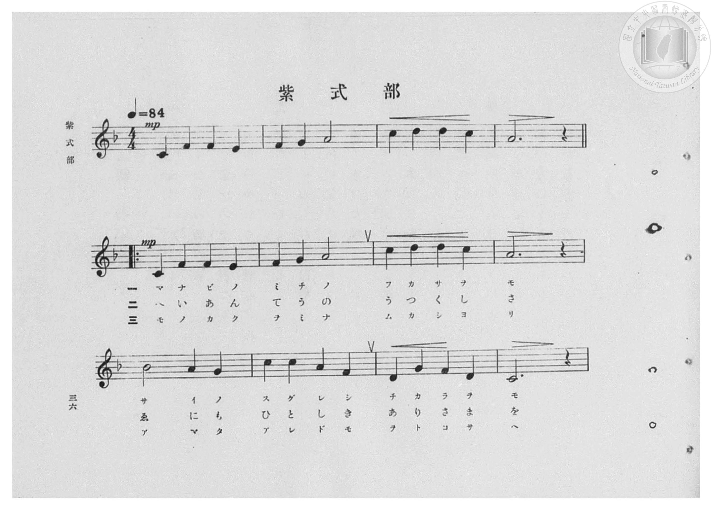
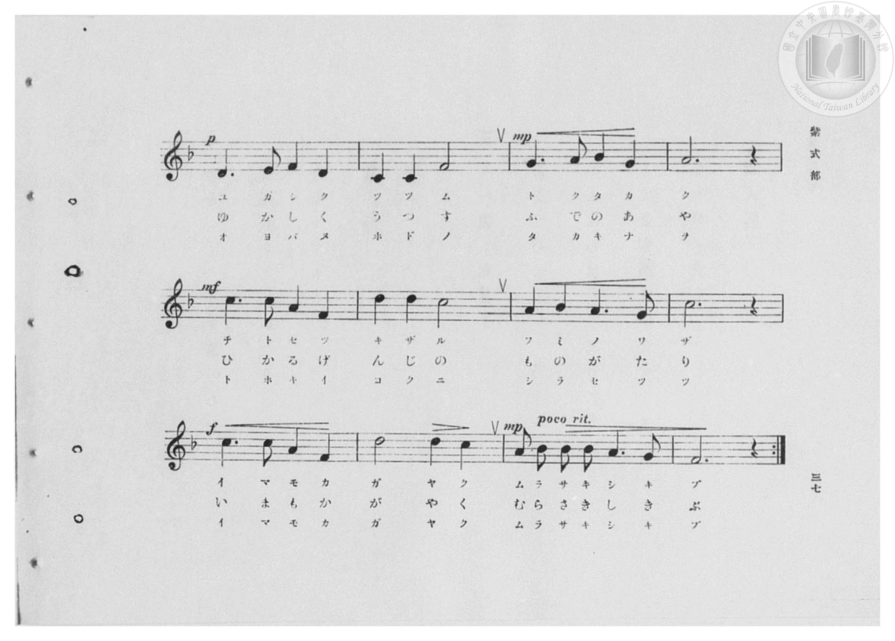
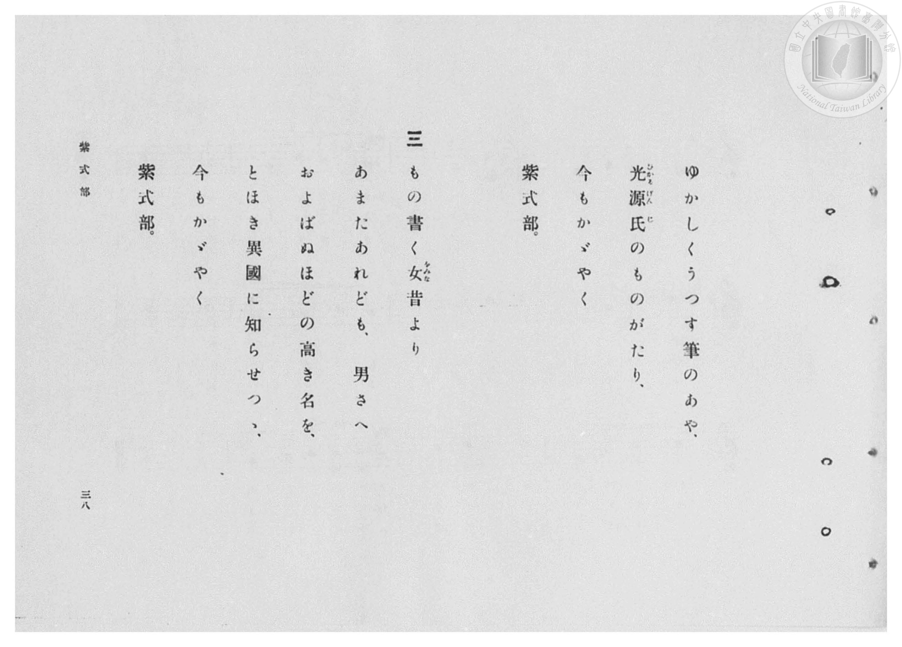
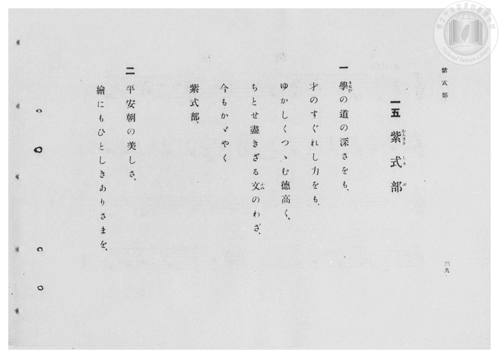

# 紫式部

> Re:Shōka 使用 AI 協助辨識與重建樂譜，可能會有錯誤。歡迎回報。

- **鋼琴伴奏版**：<br><audio controls src="murasaki_shikibu.mp3"></audio>
- **NEUTRINO 歌聲合成版**：<br><audio controls src="murasaki_shikibu_neutrino.mp3"></audio>

- 臺灣總督府《公學校高等科唱歌》第一學年用（昭和十一年，索書號 0729 74）

## 說明

原書資訊與歌詞全文（對應 P038.jpg–P041.jpg，原書 pp. 36–39，第 15 首）：
調性與拍號：ヘ調（1 降記號，F 大調／D 律音階）4/4 拍，速度 ♩=84
頁序說明：原書為右翻直排，P041.jpg 為第 39 頁（第一、二段歌詞），P040.jpg 為第 38 頁（第三段歌詞）。
前奏說明：P038.jpg 第一行印有 4 小節器樂前奏（`| 5_ 1 1 7_ | 1 2 3 - | 5 6 6 5 | 3 - - 0 |`），
第二行反覆記號 `|:` 起進入 20 小節歌唱主旋律（鋼琴伴奏版完整收錄此 4 小節前奏）。


## 歌詞

```text
一
學（まなび）の道の深さをも、
才のすぐれし力をも、
ゆかしくつゝむ德高く、
ちとせ盡きざる文（ふみ）のわざ、
今もかゞやく
紫式部。

二
平安朝の美しさ、
繪にもひとしきありさまを、
ゆかしくうつす筆のあや、
光源氏（ひかるげんじ）のものがたり、
今もかゞやく
紫式部。

三
もの書く女（をみな）昔より
あまたあれども、男さへ
およばぬほどの高き名を、
とほき異國に知らせつゝ、
今もかゞやく
紫式部。
```

## ABC

<div class="abc-score" data-abc-src="murasaki_shikibu.abc" aria-label="五線譜載入中"></div>

[下載 ABC 原始檔](murasaki_shikibu.abc)

## TMD 檔案連結

- [主旋律 TMD 檔案](murasaki_shikibu.tmd) [[在 TMD Studio 編輯](https://tmdlang.github.io/Tmd-TS/#tmd=s7IKdvYPcrWy4qpTUCpJTLdSSM7PyUlNLsnMz7PKzk9PzM7Ojy_OyM9OVIKrKMvPKc1NBcqW5McbIoSL80uLklOtipMz8vNz4ktSK0qS8vOz0eXjCxLTU60CDIwtcMpY4pIxMcApg-SOgqL8stS8xDygWwqKMvNKUlPAjkEoSC3LTEkFSRcnJ-bFl6UWZaZlpqYg-S-1qBjkfagVJUWJecXJRZkFoDBBqMovKsnITy9KLMiotMrILC7JL8pMTsyJz07MQwqqkoxUYEhBpCvRhZNLc0pKi1KRjcxMz8yzKs0Dua8E6iotLYXnW1Y_3dP_snmFgpYWl6KtgoUJl72tghuXjYm-iR1I94v2Xc8bFz_fsff53MVPd8153ND1tHXN07U7ni1Y-HL1jOdrO58vn_h0ysZna3seN3Q_X7PmyY4GoOzTnVueT1nxfk_Hsxlrn07qedrbCBLfueX9np7nWxY9m73jxcz5CgbmRpYK5ibv93QqcXHpaynYUgtwKSgoPO2bD7Jmc_uLFV0vOtqB7nuxct7T1hXPprUDnfV0Q--z9k4FUFrRyypIf9QwGRTRICbQhRCtCgUFegrGZkApY0uQs9esUTA0VXi5bBrQve_3zALZ8WLV_mcNy0Gmd_cCPQQUfdw8AygItMBQ4eXM3hcrZoCFe9wUni5ZDpbod1F4uq_75fzNL2f1AQ0ChrICUDNQycuG-U93LVN4NHOlLTAOgIa_XND4dFf_i1Wrns0AqpwFcdTzpl1P-zc_37_7-ewtz_omAfXB3K0AlAK50dgSpBPoAkhcPG5ofLKr59m6rZAAALsdpMcARY8Fsp5OZNWPG5rAodnZ-3QpwjGwcFOAWPJiITCGNzyb06lgovB0Q__z9Q1PZ654tqIJogtobkKNgmm8giEQmscr1AApIwVjBV0gy1TBDAhNgSwQX1fBQKEmAeJGkK0g03f1gEzv732xrA0SnAoJNVYJCi-2bn_ZsOlp61IFIwOonUA3AxPikx27n03vBoYx0NqX3XueT9jyZM8WoCued3Y8XdfzbOqWZ1O2vexpebZ2CcKxUGeCPQuyF-glsKfX7gAa8rhx3-PGVY8bN4MUNK572TgZSD7bvvFx49THTZMeNzUBgxik-llnL1DicePMx40THjf1PG6c_rRrNoqKx01tjxu7gRKPG_sfNy553DT3cVPD033bgfkIJAJV1LjwceOKx42zn88GMoBGTnvc1A1JtI8btz5uBKYhkDMeNwGNmAbV82R3F8gWoNlN8x43tQANA4ceLGvDvbULHKpPd25-uq7z2Zy5QGOe7-sDu2cq1KTnO4E-XQ02bBPYGUA5oBuaHjd1gRQBgwLoIWy-AbKXAP3-fC2QAQwEoIYWqLqnrZ3Pdk14tgGUDsCmAl0J1AYMF2BAzoD5BmghUBsw1OaDrCLNWzs6Ie4BmQHMI0B1T5cCY6sD5NbG_cDIA1rybMaUx01AkS5IGAOVAmN1PtihQEtXQiLp-ZTtYF_ugCgC2g508YbHjWseN-4GKQLGPiiqep9O6EUKB1AwAaV7n0_d8HQO0Gern89f-rgJ6K3Z0Egm2jdAPuWFHxQoaOlzcfmWFiUWJ2ZnBmdkZmcmlVoFZCbm5TvUGNRUg-xSsLHQsgMzsBW-0LwNKQyAGUtBAyXXg_OlDjwPaWIxAOgCkOE1CtW5BbWgAkAXmPMhGFgMgLI_iGkExJDMDykQdIEFAgSD2LCCAQINQCJgQ30MaxQeN88D8h83d4HJyWCyD6zncfN8MK8RLgYx_XHzVJBI02owuRUsuwkqswjJHrDrIPYYAeUad4BUNraAySawXpBtIJllYLE2MLkOYQ9UZAmY7AeT06EyIBdgsccY5gaIe2FuXA91HciVMF-B_AvzzwIktdvBsiugMqsw7MEf1bBaAjOqd3QSH9WgeANBUKzBinhITIJ4oLgGqkFOCWAOuHrAGc3giALBx03gAIVFctNOsNgGsNgaeBCAPA-OeEiwNK8Ek0REc9NEmD2NkAAFRTUoysCB3wgKWEg0AjM7VAaSGMAJEByxwGIF6rZJ2O0BRXMTzA3QBNy0H6oHEv1gnzR3gkmQCCL6O8CqN4NJUJiAZGZg2EMgR0Ord1g0W6LW48TmaGCGBsccKBLRoxEev5BECs79oJgHpQFEKsCXr0G5ChKB0FQNzwfgPAglQWkflg9AQQNRBwlOSOSDAhWkE1eEg3IpKNK64RELyqvo-Xcmwp5GSFJ83Lgcmt8hSQBkFshNuCIckhdBefNx8wQwqwfq7tlgHiSykcopsB9gIbAWLAtKZLCkQEKEP509G1eEk1aEpwFjHGypKXJWBpKwohridFjGh0S4IbQAwBXRoHwKSdmPm3aDWaBgBAUA2NNN28BioKiERTQ4l0ELQkiAPW5eD9YBUosjosE5GBrRTd1gFih_gnSBq41GUC5CKcDBeR8WxaDIAtHzwTKw4hdLRMOSITBaYT4AJSGQLkiuBSXGx80gF8DsgRTa4DIKHAKQMIAldRIi-smuKThzNgkFeDU8ns3Q4hkiBquWwbnaGCgNgbDIhmV7LJENDgpIoQet6eB5FFTkQeTAOQ6e2xeAgwZU2IGCExJYIPm1YNlp2CMCHOGQwAMVx7CoBAU6SAYSmSBTIPU5NMc3NQBxJ7gYBxXvkPIAUtSDdOFIXODcTXt_1XJx6dopoLXmFIBCylwA)]
- [鋼琴伴奏 TMD 檔案](murasaki_shikibu_piano.tmd) [[在 TMD Studio 編輯](https://tmdlang.github.io/Tmd-TS/#tmd=s7IKdvYPcrWy4qpTUCpJTLdSSM7PyUlNLsnMz7PKzk9PzM7Ojy_OyM9OVIKrKMvPKc1NBcqW5McbIoSL80uLklOtipMz8vNz4ktSK0qS8vOz0eXjCxLTU60CDIwtcMpY4pIxMcApg-SOgqL8stS8xDygWwqKMvNKUlPAjkEoSC3LTEkFSRcnJ-bFl6UWZaZlpqYg-S-1qBjk_YLMxLz8-MSiosS89NTc1DwkI5AErRIz4xOTk_NzCxLzMlFV5ReVZOSnFyUWZFRaZWQWl-QXZSYn5sRnJ-YhhWZJBtAYqHQlunByaU5JaVEqspGZ6Zl5ViWJmcBIAUVMeWJ8bmJmXk5iHtAHWloKz7esfrqn_2Xzivd7Ol5273k-YcuTPVueLu1_3tnxfk-ngpYWl6KtgoUJl72tghuXjYm-iR3I7Bftu543Ln6-Y-_zuYuf7przuKHraeuap2t3PFuw8OXqGc_Xdj5fPvHplI3P1vY8buh-vmbNkx0NQNmnO7c8nwKy6NmMtU8n9TztbQSJ79zyfk_P8y2Lns3e8WLmfAUDcyNLBXMToOVKXFyeeSVF-VYBoIAN8nCoMaip5lIAAhsTLTswQ19LAZQ09LIK0hUg1rxY2PO0b_6LtXMUTBSebuh_vr7haWcv0D8KWvpgHTUK1bkFtQqm8QqGQGgeDxQwVDBSMFbQBbJMFcyA0BTIAvF1FQwUarhqUVzhg80VQCPiwSaCSRjPLD5ewRjKNQIjIKMGJgyioMb7lhYlFidmZwZnZGZnJpVi8a4Fwru26ADq72frtgJDGxjmChooIbKrBxgiOvDA0MRiAEbI6AKDBIKB4QMKFxDTCIghoQIJKV1gSEEwiA0LMQg0AImADfUxrFF43DwPyH_c3AUmJ4PJPrCex83zwbxGuBjE9MfNU0EiTavB5Faw7CaozCIke8Cug9hjBJRr3AFS2dgCJpvAekG2gWSWgcXawOQ6hD1QkSVgsh9MTofKgFyAxR5jmBsg7oW5cT3UdSBXwnwF8i_MPwuQ1G4Hy66AyqzCsAd_VO_qwRXVOzqJj2pQvIEgKNZgaR8SkyAeKK5BKRVIwVICmANUBaJwRDM4okDwcRM4QGGR3LQTLLYBLLYGHgQgz4MjHhIszSvBJDHR3AGzpxESoKCoBomDA78RFLCQaHzc2AuVgSQGcAIER-zjxn1Qt03Cbg8omptgboAm4Kb9UD2Q6Af7pLkTTIJEENEPct_jps1gEhQmIJkZGPYQyNGdqNFsiVrGEZujgRkaHHOgSESPRnj8QhIpOPeDYh6UBhCpAF--BuUqSARCUzU8H4DzIJQEpX1YPoBEHUgdJDghkQ8KVJBOHBHeBMqloEjrhkcsKK-i59-ZCHsaIUnxceNyaH6HJAGQWSA34YpwSF4E5c3HzRPArB6ou2eDeZDIRiqnwH6AhcBasCwokcGSAgkR_nT2bFwRTloRngaMcbClpshZGUjCimqI02EZHxLhhtACAFdEg_IpJGU_btoNZoGCERQAYE83bQOLgaISFtHgXAYtCCEB9rh5PVgHSC2unA0JNHBEN3WDWaD8CdIFrjYaQbkIpQAH531YFIMiC0TPB8vAil8sEQ1LhsBohfkAlIRAuiC5FpQYHzeDXACzB1Jog8socAhAwgCW1EmI6Ce7puDM2SQU4NXweDZDi2eIGKxaBudqY6A0BMIiG5btsUQ2OCgghR60poPnUVCRB5ED5zh4bl8ADhpQYQcKTkhggeTXgmWnYY8IcIRDAg9UHMOiEhToIBlIZIJMgdTn0Bzf1ADEneBiHFS8Q8oDSFEP0oUjcYFzN-39hasxh7XVCEwg8KYbIl7Jb0kiGwpuJCDV9giVMHOAxpoCuUCz4NJAURALVDuAJUAUusHgagnDYBSdIBbM_UBTgLUMukVYXAwp_rC6GM2JYHOhXLjB8FDDCAhQZiPJWJCZ2M0Fxq6unQK4M6AAZKDFdLSPYSxWYSPswsZgYWUuAA)]

## 分析

```text
================================================================================
📊 TMD Song Profile: [ 紫式部 ]
================================================================================
⏱  Duration:       0:57 (57.1s), 20 measures total
🎼 Key & Tempo:    首調基準 F, != 84.0 BPM, <4/4>
   - 分析範圍：      由實際發聲的音符與和弦推測調性；播放脈絡另行呈現
🎤 人聲音域:    C4 (MIDI 60) – D5 (MIDI 74) [跨度: 14 個半音 / 1.2 個八度, 難度: moderate]
   - 最低音:  C4 in [MurasakiShikibu #1 @ m.1, 0:00]
   - 最高音: D5 in [MurasakiShikibu #1 @ m.3, 0:06]
   - 適合: soprano, mezzo-soprano, contralto, tenor, baritone, bass
🏛  結構:      MurasakiShikibu (57.1s)
⚡ 編曲密度:        Peak 1 軌道同時演奏
🗝  調性診斷：       D 小調（純淨自然小調，未偵測到可信轉調）
   - 風格氣質:    純淨自然小調（陰鬱抒情、旋律集中，無明顯調外色彩）
   - 轉調歷程:    全曲維持單一推測調性（未偵測到可信轉調）
   - 核心骨幹音:  D, A, C, F, G
   - 調性數值:    D 小調 [相關度: 0.76, 穩定度: Moderate, 自然音純度: 100.0%]
   - 候選調性 (K-S): D 小調 (0.76), F 大調 (0.71), C 大調 (0.66)
   - 五度圈歷程:   +2
   - 各段落調性細節:
     • [MurasakiShikibu #1]: D 小調 (r: 0.76, 自然音純度: 100.0%)

  [ 五度圈游移軌跡 ]
               C  
         F            G  
      Bb              [D ]*
      Eb               A  
         Ab           E  
            Db       B  
               F# 
     (* = active key center)

  [ 十二半音累積音高分佈 ]
     C  : █████████████████████     20.7%
     C# :                            0.0%
     D  : ████████████████████████  24.0%
     D# :                            0.0%
     E  : █                          1.3%
     F  : █████████████████         16.7%
     F# :                            0.0%
     G  : ███████████████           14.7%
     G# :                            0.0%
     A  : ███████████████████████   22.7%
     A# :                            0.0%
     B  :                            0.0%
--------------------------------------------------------------------------------
Assignment 軌道音域：
  - Piano         : C4 – D5 (14 個半音 / 1.2 個八度, 62 個音符)
================================================================================
```


## 原書掃描頁










