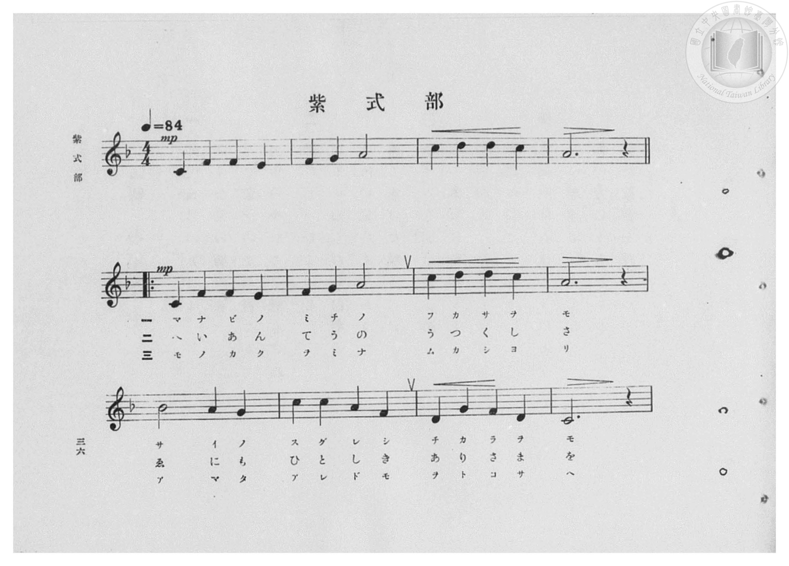
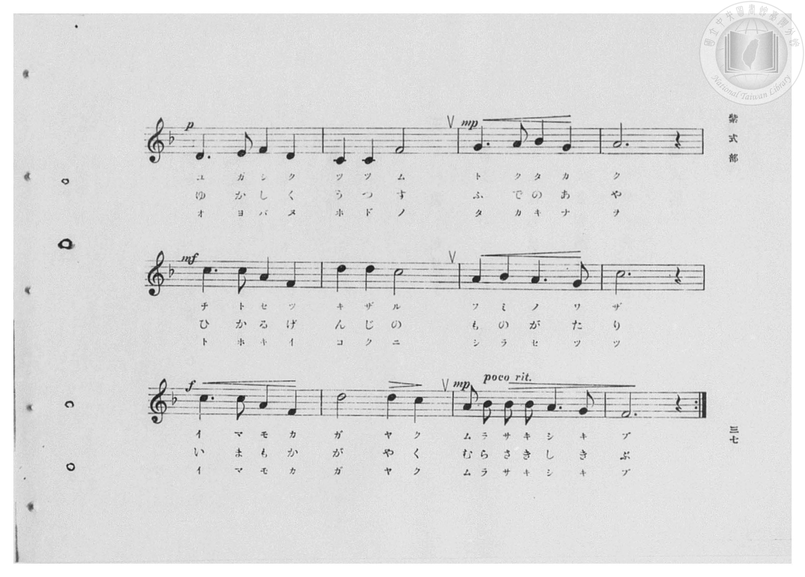
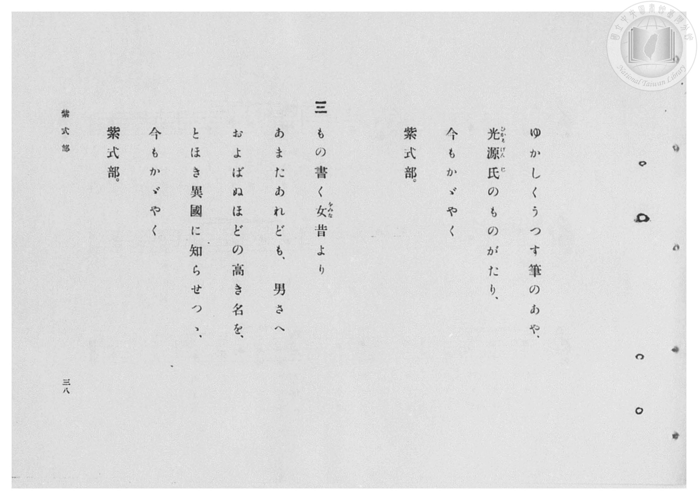
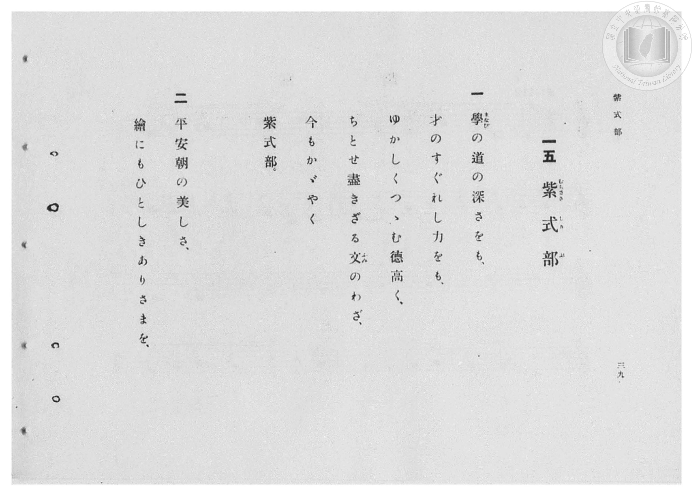

# 紫式部

> Re:Shōka 使用 AI 協助辨識與重建樂譜，可能會有錯誤。歡迎回報。

- **鋼琴伴奏版**：<br><audio controls src="murasaki_shikibu.mp3"></audio>

- 臺灣總督府《公學校高等科唱歌》第一學年用（昭和十一年，索書號 0729 74）

## 說明

原書資訊與歌詞全文（對應 P038.jpg–P041.jpg，原書 pp. 36–39，第 15 首）：
調性與拍號：ヘ調（1 降記號，F 大調／D 律音階）4/4 拍，速度 ♩=84
頁序說明：原書為右翻直排，P041.jpg 為第 39 頁（第一、二段歌詞），P040.jpg 為第 38 頁（第三段歌詞）。
前奏說明：P038.jpg 第一行印有 4 小節器樂前奏（`| 5_ 1 1 7_ | 1 2 3 - | 5 6 6 5 | 3 - - 0 |`），
第二行反覆記號 `|:` 起進入 20 小節歌唱主旋律（鋼琴伴奏版完整收錄此 4 小節前奏）。


## 歌詞

```text
一
學（まなび）の道の深さをも、
才のすぐれし力をも、
ゆかしくつゝむ德高く、
ちとせ盡きざる文（ふみ）のわざ、
今もかゞやく
紫式部。

二
平安朝の美しさ、
繪にもひとしきありさまを、
ゆかしくうつす筆のあや、
光源氏（ひかるげんじ）のものがたり、
今もかゞやく
紫式部。

三
もの書く女（をみな）昔より
あまたあれども、男さへ
およばぬほどの高き名を、
とほき異國に知らせつゝ、
今もかゞやく
紫式部。
```

## ABC

<div class="abc-score" data-abc-src="murasaki_shikibu.abc" aria-label="五線譜載入中"></div>

[下載 ABC 原始檔](murasaki_shikibu.abc)

## TMD 檔案連結

- [主旋律 TMD 檔案](murasaki_shikibu.tmd) [[在 TMD Studio 編輯](https://tmdlang.github.io/Tmd-TS/#tmd=s7IKdvYPcrWy4qpTUCpJTLdSSM7PyUlNLsnMz7PKzk9PzM7Ojy_OyM9OVIKrKMvPKc1NBcqW5McbIoSL80uLklOtipMz8vNz4ktSK0qS8vOz0eXjCxLTU60CDIwtcMpY4pIxMcApg-SOgqL8stS8xDygWwqKMvNKUlPAjkEoSC3LTEkFSRcnJ-bFl6UWZaZlpqYg-S-1qBjkfagVJUWJecXJRZkFoDBBqMovKsnITy9KLMiotMrILC7JL8pMTsyJz07MQwqqkoxUYEhBpCvRhZNLc0pKi1KRjcxMz8yzKknMBIY4KNTLE-NzEzPzchLzgM7T0lJ4vmX10z39L5tXKGhpcSnaKliYcNnbKrhx2Zjom9iBjHnRvut54-LnO_Y-n7v46a45jxu6nrauebp2x7MFC1-unvF8befz5ROfTtn4bG3P44bu52vWPNnRAJR9unPL8ykr3u_peDZj7dNJPU97G0HiO7e839PzfMuiZ7N3vJg5X8HA3MhSwdzk_Z5OJS4ufS0FW2oBLgUFhad980HWbG5_saLrRUc70H0vVs572rri2bR2oLOebuh91t6pAEo0elkF6Y8aJoNiHMQEuhCiVaGgQE_B2AwoZWwJcvaaNQqGpgovl00Duvf9nlkgO16s2v-sYTnI9O5eoIeAoo-bZwAFgRYYKryc2ftixQywcI-bwtMly8ES_S4KT_d1v5y_-eWsPqBBwFBWAGoGKnnZMP_prmUKj2autAXGAdDwlwsan-7qf7Fq1bMZQJWzII563rTraf_m5_t3P5-95VnfJKA-mLsVgFIgNxpbgnQCXQCJi8cNjU929TxbtxUSAGC3g_QYoOixQNbTiaz6cUMTODQ7e58uRTgGFm4KEEteLATG8IZnczoVTBSebuh_vr7h6cwVz1Y0QXQBzU2oUTCNVzAEQvN4hRogZaRgrKALZJkqmAGhKZAF4usqGCjUJEDcCLIVZPquHpDp_b0vlrVBglMhocYqQeHF1u0vGzY9bV2qYGQAtRPoZmBCfLJj97Pp3cAwBlr7snvP8wlbnuzZAnTF886Op-t6nk3d8mzKtpc9Lc_WLkE4FupMsGdB9gK9BPb02h1AQx437nvcuOpx42aQgsZ1LxsnA8ln2zc-bpz6uGnS46YmYBCDVD_r7AVKPG6c-bhxwuOmnseN0592zUZR8bip7XFjN1DicWP_48Ylj5vmPm5qeLpvOzAfgUSgihoXPm5c8bhx9vPZQAbQyGmPm7ohifZx49bHjcA0BHLG4yagEdOgep7s7gLZAjS7ad7jphagYeDQg2VtuLd2gUP16c7NT9d1PpszF2jM8319YPdMhZr0fCfQp6vBhm0COwMoB3RD0-OmLpAiYFAAPYTNN0D2EqDfn68FMoCBANTQAlX3tLXz2a4JzzaA0gHYVKArgdqA4QIMyBkw3wAtBGoDhtp8kFWkeWtHJ8Q9IDOAeQSo7ulSYGx1gNzauB8YeUBLns2Y8rgJKNIFCWOgUmCszgc7FGjpSkgkPZ-yHezLHRBFQNuBLt7wuHHN48bdIEXA2AdFVe_TCb1I4QAKJqB07_OpG57OAfps9fP5Sx83Ab01GxrJRPsGyKe88IMCBS19Li7f0qLE4sTszOCMzOzMpFKrgMzEvHyHGoOaapBdCjYWWnZgBrbCF5q3IYUBMGMpaKDkenC-1IHnIU0sBgBdADK8RqE6t6AWVADoAnM-BAOLAVD2BzGNgBiS-SEFgi6wQIBgEBtWMECgAUgEbKiPYY3C4-Z5QP7j5i4wORlM9oH1PG6eD-Y1wsUgpj9ungoSaVoNJreCZTdBZRYh2QN2HcQeI6Bc4w6QysYWMNkE1guyDSSzDCzWBibXIeyBiiwBk_1gcjpUBuQCLPYYw9wAcS_MjeuhrgO5EuYrkH9h_lmApHY7WHYFVGYVhj34oxpWS2BG9Y5O4qMaFG8gCIo1WBEPiUkQDxTXQDXIKQHMAVcPOKMZHFEg-LgJHKCwSG7aCRbbABZbAw8CkOfBEQ8JluaVYJKIaG6aCLOnERKgoKgGRRk48BtBAQuJRmBmh8pAEgM4AYIjFlisQN02Cbs9oGhugrkBmoCb9kP1QKIf7JPmTjAJEkFEfwdY9WYwCQoTkMwMDHsI5Gho9Q6LZkvUepzYHA3M0OCYA0UiejTC4xeSSMG5HxTzoDSASAX48jUoV0EiEJqq4fkAnAehJCjtw_IBKGgg6iDBCYl8UKCCdOKKcFAuBUVaNzxiQXkVPf_ORNjTCEmKjxuXQ_M7JAmAzAK5CVeEQ_IiKG8-bp4AZvVA3T0bzINENlI5BfYDLATWgmVBiQyWFEiI8KezZ-OKcNKK8DRgjIMtNUXOykASVlRDnA7L-JAIN4QWALgiGpRPISn7cdNuMAsUjKAAAHu6aRtYDBSVsIgG5zJoQQgJsMfN68E6QGpxRDQ4B0MjuqkbzALlT5AucLXRCMpFKAU4OO_DohgUWSB6PlgGVvxiiWhYMgRGK8wHoCQE0gXJtaDE-LgZ5AKYPZBCG1xGgUMAEgawpE5CRD_ZNQVnziahAK-Gx7MZWjxDxGDVMjhXGwOlIRAW2bBsjyWywUEBKfSgNR08j4KKPIgcOMfBc_sCcNCACjtQcEICCyS_Fiw7DXtEgCMcEnig4hgWlaBAB8lAIhNkCqQ-h-b4pgYg7gQX46DiHVIeQIp6kC4ciQucu2nvr1ouLl07BbTWnAJQSJkLAA)]
- [鋼琴伴奏 TMD 檔案](murasaki_shikibu_piano.tmd) [[在 TMD Studio 編輯](https://tmdlang.github.io/Tmd-TS/#tmd=s7IKdvYPcrWy4qpTUCpJTLdSSM7PyUlNLsnMz7PKzk9PzM7Ojy_OyM9OVIKrKMvPKc1NBcqW5McbIoSL80uLklOtipMz8vNz4ktSK0qS8vOz0eXjCxLTU60CDIwtcMpY4pIxMcApg-SOgqL8stS8xDygWwqKMvNKUlPAjkEoSC3LTEkFSRcnJ-bFl6UWZaZlpqYg-S-1qBjk_YLMxLz8-MSiosS89NTc1DwkI5AErRIz4xOTk_NzCxLzMlFV5ReVZOSnFyUWZFRaZWQWl-QXZSYn5sRnJ-YhhWZJBtAYqHQlunByaU5JaVEqspGZ6Zl5ViWJmcBIAUVMeWJ8bmJmXk5iHtAHWloKz7esfrqn_2Xzivd7Ol5273k-YcuTPVueLu1_3tnxfk-ngpYWl6KtgoUJl72tghuXjYm-iR3I7Bftu543Ln6-Y-_zuYuf7przuKHraeuap2t3PFuw8OXqGc_Xdj5fPvHplI3P1vY8buh-vmbNkx0NQNmnO7c8nwKy6NmMtU8n9TztbQSJ79zyfk_P8y2Lns3e8WLmfAUDcyNLBXMToOVKXFyeeSVF-VYBoIAN8nCoMaip5lIAAhsTLTswQ19LAZQ09LIK0hUg1rxY2PO0b_6LtXMUTBSebuh_vr7haWcv0D8KWvpgHTUK1bkFtQqm8QqGQGgeDxQwVDBSMFbQBbJMFcyA0BTIAvF1FQwUarhqUVzhg80VQCPiwSaCSRjPLD5ewRjKNQIjIKMGJgyioMb7lhYlFidmZwZnZGZnJpVi8a4Fwru26ADq72frtgJDGxjmChooIbKrBxgiOvDA0MRiAEbI6AKDBIKB4QMKFxDTCIghoQIJKV1gSEEwiA0LMQg0AImADfUxrFF43DwPyH_c3AUmJ4PJPrCex83zwbxGuBjE9MfNU0EiTavB5Faw7CaozCIke8Cug9hjBJRr3AFS2dgCJpvAekG2gWSWgcXawOQ6hD1QkSVgsh9MTofKgFyAxR5jmBsg7oW5cT3UdSBXwnwF8i_MPwuQ1G4Hy66AyqzCsAd_VO_qwRXVOzqJj2pQvIEgKNZgaR8SkyAeKK5BKRVIwVICmANUBaJwRDM4okDwcRM4QGGR3LQTLLYBLLYGHgQgz4MjHhIszSvBJBHR3DQRZk8jJEBBUQ2KMnDgN4ICFhKNjxt7oTKQxABOgOCIfdy4D-q2SdjtAUVzE8wN0ATctB-qBxL9YJ80d4JJkAgi-jvAqjeDSVCYgGRmYNhDIEd3okazJWoZR2yOBmZocMyBIhE9GuHxC0mk4NwPinlQGkCkAnz5GpSrIBEITdXwfADOg1ASlPZh-QAUNBB1kOCERD4oUEE6cUU4KJeCIq0bHrGgvIqef2ci7GmEJMXHjcuh-R2SBEBmgdyEK8IheRGUNx83TwCzeqDung3mQSIbqZwC-wEWAmvBsqBEBksKJET409mzcUU4aUV4GjDGwZaaImdlIAkrqiFOh2V8SIQbQgsAXBENyqeQlP24aTeYBQpGUACAPd20DSwGikpYRINzGbQghATY4-b1YB0gtTgiGpyDoRHd1A1mgfInSBe42mgE5SKUAhyc92FRDIosED0fLAMrfrFENCwZAqMV5gNQEgLpguRaUGJ83AxyAcweSKENLqPAIQAJA1hSJyGin-yagjNnk1CAV8Pj2QwtniFisGoZnKuNgdIQCItsWLbHEtngoIAUetCaDp5HQUUeRA6c4-C5fQE4aECFHSg4IYEFkl8Llp2GPSLAEQ4JPFBxDItKUKCDZCCRCTIFUp9Dc3xTAxB3gotxUPEOKQ8gRT1IF47EBc7dtPcXrsYc1lYjMIHAm26IeCW_JYlsKLiRgFTbI1TCzAEaawrkAs2CSwNFQSxQ7QCWAFHoBoOrJQyDUXSCWDD3A00B1jLoFmFxMaT4w-piNCeCzYVy4QbDQw0jIECZjSRjQWZiNxcYu7p2CuDOgAKQgRbT0T6GsViFjbALG4OFlbkA)]

## 分析

```text
================================================================================
📊 TMD Song Profile: [ 紫式部 ]
================================================================================
⏱  Duration:       0:57 (57.1s), 20 measures total
🎼 Key & Tempo:    首調基準 F, != 84.0 BPM, <4/4>
   - 分析範圍：      由實際發聲的音符與和弦推測調性；播放脈絡另行呈現
🎤 人聲音域:    C4 (MIDI 60) – D5 (MIDI 74) [跨度: 14 個半音 / 1.2 個八度, 難度: moderate]
   - 最低音:  C4 in [MurasakiShikibu #1 @ m.1, 0:00]
   - 最高音: D5 in [MurasakiShikibu #1 @ m.3, 0:06]
   - 適合: soprano, mezzo-soprano, contralto, tenor, baritone, bass
🏛  結構:      MurasakiShikibu (57.1s)
⚡ 編曲密度:        Peak 1 軌道同時演奏
🗝  調性診斷：       D 小調（純淨自然小調，未偵測到可信轉調）
   - 風格氣質:    純淨自然小調（陰鬱抒情、旋律集中，無明顯調外色彩）
   - 轉調歷程:    全曲維持單一推測調性（未偵測到可信轉調）
   - 核心骨幹音:  D, A, C, F, G
   - 調性數值:    D 小調 [相關度: 0.76, 穩定度: Moderate, 自然音純度: 100.0%]
   - 候選調性 (K-S): D 小調 (0.76), F 大調 (0.71), C 大調 (0.66)
   - 五度圈歷程:   +2
   - 各段落調性細節:
     • [MurasakiShikibu #1]: D 小調 (r: 0.76, 自然音純度: 100.0%)

  [ 五度圈游移軌跡 ]
               C  
         F            G  
      Bb              [D ]*
      Eb               A  
         Ab           E  
            Db       B  
               F# 
     (* = active key center)

  [ 十二半音累積音高分佈 ]
     C  : █████████████████████     20.7%
     C# :                            0.0%
     D  : ████████████████████████  24.0%
     D# :                            0.0%
     E  : █                          1.3%
     F  : █████████████████         16.7%
     F# :                            0.0%
     G  : ███████████████           14.7%
     G# :                            0.0%
     A  : ███████████████████████   22.7%
     A# :                            0.0%
     B  :                            0.0%
--------------------------------------------------------------------------------
Assignment 軌道音域：
  - Piano         : C4 – D5 (14 個半音 / 1.2 個八度, 62 個音符)
================================================================================
```


## 原書掃描頁










