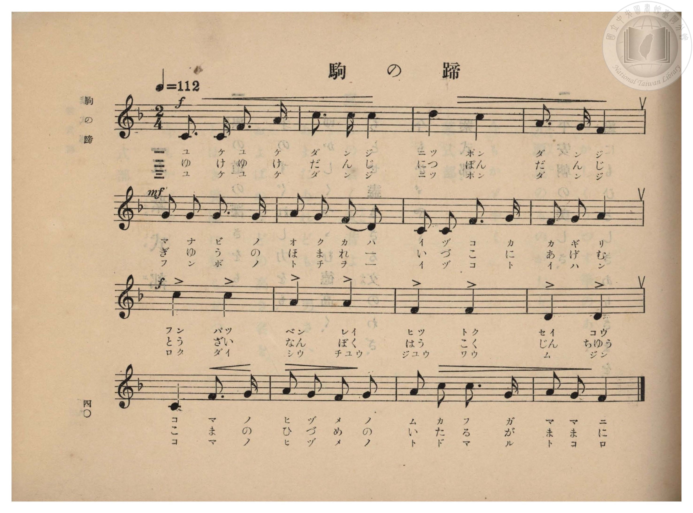
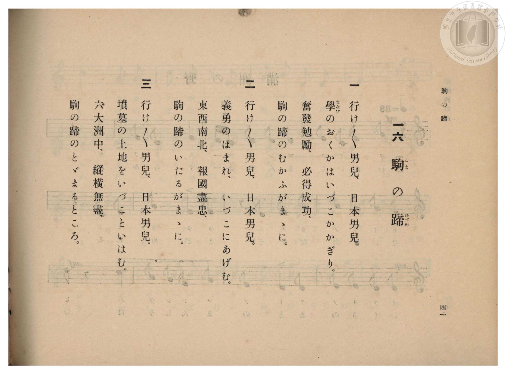

# 駒の蹄

> Re:Shōka 使用 AI 協助辨識與重建樂譜，可能會有錯誤。歡迎回報。

- **鋼琴伴奏版**：<br><audio controls src="koma_no_hizume.mp3"></audio>

- 臺灣總督府《公學校高等科唱歌》第一學年用（昭和十一年，索書號 0729 74）

## 說明

原書資訊與歌詞全文（對應 P042.jpg–P043.jpg，原書 pp. 40–41，第 16 首）：
調性與拍號：ヘ長調（F 大調，1 降記號）2/4 拍，速度 ♩=112
曲風說明：全曲採ヨナ抜き長音階（五聲音階），第三樂句（第 9–12 小節）以四分音符重音連用四字漢語成語
（「奮發勉勵、必得成功」「東西南北、報國盡忠」「六大洲中、縱橫無盡」），節奏剛健明快。


## 歌詞

```text
一
行け〳〵男兒、日本男兒。
學（まなび）のおくかはいづこかかぎり。
奮發勉勵、必得成功、
駒の蹄（ひづめ）のむかふがまゝに。

二
行け〳〵男兒、日本男兒。
義勇のほまれ、いづこにあげむ。
東西南北、報國盡忠、
駒の蹄のいたるがまゝに。

三
行け〳〵男兒、日本男兒。
墳墓の土地をいづこといはむ。
六大洲中、縱橫無盡、
駒の蹄のとゞまるところ。
```

## ABC

<div class="abc-score" data-abc-src="koma_no_hizume.abc" aria-label="五線譜載入中"></div>

[下載 ABC 原始檔](koma_no_hizume.abc)

## TMD 檔案連結

- [主旋律 TMD 檔案](koma_no_hizume.tmd) [[在 TMD Studio 編輯](https://tmdlang.github.io/Tmd-TS/#tmd=s7IKdvYPcrWy4qpTUCpJTLdSSM7PyUlNLsnMz7PKzk9PzM7Ojy_OyM9OVIKrKMvPKc1NBcqW5McbIoSL80uLklOtipMz8vNz4ktSK0qS8vOz0eXjCxLTU60CDEyMcMoYI2QKivLLUvMS84DmFhRl5pWkpoANRihILctMSQVJFycn5sWXpRZlpmWmpiC5NbWoGOQVqBUlRYl5xclFmQUg_yFU5ReVZOSnFyUWZFRaZWQWl-QXZSYn5sRnJ-YhebskIxXo65TEzJzK-JzMtFR0mdzMnMySxKJKZGMz0zPzrEoSM4EhCArF8sT43MTMvJzEPKATtbQUXi6f9Lhx3YudLQpaWlyKtgqGhkZc9rYKblw2RvomdiBzXrTvet64-PmOvc_nLn66a87jhq6nrWuert3xbMHCl6tnPF_b-Xz5xKdTNj5b2_O4ofv5mjVPdjQAZZ_u3PJ8yor3ezqezVj7dFLP095GkPjOLe_39DzfsujZ7B0vZs5XMDA3slQwN3m_p1OJi0tfS8GWWoBLQUHhad98kDWb21-s6HrR0Q5034uV8562rng2rR3orKcbep-1dyqAUoFeVkH6o4bJoGgHMYEuhGhVKCjQUzAxAEqZGIKcvWaNgqGZwstl04Dufb9nFsiOF6v2P2tYDjK9uxfoIaDo4-YZL6duB4oD7XBTeLpkOZjZY6jwcmbvixUzwIo6gUGrANQBFH_ZMP_prmUKj2autAWFPNDIZ7M3vVy04sWqVc9m9AHNAzl49qZnfQsfN6943Nz1rGvO48ZeoA0v529-OQuooOPJrikvGjfBuECHgRz6ZEfnsxVNT_uXAhWA3G0J9IShkcLTDf3P1zcAVT3ZvfTp7NlPO9qA-p6vWfayvRdkQMNiYJSBxNdOf7Zn0YtV8551TACSIFcBzXnc0PN06brnM_c87e582r31cUPj0_2tT_dNByp62jX_cUMvUMGzuRtfLN3_tHf6057pIAULNj6d0_189sKn-xdAFDxtXQsMk2dbNj3ZsRao4PmOjc9Wrn7eshCoBqgA6v71DU-X9j_tnP20cSkwEJ7uX_24oYkL5ApgEgKH-sKex40THzdsftyw9fmU7U9bJwGNejZ96bM5a2DcJnAKWLsD5O7GfY8bVz1u3Aw0HZjUHzd2PW7sf9zY_bhx_ePGlseNSx83TgZzgajvcVMXTDM-vzaCVMCzDtiSTSCTmhqhljQ1gM3b-rgR6NR9j5vmPm5E-GJXDym-eL5v5dPudrDLd4PNAuazRiSXr37c2PS4cRLISogGvJGA6nKwqUBy_uMmoGuxOHVHJ0kBvmjz00VAJ617Omf-0zkbHjcBrYG7cwWYvR7hTrxpAYs7Vzxumgd2IdCpQMMmP24CpiiwSZQXGFCgoKXPxeWdn5vol--RWQWqYgIyE_PyHWoMaqpBFinYGJpp2YFZ2IorBUjxBwwuBQ0TaG7TgZcxmlg0AO0DGVajUJ1Wq2Aar6ALhEDKEMwwAoobg1nGCqZgWhcoYgZlIUQgaoyguoAiYDN9DGsUHjcvA4s8btqIwgbJNEB4zZuBIjvgZj1u7n7c3ALlPm6eC5JHyGHVA7HNCCjf1AaRb5yIwgbKNC6A2j0ZyJ6BMBGUepfAbGvcC5JHyGHVA7HNmF5-wx_Xu3rIiutcYGQbgaMMgnWBUVcDZoGiEhSNZqCkUANJEWACErfIyiAaUWN7HtgHXWASEpKPm_tAvmtaBQ6d9WByNVi8H-LvJlDwP25uBctAwgOkAiQDVte0DiwP0o8W2419YHlQPD9uhMX2OnDM7Qaz94Hle8D690BsawQFP7BEAJNQFzaCbWtsArMngfVA4gI1tqdCYwdEzkH2W3MHmN0IJjch24bNb0DVCBlQGDxuhqQzwrG9o5PsnA21ATMXQ_IuSAQWn_B4hcuBEwN6VE9FpN7HzRMR6RokNxNZbg3EszC5SchZoAOSJKByTbsRSoHh9bgJkqlQIx1Y8kLiGhRb0yARCtUPrGXh-fdx4x5gNYskB6xsEfqA1QGy3AxkfQuBSQqhFjkFrEW4FphdUbzVtB3hWmBSAJYHSK4HZWgUkcfNwGoISRqeAsAK4YUC_uQAbCiRkxyghTwsnmFlPIgHyuMgGiICSiuQ9GKMVjigJQVoygZ5C5T_EfkCnJcgqb95IVQc4V9YOQDKVyDeGrAMpASBkN2odoGjHxFPoNyNyPHgfAfJ103gnAgUR87x88EyEBOBLQ2wDLh8gJIgt6DFNxn-gpQEnSh6wKULRAZsIjAdwe2q5eLStVNArvAVgHxlLgA)]
- [鋼琴伴奏 TMD 檔案](koma_no_hizume_piano.tmd) [[在 TMD Studio 編輯](https://tmdlang.github.io/Tmd-TS/#tmd=s7IKdvYPcrWy4qpTUCpJTLdSSM7PyUlNLsnMz7PKzk9PzM7Ojy_OyM9OVIKrKMvPKc1NBcqW5McbIoSL80uLklOtipMz8vNz4ktSK0qS8vOz0eXjCxLTU60CDEyMcMoYI2QKivLLUvMS84DmFhRl5pWkpoANRihILctMSQVJFycn5sWXpRZlpmWmpiC5NbWoGOSVgszEvPz4xKKixLz01NzUPCQjkAStEjPjE5OT83MLEvMyUVXlF5Vk5KcXJRZkVFplZBaX5BdlJifmxGcn5iGFTEkG0BirlMTMnMr4nMy0VHSZ3MyczJLEokpkYzPTM_OsShIzgYEMCujyxPjcxMy8nMQ8oC-0tBReLp_0uHHdi50t7_d0vOze83zClid7tjxd2v-8s-P9nk4FLS0uRVsFQ0MjLntbBTcuGyN9EzuQ4S_adz1vXPx8x97ncxc_3TXncUPX09Y1T9fueLZg4cvVM56v7Xy-fOLTKRufre153ND9fM2aJzsagLJPd255PmUF0KZnM9Y-ndTztLcRJL5zy_s9Pc-3LHo2e8eLmfMVDMyNLBXMTYC2K3FxeefnJvrle2RWgVJEACiQgzwcagxqqrkUgMDG0EzLDszS11KwRQcKEHtfLOxR0DBReLqh__n6Bh0FUNLQyypI18SiQUsfbFiNQnVarYJpvIIuEAIpQzDDCChuDGYZK5iCaV2giBmUhRCBqDGC6gKKgM30MaxReNy8DCzyuGkjChsk0wDhNW8GiuyAm_W4uftxcwuU-7h5LkgeIYdVD8Q2I6B8UxtEvnEiChso07gAavdkIHsGwsTG1Y8bl8Bsa9wLkkfIYdUDsc2YXn7DH9e7esiK61xgZBuBowyCdYFRVwNmgaISFI1moKRQA0kRYAISt8jKIBpRY3se2AddYBISko-b-0C-a1oFDp31YHI1WLwf4u8mUPA_bm4Fy0DCA6QCJANW17QOLA_SjxbbjX1geVA8P26ExfY6cMztBrP3geV7wPr3QGxrBAX_48alYBLqwkawbY1NYPYksB5IXKDG9lRo7IDIOch-a-4AsxvB5CZk27D5DagaIQMKg8fNkHRGOLZ3dJKds6E2YOZiSN4FicDiEx6vcDlwYkCP6qmI1Pu4eSIiXYPkZiLLrYF4FiY3CTkLdECSBFSuaTdCKTC8HjdBMhVqpK-AxTUotqZBIhSqv3EVIv8-btzzuBEUvDC59cj6JqPKzUDWtxCYpBBqkVPAWoRrgdkVxVtN2xGuBSYFYHmA5HpQhkYRedy8HkUangLACuGFAv7k8HT2bHKSA7SQh8UzrIwH8UB5HERDREBpBZJejNEKB7SkAE3ZIG-B8j8iX4DzEiT1Ny-EiiP8CysHQPkKxFsDloGUIBCyG9UucPQj4gmUuxE5HpzvIPm6CZwTgeLIOX4-WAZi4uPGHrAMuHyAkiC3oMU3Gf6ClASdKHrApQtEBmwiMB3B7arFVt_7INf3JojqHlG5wyPTEFhVx0NoYLwCYwnKN42HMOApCFFZICWEeJB6CMMMiBHa4HIo-iHFD7LdYDtBWo2RNYFF0HVDUyum7WBjkP0AdzswcHTtFJDDJ9rHMFYBQ8wIi5gxWEyZCwA)]

## 分析

```text
================================================================================
📊 TMD Song Profile: [ 駒の蹄 ]
================================================================================
⏱  Duration:       0:17 (17.1s), 16 measures total
🎼 Key & Tempo:    首調基準 F, != 112.0 BPM, <2/4>
   - 分析範圍：      由實際發聲的音符與和弦推測調性；播放脈絡另行呈現
🎤 人聲音域:    C4 (MIDI 60) – D5 (MIDI 74) [跨度: 14 個半音 / 1.2 個八度, 難度: moderate]
   - 最低音:  C4 in [KomaNoHizume #1 @ m.1, 0:00]
   - 最高音: D5 in [KomaNoHizume #1 @ m.3, 0:02]
   - 適合: soprano, mezzo-soprano, contralto, tenor, baritone, bass
🏛  結構:      KomaNoHizume (17.1s)
⚡ 編曲密度:        Peak 1 軌道同時演奏
🗝  調性診斷：       C 大調（純淨自然大調，未偵測到可信轉調）
   - 風格氣質:    純淨自然大調（陽光明朗、易唱易記，無明顯調外色彩）
   - 轉調歷程:    全曲維持單一推測調性（未偵測到可信轉調）
   - 核心骨幹音:  G, C, A, F, D
   - 調性數值:    C 大調 [相關度: 0.83, 穩定度: High, 自然音純度: 100.0%]
   - 候選調性 (K-S): C 大調 (0.83), F 大調 (0.68), A 小調 (0.60)
   - 五度圈歷程:   +0
   - 各段落調性細節:
     • [KomaNoHizume #1]: C 大調 (r: 0.83, 自然音純度: 100.0%)

  [ 五度圈游移軌跡 ]
              [C ]*
         F            G  
      Bb               D  
      Eb               A  
         Ab           E  
            Db       B  
               F# 
     (* = active key center)

  [ 十二半音累積音高分佈 ]
     C  : ███████████████████████   25.8%
     C# :                            0.0%
     D  : ██████████                10.9%
     D# :                            0.0%
     E  :                            0.0%
     F  : ██████████████            15.6%
     F# :                            0.0%
     G  : ████████████████████████  27.3%
     G# :                            0.0%
     A  : ██████████████████        20.3%
     A# :                            0.0%
     B  :                            0.0%
--------------------------------------------------------------------------------
Assignment 軌道音域：
  - Piano         : C4 – D5 (14 個半音 / 1.2 個八度, 49 個音符)
================================================================================
```


## 原書掃描頁






