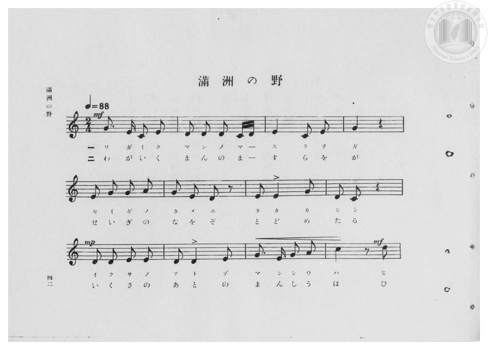
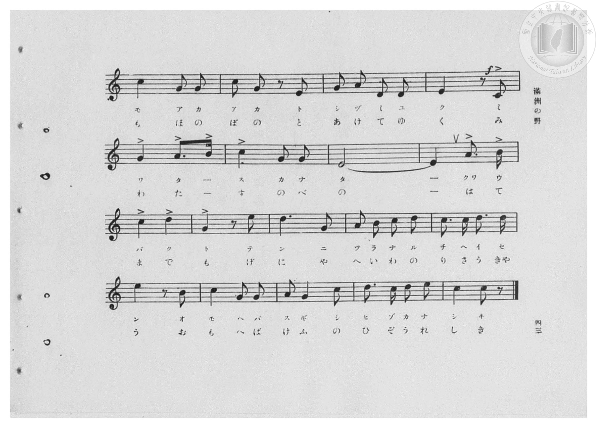
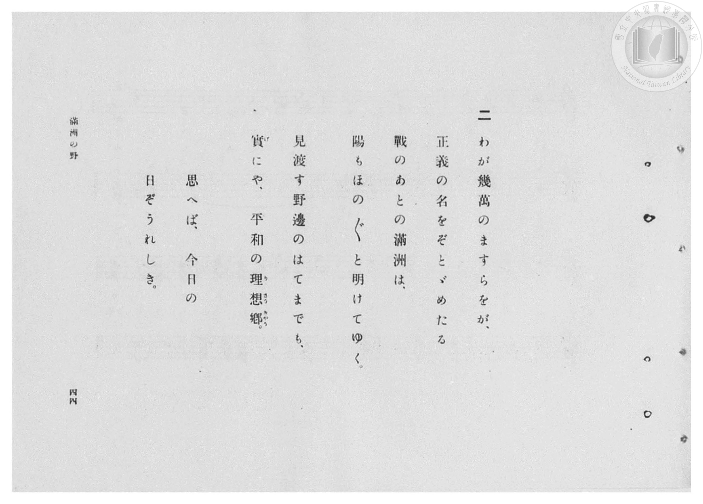
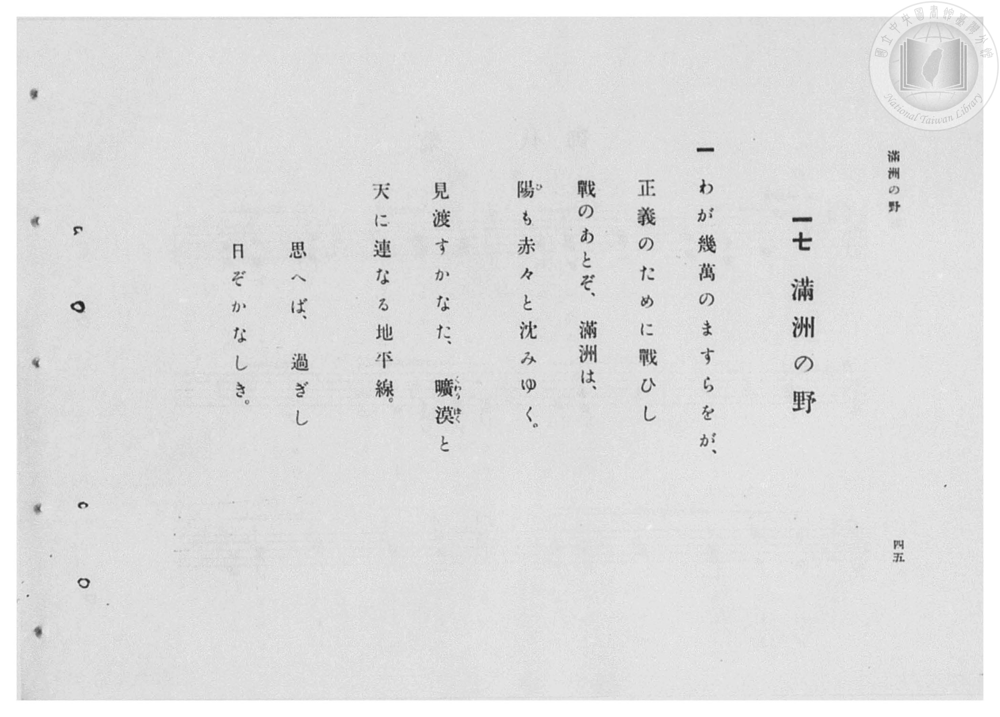

# 滿洲の野

> Re:Shōka 使用 AI 協助辨識與重建樂譜，可能會有錯誤。歡迎回報。

- **鋼琴伴奏版**：<br><audio controls src="manshu_no_no.mp3"></audio>
- **NEUTRINO 歌聲合成版**：<br><audio controls src="manshu_no_no_neutrino.mp3"></audio>

- 臺灣總督府《公學校高等科唱歌》第一學年用（昭和十一年，索書號 0729 74）

## 說明

原書資訊與歌詞全文（對應 P044.jpg–P047.jpg，原書 pp. 42–45，第 17 首）：
調性與拍號：ハ長調（C 大調，無升降記號）2/4 拍，速度 ♩=88
頁序說明：原書為右翻直排，P047.jpg 為第 45 頁（第一段歌詞），P046.jpg 為第 44 頁（第二段歌詞）。


## 歌詞

```text
一
わが幾萬のますらをが、
正義のために戰ひし
戰のあとぞ、滿洲は、
陽（ひ）も赤々と沈みゆく。
見渡すかなた、曠漠（くわうばく）と
天に連なる地平線。
思へば、過ぎし
日ぞかなしき。

二
わが幾萬のますらをが、
正義の名をぞとゞめたる
戰のあとの滿洲は、
陽もほの〳〵と明けてゆく。
見渡す野邊のはてまでも、
實（げ）にや、平和の理想鄉（りさうきやう）。
思へば、今日の
日ぞうれしき。
```

## ABC

<div class="abc-score" data-abc-src="manshu_no_no.abc" aria-label="五線譜載入中"></div>

[下載 ABC 原始檔](manshu_no_no.abc)

## TMD 檔案連結

- [主旋律 TMD 檔案](manshu_no_no.tmd) [[在 TMD Studio 編輯](https://tmdlang.github.io/Tmd-TS/#tmd=s7IKdvYPcrWy4qpTUCpJTLdSSM7PyUlNLsnMz7PKzk9PzM7Ojy_OyM9OVIKrKMvPKc1NBcqW5McbIoSL80uLklOtipMz8vNz4ktSK0qS8vOz0eXjCxLTU60CDExMcMqY4pQxwyljjpApKMovS81LzAO6paAoM68kNQXsGISC1LLMlFSQdHFyYl58WWpRZlpmagqS_1KLikHeh1pRUpSYV5xclFkAChOEqvyikoz89KLEgoxKq4zM4pL8oszkxJz47MQ8pKAqyUgFhlRuZk5mSWJRJbp4eirUAHQJiHlIwkDD0zPzrEoSM4FxAYqP8sT43MTMvJzEPKDDtbQUnu3e_2zLpseN61629yloaXEp2ipYWHDZ2yo4c9kY6ZvYgUx60b7reePi5zv2Pp-7-OmuOY8bup62rnm6dsezBQtfrp7xfG3n8-UTn07Z-Gxtz-OG7udr1jzZ0QCUfbpzy_MpK97v6Xg2Y-3TST1PextB4ju3vN_T83zLomezd7yYOV_BwNzIUsHc5P2eTiUuLn0tBVtqAS4FBYWnffNB1mxuf7Gi60VHO9B9L1bOe9q64tm0dqCznm7ofdbeqQBKUXpZBemPGiaDkgOICXQhRKtCQYGegokRUMrEFOTsNWsUDM0VXi6bBnTv-z2zQHa8WLX_WcNykOndvUAPAUUfN_e_nLodKA60w1nh6ZLlYGbP85aFT3vbX87sfbFiBlhhJzB4FYC6gHIvG-Y_3bVM4dHMlbbAwAea-nJB49Nd_S9WrXo2ow9oJMQ1z5t2Pe3f_Hz_7ueztzzrmwTUB3OwAlAK5DgTU5BOoL2QSHi2bivEz2DnglSboag2QVK9qwdZ9eOGJi6QO4CGgKjHTf2PG3ue7tz3YsIaYFJ53LjvcePMx02dj5smAcUfNzSCFD1bu_j5vpVg6fmPmxofN65-1rHhcSMwbU0HS4M4QLmmx40rHjfOA2qCJb31UANeztwLdAxQB8gBTU0vti553NAKVP1sE1Bw_-OmtseN_SCHgUJ9WfezHQtBjmjsfty4CmQj0LzZC57tWQA2oh_sYqAGoJ39IOMaV4ATxBKg-1a_bFgM0tPU_XTOhqc7Nz_fPgtq6rOGuY8bd4A0NTS-bOx7DEIQt09fCnIy1K7pjxt74QG0q4f0AHo6oRcsATRxxeOmeeDAAgZZN2YwrcMSRsCgedy4G6SoYfPjhq2gAJoBdOjEx43LsIcRMGe_bOoCm7oepAjkuOUgUyBGPl2_DBxmwAQFDKfVj5tagBLAcAHmWaCe5xPanjVvftkCTEAdj0GmTAWHK9ADLUAGNKmghd2T3V3gEFuHHHZtj5uA5sHCDihBeR6HAgUtfS4uX2BZm1Hql--XbxWQmZiX71BjUFMNskbBxtBMyw7Mwla-KECyyouFPQoaJgpPN_Q_X9-gAy8UNLFoANoGMqxGoTo3rVbBVEEXCI0VDMGkLlDYCEjCsCGQrAGLgyBCDUSXroIBlK4BG-ljWKPwuHk9WORx0xogXgJmgURAMvNAvObNYLIPTM4D4j0guaadUJMeN68Ek5sgeoCmQMTjUW0yAsn1Q3Q09gBxC5gFEgHKNO4D2zsZLLYOTO6D2dQ4E2ZTUyeYnATV04NhE_5A39VDTqCDwg8UeiBsBg9LkCgovEHhCVEDC3OQLCROQKGPJbybdoN9AQlpsF_BYQuS2Q_mLQST3VCfwcXBJCQcVkPjBxQSj5u2Yw_txtngcISEMzj2wCELklkFD0dgTkHY07gCLAKKT4g9jVDx-WAezEXEhPWOTvISeEEtPCnDAhWRwCEJH5GcjZEixTAOqgAU4uCMYgQSQQ53RNp-3LQVJdwXgXkdcH-DUiMs_UNyACSUHzctg8pAUjIkPCDxgBzyiLQNLL5QQr4JzAOFMyQnwMRBNkJyALDIAsu0QWUguRNqUyM4l-EP-6ezZ2OGvSnBsIcHICyxQ4VATFCYIgIeFOCwKEGUNeBwBwY7KNUjly6gsIX4DRzKsLSLxIOEISj0QeLgcG5uBZPgdNcMDXNwzCHCHCSHXLaAQhYSpuD8BQ_ZPXAeJARBYY-IiYlgEmQDsCqDyqDEbSMo1xEsWaaQE-KwMhkUnroK5tjjAJbuYbAGzoJrwyjKEYUFRmENDvDHzV3QIIUVKZimA4MbUTMsw1KKg8IGFAdwSxDlNLQEB1kKEgfxcFgCTd2gGCCUqlvXgsPYlMxUDS4NILYj14XG4EICIQsL_Bpw8JoDMdgESFkCMw1IQTUAKeTgn4AIPLhtiHIFkm6hqQxcq8LDAVzag0TBJQe0RgVF0uNmWFkPKotB_BnQkgxky26UUgdShoBCcznCdni-gKRmWN0JMhUR1SBbQaI7wGrAbgDHMjwXNYHcAinNICUTiA1qkhGuCJrJiTZwtMDiCBQLWPMGKIpgkQmWhkckLIag0QvXC2aA62ykWIPFBDiEmkB1I0q5BQxxEAmKW1hWgtTbkLADlVewuhhSd6BnMpAKiNxaqC3IsQYJTVj8wPQgSjNInGyAiEPLK1DtBZGFlXKgegHEB7bPwCYC275QGVBtAo0vuO21XFy6dgqIFqwCkKfMBQA)]
- [鋼琴伴奏 TMD 檔案](manshu_no_no_piano.tmd) [[在 TMD Studio 編輯](https://tmdlang.github.io/Tmd-TS/#tmd=s7IKdvYPcrWy4qpTUCpJTLdSSM7PyUlNLsnMz7PKzk9PzM7Ojy_OyM9OVIKrKMvPKc1NBcqW5McbIoSL80uLklOtipMz8vNz4ktSK0qS8vOz0eXjCxLTU60CDExMcMqY4pQxwyljjpApKMovS81LzAO6paAoM68kNQXsGISC1LLMlFSQdHFyYl58WWpRZlpmagqS_1KLikHeL8hMzMuPTywqSsxLT81NzUMyAknQKjEzPjE5OT-3IDEvE1VVflFJRn56UWJBRqVVRmZxSX5RZnJiTnx2Yh5SaJZkAI2xys3MySxJLKpEF09PhRqALgExD0kYaHh6Zp5VSWImMLpAUVaeGJ-bmJmXk5gH9JuWlsKz3fufbdn0uHHdy_a-93s6XnbveT5hy5M9W54u7X_e2fF-T6eClhaXoq2ChQWXva2CM5eNkb6JHcj4F-27njcufr5j7_O5i5_umvO4oetp65qna3c8W7Dw5eoZz9d2Pl8-8emUjc_W9jxu6H6-Zs2THQ1A2ac7tzyfsgJo0bMZa59O6nna2wgS37nl_Z6e51sWPZu948XM-QoG5kaWCuYmQMuVuLh8E_OKM0r98v3yrQJAQR_k4VBjUFPNpQAENoZmWnZglr6Wgi06UIDY-mJhj4KGicLTDf3P1zfoKIASmV5WQbomFg1a-mDDahSqc9NqFUwVdIHQWMEQTOoChY2AJAwbAskasDgIItRAdOkqGEDpGrCRPoY1Co-b14NFHjetAeIlYBZIBCQzD8Rr3gwm-8DkPCDeA5Jr2gk16XHzSjC5CaIHaApEPB7VJiOQXD9ER2MPELeAWSARoEzjPrC9k8Fi68DkPphNjTNhNjV1gslJUD09GDbhD_RdPeQEOij8QKEHwmbwsASJgsIbFJ4QNbAwB8lC4gQU-ljCu2k32BeQkAb7FRy2IJn9YN5CMNkN9RlcHExCwmE1NH5AIfG4aTv20G6cDQ5HSDiDYw8csiCZVfBwfNwIimOoPY0rwCKg-ITY0wgVnw_mwVxETFjv6CQvgRfUwpMyLFARCRyS8BHJ2RgpUgzjoApAIQ7OKEYgEeRwR6Ttx01bUcJ9EZjXAfc3KDXC0j8kB0BC-XHTMqgMJCVDwgMSD8ghj0jbjxunooR8E5gHCmdIToCJg2yE5IDHjdPBMm1QGUjuhNrUCM5l-MP-6ezZmGFvSjDs4QEIS-xQIRATFKaIgAcFOCxKEGUNONyBwQ5K9cilCyhsIX4DhzIs7SLxIGEICn2QODicm1vBJDjdNUPDHBxziDAHySGXLaCQhYQpOH_BQ3YPnAcJQVDYI2JiIpgE2fC4CRbiKHHbCMp1BEuWKeSEOKxMBoWnroI59jiApXsYrIGz4NowinJEYYFRWIMD_HFzFzRIYUUKpunA4EbUDMuwlOKgsAHFAdwSRDkNLcFBloLEQTwclkBTNygGCKXq1rXgMDYlM1WDSwOI7ch1oTG4kEDIwgK_Bhy85kAMNgFSlsBMA1JQDUAKOfgnIAIPbhuiXIGkW2gqA9eq8HAAl_YgUXDJAa1RQZH0uBlW1oPKYhB_BrQkA9myG6XUgZQhoNBcjrAdni8gqRlWd4JMRUQ1yFaQ6A6wGrAbwLEMz0VNILdASjNIyQRi94I0EqwImsmJNnC0wOIIFAtY8wYoimCRCZaGRyQshqDRC9cLZoDrbKRYg8UEOISaQHUjSrkFDHEQCYpbWFaC1NuQsAOVV7C6GFJ3oGcykAqI3FqoLcixBglNWPzA9CBKM0icbICIQ8srUO0FkYWVcqB6AcQHts_AJj5uArWOQDKg2gQaX3DbazEbsD7IDVgTRPsV0VpF5Kl4BdP4eFBGApJGIAZcBMgwQEoSiFYXsmYTmFK4HoRxQA6qdkhDAlFmQtWg2I1qILJ2aF2I6XQgA2wMXpeDS3U8Loe7AcQAy6HYDSmxcNsN1w7SihoWqEEAzkJYzYEzjGEGolgBimhdOwVEXEf7GMYqoIkYgUWUuQA)]

## 分析

```text
================================================================================
📊 TMD Song Profile: [ 滿洲の野 ]
================================================================================
⏱  Duration:       0:40 (40.9s), 30 measures total
🎼 Key & Tempo:    首調基準 C, != 88.0 BPM, <2/4>
   - 分析範圍：      由實際發聲的音符與和弦推測調性；播放脈絡另行呈現
🎤 人聲音域:    C4 (MIDI 60) – E5 (MIDI 76) [跨度: 16 個半音 / 1.3 個八度, 難度: moderate]
   - 最低音:  C4 in [ManshuNoNo #1 @ m.1, 0:00]
   - 最高音: E5 in [ManshuNoNo #1 @ m.22, 0:29]
   - 適合: soprano, mezzo-soprano, contralto, tenor, baritone, bass
🏛  結構:      ManshuNoNo (40.9s)
⚡ 編曲密度:        Peak 1 軌道同時演奏
🗝  調性診斷：       G 大調（純淨自然大調，未偵測到可信轉調）
   - 風格氣質:    純淨自然大調（陽光明朗、易唱易記，無明顯調外色彩）
   - 轉調歷程:    全曲維持單一推測調性（未偵測到可信轉調）
   - 核心骨幹音:  D, G, C, E, A
   - 調性數值:    G 大調 [相關度: 0.83, 穩定度: Moderate, 自然音純度: 100.0%]
   - 候選調性 (K-S): G 大調 (0.83), C 大調 (0.74), E 小調 (0.58)
   - 五度圈歷程:   +1
   - 各段落調性細節:
     • [ManshuNoNo #1]: G 大調 (r: 0.83, 自然音純度: 100.0%)

  [ 五度圈游移軌跡 ]
               C  
         F           [G ]*
      Bb               D  
      Eb               A  
         Ab           E  
            Db       B  
               F# 
     (* = active key center)

  [ 十二半音累積音高分佈 ]
     C  : ██████████████████        21.1%
     C# :                            0.0%
     D  : ████████████████████████  27.5%
     D# :                            0.0%
     E  : ████████████████          18.3%
     F  :                            0.0%
     F# :                            0.0%
     G  : ████████████████████      22.9%
     G# :                            0.0%
     A  : ██████                     7.3%
     A# :                            0.0%
     B  : ██                         2.8%
--------------------------------------------------------------------------------
Assignment 軌道音域：
  - Piano         : C4 – E5 (16 個半音 / 1.3 個八度, 87 個音符)
================================================================================
```


## 原書掃描頁










