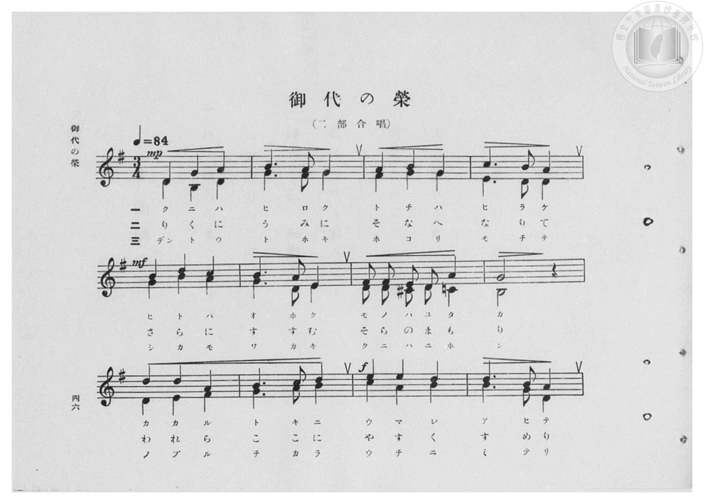
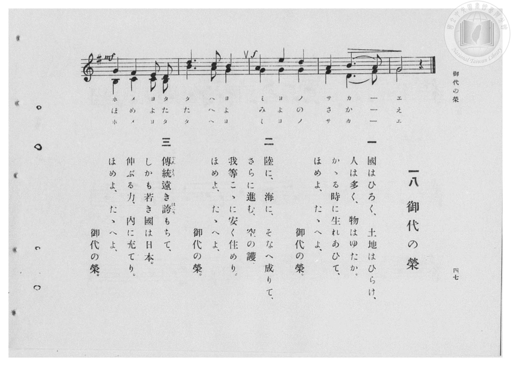

# 御代の榮

> Re:Shōka 使用 AI 協助辨識與重建樂譜，可能會有錯誤。歡迎回報。

- **鋼琴伴奏版**：<br><audio controls src="miyo_no_sakae.mp3"></audio>

- 臺灣總督府《公學校高等科唱歌》第一學年用（昭和十一年，索書號 0729 74）

## 說明

原書資訊與歌詞全文（對應 P048.jpg–P049.jpg，原書 pp. 46–47，第 18 首）：
調性與拍號：ト長調（G 大調，1 升記號）3/4 拍，速度 ♩=84，二部合唱


## 歌詞

```text
一
國はひろく、土地はひらけ、
人は多く、物はゆたか。
かゝる時に生れあひて、
ほめよ、たゝへよ、御代の榮。

二
陸に、海に、そなへ成りて、
さらに進む、空の護、
我等こゝに安く住めり。
ほめよ、たゝへよ、御代の榮。

三
傳統（でんとう）遠き誇（ほこり）もちて、
しかも若き國は日本。
伸ぶる力、内に充てり。
ほめよ、たゝへよ、御代の榮。
```

## ABC

<div class="abc-score" data-abc-src="miyo_no_sakae.abc" aria-label="五線譜載入中"></div>

[下載 ABC 原始檔](miyo_no_sakae.abc)

## TMD 檔案連結

- [主旋律 TMD 檔案](miyo_no_sakae.tmd) [[在 TMD Studio 編輯](https://tmdlang.github.io/Tmd-TS/#tmd=s7IKdvYPcrWy4qpTUCpJTLdSSM7PyUlNLsnMz7PKzk9PzM7Ojy_OyM9OVIKrKMvPKc1NBcqW5McbIoSL80uLklOtipMz8vNz4ktSK0qS8vOz0eXjCxLTU60CDEwscMpYImQKivLLUvMS84DmFhRl5pWkpoANRihILctMSQVJFycn5sWXpRZlpmWmpiC5NbWoGOQVqBUlRYl5xclFmQUg_yFU5ReVZOSnFyUWZFRaZWQWl-QXZSYn5sRnJ-YhebskIxXo6-TUotTc_LxKDPHMssxkZBMz0zPzrEoSM4GBBwrA8sT43MTMvJzEPKDrtLQUnu5b-GT34seN654tW6egpcWlaKtgYcJlb6vgzmVjrG9iBzLpRfuu542Ln-_Y-3zu4qe75jxu6Hrauubp2h3PFix8uXrG87Wdz5dPfDpl47O1PY8bup-vWfNkRwNQ9unOLc-nrHi_p-PZjLVPJ_U87W0Eie_c8n5Pz_Mti57N3vFi5nwFA3MjSwVzk_d7OpW4uPS1FGypBbgUFBSe9s0HWbO5_cWKrhcd7UD3vVg572nrimfT2oHOerqh91l7pwIoCehlFaQ_apgMinMQE-hCiFaFggI9BRMzoJSJOcjZa9YoGFoovFw2Deje93tmgex4sWr_s4blINO7e4EeAoo-bu54OXU7UBxoh7vC0yXLwcweQ4WnvUCHzAAr6gQGrQJQB1D8ZcP8p7uWKTyaudLWAhgOPU929bxsXvF0QgcwRLlANgBDDeyZOd2PG9c_btz0uKn3cWP_44bGp3PmP52zASbY-bhxIlAQrGPXLqDo0yWzIOqed64EKWpqe9w4_3Fj9-OGJpAiEKtp7uOm7mczmx43rn4-Zf7jpp7HjUD2pseNy6AmPW7c_bip8XFTB5AP0g3U0LgDwkVOOCAjIRb3gKiXM3cATQSqebZ1O4TxuBGocRVQ77OOCY-bupAtmAp2-uqXDUA_NIBcuxLo-HUv1m6HqnjWMRGYwh43TgZbvvrpOiC7_8nefrC7uuCeIc2dOzrBQdq0-fnWjcBoety4_HHT5MeNKx43tgEj52XjgseNvS9WgVIJyGSQ3V1A8cdNwNBZiOz46eBQbHrRvRSoARJDz6YvfTZnDdRdT_YAQ2IbMJCfds0GuaWtFeSFViC5jCzHA1VTnjWgQEFLn4vLN7My3y8_ODE7MdUqOL8AWCzlO9QY1FSDbFKwsdCyAzOAGROSrV8s7FHQMFF4uqH_-foGHXje0QSZBVJYo1CdW1CrYBqvoKtgCMRGQFyjYAwkQWyQSA1YDCQC4ZmA5YwhKsFm-BjWKDxuWg_kP27uBpP9YJWPmyeB1T5uXguVB4l1gEUasapbCVS3EWGuEcjcLpBMI0glMCYg6hvbIOob9yOJzQWLrAKTO6BiIB6QDzQDGH8Ic41BdrY_bt4MthTsoCawNJQHEp0NFFsLFZsNVgFRDTISJLYIqq4RiEHOqQGnU1jA7-ohJuDTasHhagrEoFBFhLsZKDpqFMzjQQjIAUYPJGJAUQCCBqiBDw5AWNBCA7UJ6nmwT2CBvwiI-8BqHjcvA4rvh6oFBSIIgu1FBH7jVLDPO1ECfyY08GcCZRrggQ9SBUz2QLwPyG6CmguKPDRzQYHftB1sLshESEiC3AZyI0QUHvJAd4OSFMS9IBoUEyC1oLhAmIuS5DsJhzwowEEYObGbgEWAsQKMFDMgC4QhIiASW4IHux7qB2jYwFIP0P2QrABSB0pZj5vngck1UDFY6pkETz2IBA9O6k098JAHhe9kaJhPRsRDUws0FmDZAylumoCpEhz2yAm-D2zjNBT3grIhNMyBmQ_ZvZAMCvVD83yoe9tgOQA5zJ_Ong0Oc1PkMAfXy-ipHZR8gSkaGLrgNA0LWxNwHEDCHhTKiLCHFT2guMKd-sH5s3khmFwBTtUgf4DSNkhkBlgU4Q8IDxIeIHVb4fEIEt0DFgOpwJYfdkNDF0R2APnzwaEODR1gsQMShcQEyHYID5QrIGLg3NQIClO4TY2QFIORQ2jup1rUqsQxp4RgPYKlyjAGEWAWLHaA0QupJ8DxDGJCuOAiDawWohxLcYmZVkBRj1zwAbVCi0aIOSbqEAoiBnYMIn1glgqIAgCaBqGpEWa8EVI6BBXIsNQHKyMMsbgdmvjRSnWQMrCrgASQg16jgiyABQ1SaIFNB7sJPa0DY0vXTgEpwqJ9DGMVgELKXAA)]
- [鋼琴伴奏 TMD 檔案](miyo_no_sakae_piano.tmd) [[在 TMD Studio 編輯](https://tmdlang.github.io/Tmd-TS/#tmd=s7IKdvYPcrWy4qpTUCpJTLdSSM7PyUlNLsnMz7PKzk9PzM7Ojy_OyM9OVIKrKMvPKc1NBcqW5McbIoSL80uLklOtipMz8vNz4ktSK0qS8vOz0eXjCxLTU60CDEwscMpYImQKivLLUvMS84DmFhRl5pWkpoANRihILctMSQVJFycn5sWXpRZlpmWmpiC5NbWoGOSVgszEvPz4xKKixLz01NzUPCQjkAStEjPjE5OT83MLEvMyUVXlF5Vk5KcXJRZkVFplZBaX5BdlJifmxGcn5iGFTEkG0Bir5NSi1Nz8vEoM8cyyzGRkEzPTM_OsShIzgeELCuPyxPjcxMy8nMQ8oAe0tBSe7lv4ZPfix43rni1b935Px8vuPc8nbHmyZ8vTpf3POzve7-lU0NLiUrRVsDDhsrdVcOeyMdY3sQMZ_6J91_PGxc937H0-d_HTXXMeN3Q9bV3zdO2OZwsWvlw94_nazufLJz6dsvHZ2p7HDd3P16x5sqMBKPt055bnU1YALXo2Y-3TST1PextB4ju3vN_T83zLomezd7yYOV_BwNzIUsHcBGi5EheXb2Zlvl9-cGJ2YqpVcH4BMBjzHWoMaqq5FIDAxkLLDszQ11KA2PFiYY-ChonC0w39z9c36CiA0oBeVkG6poKWPlhhjUJ1bkGtgmm8gq6CIRAbAXGNgjGQBLFBIjVgMZAIhGcCljOGqASb4WNYo_C4aT2Q_7i5G0z2g1U-bp4EVvu4eS1UHiTWARZpxKpuJVDdRoS5RiBzu0AyjSCVjxtXQ9Q3tkHUN-5HEpsLFlkFJndAxUA8IB9oxuPGZQhzjUF2tj9u3gy2FOygJrA0lAcSnQ0UWwsVmw1WAVENMhIktgiqrhGIQc6p4UIO-F09xAR8Wi04XE2BGBSqiHA3A0VHjYJ5PAgBOcDogUQMKApA0AA18MEBCAtaaKA2QT0P9gks8BcBcR9YzePmZUDx_VC1oEAEQbC9iMBvnAr2eSdK4M-EBv5MoEwDPPBBqoDZBoj3AdlNUHNBkYdmLijwm7aDzQWZCAlJkNtAboSIwkMe6G5QkoK4F0SDYgKkFhQXCHNRknwn4ZAHBTgIIyd2E7AIMFaAkWIGZIEwRAREYkvwYNdD_QANG1jqAbofkhVA6kAp63HzPDC5BioGSz2T4KkHkeDBSb2pBx7yoPCdDA3zyYh4aGqBxgIseyDFTRMwVYLDHjnB94FtnIbiXlA2hIY5MPMhuxeSQaF-aJ4PdW8bLAcgh_nT2bPBYW6KHOaW2FI7KPkCUzQwdMFpGha2JuA4gIQ9KJQRYQ8rekBxhTv1g_Nn80IwuQKcqkH-AKVtkMgMsCjCHxAeJDxA6rbC4xEkugcsBlKBLT_shoYuiOwA8ueDQx0aOsBiByQKiQmQ7RAeKFdAxMC5qREUpnCbGiEpBiOH0NxPtahViWNOCcF6BEuVYQwiwCxY7ACjF1JPgOMZxIRwwUUaWC1EOZbiEjOtgKIeueADaoUWjRBzTNQhFEQM7BhE-sAsFRAFADQNQlMjzHgjpHQIKpBhqQ9WRhhicTs08aOV6iBlYFcBCSAHvUYFWQALGqTQApsOdhN6WkeLrQBQy8rHg7QIM4RYgSCBlsAiBRhpsHAFRxs8boFZEKEGqo1w1CHsAOuGW2QOFDOD2g2RB_FALBNkFyE5Am80goyDqkO1BxLq8KiExwaKJ8FcLF7CGqMIS3CHHapdyMEHsxBEY_MjMHp17RSQYjjaxzBWAV3ICFPIGCykzAUA)]

## 分析

```text
================================================================================
📊 TMD Song Profile: [ 御代の榮 ]
================================================================================
⏱  Duration:       0:36 (36.4s), 17 measures total
🎼 Key & Tempo:    首調基準 G, != 84.0 BPM, <3/4>
   - 分析範圍：      由實際發聲的音符與和弦推測調性；播放脈絡另行呈現
🎤 人聲音域:    D4 (MIDI 62) – E5 (MIDI 76) [跨度: 14 個半音 / 1.2 個八度, 難度: moderate]
   - 最低音:  D4 in [MiyoNoSakae[L1] #1 @ m.1, 0:00]
   - 最高音: E5 in [MiyoNoSakae[L1] #1 @ m.11, 0:21]
   - 適合: soprano, mezzo-soprano, contralto, tenor, baritone, bass
🏛  結構:      MiyoNoSakae[L1] (36.4s)
⚡ 編曲密度:        Peak 2 軌道同時演奏
🗝  調性診斷：       G 大調（純淨自然大調，未偵測到可信轉調）
   - 風格氣質:    純淨自然大調（陽光明朗、易唱易記，無明顯調外色彩）
   - 轉調歷程:    全曲維持單一推測調性（未偵測到可信轉調）
   - 核心骨幹音:  G, B, D, A, E
   - 調性數值:    G 大調 [相關度: 0.93, 穩定度: High, 自然音純度: 99.5%]
   - 候選調性 (K-S): G 大調 (0.93), B 小調 (0.73), D 大調 (0.72)
   - 五度圈歷程:   +1
   - 各段落調性細節:
     • [MiyoNoSakae[L1] #1]: G 大調 (r: 0.93, 自然音純度: 99.5%, 調外音: C#)

  [ 五度圈游移軌跡 ]
               C  
         F           [G ]*
      Bb               D  
      Eb               A  
         Ab           E  
            Db       B  
               F# 
     (* = active key center)

  [ 十二半音累積音高分佈 ]
     C  : ███████                    7.1%
     C# : █                          0.5%
     D  : █████████████████████     20.4%
     D# :                            0.0%
     E  : █████████                  8.7%
     F  :                            0.0%
     F# : ██████                     6.1%
     G  : ████████████████████████  23.5%
     G# :                            0.0%
     A  : █████████████             12.8%
     A# :                            0.0%
     B  : █████████████████████     20.9%
--------------------------------------------------------------------------------
Assignment 軌道音域：
  - Alto          : B3 – C5 (13 個半音 / 1.1 個八度, 50 個音符)
  - Soprano       : D4 – E5 (14 個半音 / 1.2 個八度, 50 個音符)
================================================================================
```


## 原書掃描頁






