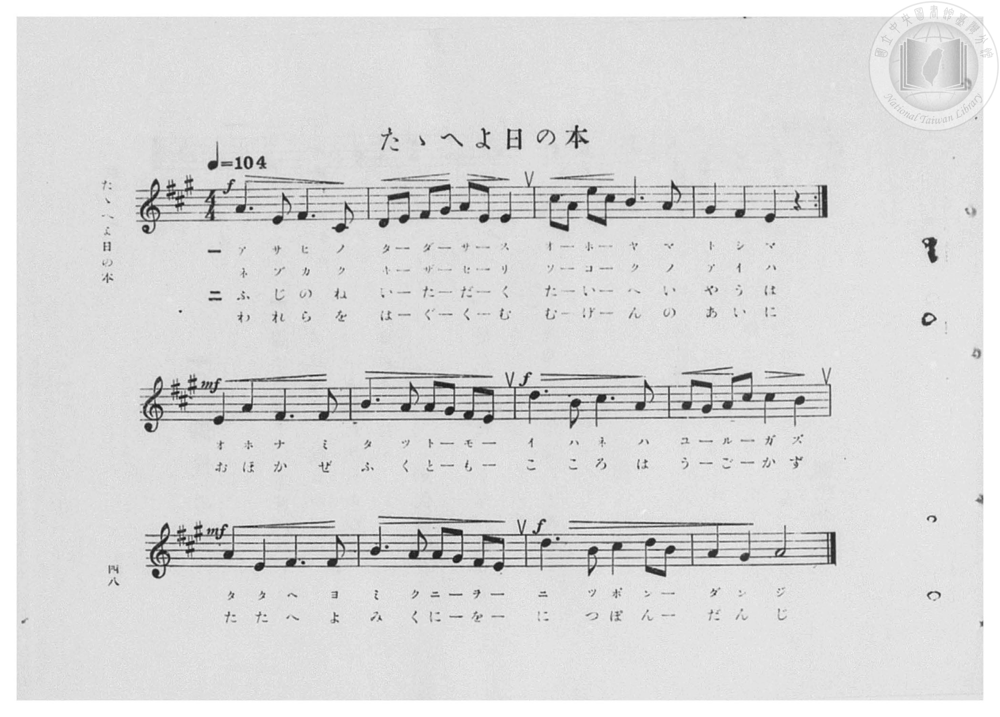
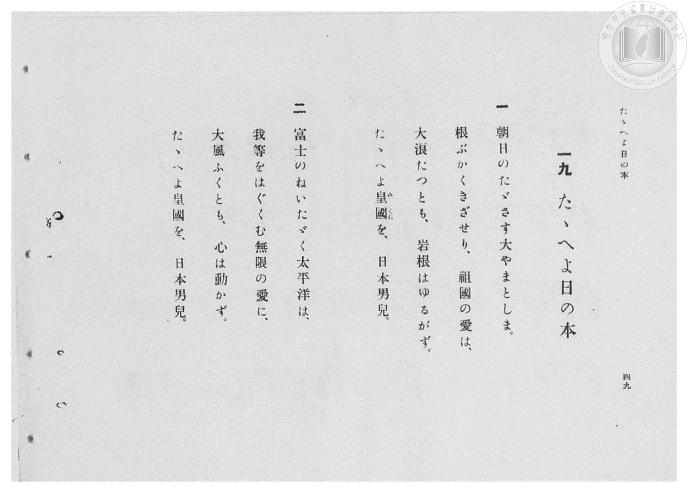

# たゝへよ日の本

> Re:Shōka 使用 AI 協助辨識與重建樂譜，可能會有錯誤。歡迎回報。

- **鋼琴伴奏版**：<br><audio controls src="tataeyo_hinomoto.mp3"></audio>

- 臺灣總督府《公學校高等科唱歌》第一學年用（昭和十一年，索書號 0729 74）

## 說明

原書資訊與歌詞全文（對應 P050.jpg–P051.jpg，原書 pp. 48–49，第 19 首）：
調性與拍號：イ長調（A 大調，3 升記號）4/4 拍，速度 ♩=104
樂譜結構：第一行（4 小節）末有反覆記號 :|，反覆演唱每節前二句後進入第二、三行。


## 歌詞

```text
一
朝日のたゞさす大やまとしま。
根ぶかくきざせり、祖國の愛は、
大浪たつとも、岩根はゆるがず。
たゝへよ皇國（みくに）を、日本男兒。

二
富士のねいたゞく太平洋は、
我等をはぐくむ無限の愛に、
大風ふくとも、心は動かず。
たゝへよ皇國を、日本男兒。
```

## ABC

<div class="abc-score" data-abc-src="tataeyo_hinomoto.abc" aria-label="五線譜載入中"></div>

[下載 ABC 原始檔](tataeyo_hinomoto.abc)

## TMD 檔案連結

- [主旋律 TMD 檔案](tataeyo_hinomoto.tmd) [[在 TMD Studio 編輯](https://tmdlang.github.io/Tmd-TS/#tmd=s7IKdvYPcrWy4qpTUCpJTLdSSM7PyUlNLsnMz7PKzk9PzM7Ojy_OyM9OVIKrKMvPKc1NBcqW5McbIoSL80uLklOtipMz8vNz4ktSK0qS8vOz0eXjCxLTU60CDEwNcMogmVlQlF-WmpeYBzS3oCgzryQ1BWwwQkFqWWZKKki6ODkxL74stSgzLTM1BcmtqUXFIK9ArSgpSswrTi7KLAD5D6Eqv6gkIz-9KLEgo9IqI7O4JL8oMzkxJz47MQ_J2yUZqUBfJ6cWpebm51ViiGeWZSajC6anQk1FtiozPTPPqiQxExiqoJAtT4zPTczMy0nMAzpbS0vhceP8x01zHzfueNzU8Wz60seN657NWaOgpcWlaKtgaGDCZW-r4MhlY6JvYgcy80X7rueNi5_v2Pt87uKnu-Y8buh62rrm6dodzxYsfLl6xvO1nc-XT3w6ZeOztT2PG7qfr1nzZEcDUPbpzi3Pp6x4v6fj2Yy1Tyf1PO1tBInv3PJ-T8_zLYuezd7xYuZ8BQNzI0sFc5P3ezqVuLj0tRRsqQW4FBQUnvbNB1mzuf3Fiq4XHe1A971YOe9p64pn09qBznq6ofdZe6cCKJXoZRWkP2qYDEoWICbQhRCtCgUFegomFkApE0uQs9esUTC0VHi5bBrQve_3zALZ8WLV_mcNy0Gmd_cCPQQUfdy05OXU7UBxoB2OCk-XLAcze4wVnvYCHTIDrKgTGLQKQB1A8ZcN85_uWqbwaOZKW1DIA418tqLpxdo5z7dOeLa8G2geJEBfLOwBmmei8HRD__P1DUATns1Z_WxO59P-3hfL2iDGKljVgFwOFnm2ZwooRtaDFD_t7H2yCyi-9Ok-oG2bnrYuBRm5CxhZwBjpBBr8uKGJC2Qx0Bqw_XPmQtIEOJXMe9w49XHjTKA_Hje1PG7c97hxxePG6SAGUBdI9YKdjxu3PW7sftzY_7ix93HjtMeNsx83dQFNf7502tM5QPF1z1pmP25cDxQBx8qS5c-2rgKZ3bgEZFhTE1Di6aaVYIPWP25qe9wE1NPzuHEW1AbkxPp8VjvQSGBIPG7cD7ZwNTAoHjdNAhoBdDMwET-fsv1pK5AL9dGuHrCV63ueLl4N9tHax41AX0D81f90yaqnOzc_2wK0D-a6Zx0TgQkaZCJQqHECyI6mhuctC1_OBLIhHlmN8MjLRcDA2Ap2CMwj-5uBOp92A8MMaCpuL2B3M1Ap5UkfChS09Lm4QhJLElMr8z0y8_JzgUWpVUBmYl6-Q41BTTXILgUbCy07MAOY9ZDTGTDJPO3tAqYmWO4AhjLIPJDSGoXqtFoFQwVdIDSNVzCLB7OM44ESJvFQEfN4oAIgE4h0geLGIB6QNAIrNQSKABXoQrSClRiAlIFN9zGsUXjctAis8HHTVoXHzZMg7OY-oLbHTfuBrD1A3AChwSpA9E6wRY-bVkHlZ0PpJVDd80CyzR1gU7dDRXQVwM6D2GsElG_cClHdOAOI10HZa0E6G1sg5jXOh9ILoHQ_xF64OEzdDqjuFrCrWsDsNjC5Hm4v1pAHZ19gTh3I8G_uhYbaNKDbV0PjYj3YJ2uh4b0NSu-GhvMqaPjvhYpvhtIg3yJiDxSvwPIRLAIKObTwbwKJgVT0AHEnlD0JHL7roeE6AR7uEPMboPZC00PjJKj4ZGj4rwPrboLGBYgE-Qcz_Hf1AMNfQQMW3ppIoZ0LDG5wKIHCHBrcQKoGHpyGoOAEigAVQSLHBCxhBAxxWHiDlRgCBUBCIH3IqR0UdqAUCyK7oOE1H5raITxQquqAhvQiMA2ShaVtUFjAYqwfnM6XQdWuhobGGnBI7kIN7UaQXY8bd4PJbmh4zQGHFywfAE1uXAE1owlmbyMsbCcDRaH2AuMHJNMGjYUpUBpkKrAUxAhtcLWDO7RBAQ0OcZJD2wRIg0JbF5LCIbkENbRBYQolm2dAQ20FONTmQ1McKK11Q0NwE8zXQBFEXMwFsyBpHCQHSoUgPkg3JOejhjTIZBgJLRmaOsAhBo1hcEjDYguShkGy0LzXuASI94J1AcMcKrcAyoeUVzA7a7m4dO0U0Ir9aB_DWAWgsDIXAA)]
- [鋼琴伴奏 TMD 檔案](tataeyo_hinomoto_piano.tmd) [[在 TMD Studio 編輯](https://tmdlang.github.io/Tmd-TS/#tmd=s7IKdvYPcrWy4qpTUCpJTLdSSM7PyUlNLsnMz7PKzk9PzM7Ojy_OyM9OVIKrKMvPKc1NBcqW5McbIoSL80uLklOtipMz8vNz4ktSK0qS8vOz0eXjCxLTU60CDEwNcMogmVlQlF-WmpeYBzS3oCgzryQ1BWwwQkFqWWZKKki6ODkxL74stSgzLTM1BcmtqUXFIK8UZCbm5ccnFhUl5qWn5qbmIRmBJGiVmBmfmJycn1uQmJeJqiq_qCQjP70osSCj0iojs7gkvygzOTEnPjsxDylkSjKAxlglpxal5ubnVWKIZ5ZlJqMLpqdCTUW2KjM9M8-qJDETGPCgwC9PjM9NzMzLScwD-kxLS-Fx4_zHTXMfN-543NTxbPrSx43rns1Z835Px8vuPc8nbHmyZ8vTpf3POzve7-lU0NLiUrRVMDQw4bK3VXDksjHRN7EDWfSifdfzxsXPd-x9Pnfx011zHjd0PW1d83TtjmcLFr5cPeP52s7nyyc-nbLx2dqexw3dz9esebKjASj7dOeW51NWAG16NmPt00k9T3sbQeI7t7zf0_N8y6Jns3e8mDlfwcDcyFLB3ARouxIXV0hiSWJqZb5HZl5-LjC9WAWA4iHIw6HGoKaaSwEIbCy07MAMfS0FiD0vFvYAbXja2fu0twtoMCip6GUVpIN9ow9WWqNQnVarYKigC4Sm8Qpm8WCWcTxQwiQeKmIeD1QAZAKRLlDcGMQDkkZgpYZAEaACXYhWsBIDkDKw6T6GNQqPmxaBFT5u2qrwuHkShN3cB9T2uGk_kLUHiBsgNFgFiN4Jtuhx0yqo_GwovQSqex5ItrkDbOp2qIiuAth5EHuNgPKNWyGqG2cA8Tooey1IZ2MLxLzG-VB6AZTuh9gLF4ep2wHV3QJ2VQuY3QYm18PtxRry_b0vlrU93QeM3oEL_-ZeaKhNA7p9NTQu1oN9shYa3tug9G5oOK-Chv9eqPhmKA3yLSL2QPH6uAkUJ4-bQSGHFv5NIDGQih4g7oSyJ4HDdz00XCfAwx1ifgPUXmh6aJwEFZ8MDf91YN1N0LgAkSD_YIb_rh5g-CtowMJbEym0c4HBDQ4lUJhDgxtI1cCD0xAUnEARoCJI5JiAJYyAIQ4Lb7ASQ6AASAikDzm1g8IOlGJBZBc0vOZDUzuEB0pVHdCQXgSmQbKwtA0KC1iM9YPT-TKo2tXQ0FgDDsldqKHdCLLrceNuMNkNDa854PCC5QOgyY0roGY0wexthIXtZKAo1F5g_IBk2qCxMAVKg0x93DgLI7R3dOINbVBAg0Oc5NA2AdKg0NaFpHBILkENbVCYQsnmGdBQWwEOtfnQFAdKa93QENwE8zVQBBEXc8EsSBoHyYFSIYgP0g3J-aghDTIZRkJLhqYOcIhBYxgc0rDYgqRhkCw07zUuAeK9YF3AMIfKLYDyIeUVzM5aHKW-DwmlPnpRE68NLF1ARYw2OFJM4rXB8QIUB9PAqInXBhY9wDiA0jAdMBoYI1C9MBqoEsUsYBmFkDFRhxRMUBFI4US4sBz0zoaUMWhJHc1OmMkIG2B2AmmwCMxGuEUQ78KkkTwDczrCM0AWxDiYKNwQhGlYMiqdnQzjI0IXrtEQyDAEMeCpXddOAS3BR_sYxipgEzYCCytzAQA)]

## 分析

```text
================================================================================
📊 TMD Song Profile: [ たゝへよ日の本 ]
================================================================================
⏱  Duration:       0:36 (36.9s), 16 measures total
🎼 Key & Tempo:    首調基準 A, != 104.0 BPM, <4/4>
   - 分析範圍：      由實際發聲的音符與和弦推測調性；播放脈絡另行呈現
🎤 人聲音域:    C#4 (MIDI 61) – E5 (MIDI 76) [跨度: 15 個半音 / 1.2 個八度, 難度: moderate]
   - 最低音:  C#4 in [TataeyoHinomoto[L1] #1 @ m.1, 0:02]
   - 最高音: E5 in [TataeyoHinomoto[L1] #1 @ m.3, 0:05]
   - 適合: soprano, mezzo-soprano, contralto, tenor, baritone, bass
🏛  結構:      TataeyoHinomoto[L1] (36.9s)
⚡ 編曲密度:        Peak 1 軌道同時演奏
🗝  調性診斷：       A 大調（純淨自然大調，未偵測到可信轉調）
   - 風格氣質:    純淨自然大調（陽光明朗、易唱易記，無明顯調外色彩）
   - 轉調歷程:    全曲維持單一推測調性（未偵測到可信轉調）
   - 核心骨幹音:  A, E, F#, B, C#
   - 調性數值:    A 大調 [相關度: 0.89, 穩定度: Moderate, 自然音純度: 100.0%]
   - 候選調性 (K-S): A 大調 (0.89), F# 小調 (0.79), E 大調 (0.73)
   - 五度圈歷程:   +3
   - 各段落調性細節:
     • [TataeyoHinomoto[L1] #1]: A 大調 (r: 0.89, 自然音純度: 100.0%)

  [ 五度圈游移軌跡 ]
               C  
         F            G  
      Bb               D  
      Eb              [A ]*
         Ab           E  
            Db       B  
               F# 
     (* = active key center)

  [ 十二半音累積音高分佈 ]
     C  :                            0.0%
     C# : ████████████              11.3%
     D  : ███████                    7.3%
     D# :                            0.0%
     E  : ██████████████████        17.7%
     F  :                            0.0%
     F# : ██████████████████        17.7%
     G  :                            0.0%
     G# : █████████                  8.9%
     A  : ████████████████████████  23.4%
     A# :                            0.0%
     B  : ██████████████            13.7%
--------------------------------------------------------------------------------
Assignment 軌道音域：
  - Piano         : C#4 – E5 (15 個半音 / 1.2 個八度, 78 個音符)
================================================================================
```


## 原書掃描頁






