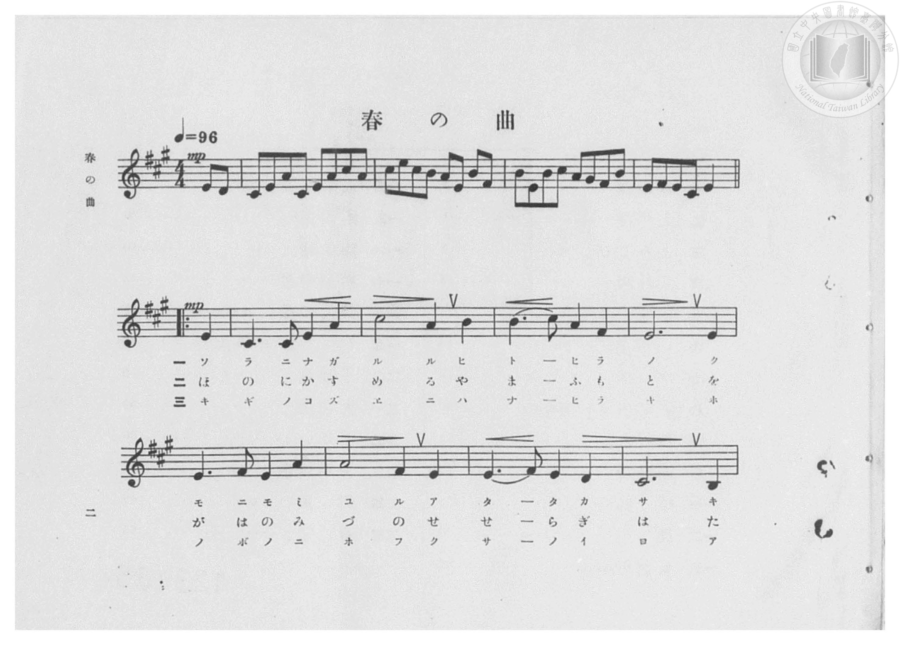
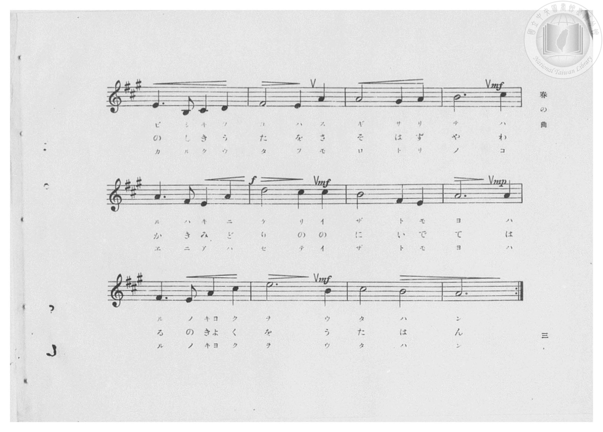
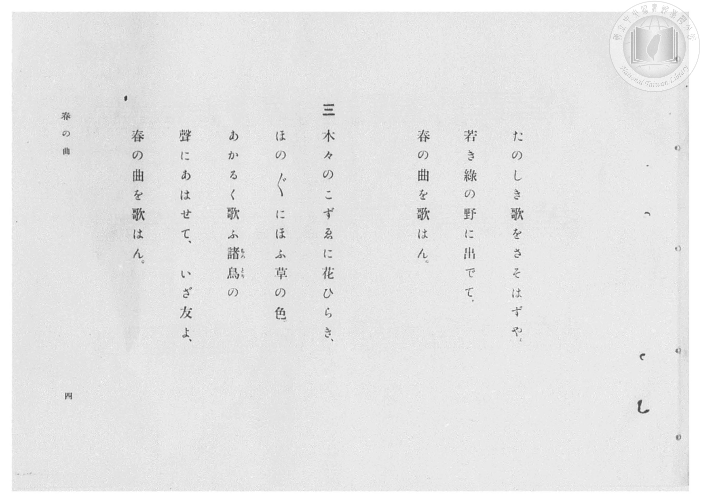
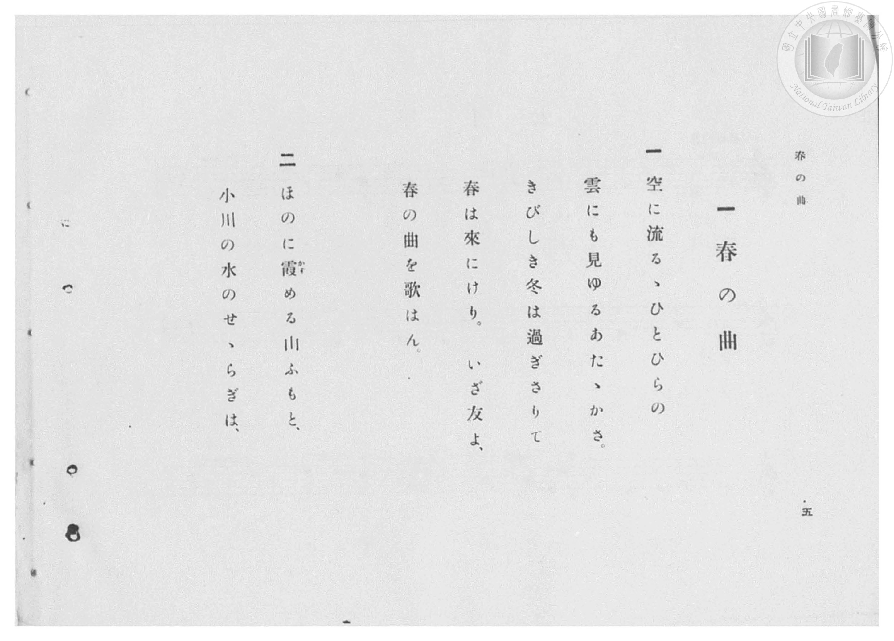

# 春の曲

> Re:Shōka 使用 AI 協助辨識與重建樂譜，可能會有錯誤。歡迎回報。

- **鋼琴伴奏版**：<br><audio controls src="haru_no_kyoku.mp3"></audio>

- 臺灣總督府《公學校高等科唱歌》第一學年用（昭和十一年，索書號 0729 74）

## 說明


- 出處：臺灣總督府《公學校高等科唱歌》第一學年用（昭和十一年，索書號 0729 74）
- 調性與拍號：調號 ?= A，拍號 <4/4>，速度 != 96


## 歌詞

```text
（TMD 檔案未包含歌詞註解）
```

## ABC

<div class="abc-score" data-abc-src="haru_no_kyoku.abc" aria-label="五線譜載入中"></div>

[下載 ABC 原始檔](haru_no_kyoku.abc)

## TMD 檔案連結

- [主旋律 TMD 檔案](haru_no_kyoku.tmd) [[在 TMD Studio 編輯](https://tmdlang.github.io/Tmd-TS/#tmd=s7IKdvYPcrWy4qpTUCpJTLdSSM7PyUlNLsnMz7PKzk9PzM7Ojy_OyM9OVIKrKMvPKc1NBcqW5McbIoSL80uLklOtipMz8vNz4ktSK0qS8vOz0eXjCxLTU60CDAxMEDIFRfllqXmJeUDdBUWZeSWpKWDtCAWpZZkpqSDp4uTEvPiy1KLMtMzUFCQXpRYVgxwMtaKkKDGvOLkoswDkC4Sq_KKSjPz0osSCjEqrjMzikvyizOTEnPjsxDwkz5VkpAL9VpyaWJyfV4wunJdYUlqUii6aW1qcmYxsTWZ6Zp5VSWJmOdCx-WlpmcmZiTlKXFpaCs9mLH3cuO7Z7E0KWlpcirYKlmZc9rYKjlw2JvomdiADXrTvet64-PmOvc_nLn66a87jhq6nrWuert3xbMHCl6tnPF_b-Xz5xKdTNj5b2_O4ofv5mjVPdjQAZZ_u3PJ8yor3ezqezVj7dFLP095GkPjOLe_39DzfsujZ7B0vZs5XMDA3slQwN3m_p1OJi0tfS8GWWoBLQUHhad98kDWb21-s6HrR0Q5034uV8562rng2rR3orKcbep-1dyqAIl0vqyD9UcNkINMcxAS6EKJVoaBAT8EIKGMKdOD7PbNAhr5Ytf9Zw3KQcd29QB8ARR83LXk5dTtQHGioo8LTJcvBzB5jhae9QJtngBV1AsNSAagDZO-ejS-2blcwhHCBxva8bJj_dNcyhUczV9oCwx5ox7MVTS_Wznm-dcKz5d0vVq16NqMParku3LkKkHB-sbDnedOupzNXALU87ex9urQfzQYFbQUThacb-p-vbwDa9GxOw7M5qyFcBWOQ_JMdy57sXvpy9sznOzY-3z4LZOdckHuhFioo1CgYAK2F4ercgloF03gFk3ighHE8iGmIoIEYKKpgCsRGQDZQ0EjBDKTSCMIGKTCPBwkZAQWBQkAWkIToh1hQg8Wbu3qA3gT6COjQp_29L5a1QUJVocZK4WXDpqetS4ExC0x_T3bsfja9--m-bswgMDKAhwEowF-0bwbZYAq2ARggQOOBZitY1ShAzH_c0ARxBiTJvFzQ-Kxv4fMpG5_2bwZqfbp92YvFc1-saAKGESLJdMCSjJ7Ck11TgPa82NP5bE4nJJoeNzQCffFs3Vag5UAtZhhans6eDdTyrG_p8109EC8DFT_dB8w1oJQLNqQTKAJyGMhlQCNB1POVux43rn62tfFxU_fjprmPGzc9blwBIps6gTkapOLlbKDQ6sdNTS-WAVW0gdQ1Nj1unA9WDWRPhXr1cWPv48bNjxunAxlP29Y8blz_srHvMQhNfdzU9bhxGThZggqK9U_2tYGMbJwIkmgAGtbyuHHa036g8R1Ab8LVgQqUx02TQIVC4_rHTZPhTt_VA7FwN1AN0KCXc-YBQwLsmJnAIHjcBPLM040bHzduBTob5B-IocD4e7od6Oh1zzZsAeucDfIDyKNAR66HKgL5DCQH8gbI5qZJIA80ArWtf9wIzKgtUO--6Aa6sPf5tgVA1S_bgQasftoODMrlQI8S5YcdnWA1c4COawVbOBls_ESgQS-6gE6HxEAv3FVgvzZsftywFRx0QO7WF72gOHrRuQmuCOhZYCACw6EfbOHWF6t3vNy8FBQ4wHBoAsbPSmCIg4IIErUvQLENNAyoDei52RCnkxIbQDnKy1koUNDS5-LySCwq9cv3rszPLrUKyEzMy3eo0TWsqQaXIzYWWnZgBrZCHlGYAbMUJDMDRYC592n_UgUNHMWZDpZCQhOL2UCXQe3VANqhaaXwuGkvsPR53LwSiLuBuAsosgYsshqKJ4F5HUC8B8wDqQWJ9AFVrkcxcFcPyMDG3SDpxnVADNTeCDS0cSZIpKkRiIG8phaw_D6IgY1bgSJNYJEVQNYkVBd2gl24FqwdaCDYzs1AvAvsgo1QN_eDeUCXo7oQqO9x82yYgdiLbmAZCypxdYEQVvAaQgTBYhCeEVgERAJVgUWARTVICKweBiGmge3yMaxRAPFgGBTIIPUgh4GUwoIaJLMGKrMaagyEBfIGRLwDKgrxGogFMgMSAQjLQVEBt90IzXZgjIB1AOMErBYaLyDWTIgMMG5g5oDFgXEE0bEPYTswpkAyTVCZFSi2g10Lsd0Y3e9roXZAbYdGIkhmF9QnG-F-B9sOjFCIOCiEsPodbCbcdmAkg2zHn6PAWQIlRxlBchSOLLSjk-gs1LwIGqMgGlgTA8llkMzTtAjs2v0QP4DoptVgEVCqX4st8_QA8Xpo9tkPDuilUN5sMG821KhOILsPLAJSPR9LtgGFc_McKN0NdhVI81RwWoG6ARyyoPhYApYHZhigi-EZBpq8Ie0SWMYAkVBRWJpHVwhsDyHlKwg0Qs0doLBC5AQQGxRykFhfBo9XcE4AuggS5_sRqQHMBoUlRAaUMhFpEZze4DkBFKSQVA8JVhALpBsStFA9UHFwOoLSMJs6wTKgvAYJbCSbgMGOnOphORIW6rD0DAl5mJ-mgt0Izq1wl8PiASSzBKoDJYVDwoBACgenWJQUDmx1Y6RwSDsPXscQmcInA92wHVqkToWn8H6gyE5Y4QxOT6vAcm1gOSypG5SOp4PaV0DcBg7Q-eDCA9gwAfPmQqNpFtjQFiBGNQZaIUCrJmAoPm5aBs9hwJQNTEnQdAyusCCugZQ36KkamDrB6RSahMHJGV6MoyZ1YCsdJgSpBCCwOjetFlxPICfrydAIgwQWLMJRkzWoeAMFHHKxCBIBF7BAR0PUtyEnAEiRiJSoYUU5JDRBLJB6SIjCzAMXmcCQhYjPhYmDEzEojCH2g4p6REJDsgeUpMFZDJIVIYkWFODI2RGepMGZGDnhQqouhH9QqytQBUAgQQO7AegJGpiS8SRoElo94JYNKPmCkgq4cGwCtSZWwYrCpm3QJARJUMCmCfYEDWrdgBIzMP01QhodwGYIOJmvAwc6qKYFJuPG5WAeMM8AAx9LUQ1tyQCzObQ107Qbko0IuwaWTFFL6Wpg0jSBBjYoiSLSKjwJIxfgsJQOSdbAphHYFKRkDUsGkCBDKtmAwQaLblBEw8svoJNRkwEseaC0GzCSNchUUOKEhCmIBavxIW0BRFkNIiEhDBMHJWRQSEPEYdkNkeSRS2qIq2GBDncJOOBhbgNlKPL8Q6AlMgU9WZviL6dJaImAkjWovFsLTiWQir55E0oxCWktwwtEpNQMap2D024vsMMEpCApEVQ6w8tqYECCxCZjS8Sk2w0vdsEjJpCUCiygkUIUnG4h7W9YixyWflFTLXy4BC3Bwh2EVOsCHYVcFGEWaKBYhFgBcixCLVIbBpRawW1lSFqEhhmIA0tIoNIXkQAxSmd4UwISnlgtASdVGvqklotL104BqaeqAOQqcwEA)]
- [鋼琴伴奏 TMD 檔案](haru_no_kyoku_piano.tmd) [[在 TMD Studio 編輯](https://tmdlang.github.io/Tmd-TS/#tmd=s7IKdvYPcrWy4qpTUCpJTLdSSM7PyUlNLsnMz7PKzk9PzM7Ojy_OyM9OVIKrKMvPKc1NBcqW5McbIoSL80uLklOtipMz8vNz4ktSK0qS8vOz0eXjCxLTU60CDAxMEDIFRfllqXmJeUDdBUWZeSWpKWDtCAWpZZkpqSDp4uTEvPiy1KLMtMzUFCQXpRYVgxxckJmYlx-fWFSUmJeempuah2QEkqBVYmZ8YnJyfm5BYl4mqqr8opKM_PSixIKMSquMzOKS_KLM5MSc-OzEPCT_l2QAjbEqTk0szs8rRhfOSywpLUpFF80tLc5MRrYmMz0zz6okMbMc6J_8tLTM5MzEHCUuLS2FZzOWPm5c92z2pvd7Ol5273k-YcuTPVueLu1_3tnxfk-ngpYWl6KtgqUZl72tgiOXjYm-iR3I1Bftu543Ln6-Y-_zuYuf7przuKHraeuap2t3PFuw8OXqGc_Xdj5fPvHplI3P1vY8buh-vmbNkx0NQNmnO7c8n7ICaNGzGWufTup52tsIEt-55f2enudbFj2bvePFzPkKBuZGlgrmJkDLlbi4PPNKivKtAkDBHOThUKNrWFPNpQAENhZadmCGvpbC0775L9bOgVjyYmEP0HhQbOtlFaQDzXixYsaLPZ1PdnY_nbni2Yqmp529QL8BlTzds_HF1u0KhgrPunsVtBVMFJ5u6H--vgHsZX2wyTUKBgq6cFydW1CrYBqvYBIPlDCOBzENETQQA0UVTIHYCMgGChopmIFUGkHYIAXm8SAhI6AgUAjIApIQ_RALarhqUbzrg-JdE6h3QY6CwBqIkwzjFaINY2FUDRLfCGS_aTyQbxofC7QQSQQoC6KAhoAs9UgsKvXL967Mzy7FF9LYwwPocJA3dIEQ5htDiCBYDMIzAouASKAqsAjQ_yAhsHoYhJgGtsvHsEYBxIPhx017weofN68EK33c3A3EXWCZNVCZ1VBjIKzHzZOg4h1Q0T1QMYgZIJk-JMsfN61H2G6EZnvjboiOxnUQtY2rgbgbzJoJkWlqhJsDFm9qgerYh7C9cStYpgkqswLFdrBrIbYbo_t9LdQOqO1Adz9u2gyW2QX1yUa438G2N_dDxUEhhNXvYDPhtjfPBtsOjWZopECSKCw6QSRUFBZT6AqBWQMpNUAgMMkhx-nj5kVwd0LYj5vnQ926DO4acPw1gWRBLt2P8AOY_bgJJA-SAYUnIgTBoQSPv8eNPRDxxvXQeHvcCNINklkK0wMVB_seSsNs6gTLgFIISAaUNuA2NYJdDI8rWDp63DwHyobEAkgGYiJIZCrYjeA0Bnc5JF7AOpqWQHWgxAskDNDiBRi-4JCGRgI4QuDZBzWygEUOTAiS-SCwOjetFpw_kSNmMtTK7dCghDgZNWJAyepx006oJyDJESQCTtjNq6Dq25C9AEmKSNECy0LTgbgXzAKpB8mAghViHjipNkLtb5wLEwdHw-PGWVD7QVkMEVRI9oAiBZxIIIkJEuyPm0D-QCQoeKSAkyFy0EOKDIR_UIsJUMaDRwkkoFFzSjUwcE2gykGBjAhteCQgZyJYXEEiBlSiIzwCjhiYR_rhEQNNXU2IXA9yKjwNNW1D8wjMgyglDkbEgEwFBW8vNKc8boSVFZBSBJFfQCRIB7zEbQRFxePG5VBxWIJBRBpyboG4GlwCgNM3vLRqApWyEDlQkiDPP9CIgeYKcO0MiQZg_kFSDo4USLUEq6hgkYMaJZCqGTM2QGXwWogT4Nm6eROyg7CkN5ATIVY8bgalIxhEKiRBUQGuQiABDYyOx01gXzfCQgmUORChi5F54GUVSC0kU2NYAo4HGvoEW6MCf3sG2pwANVBwt2jADRmkNg2wGIw2QREBMcCmwPInmllQHUAKKIQsDW7WIbhYzACqgLgPaga6-6DtKjTHgNMZSBhqGLpmcGEBFwOrhkggexI9XGANP1yGIqsEGoiiHW4usjJoQ1DXTgHcAFUAMpDiL9oHqApdyAhTyBgspMwFAA)]

## 分析

```text
================================================================================
📊 TMD Song Profile: [ 春の曲 ]
================================================================================
⏱  Duration:       0:50 (50.0s), 20 measures total
🎼 Key & Tempo:    首調基準 A, != 96.0 BPM, <4/4>
   - 分析範圍：      由實際發聲的音符與和弦推測調性；播放脈絡另行呈現
🎤 人聲音域:    B3 (MIDI 59) – E5 (MIDI 76) [跨度: 17 個半音 / 1.4 個八度, 難度: challenging]
   - 最低音:  B3 in [HaruNoKyoku #1 @ m.9, 0:21]
   - 最高音: E5 in [HaruNoKyoku #1 @ m.19, 0:45]
   - 適合: soprano, mezzo-soprano, contralto, tenor, baritone, bass
🏛  結構:      HaruNoKyoku (50.0s)
⚡ 編曲密度:        Peak 1 軌道同時演奏
🗝  調性診斷：       A 大調（純淨自然大調，未偵測到可信轉調）
   - 風格氣質:    純淨自然大調（陽光明朗、易唱易記，無明顯調外色彩）
   - 轉調歷程:    全曲維持單一推測調性（未偵測到可信轉調）
   - 核心骨幹音:  E, A, C#, B, F#
   - 調性數值:    A 大調 [相關度: 0.93, 穩定度: High, 自然音純度: 100.0%]
   - 候選調性 (K-S): A 大調 (0.93), E 大調 (0.77), C# 小調 (0.63)
   - 五度圈歷程:   +3
   - 各段落調性細節:
     • [HaruNoKyoku #1]: A 大調 (r: 0.90, 自然音純度: 100.0%)

  [ 五度圈游移軌跡 ]
               C  
         F            G  
      Bb               D  
      Eb              [A ]*
         Ab           E  
            Db       B  
               F# 
     (* = active key center)

  [ 十二半音累積音高分佈 ]
     C  :                            0.0%
     C# : ████████████████          17.5%
     D  : █████                      5.0%
     D# :                            0.0%
     E  : ████████████████████████  26.2%
     F  :                            0.0%
     F# : █████████                 10.0%
     G  :                            0.0%
     G# : █                          1.2%
     A  : ███████████████████████   25.6%
     A# :                            0.0%
     B  : █████████████             14.4%
--------------------------------------------------------------------------------
Assignment 軌道音域：
  - Piano         : B3 – E5 (17 個半音 / 1.4 個八度, 60 個音符)
================================================================================
```


## 原書掃描頁










