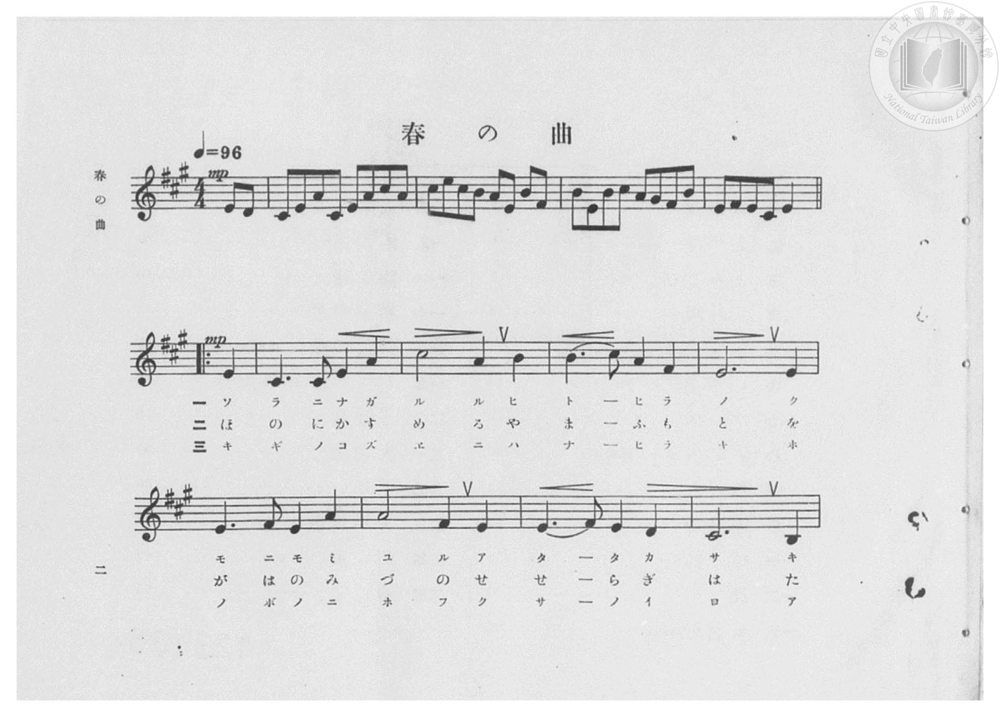
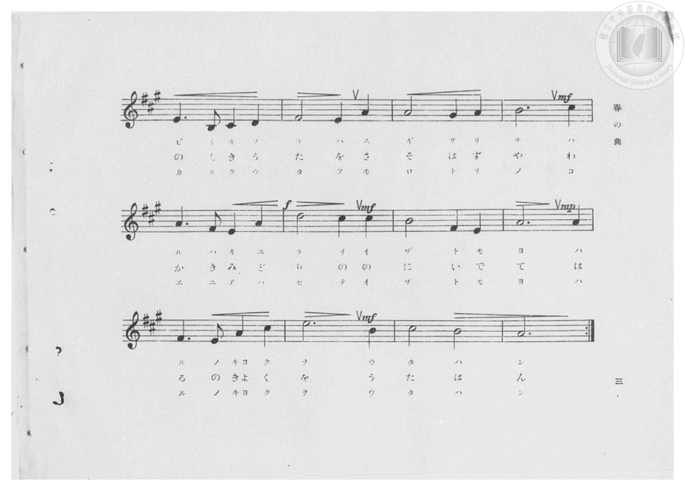
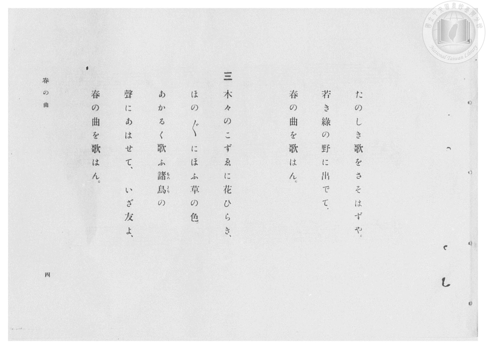
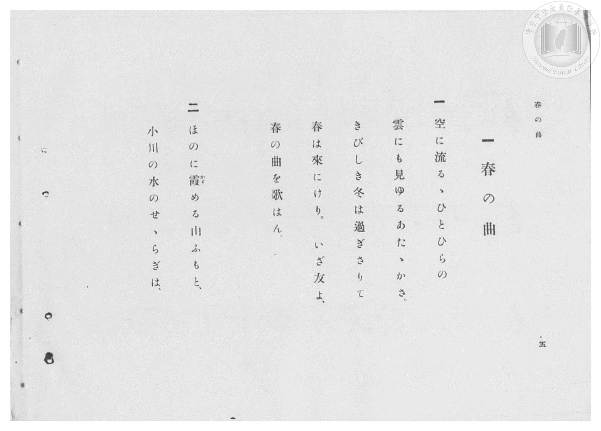

# 春の曲

> Re:Shōka 使用 AI 協助辨識與重建樂譜，可能會有錯誤。歡迎回報。

- **鋼琴伴奏版**：<br><audio controls src="haru_no_kyoku.mp3"></audio>
- **NEUTRINO 歌聲合成版**：<br><audio controls src="haru_no_kyoku_neutrino.mp3"></audio>

- 臺灣總督府《公學校高等科唱歌》第一學年用（昭和十一年，索書號 0729 74）

## 說明


- 出處：臺灣總督府《公學校高等科唱歌》第一學年用（昭和十一年，索書號 0729 74）
- 調性與拍號：調號 ?= A，拍號 <4/4>，速度 != 96


## 歌詞

```text
（TMD 檔案未包含歌詞註解）
```

## ABC

<div class="abc-score" data-abc-src="haru_no_kyoku.abc" aria-label="五線譜載入中"></div>

[下載 ABC 原始檔](haru_no_kyoku.abc)

## TMD 檔案連結

- [主旋律 TMD 檔案](haru_no_kyoku.tmd) [[在 TMD Studio 編輯](https://tmdlang.github.io/Tmd-TS/#tmd=s7IKdvYPcrWy4qpTUCpJTLdSSM7PyUlNLsnMz7PKzk9PzM7Ojy_OyM9OVIKrKMvPKc1NBcqW5McbIoSL80uLklOtipMz8vNz4ktSK0qS8vOz0eXjCxLTU60CDAxMEDIFRfllqXmJeUDdBUWZeSWpKWDtCAWpZZkpqSDp4uTEvPiy1KLMtMzUFCQXpRYVgxwMtaKkKDGvOLkoswDkC4Sq_KKSjPz0osSCjEqrjMzikvyizOTEnPjsxDwkz5VkpAL9VpyaWJyfV4wunJdYUlqUii6aW1qcmYxsTWZ6Zp5VaR7IzSVQl2ppKTybsfRx47pnszcpaGlxKdoqWJpx2dsqOHLZmOib2IF0v2jf9bxx8fMde5_PXfx015zHDV1PW9c8Xbvj2YKFL1fPeL628_nyiU-nbHy2tudxQ_fzNWue7GgAyj7dueX5lBXv93Q8m7H26aSep72NIPGdW97v6Xm-ZdGz2TtezJyvYGBuZKlgbvJ-T6cSF5e-loIttQCXgoLC0775IGs2t79Y0fWiox3ovhcr5z1tXfFsWjvQWU839D5r71QAxbheVkH6o4bJQKY5iAl0IUSrQkGBnoIRUMYU6MD3e2aBDH2xav-zhuUg47p7gT4Aij5uWvJy6nagONBQR4WnS5aDmT3GCk97gTbPACvqBIalAlAHyN49G19s3a5gCOECje152TD_6a5lCo9mrrQFhj3Qjmcrml6snfN864Rny7tfrFr1bEYf1HJduHMVIOH8YmHP86ZdT2euAGp52tn7dGk_mg0K2gomCk839D9f3wC06dmchmdzVkO4CsYg-Sc7lj3ZvfTl7JnPd2x8vn0WyM65IPdCLVRQqFEwAFoLw9W5BbUKpvEKJvFACeN4ENMQQQMxUFTBFIiNgGygoJGCGUilEYQNUmAeDxIyAgoChYAsIAnRD7GgBos3d_UAvQn0EdChT_t7Xyxrg4SqQo2VwsuGTU9blwJjFpj-nuzY_Wx699N93ZhBYGQADwNQgL9o3wyywRRsAzBAgMYDzVawqlGAmP-4oQniDEiSebmg8VnfwudTNj7t3wzU-nT7sheL575Y0QQMI0SS6YAlGT2FJ7umAO15safz2ZxOSDQ9bmgE-uLZuq1Ay4FazDC0PJ09G6jlWd_S57t6IF4GKn66D5hrQCkXbEgnUATkMJDLgEaCqOcrdz1uXP1sa-Pjpu7HTXMfN2563LgCRDZ1AnM0SMXL2UCh1Y-bml4sA6poA6lrbHrcOB-sGsieCvXq48bex42bHzdOBzKetq153Lj-ZWPfYxCa-rip63HjMnCyBBUU65_sawMZ2TgRJNEANKzlceO0p_1A4zuA3oSrAxUoj5smgQqFxvWPmybDnb6rB2LhbqAaoEEv58wDhgTYMTOBQfC4CeSZpxs3Pm7cCnQ2yD8QQ4Hx93Q70NHrnm3YAtY5G-QHkEeBjlwPVQTyGUgO5A2QzU2TQB5oBGpb_7gRmFFboN590Q10Ye_zbQuAql-2Aw1Y_bQdGJTLgR4lyg87OsFq5gAd1wq2cDLY-IlAg150AZ0OiYFeuKvAfm3Y_LhhKzjogNytL3pBcfSicxNcEdCzwEAEhkM_2MKtL1bveLl5KShwgOHQBIyflcAQBwURJGpfgGIbaBhQG9BzsyFOJyU2gHKUl7NQoKClz8XlkVhU6pfvXZmfXWoVkJmYl-9Qo2tYUw0uR2wstOzADGyFPKIwA2YpSGYGigBz79P-pQoaOIozHSyFhCYWs4Eug9qrAbRD00rhcdNeYOnzuHklEHcDcRdQZA1YZDUUTwLzOoB4D5gHUgsS6QOqXI9i4K4ekIGNu0HSjeuAGKi9EWho40yQSFMjEAN5TS1g-X0QAxu3AkWawCIrgKxJqC7sBLtwLVg70ECwnZuBeBfYBRuhbu4H84AuR3UhUN_j5tkwA7EX3cAyFlTi6gIhrOA1hAiCxSA8I7AIiASqAosAi2qQEFg9DEJMA9vlY1ijAOLBMCiQQepBDgMphQU1SGYNVGY11BgIC-QNiHgHVBTiNRALZAYkAhCWg6ICbrsRmu3AGAHrAMYJWC00XkCsmRAZYNzAzAGLA-MIomMfwnZgTIFkmqAyK1BsB7sWYrsxut_XQu2A2g6NRJDMLqhPNsL9DrYdGKEQcVAIYfU72Ey47cBIBtmOP0eBswRKjjKC5CgcWWhHJ9FZqHkRNEZBNLAmBpLLIJmnaRHYtfshfgDRTavBIqBUvxZb5ukB4vXQ7LMfHNBLobzZYN5sqFGdQHYfWASkej6WbAMK5-Y5ULob7CqQ5qngtAJ1AzhkQfGxBCwPzDBAF8MzDDR5Q9olsIwBIqGisDSPrhDYHkLKVxBohJo7QGGFyAkgNijkILG-DB6v4JwAdBEkzvcjUgOYDQpLiAwoZSLSIji9wXMCKEghqR4SrCAWSDckaKF6oOLgdASlYTZ1gmVAeQ0S2Eg2AYMdOdXDciQs1GHpGRLyMD9NBbsRnFvhLofFA0hmCVQHSgqHhAGBFA5OsSgpHNjqxkjhkHYevI4hMoVPBrphO7RInQpP4f1AkZ2wwhmcnlaB5drAclhSNygdTwe1r4C4DRyg88GFB7BhAubNhUbTLLChLUCMagy0QoBWTcBQfNy0DJ7DgCkbmJKg6RhcYUFcAylv0FM1MHWC0yk0CYOTM7wYR03qwFY6TAhSCUBgdW5aLbieQE7Wk6ERBgksWISjJmtQ8QYKOORiESQCLmCBjoaob0NOAJAiESlRw4pySGiCWCD1kBCFmQcuMoEhCxGfCxMHJ2JQGEPsBxX1iISGZA8oSYOzGCQrQhItKMCRsyM8SYMzMXLChVRdCP-gVlegCoBAggZ2A9ATNDAl40nQJLR6wC0bUPIFJRVw4dgEak2sghWFTdugSQiSoIBNE-wJGtS6ASVmYPprhDQ6gM0QcDJfBw50UE0LTMaNy8E8YJ4BBj6WohrakgFmc2hrpmk3JBsRdg0smaKW0tXApGkCDWxQEkWkVXgSRi7AYSkdkqyBTSOwKUjJGpYMIEGGVLIBgw0W3aCIhpdfQCejJgNY8kBpN2Aka5CpoMQJCVMQC1bjQ9oCiLIaREJCGCYOSsigkIaIw7IbIskjl9QQV8MCHe4ScMDD3AbKUOT5h0BLZAp6sjbFX06T0BIBJWtQebcWnEogFX3zJpRiEtJahheISKkZ1DoHp91eYIcJSEFSIqh0hpfVwIAEiU3GlohJtxte7IJHTCApFVhAI4UoON1C2t-wFjks_aKmWvhwCVqChTsIqdYFOgq5KMIs0ECxCLEC5FiEWqQ2DCi1gtvKkLQIDTMQB5aQQKUvIgFilM7wpgQkPLFaAk6qNPRJLReXrp0CUk9VAchV5gIA)]
- [鋼琴伴奏 TMD 檔案](haru_no_kyoku_piano.tmd) [[在 TMD Studio 編輯](https://tmdlang.github.io/Tmd-TS/#tmd=s7IKdvYPcrWy4qpTUCpJTLdSSM7PyUlNLsnMz7PKzk9PzM7Ojy_OyM9OVIKrKMvPKc1NBcqW5McbIoSL80uLklOtipMz8vNz4ktSK0qS8vOz0eXjCxLTU60CDAxMEDIFRfllqXmJeUDdBUWZeSWpKWDtCAWpZZkpqSDp4uTEvPiy1KLMtMzUFCQXpRYVgxxckJmYlx-fWFSUmJeempuah2QEkqBVYmZ8YnJyfm5BYl4mqqr8opKM_PSixIKMSquMzOKS_KLM5MSc-OzEPCT_l2QAjbEqTk0szs8rRhfOSywpLUpFF80tLc5MRrYmMz0zz6okMbMc6J_8tLTM5MzEHCUuLS2FZzOWPm5c92z2pvd7Ol5273k-YcuTPVueLu1_3tnxfk-ngpYWl6KtgqUZl72tgiOXjYm-iR3I1Bftu543Ln6-Y-_zuYuf7przuKHraeuap2t3PFuw8OXqGc_Xdj5fPvHplI3P1vY8buh-vmbNkx0NQNmnO7c8n7ICaNGzGWufTup52tsIEt-55f2enudbFj2bvePFzPkKBuZGlgrmJkDLlbi4PPNKivKtAkDBHOThUKNrWFPNpQAENhZadmCGvpbC0775L9bOgVjyYmEP0HhQbOtlFaQDzXixYsaLPZ1PdnY_nbni2Yqmp529QL8BlTzds_HF1u0KhgrPunsVtBVMFJ5u6H--vgHsZX2wyTUKBgq6cFydW1CrYBqvYBIPlDCOBzENETQQA0UVTIHYCMgGChopmIFUGkHYIAXm8SAhI6AgUAjIApIQ_RALarhqUbzrg-JdE6h3QY6CwBqIkwzjFaINY2FUDRLfCGS_aTyQbxofC7QQSQQoC6KAhoAs9UgsKvXL967Mzy7FF9LYwwPocJA3dIEQ5htDiCBYDMIzAouASKAqsAjQ_yAhsHoYhJgGtsvHsEYBxIPhx017weofN68EK33c3A3EXWCZNVCZ1VBjIKzHzZOg4h1Q0T1QMYgZIJk-JMsfN61H2G6EZnvjboiOxnUQtY2rgbgbzJoJkWlqhJsDFm9qgerYh7C9cStYpgkqswLFdrBrIbYbo_t9LdQOqO1Adz9u2gyW2QX1yUa438G2N_dDxUEhhNXvYDPhtjfPBtsOjWZopECSKCw6QSRUFBZT6AqBWQMpNUAgMMkhx-nj5kVwd0LYj5vnQ926DO4acPw1gWRBLt2P8AOY_bgJJA-SAYUnIgTBoQSPv8eNPRDxxvXQeHvcCNINklkK0wMVB_seSsNs6gTLgFIISAaUNuA2NYJdDI8rWDp63DwHyobEAkgGYiJIZCrYjeA0Bnc5JF7AOpqWQHWgxAskDNDiBRi-4JCGRgI4QuDZBzWygEUOTAiS-SCwOjetFpw_kSNmMtTK7dCghDgZNWJAyepx006oJyDJESQCTtjNq6Dq25C9AEmKSNECy0LTgbgXzAKpB8mAghViHjipNkLtb5wLEwdHw-PGWVD7QVkMEVRI9oAiBZxIIIkJEuyPm0D-QCQoeKSAkyFy0EOKDIR_UIsJUMaDRwkkoFFzSjUwcE2gykGBjAhteCQgZyJYXEEiBlSiIzwCjhiYR_rhEQNNXU2IXA9yKjwNNW1D8wjMgyglDkbEgEwFBW8vNKc8boSVFZBSBJFfQCRIB7zEbQRFxePG5VBxWIJBRBpyboG4GlwCgNM3vLRqApWyEDlQkiDPP9CIgeYKcO0MiQZg_kFSDo4USLUEq6hgkYMaJZCqGTM2QGXwWogT4Nm6eROyg7CkN5ATIVY8bgalIxhEKiRBUQGuQiABDYyOx01gXzfCQgmUORChi5F54GUVSC0kU2NYAo4HGvoEW6MCf3sG2pwANVBwt2jADRmkNg2wGIw2QREBMcCmwPInmllQHUAKKIQsDW7WIbhYzACqgLgPaga6-6DtKjTHgNMZSBhqGLpmcGEBFwOrhkggexI9XGANP1yGIqsEGoiiHW4usjJoQ1DXTgHcAFUAMpDiL9oHqApdyAhTyBgspMwFAA)]

## 分析

```text
================================================================================
📊 TMD Song Profile: [ 春の曲 ]
================================================================================
⏱  Duration:       0:50 (50.0s), 20 measures total
🎼 Key & Tempo:    首調基準 A, != 96.0 BPM, <4/4>
   - 分析範圍：      由實際發聲的音符與和弦推測調性；播放脈絡另行呈現
🎤 人聲音域:    B3 (MIDI 59) – E5 (MIDI 76) [跨度: 17 個半音 / 1.4 個八度, 難度: challenging]
   - 最低音:  B3 in [HaruNoKyoku #1 @ m.9, 0:21]
   - 最高音: E5 in [HaruNoKyoku #1 @ m.19, 0:45]
   - 適合: soprano, mezzo-soprano, contralto, tenor, baritone, bass
🏛  結構:      HaruNoKyoku (50.0s)
⚡ 編曲密度:        Peak 1 軌道同時演奏
🗝  調性診斷：       A 大調（純淨自然大調，未偵測到可信轉調）
   - 風格氣質:    純淨自然大調（陽光明朗、易唱易記，無明顯調外色彩）
   - 轉調歷程:    全曲維持單一推測調性（未偵測到可信轉調）
   - 核心骨幹音:  E, A, C#, B, F#
   - 調性數值:    A 大調 [相關度: 0.93, 穩定度: High, 自然音純度: 100.0%]
   - 候選調性 (K-S): A 大調 (0.93), E 大調 (0.77), C# 小調 (0.63)
   - 五度圈歷程:   +3
   - 各段落調性細節:
     • [HaruNoKyoku #1]: A 大調 (r: 0.90, 自然音純度: 100.0%)

  [ 五度圈游移軌跡 ]
               C  
         F            G  
      Bb               D  
      Eb              [A ]*
         Ab           E  
            Db       B  
               F# 
     (* = active key center)

  [ 十二半音累積音高分佈 ]
     C  :                            0.0%
     C# : ████████████████          17.5%
     D  : █████                      5.0%
     D# :                            0.0%
     E  : ████████████████████████  26.2%
     F  :                            0.0%
     F# : █████████                 10.0%
     G  :                            0.0%
     G# : █                          1.2%
     A  : ███████████████████████   25.6%
     A# :                            0.0%
     B  : █████████████             14.4%
--------------------------------------------------------------------------------
Assignment 軌道音域：
  - Piano         : B3 – E5 (17 個半音 / 1.4 個八度, 60 個音符)
================================================================================
```


## 原書掃描頁










