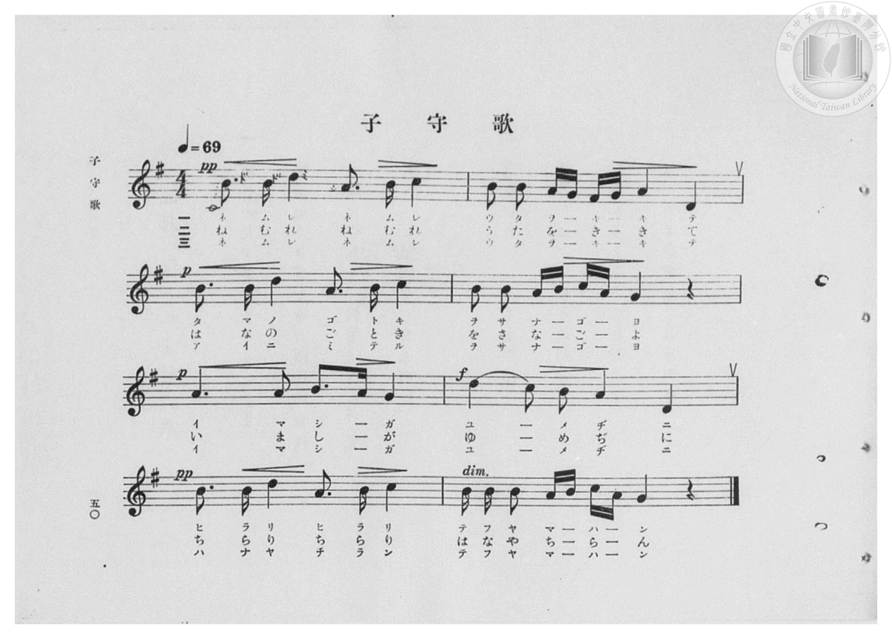
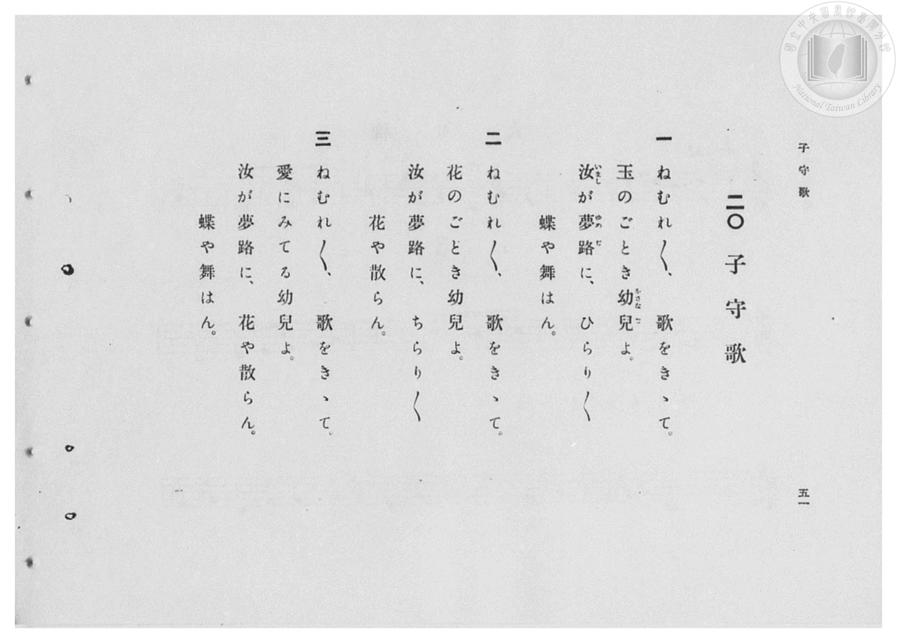

# 子守歌

> Re:Shōka 使用 AI 協助辨識與重建樂譜，可能會有錯誤。歡迎回報。

- **鋼琴伴奏版**：<br><audio controls src="komoriuta.mp3"></audio>
- **NEUTRINO 歌聲合成版**：<br><audio controls src="komoriuta_neutrino.mp3"></audio>

- 臺灣總督府《公學校高等科唱歌》第一學年用（昭和十一年，索書號 0729 74）

## 說明

原書資訊與歌詞全文（對應 P052.jpg–P053.jpg，原書 pp. 50–51，第 20 首）：
調性與拍號：ト長調（G 大調，1 升記號）4/4 拍，速度 ♩=69
詞曲考證：山口重樹作詞，採用 Franz Schubert《搖籃曲》（Wiegenlied, D. 498）旋律。


## 歌詞

```text
一
ねむれ／＼、歌をきゝて。
玉のごとき幼兒（をさなご）よ。
汝（いまし）が夢路（ゆめぢ）に、ひらり／＼
蝶や舞はん。

二
ねむれ／＼、歌をきゝて。
花のごとき幼兒よ。
汝が夢路に、ちらり／＼
花や散らん。

三
ねむれ／＼、歌をきゝて。
愛にみてる幼兒よ。
汝が夢路に、花や散らん。
蝶や舞はん。
```

## ABC

<div class="abc-score" data-abc-src="komoriuta.abc" aria-label="五線譜載入中"></div>

[下載 ABC 原始檔](komoriuta.abc)

## TMD 檔案連結

- [主旋律 TMD 檔案](komoriuta.tmd) [[在 TMD Studio 編輯](https://tmdlang.github.io/Tmd-TS/#tmd=s7IKdvYPcrWy4qpTUCpJTLdSSM7PyUlNLsnMz7PKzk9PzM7Ojy_OyM9OVIKrKMvPKc1NBcqW5McbIoSL80uLklOtipMz8vNz4ktSK0qS8vOz0eXjCxLTU60CDEyNcMoYI2QKivLLUvMS84DmFhRl5pWkpoANRihILctMSQVJFycn5sWXpRZlpmWmpiC5NbWoGOQVqBUlRYl5xclFmQUg_yFU5ReVZOSnFyUWZFRaZWQWl-QXZSYn5sRnJ-YhebskIxXo67TE3MycSmStmemZeVblqcUlqUV58bmpOfkpmNIliZnAQAQFZHlifG5iZl5OYh7QlVpaCk_XTni6ruPZ2h4FLS0uRVsFM0sue1sFdy4bE30TO5AxL9p3PW9c_HzH3udzFz_dNedxQ9fT1jVP1-54tmDhy9Uznq_tfL584tMpG4EmPG7ofr5mzZMdDUDZpzu3PJ-y4v2ejmcz1j6d1PO0txEkvnPL-z09z7csejZ7x4uZ8xUMzI0sFcxN3u_pVOLi0tdSsKUW4FJQUHjaNx9kzeb2Fyu6XnS0A933YuW8p60rnk1rBzrr6YbeZ-2dCqB0oJdVkP6oYTIo4kFMoAshWhUKCvQUTA2AUqaGIGevWaNgZKDwctk0oHvf75kFsuPFqv3PGpaDTO_uBXoIKPq4uePl1O1AcaAd7gpPlywHM3sMFZ72Ah0yA6yoExi0CkAdQPGXDfOf7lqm8GjmSltgwINMXDnv2exNLxqaX6wFWfJ048an_Ytftvc-W7Hzyd45QFmgpmd9C4Fhq-AGTEtVCsHJGaVJqUUlwHh5NmHa843NQO3AiABaH56Zmp6alwNMjjoKLnoKJpYWQKufTe9-uq_7cUMTF8g2YJyAqMeNax83NTxu6nm_p__9nj2PGxpBsdk06XFj7-OmuY8bl4HUA9U97-t83LjuceOUx40rgHJPd-552joJaBNY6dTHjauAUkA7Hjd1QDU82zgXJN3Y8rhx3-PG6SC5xp6nSxa92L4erK3tcVPj48ZFYPHVQGsfN2563ATU3wVxCDhA5m573NTyomPe48b1j5smw12-q4cUl7_o2ojpchR3wh0Gc8lCDJcAzWhqeTZ1MVgC4ZIdnaS45FnLbJANjftBQk3dhF2CxVrswQIUpTznQIGClj4Xl3d-LrD4KC1JtArITMzLd6gxqKkG2aJgY2imZQdmYcu0CpBC4MXCHgUNI4WnG_qfr2_Qgec0TSwagJaBDKtRqC4oqFUwVtAFQmMFUzCtq2AE5ZtA-TVgFSBspGCoYB4PJCBKdBVM42FqwAb6GNYoPG7uBYs8bl4AxGug8thFgaqbloFEm_aD5TYB8R4gby2chuluQ7XHCKizESILTARA3ANTiVUUpBpkwuPG-WC5SRDzG3vhNEw3yDVI9hjT3j_4o3VXD3nRSlqsgkRBcQuRMUANA1Ccgv0Dcvc8IO6D-aJpC1S0A8lvoBDbBJbdCpbrgvp9C4RuXgFVh5ZywDG6HhoLq4B4HTxOpkDpFUgxBXLTJLDoVJgOcExOgdrWgd0WUHw2LYK6fglQbTc8RkApAxIzj5tXk-0XApm0k9zYhGU4WExCYhcRZ0BVabXwuAbFMSRmIXxs2RTofYSRoIgFeXM7lAfyJFKiboZlC5AMiFwIJpvgorBgRI7MFmTzG_eByekI8xuRMmcTLDtAzW9qBKuGRBSIBY8QpGikjfvxRuDT2bNpWsqCIFH5sRmU9kEOXwnEq-DewCYKUg1K01OBGBRkkDwMSr39UHozVCW2HAkKKFDAdgJxFzw6sIlC8i84JzaBoh6kChIRQFVgejJ2e8BlbD_U5aAcBovYx82gZADzD8yV5PinlotL104BXr0qADnKXAA)]
- [鋼琴伴奏 TMD 檔案](komoriuta_piano.tmd) [[在 TMD Studio 編輯](https://tmdlang.github.io/Tmd-TS/#tmd=s7IKdvYPcrWy4qpTUCpJTLdSSM7PyUlNLsnMz7PKzk9PzM7Ojy_OyM9OVIKrKMvPKc1NBcqW5McbIoSL80uLklOtipMz8vNz4ktSK0qS8vOz0eXjCxLTU60CDEyNcMoYI2QKivLLUvMS84DmFhRl5pWkpoANRihILctMSQVJFycn5sWXpRZlpmWmpiC5NbWoGOSVgszEvPz4xKKixLz01NzUPCQjkAStEjPjE5OT83MLEvMyUVXlF5Vk5KcXJRZkVFplZBaX5BdlJifmxGcn5iGFTEkG0BirtMTczJxKZK2Z6Zl5VuWpxSWpRXnxuak5-SmY0iWJmcBwBoV1eWJ8bmJmXk5iHtAjWloKT9dOeLqu49nanvd7Ol5273k-YcuTPVueLu1_3tnxfk-ngpYWl6Ktgpkll72tgjuXjYm-iR3I7Bftu543Ln6-Y-_zuYuf7przuKHraeuap2t3PFuw8OXqGc_Xdj5fPvHplI1AYx83dD9fs-bJjgag7NOdW55PWQG06NmMtU8n9TztbQSJ79zyfk_P8y2Lns3e8WLmfAUDcyNLBXMToOVKXFze-blAH5SWJFoFgMI4yMOhxqCmmksBCGwMzbTswCx9LQVbdKAAsfTFwh4FDSOFpxv6n69v0FEApQy9rIJ0TSwatPTBhtUoVBcU1CoYK-gCobGCKZjWVTCC8k2g_BqwChA2UjBUMI8HEhAlugqm8TA1YAN9DGsUHjf3gkUeNy8A4jVQeeyiQNVNy0CiTfvBcpuAeA-QtxZOw3S3odpjBNTZCJF93NQAxD0wlVhFQapBJjxunA-WmwQxv7EXTsN0g1yDZI8x7f2DP1p39ZAXraTFKkgUFLcQGQPUMADFKdg_IHfPA-I-mC-atkBFO5D8BgqxTWDZrWC5Lqjft0Do5hVQdWgpBxyj66GxsAqI18HjZAqUXoEUUyA3TQKLToXpAMfkFKhtHdhtAcVn0yKo65cA1XbDYwSUMiAx87h5Ndl-IZBJO8mNTViGg8UkJHYRcQZUlVYLj2tQHENiFsLHlk2B3kcYCYpYkDe3Q3kgTyIl6mZYtgDJgMiFYLIJLgoLRuTIbEE2v3EfmJyOML8RKXM2wbID1PymRrBqSESBWPAIQYpG2rgfbwQ-nT2bpqUsCBKVH5tBaR_k8JVAvAruDWyiINWgND0ViEFBBsnDoNTbD6U3Q1Viy5GggAIFbCcQd8GjA5soJP-Cc2ITKOpBqiARAVQFpidjtwdcxvZDXQ7KYbCIfdwMSgYw_8BcSY5_ajFqVx_k2tUEUbkiqlJ47BnGA_MPBBvFY_LhKQZRXBPSCqQM0DRCSga4RqgOqGIIH6oZ3U5omiTSTmBI6NopwAMj2scwVgFVwAhdwBgsoMwFAA)]

## 分析

```text
================================================================================
📊 TMD Song Profile: [ 子守歌 ]
================================================================================
⏱  Duration:       0:27 (27.8s), 8 measures total
🎼 Key & Tempo:    首調基準 G, != 69.0 BPM, <4/4>
   - 分析範圍：      由實際發聲的音符與和弦推測調性；播放脈絡另行呈現
🎤 人聲音域:    D4 (MIDI 62) – D5 (MIDI 74) [跨度: 12 個半音 / 1.0 個八度, 難度: easy]
   - 最低音:  D4 in [Komoriuta #1 @ m.2, 0:06]
   - 最高音: D5 in [Komoriuta #1 @ m.1, 0:00]
   - 適合: soprano, mezzo-soprano, contralto, tenor, baritone, bass
🏛  結構:      Komoriuta (27.8s)
⚡ 編曲密度:        Peak 1 軌道同時演奏
🗝  調性診斷：       G 調性不明確（純淨自然大調，未偵測到可信轉調）
   - 風格氣質:    純淨自然大調（陽光明朗、易唱易記，無明顯調外色彩）
   - 轉調歷程:    全曲維持單一推測調性（未偵測到可信轉調）
   - 核心骨幹音:  B, A, D, C, G
   - 調性數值:    G 調性不明確 [相關度: 0.63, 穩定度: Ambiguous, 自然音純度: 100.0%]
   - 候選調性 (K-S): G 大調 (0.63), D 大調 (0.61), B 小調 (0.60)
   - 五度圈歷程:   +1
   - 各段落調性細節:
     • [Komoriuta #1]: G 調性不明確 (r: 0.63, 自然音純度: 100.0%)

  [ 五度圈游移軌跡 ]
               C  
         F           [G ]*
      Bb               D  
      Eb               A  
         Ab           E  
            Db       B  
               F# 
     (* = active key center)

  [ 十二半音累積音高分佈 ]
     C  : ███████████               13.3%
     C# :                            0.0%
     D  : █████████████████         20.0%
     D# :                            0.0%
     E  :                            0.0%
     F  :                            0.0%
     F# : █                          0.8%
     G  : ██████████                11.7%
     G# :                            0.0%
     A  : ██████████████████████    25.8%
     A# :                            0.0%
     B  : ████████████████████████  28.3%
--------------------------------------------------------------------------------
Assignment 軌道音域：
  - Piano         : D4 – D5 (12 個半音 / 1.0 個八度, 51 個音符)
================================================================================
```


## 原書掃描頁






