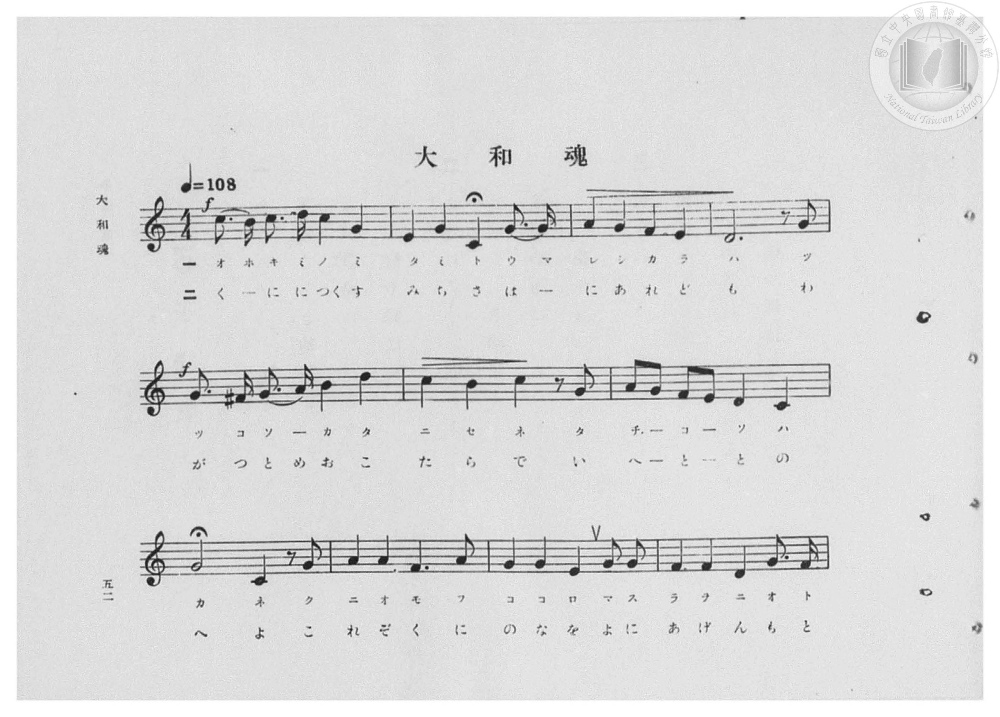
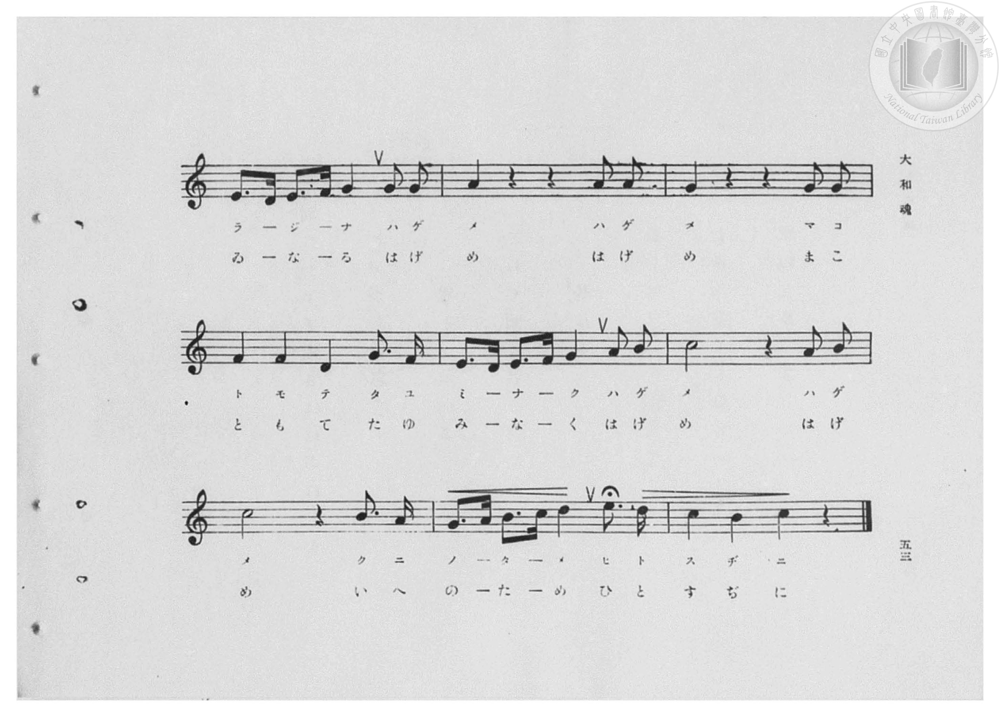
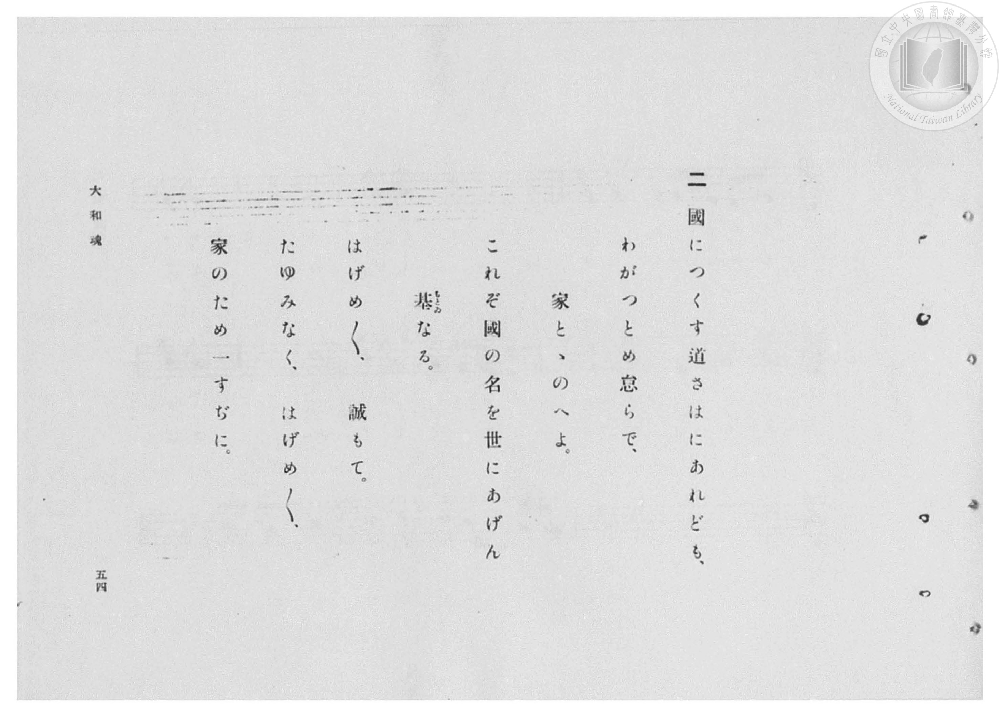
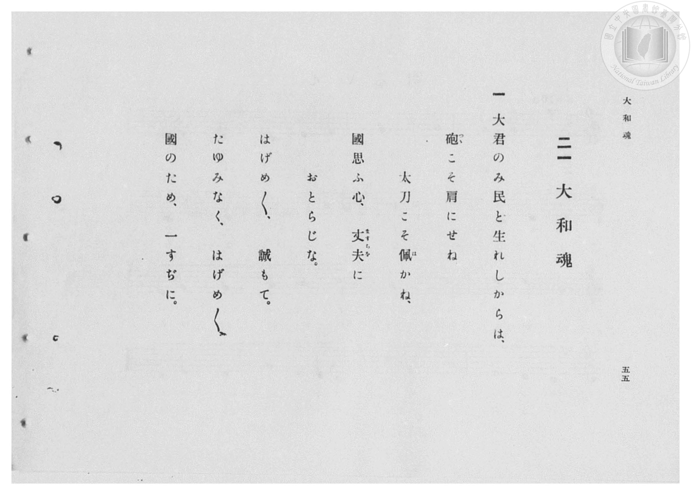

# 大和魂

> Re:Shōka 使用 AI 協助辨識與重建樂譜，可能會有錯誤。歡迎回報。

- **鋼琴伴奏版**：<br><audio controls src="yamato_damashii.mp3"></audio>

- 臺灣總督府《公學校高等科唱歌》第一學年用（昭和十一年，索書號 0729 74）

## 說明

原書資訊與歌詞全文（對應 P054.jpg–P057.jpg，原書 pp. 52–55，第 21 首）：
調性與拍號：ハ長調（C 大調，無升降記號）4/4 拍，速度 ♩=108
頁序說明：原書為右翻直排，P057.jpg 為第 55 頁（第一段歌詞），P056.jpg 為第 54 頁（第二段歌詞）。
詞曲考證：佐佐木信綱作詞，原載明治期《女子音樂教科書》。


## 歌詞

```text
一
大君のみ民と生れしからは、
砲（つつ）こそ肩にせね　太刀こそ佩（は）かね、
國思ふ心、丈夫（ますらを）におとらじな。
はげめ／＼、誠もて。
たゆみなく、はげめ／＼、
國のため、一すぢに。

二
國につくす道さはにあれども、
わがつとめ怠らで、家とゝのへよ。
これぞ國の名を世にあげん基（もとゐ）なる。
はげめ／＼、誠もて。
たゆみなく、はげめ／＼、
家のため一すぢに。
```

## ABC

<div class="abc-score" data-abc-src="yamato_damashii.abc" aria-label="五線譜載入中"></div>

[下載 ABC 原始檔](yamato_damashii.abc)

## TMD 檔案連結

- [主旋律 TMD 檔案](yamato_damashii.tmd) [[在 TMD Studio 編輯](https://tmdlang.github.io/Tmd-TS/#tmd=s7IKdvYPcrWy4qpTUCpJTLdSSM7PyUlNLsnMz7PKzk9PzM7Ojy_OyM9OVIKrKMvPKc1NBcqW5McbIoSL80uLklOtipMz8vNz4ktSK0qS8vOz0eXjCxLTU60CDExNcMqY4pQxwyljjpApKMovS81LzAO6paAoM68kNQXsGISC1LLMlFSQdHFyYl58WWpRZlpmagqS_1KLikHeh1pRUpSYV5xclFkAChOEqvyikoz89KLEgoxKq4zM4pL8oszkxJz47MQ8pKAqyUgFhlRuZk5mSWJRJbLmzPTMPKvc1MysTCxBBZUuScwEBj0o-MsT43MTM_NyEvOA7tTSUni6ZPnTST0v1zYpaGlxKdoqGBpYcNnbKjhz2Zjom9iBzHnRvut54-LnO_Y-n7v46a45jxu6nrauebp2x7MFC1-unvF8befz5ROfTtn4bG3P44bu52vWPNnRAJR9unPL8ykr3u_peDZjLdCCp72NIPGdW97v6Xm-ZdGz2TtezJyvYGBuZKlgbvJ-T6cSF5e-loIttQCXgoLC0775IGs2t79Y0fWiox3ovhcr5z1tXfFsWjvQWU839D5r71QAJR-9rIL0Rw2TQXEPYgJdCNGqUFCgp2BqBJQyNQU5e80aBSNDhZfLpgHd-37PLJAdL1btf9awHGR6dy_QQ0DRx839L6duB4oD7XAGhS6Y2fO8ZeHT3vaXM3tfrJgBVtgJDF4FoC6g3MuG-U93LVN4NHOlLSj0gca-XND4dFf_i1Wrns3oA5oJcc7zpl1P-zc_37_7-ewtz_omATXCXKwAlAK5ztQUpBNoMSQWnq3bCvE02L0g1WYoqk2QVO_qQVb9uKEJ7LuV857N3vSiofnFWpCHn-ydAETP5qx4sn_h820bn-ydA1YNCq0XezqBTn22afezOfNBCWTp5qdrJ7ycv_nZiqZnU2cCEwjQ_cDUATIXZDDQceAYAqa9CbMfN6573Lj_2YaJjxtXPJ8y_3FTz-PG6Y8bux83dT5uXP-4oRGk9PmCTUCXPm5cAkQgBzZOftw490XTyseNqx83Ao1Y-7ih4emSVU87GiBST_auBKtfD1bcDVYANujpnO5nDXMfN259ur8ZKPRkR8fTJavBSvc9bpwJsrMJGLRAPUBzu4AuArtixuPGVdAwATmpcdLjJmDA9b_fswdoxItVCx43NT1uXAZXAfRDG9BLIE2N_UAVmHqgLgF7Hai6EewSoNNnPm5cBLIaFk67euAqge4Ber4fqOYlyIdTwYYCBZvAAbYS5ASIuY-bgIqAQkDVQNc3PmsAOg_oh-VA6afrtoEFgf4HWrzjcVMH3M2TwcbMgzjq6YReYDA82TENagPI8ZOfzt8FCieQV4FGTAAH0qrHTeBIpW7AgFwJDRj0UAFKU146QIGClj4XV2RibmJJvguQLM7IzLQKyEzMy3eoMaipBlmlYGNopmUHZmErnRQg-ezFwh4FDROFpxv6n69v0IEXKZpYNABtBBlWo1CdVqtgGKegC4TmEIYRiIAK6SqYQukaBWM0EUMUvilQhRmaChMoDdNZo2AEZaFDA6iuGrCrfAxrgIlnFVjmcfNsIHstmDUfTPZB9UD4EHMfN-3HEH3c3AFjNS2DiswDqW1eAxffDmethutaiTC1uR-He-PBKlsQLjYCqm6EqH7cvAfIBpkHI5fAzIaqAJvdOBMuCnd740I4ayqUXg9WC3ddYxPcxT1wMSQXN8Hksbq4CWR_DThH405Hu3rA6ciY9HQEiXcTdSjDDJiiIJaDkxTEhfCEBZODC8DTADgdgVig9ANKO7BUA0txSKkEHAcgn20G4r0QNij8EfEJTxkg1d1w0d0wVnMvSgiBVINUNkJNgpiNYEPsAPHhcYmUAiBxAopxYNkEtakRyO6C6WqcjHBNIzylNnXC5Zcju6YRnMKA9A6EC8DmIrMh-tbBXUOglOgkp5SA5WgYhMUEapxBIh1Cw_I-TAxhBoxGLk8gZsD0wGhYvEPTFUrpAItfGESPx_VgE5FjHFKegFQuQtEHymkgE0GxDFEJZzWvhbPmgWV2Qk2F5bjHzZvgLHSbQOUPctoAxSGKi5tg5RMkrkEpA-QORL4G2QlhIZdDkNIAZCIszoHVGNzMSSimI9TCy41GhApYWoSVGqD0RCD9PJ09G7N0MCWYfiBxbQSlTVDSAmr6AaUoZBokjpp-0FXAzUAqFSDxAykJIOEOZjfD8yE49z5uAsUeSD2s3AXFBDJNvDpI-gClHKQ4b5qAsBsaRxA3wdMKsHyHxQlIPajUwWo-0er2gUlwWiJUzk8hJyYJ5lGccQ2KRVChj1QHwCByZIOVIEUlvBKHZ9vHzW0wFrRwf9y8DBw9kAIVOaohwQ0KPHzRCYNYox0pC8OLW3g1C2xUwllQ25vawBkO5jK0qIdnZVxRiuEWZHUEMmfrWnKiFGd0QKpoM3jeg1XoQA3wGt0YwgDyCdXtIIgcsTgDHxpdoBIVpA7S3oNEJFKgwvU_boaUaODyFlpGQ_jwSIKXzTA7kPMo7oCHti2AJTeitIVEIlJCg-t_3AipC8ClKEr7Dp5w4e04hDtqubh07RRQG_8KQBFlLgA)]
- [鋼琴伴奏 TMD 檔案](yamato_damashii_piano.tmd) [[在 TMD Studio 編輯](https://tmdlang.github.io/Tmd-TS/#tmd=s7IKdvYPcrWy4qpTUCpJTLdSSM7PyUlNLsnMz7PKzk9PzM7Ojy_OyM9OVIKrKMvPKc1NBcqW5McbIoSL80uLklOtipMz8vNz4ktSK0qS8vOz0eXjCxLTU60CDExNcMqY4pQxwyljjpApKMovS81LzAO6paAoM68kNQXsGISC1LLMlFSQdHFyYl58WWpRZlpmagqS_1KLikHeL8hMzMuPTywqSsxLT81NzUMyAknQKjEzPjE5OT-3IDEvE1VVflFJRn56UWJBRqVVRmZxSX5RZnJiTnx2Yh5SaJZkAI2xys3MySxJLKpE1pyZnplnlZuamZWJJTSh0iWJmcDYAcVQeWJ8bmJmXk5iHtArWloKT5csfzqp5-Xapvd7Ol5273k-YcuTPVueLu1_3tnxfk-ngpYWl6KtgqGBBZe9rYIzl42JvokdyPAX7bueNy5-vmPv87mLn-6a87ih62nrmqdrdzxbsPDl6hnP13Y-Xz7x6ZSNz9b2PG7ofr5mzZMdDUDZpzu3PJ-yAmjTsxlrgbY-7W0Eie_c8n5Pz_Mti57N3vFi5nwFA3MjSwVzE6DtSlxckYm5iSX5LkCyOCMz0yoAFNZBHg41BjXVXApAYGNopmUHZulrKdiiAwWIzS8W9ihomCg83dD_fH2DjgIoVellFaRrYtGgpQ82rEahOq1WwTBOQRcIzSEMIxABFdJVMIXSNQrGaCKGKHxToAozNBUmUBqms0bBCMpChwZQXTVgV_kY1ig8bloFlnncPBvIXgtmzQeTfVA9ED7E3MdN-zFEHzd3wFhNy6Ai80Bqm9fAxbfDWavhulYiTG3ux-HeeLDKFoSLjYCqGyGqHzfvAbJB5sHIJTCzoSrAZjfOhIvC3d64EM6aCqXXg9XCXdfYBHdxD1wMycVNMHmsLm4C2V_DhT8d7eoBpyNj0tMRJN5N1KEMM2CKglgOTlIQF8ITFkwOLgBPA-B0BGKB0g8o7cBSDSzFIaUScByAfLYZiPdC2KDwR8QnPGWAVHfDRXfDWM29KCEEUg1S2Qg1CWI2gg2xA8SHxyVSCoDECSjGHzeugNrUCGR3wXQ1Tka4phGeUps64fLLkV3TCE5hQHoHwgVgc5HZEH3r4K4hUEp0klNKwHI0DMJiAjXOIJEOoWF5HyaGMANGI5cnEDNgemA0LN6h6QqldIDFLwyix-N6sInIMQ4pT0AqF6HoA-U0kImgWIaohLOa18JZ88AyO6GmwnLc4-ZNcBa6TaDyBzltgOIQxcVNsPIJEteglAFyByJfg-yEsJDLIUhpADIRFuePG-F-a5qEYjpCLbzcaESogKVFWKkBSk8E0s_T2bMxSwdTgukHEtdGUNoEJS2gph9QikKmQeKo6QddBdwMpFIBEj-QkgAS7mB2MzwfgnPv4yZQ7IHUw8pdUEwg08Srg6QPUMpBivOmCQi7oXEEcRM8rQDLd1icgNSDSh2s5hOtbh-YBKclQuX8FHJikmAexRnXoFgEFfpIdQAMIkc2WAlSVMIrcXi2fdzcBmNBC_fHzcvA0QMpUJGjGhLcoMDDF50wiDXakbIwvLiFV7OPGyFNCxALantTGzjDwVyGFvXwrIwrSjHcgqyOQOZsXUtOlOKMDkgVbQbPe7AKHagBXqMbQxhAPqG6HQSRIxZn4EOjC1SigtRB2nuQiEQKVLj-x82QEg1c3kLLaAgfHknwshlmB3IexR3w0LYFsORGlLaQSERKaHD9jxshdQG4FEVp38ETLrwdh3BHLfa2vw9y298E0fRHNPQRZWt8vIIpEBtCKGA0oPFNIBwjMAmMSyAXyAZRBkgpCtH0g5tsBFRiBjUdqAPZZKBOmLlQEVSTIM0MRPsBYgKqRiiF08Ewa5ENhtY_iLSLRasBEIJosCyIg-E6SNGHKNNQ7cMwFMXbKK6BZDgsrgF5Eymg0bwJMgYY8bp2CqhxH-1jGKuARdQILKrMBQA)]

## 分析

```text
================================================================================
📊 TMD Song Profile: [ 大和魂 ]
================================================================================
⏱  Duration:       0:44 (44.4s), 20 measures total
🎼 Key & Tempo:    首調基準 C, != 108.0 BPM, <4/4>
   - 分析範圍：      由實際發聲的音符與和弦推測調性；播放脈絡另行呈現
🎤 人聲音域:    C4 (MIDI 60) – E5 (MIDI 76) [跨度: 16 個半音 / 1.3 個八度, 難度: moderate]
   - 最低音:  C4 in [YamatoDamashii #1 @ m.2, 0:03]
   - 最高音: E5 in [YamatoDamashii #1 @ m.19, 0:41]
   - 適合: soprano, mezzo-soprano, contralto, tenor, baritone, bass
🏛  結構:      YamatoDamashii (44.4s)
⚡ 編曲密度:        Peak 1 軌道同時演奏
🗝  調性診斷：       C 大調（純淨自然大調，未偵測到可信轉調）
   - 風格氣質:    純淨自然大調（陽光明朗、易唱易記，無明顯調外色彩）
   - 轉調歷程:    全曲維持單一推測調性（未偵測到可信轉調）
   - 核心骨幹音:  G, C, D, F, A
   - 調性數值:    C 大調 [相關度: 0.89, 穩定度: Moderate, 自然音純度: 99.7%]
   - 候選調性 (K-S): C 大調 (0.89), G 大調 (0.84), E 小調 (0.58)
   - 五度圈歷程:   +0
   - 各段落調性細節:
     • [YamatoDamashii #1]: C 大調 (r: 0.89, 自然音純度: 99.7%, 調外音: F#)

  [ 五度圈游移軌跡 ]
              [C ]*
         F            G  
      Bb               D  
      Eb               A  
         Ab           E  
            Db       B  
               F# 
     (* = active key center)

  [ 十二半音累積音高分佈 ]
     C  : ████████████████          18.9%
     C# :                            0.0%
     D  : ███████████               12.9%
     D# :                            0.0%
     E  : █████████                 10.1%
     F  : ██████████                11.2%
     F# :                            0.3%
     G  : ████████████████████████  27.6%
     G# :                            0.0%
     A  : █████████                 10.8%
     A# :                            0.0%
     B  : ███████                    8.0%
--------------------------------------------------------------------------------
Assignment 軌道音域：
  - Piano         : C4 – E5 (16 個半音 / 1.3 個八度, 91 個音符)
================================================================================
```


## 原書掃描頁










