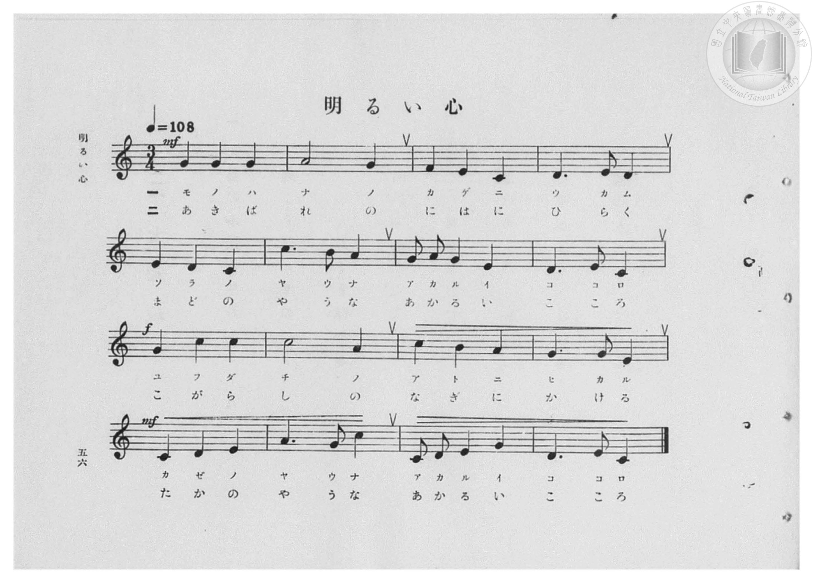
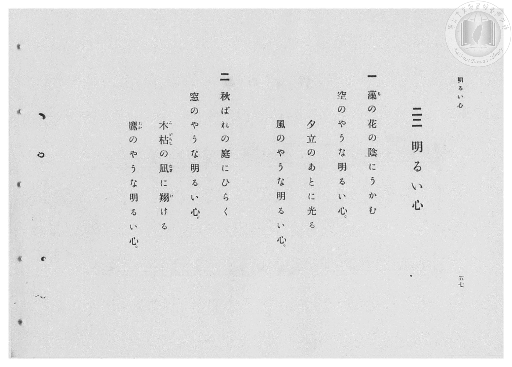

# 明るい心

> Re:Shōka 使用 AI 協助辨識與重建樂譜，可能會有錯誤。歡迎回報。

- **鋼琴伴奏版**：<br><audio controls src="akarui_kokoro.mp3"></audio>
- **NEUTRINO 歌聲合成版**：<br><audio controls src="akarui_kokoro_neutrino.mp3"></audio>

- 臺灣總督府《公學校高等科唱歌》第一學年用（昭和十一年，索書號 0729 74）

## 說明

原書資訊與歌詞全文（對應 P058.jpg–P059.jpg，原書 pp. 56–57，第 22 首）：
調性與拍號：ハ長調（C 大調，無升降記號）3/4 拍，速度 ♩=108
詞曲考證：佐佐木信綱作詞、信時潔作曲，原出文部省《新尋常小學唱歌》第六學年用（昭和七年）。


## 歌詞

```text
一
藻（も）の花の陰にうかむ
空のやうな明るい心。
夕立のあとに光る
風のやうな明るい心。

二
秋ばれの庭にひらく
窓のやうな明るい心。
木枯（こがらし）の凪（なぎ）に翔（か）ける
鷹（たか）のやうな明るい心。
```

## ABC

<div class="abc-score" data-abc-src="akarui_kokoro.abc" aria-label="五線譜載入中"></div>

[下載 ABC 原始檔](akarui_kokoro.abc)

## TMD 檔案連結

- [主旋律 TMD 檔案](akarui_kokoro.tmd) [[在 TMD Studio 編輯](https://tmdlang.github.io/Tmd-TS/#tmd=s7IKdvYPcrWy4qpTUCpJTLdSSM7PyUlNLsnMz7PKzk9PzM7Ojy_OyM9OVIKrKMvPKc1NBcqW5McbIoSL80uLklOtipMz8vNz4ktSK0qS8vOz0eXjCxLTU60CDEwtcMpYImQKivLLUvMS84DmFhRl5pWkpoANRihILctMSQVJFycn5sWXpRZlpmWmpiC5NbWoGOQVqBUlRYl5xclFmQUg_yFU5ReVZOSnFyUWZFRaZWQWl-QXZSYn5sRnJ-YhebskIxXo67zEktKiVHTR1Nx8dBMz0zPzrHLz85JKgcGHIVGSmAkUBoVseWJ8bmJmXk5iHtDZWloKz2b0PW7qftzY8nR_s4KWFpeirYKhgQWXva2CM5eNsb6JHcioF-27njcufr5j7_O5i5_umvO4oetp65qna3c8W7Dw5eoZz9d2Pl8-8emUjc_W9jxu6H6-Zs2THQ1A2ac7tzyfsuL9no5nM9Y-ndTztLcRJL5zy_s9Pc-3LHo2e8eLmfMVDMyNLBXMTd7v6VTi4tLXUrClFuBSUFB42jcfZM3m9hcrul50tAPd92LlvKetK55Nawc66-mG3mftnQqgxKGXVZD-qGEyKDWAmEAXQrQqFBToKZiaAaVMzUHOXrNGwchI4eWyaUD3vt8zC2THi1X7nzUsB5ne3Qv0EFD0cXP_y6nbgeJAO5wVni5ZDmb2PG9Z-LS3_eXM3hcrZoAVdgKDVwGoCyj3smH-013LFB7NXGkLCn2QsSvnPZu96UVD84u1IJue7J0ARM_mrHiyf-HzbRuf7J0DVPC4oRHIfTaz6dneKUARoHqIw5-27wL68GXziudzGoFx9Wzahqcbup_u2PF0Qz8oWpAi6mnrWsyIerKjGRxLnY8bmrhAbgFGG9hJ03cD1TxuagJJNa570bURSL6cueFx4-rHjW2PG7sfN4HVPV-5CyjxuKkFLLoKOYWBTATFy5Kpz1cDhdY9bmx63LgCaMDT1k6gIpDcy0VAPm7dYPfs6gHbsxwovuFxUw9Q_dNda8HO2PS4Cei2frD0qskEnAEMzmfz1oP81AhU2gPWOh3iuaftq8Diqx439oFFVj_fPwUs0g3mToS5dvtOsOh8mAReCylP1VCgoKXPxeWYnVhUmumdn51flG8VkJmYl-9QY1BTDbJIwcZCyw7MwJalFCBZ9MXCHgUNEwVgqni-vkEHng80sWgAWgcyrEahOjetVsFUQReOaxTMgCQIQngmQNIYiA3BPCOwjDGYrgEb4WNYo_C4eRGQ_7i5D0z2g1U-bu6CmgMRB4o0rQbxmjaBxbqhYssgaoByj5sXIEw1Aso1NoFkGnvB5Aao-h6YqY3rICKNYFMb14NJEBskBrIDZGonkA12Dzid4Q68XT3kBB4oXEAhAQkbwziwpebgAKwBBp8ZOAhBihABB1aKCLimveDAWIkcTM1LoI5fBg1EkLpF0CCCBCFIBUh0M1TlZqDMWrTA2wcOELDJsKBqaoEGXRsQr4IGVRMQdwPlQBECTNxQ0clQlZOBMqAIIBSAOzrJSn3QxAcOOjABD0ZdaDCCueZwLkg1KGmCQxUpAYKS0ePmqWCyARqOjbCkAk-AkGTaASahCbB5EjQMYaGLHIagUAAWJNCkBAmZ6TBT4QkQFJLAYgVMwhIgyHQQfyI0ZAmE39PZs8nOvaAkBUpekIQGyb2m8NAESoEkIJkZVyqEpKo9yGFFpVQ4HxwKkLRFjVRYy8Wla6eAXFIqAPnKXAA)]
- [鋼琴伴奏 TMD 檔案](akarui_kokoro_piano.tmd) [[在 TMD Studio 編輯](https://tmdlang.github.io/Tmd-TS/#tmd=s7IKdvYPcrWy4qpTUCpJTLdSSM7PyUlNLsnMz7PKzk9PzM7Ojy_OyM9OVIKrKMvPKc1NBcqW5McbIoSL80uLklOtipMz8vNz4ktSK0qS8vOz0eXjCxLTU60CDEwtcMpYImQKivLLUvMS84DmFhRl5pWkpoANRihILctMSQVJFycn5sWXpRZlpmWmpiC5NbWoGOSVgszEvPz4xKKixLz01NzUPCQjkAStEjPjE5OT83MLEvMyUVXlF5Vk5KcXJRZkVFplZBaX5BdlJifmxGcn5iGFTEkG0BirvMSS0qJUdNHU3HxQoCKbmJmemWeVm5-XVAoMYQyJksRMoDAo8MsT43MTM_NyEvOAPtPSUng2o-9xU_fjxpan-5vf7-l42b3n-YQtT_Zsebq0_3lnx_s9nQpaWlyKtgqGBhZc9rYKzlw2xvomdiDzX7Tvet64-PmOvc_nLn66a87jhq6nrWuert3xbMHCl6tnPF_b-Xz5xKdTNj5b2_O4ofv5mjVPdjQAZZ_u3PJ8ygqgTc9mrH06qedpbyNIfOeW93t6nm9Z9Gz2jhcz5ysYmBtZKpibAG1X4uJyzE4sKs30zs_OL8q3CgCFfZCHQ41BTTWXAhDYWGjZgRn6Wgq26EABYu2LhT0KGiYKTzf0P1_foKMASjB6WQXpmlg0aOmDDatRqM5Nq1UwVdCF4xoFMyAJghCeCZA0BmJDMM8ILGMMpmvARvgY1ig8bl4E5D9u7gOT_WCVj5u7oOZAxIEiTatBvKZNYLFuqNgyiBqg3OPmBQhTjYByjU0gmcZeMLkBqr4HZmrjOohII9jUxvVgEsQGiYHsAJnaCWSD3cOFP_B29ZATeKBwAYUEJGwM48CWmoMDsAYYfGbgIAQpQgQcWCki4Jr2ggNjJXIwNS-BOn4ZNBBB6hZBgwgShCAVINHNUJWbgTJr0QJvHzhAwCbDgqqpBRp0bUC8ChpUTUDcDZQDRQgwf0BFJ0NVTgbKgCKAUADu6CQr9UETHzjowAQ8GHWhwQjmmsO5INWgpAkOVaQECEpGj5ungskGaDg2wpIKPAFCkmkHmIQmwOZJ0DCEhS5yGIJC4XEjKMmBkhIkZKbDTIUnQFBIPm4EJ354AgSZDuJPhIYsgfB7Ons22bkXlKRAyQuS0CC51xQemkApkAQkM-NKhZBUtQc5rKiUCueDQwGStqiRCmuxFZQ-yAWlCaKgRBSL8BAzjFcwjY8HUcCiDcJAZpsBKWAiA5JGEIWIeEMUE-iGQTSBSON4oEFotoAYMA6KYZAsg8NlIBpsFJAwxTQV2SBo2oEbBHIImkkIF8L8i-IqYKDq2ikgh2u0j2GsAoaYEVhMmQsA)]

## 分析

```text
================================================================================
📊 TMD Song Profile: [ 明るい心 ]
================================================================================
⏱  Duration:       0:26 (26.7s), 16 measures total
🎼 Key & Tempo:    首調基準 C, != 108.0 BPM, <3/4>
   - 分析範圍：      由實際發聲的音符與和弦推測調性；播放脈絡另行呈現
🎤 人聲音域:    C4 (MIDI 60) – C5 (MIDI 72) [跨度: 12 個半音 / 1.0 個八度, 難度: easy]
   - 最低音:  C4 in [AkaruiKokoro #1 @ m.3, 0:04]
   - 最高音: C5 in [AkaruiKokoro #1 @ m.6, 0:08]
   - 適合: soprano, mezzo-soprano, contralto, tenor, baritone, bass
🏛  結構:      AkaruiKokoro (26.7s)
⚡ 編曲密度:        Peak 1 軌道同時演奏
🗝  調性診斷：       C 大調（純淨自然大調，未偵測到可信轉調）
   - 風格氣質:    純淨自然大調（陽光明朗、易唱易記，無明顯調外色彩）
   - 轉調歷程:    全曲維持單一推測調性（未偵測到可信轉調）
   - 核心骨幹音:  C, G, D, E, A
   - 調性數值:    C 大調 [相關度: 0.90, 穩定度: High, 自然音純度: 100.0%]
   - 候選調性 (K-S): C 大調 (0.90), G 大調 (0.75), A 小調 (0.68)
   - 五度圈歷程:   +0
   - 各段落調性細節:
     • [AkaruiKokoro #1]: C 大調 (r: 0.90, 自然音純度: 100.0%)

  [ 五度圈游移軌跡 ]
              [C ]*
         F            G  
      Bb               D  
      Eb               A  
         Ab           E  
            Db       B  
               F# 
     (* = active key center)

  [ 十二半音累積音高分佈 ]
     C  : ████████████████████████  27.1%
     C# :                            0.0%
     D  : ███████████████           16.7%
     D# :                            0.0%
     E  : ██████████████            15.6%
     F  : ██                         2.1%
     F# :                            0.0%
     G  : ██████████████████        20.8%
     G# :                            0.0%
     A  : █████████████             14.6%
     A# :                            0.0%
     B  : ███                        3.1%
--------------------------------------------------------------------------------
Assignment 軌道音域：
  - Piano         : C4 – C5 (12 個半音 / 1.0 個八度, 48 個音符)
================================================================================
```


## 原書掃描頁






