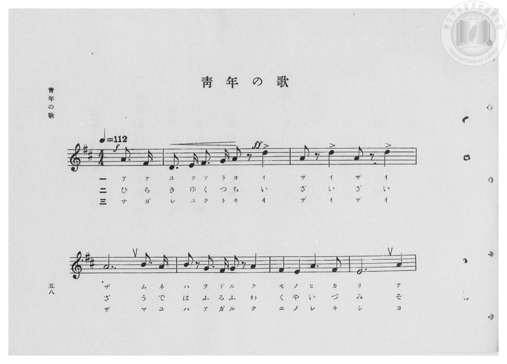
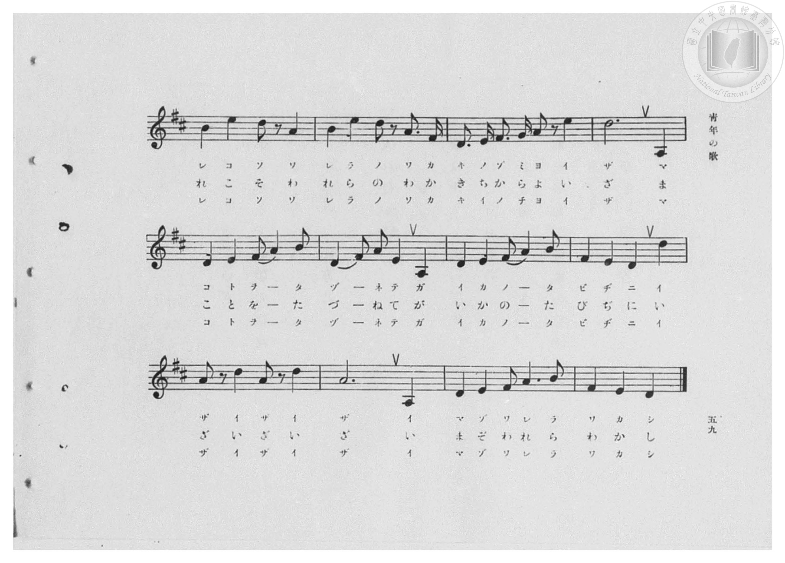
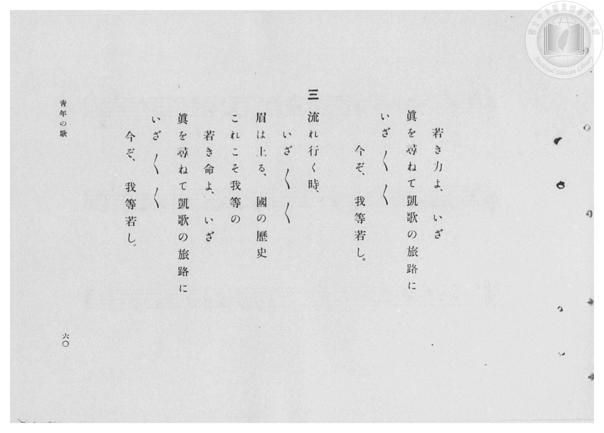
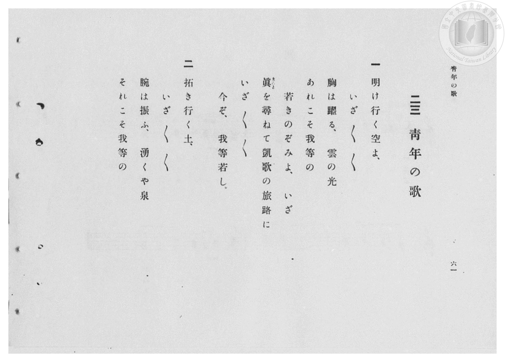

# 青年の歌

> Re:Shōka 使用 AI 協助辨識與重建樂譜，可能會有錯誤。歡迎回報。

- **鋼琴伴奏版**：<br><audio controls src="seinen_no_uta.mp3"></audio>
- **NEUTRINO 歌聲合成版**：<br><audio controls src="seinen_no_uta_neutrino.mp3"></audio>

- 臺灣總督府《公學校高等科唱歌》第一學年用（昭和十一年，索書號 0729 74）

## 說明

原書資訊與歌詞全文（對應 P060.jpg–P063.jpg，原書 pp. 58–61，第 23 首）：
調性與拍號：ニ長調（D 大調，2 升記號）4/4 拍（弱起第 4 拍進入），速度 ♩=112
頁序說明：原書為右翻直排，P063.jpg 為第 61 頁（第一段與第二段前半歌詞），P062.jpg 為第 60 頁（第二段後半與第三段歌詞）。
詞曲考證：山田耕筰作曲（東京日日新聞社懸賞一等當選曲）。


## 歌詞

```text
一
明け行く空よ、
いざ／＼／＼
胸は躍る、雲の光
あれこそ我等の
若きのぞみよ、いざ
眞（まこと）を尋ねて凱歌の旅路に
いざ／＼／＼
今ぞ、我等若し。

二
拓き行く土、
いざ／＼／＼
腕は振ふ、湧くや泉
それこそ我等の
若き力よ、いざ
眞を尋ねて凱歌の旅路に
いざ／＼／＼
今ぞ、我等若し。

三
流れ行く時、
いざ／＼／＼
眉は上る、國の歷史
これこそ我等の
若き命よ、いざ
眞を尋ねて凱歌の旅路に
いざ／＼／＼
今ぞ、我等若し。
```

## ABC

<div class="abc-score" data-abc-src="seinen_no_uta.abc" aria-label="五線譜載入中"></div>

[下載 ABC 原始檔](seinen_no_uta.abc)

## TMD 檔案連結

- [主旋律 TMD 檔案](seinen_no_uta.tmd) [[在 TMD Studio 編輯](https://tmdlang.github.io/Tmd-TS/#tmd=s7IKdvYPcrWy4qpTUCpJTLdSSM7PyUlNLsnMz7PKzk9PzM7Ojy_OyM9OVIKrKMvPKc1NBcqW5McbIoSL80uLklOtipMz8vNz4ktSK0qS8vOz0eXjCxLTU60CDMwMcMpgmAmXMcIpY4yQKSjKL0vNS8wDuqWgKDOvJDUF7BiEgtSyzJRUkHRxcmJefFlqUWZaZmoKkv9Si4pB3odaUVKUmFecXJRZAAoThKr8opKM_PSixIKMSquMzOKS_KLM5MSc-OzEPKSgKslIBYYUNEhyMtNS0aWS83NzS_MySyqRDc5Mz8yzKknMBIY7KOzLE-NzEzPzchLzgI7U0lJ4OXfS051bHjeue7a2R0FLi0vRVsHQ0IjL3lbBhcvGRN_EDmTUi_ZdzxsXP9-x9_ncxU93zXnc0PW0dc3TtTueLVj4cvWM52s7ny-f-HTKRqARjxu6n69Z82RHA1AWaO7zKSve7-l4NmPt00k9T3sbQeI7t7zf0_N8y6Jns3e8mDlfwcDcyFLB3OT9nk4lLi59LQVbagEuBQWFp33zQdZsbn-xoutFRzvQfS9WznvauuLZtHags55u6H3W3qkASj56WQXpjxomg-IexAS6EKJVoaBAT8HUAihlZghy9po1CkbGCi-XTQO69_2eWSA7Xqza_6xhOcj07l6gh4Cij5u7X07dDhQH2uGi8HTJcjCzx0jhaS_QITPAijqBQasA1AFyxp6NL7ZuBxkNFnnZsOlp61Kw-T0vG-Y_3bVM4dHMlbagSAHa9nJB49Nd_S9WrXo2ow9oFcSVz5t2Pe3f_Hz_7ueztzzrmwTUCPOIAlAKZLKZIUgn0DJI5DxbtxXoYBB7Vw-Q_bSz92lvFyR0IBaDsgeKfgMk_RA9-4ARCgpUsImdQBG4_scNTeCAWTnv2exNLxqaX6wFhdXTjRufT9nwomHq87UbnuydA5QCpYy5G5_sWvNs-lIQmrbhReO850v2PWsHRtk8oDNBCWvqtpeNO8CKweaCDAbKgChgCDxunPhiYc_jxv7nK3c9bup43NAIknjc2PK4ERhD_e_37IGQYOc073jcuP7Frt7HTd1AhS9nbwIm-qetnRAdTY-bgOZMftw491nHRKC9QDmwpu6ljxt7gZzHjfMeN-6H2AExHyT9fA7Qvx2PG_eBtQKTeufjpklPN3Q_blz7uHHZ03ZwjgBmremtL7avf9y4GrfrnuzuAlnR0AixHmzvdLiHd_WAPdwNtKQX4uGnc-bj923rVKBvn_UAbd0KMnXncqCmx00tzzZDPTwXn4efds3G4lXa-G0H2EHPtjYCHQTx27OZTXj99nwO0LXrn-zogsTk0zlANwGLr-1P-zdBNE3G67eJe-nhN6Ac5WUYFCho6XNxBadm5qXm-eWHliRaBWQm5uU71Oga1lSDLFKwMTTTsgOzsJWgCpBMDwxcBQ1IYaNgCCppFLQVgGXShv7n6xt04KWgJhb9QOtBZtcoGCjogiE6XZ1Wq2AKZhkDVRmCWUZANog2AcuAVFanAZUZxkH11MDF4UIYAjVge30MaxTioSLo9OOmRVB6I9DEx83LoLz1QLwXwm5eCcQroHoeNy2B2_-4aRuGKDYxqCuM8LiicRNUdyfI3MZeKK8NyO6HqlgCxAthZje2IFzROA1DFJsY1BXGeFzR3AW1dw04LNZARZeBwwPC7gCy11IUFviT2S5QHlbQMCEtXUHSDiY0A5OmQBUgFihpmIBFjMA0iA_TWQNNbSA5CI1sJkiuBi6DDuFmwFMbxOfY4OPmBVC6FxzGoNgFh1AzNAU0dwLxapgoNNzBIdwMSakgNX1w1iRks5tA-kAqV-GyHZrakdMkJK1gVd3YBqWXg9MZyC2QNLUValo3lA1xKySlQtIkjA2sMuCmwVgQ3lKoyv04bZ-L6lZgysUXrvOg9DLUcIXn7zU4w7UbbgYiXCFpH-aHtRCVTdtx2d60Ge5WAsVoJ2b6NiSYviHpGJg2YQUbuIRDTb-E1OArWeF6gEpgTHRoCismkJI5PJgQAQApNiFJGjmQ4SqBxSlycCOrBCVgUDCDghsi_7hpH5Q9H28hjDVSoEkCJbE39cBkGyfDWaCEhpGEESqBhTJM5To0lY8bu5ELbGABDRKB6QK2E2DqMQpsrC5uhPgWJcnTNoyBIQlL9o-bGykKY7wJ_-ns2eQkfEiCRRTKoIQLS_KgBI9QAZOBF9_w5EqEIehlP0wHloYEUiwAK0MYC1R4P27eA-M3gQo1UIy0wlWA5ECFPoiEFKuQQgkRxohqE1RMIWIPm7nwtNvcBGfBizEsDQ_k1A6KYYg6UOWBZHrjfIjp4KIZydWNa8EkpGkEYsFyBkgtoniH2w_OJdjMhYdcI7wqa4T7FUtDZWiFNYGGzRRy0j8RTVycjR-q5ABYCx29bUNESw9fsYGsCl6EwAp7WGGFXqCB1MKKO6SIg9fKaBUUvG1DRNsYb6GMrAruwkaEq0FVAXp1AfI9vA2ElDWmY3crvG0zuMO1lotL104BqSepAOQqcwEA)]
- [鋼琴伴奏 TMD 檔案](seinen_no_uta_piano.tmd) [[在 TMD Studio 編輯](https://tmdlang.github.io/Tmd-TS/#tmd=s7IKdvYPcrWy4qpTUCpJTLdSSM7PyUlNLsnMz7PKzk9PzM7Ojy_OyM9OVIKrKMvPKc1NBcqW5McbIoSL80uLklOtipMz8vNz4ktSK0qS8vOz0eXjCxLTU60CDMwMcMpgmAmXMcIpY4yQKSjKL0vNS8wDuqWgKDOvJDUF7BiEgtSyzJRUkHRxcmJefFlqUWZaZmoKkv9Si4pB3i_ITMzLj08sKkrMS0_NTc1DMgJJ0CoxMz4xOTk_tyAxLxNVVX5RSUZ-elFiQUalVUZmcUl-UWZyYk58dmIeUmiWZACNgYVaTmZaKroU0Ojc0rzMkkpkgzPTM_OsShIzgVEDip7yxPjcxMy8nMQ8oD-0tBRezp30dOeWx43rnq3teb-n42X3nucTtjzZs-Xp0v7nnR3v93QqaGlxKdoqGBoacdnbKrhw2Zjom9iBzH_Rvut54-LnO_Y-n7v46a45jxu6nrauebp2x7MFC1-unvF8befz5ROfTtkINPdxQ_fzNWue7GgAygItez5lBdCmZzPWPp3U87S3ESS-c8v7PT3Ptyx6NnvHi5nzFQzMjSwVzE2AtitxcQWnZual5vnlh5YkWgWAAjrIw6FG17CmmksBCGwMzbTswCx9LQVbdKAAsffFwh4Fjad7Nr7Yul3BUOFZd6-CtoKRwtMN_c_XN-gogJKYXlZBuiYW_Vr6YLNrFAwUdMEQna5Oq1UwBbOMgaoMwSwjIBtEm4BlQCqr04DKDOOgemrg4nAhDIEasL0-hjUK8VARdPpx0yIovRFo4uPmZVDeeiDeC2E3rwTiFVA9j5uWwO1_3LQNQxSbGNQVRnhc0bgJqrsTZG5jL5TXBmT3Q1UsAeKFMLMbWxCuaJyGIYpNDOoKYzyuaO6C2rsGHBZroKLLwOEBYXcA2WspCgv8yWxXDziZmZCWriBpBxOagUlToAoQC5Q0TMAiRmAaxIfprIGmNpAchEY2EyRXA5dBh3Az4KkN4nNs8HHzAijdCw5jUOyCQ6gZmgKaO4F4NUwUGu7gEG6GpFSQmj44axKy2U0gfSCVq3DZDk3tyGkSklawqm5sg9LLwekM5BZImtoKNa0byoa4FZJSIWkSxn7chEiTMBaEtxSqcj9O2-eiuhWYcvGF6zwovQw1XOH5ew3OcO2Gm4EIV0jah_lhLURl03ZctjdthruVQDHaiZm-DQmmb0g6BqZNWMEGLuFQ0y8hNfhKVrgeoBIYEx2awooJpGQODyZEAECKTUiSRg5kuEpgcYoc3MgqQQkYFMyg4IbIP27aB2XPx1sIY40UaJJASexNPTDZxslwFiihYSRhhEpgoQxTuQ5N5ePGbuQCG1hAg0Rguh43dcDUYxTYWF3cCPEtSpKnbRgDQxKW7B83N1IUxngT_tPZs8lJ-JAEiyiUQQkXluRBCR6hAiYDL77hyZUIQ9DLfpgOLA0JpFgAVoYwFqjwfty8B8ZvAhVqoBhphasAyYEKfRAJKVYhhRIijBHVJqiYQsQeNnPhabe5Cc6CF2NYGh7IqR0UwxB1oMoDyfTG-RDTwUUzkqsb14JJSNMIxILlDJBaRPEOtx-cS7CZCw-5RnhV1gj3K5aGytAKawINmynkpH8imrg4Gz9UyQGwFjp624aIlh6-YgNZFbwIgRX2sMIKvUADqYUVd0gRB6-V0SooeNuGiLYx3kIZWRXchY0IV4OqAvTqAuR7eBsIKWtMx-5WeNtmcIdrLZaOpA9KR9IE0Y9E9BqR-n8QCEyR8QiExoNnJER_AFEfxAOTNViZCZCqAZNGYAQzByoN5oLYQCkQBbQTxVxIOwxuLsgcZJ3ofLjrQILI9qCZC63msLgXyRiQCLo5WJyPGg7g4gPZXNTgQzgHt6EgtwJjUNdOASkSo30MYxXQhYwwhYzBQspcAA)]

## 分析

```text
================================================================================
📊 TMD Song Profile: [ 青年の歌 ]
================================================================================
⏱  Duration:       0:38 (38.6s), 18 measures total
🎼 Key & Tempo:    首調基準 D, != 112.0 BPM, <4/4>
   - 分析範圍：      由實際發聲的音符與和弦推測調性；播放脈絡另行呈現
🎤 人聲音域:    A3 (MIDI 57) – E5 (MIDI 76) [跨度: 19 個半音 / 1.6 個八度, 難度: challenging]
   - 最低音:  A3 in [SeinenNoUta #1 @ m.11, 0:23]
   - 最高音: E5 in [SeinenNoUta #1 @ m.8, 0:15]
   - 適合: soprano, mezzo-soprano, contralto, tenor, baritone, bass
🏛  結構:      SeinenNoUta (38.6s)
⚡ 編曲密度:        Peak 1 軌道同時演奏
🗝  調性診斷：       D 調性不明確（純淨自然大調，未偵測到可信轉調）
   - 風格氣質:    純淨自然大調（陽光明朗、易唱易記，無明顯調外色彩）
   - 轉調歷程:    全曲維持單一推測調性（未偵測到可信轉調）
   - 核心骨幹音:  A, D, E, F#, B
   - 調性數值:    D 調性不明確 [相關度: 0.84, 穩定度: Ambiguous, 自然音純度: 100.0%]
   - 候選調性 (K-S): D 大調 (0.84), A 大調 (0.84), A 小調 (0.57)
   - 五度圈歷程:   +3
   - 各段落調性細節:
     • [SeinenNoUta #1]: A 調性不明確 (r: 0.85, 自然音純度: 97.3%, 調外音: G)

  [ 五度圈游移軌跡 ]
               C  
         F            G  
      Bb               D  
      Eb              [A ]*
         Ab           E  
            Db       B  
               F# 
     (* = active key center)

  [ 十二半音累積音高分佈 ]
     C  :                            0.0%
     C# :                            0.0%
     D  : ███████████████████       26.1%
     D# :                            0.0%
     E  : ███████████████           20.5%
     F  :                            0.0%
     F# : ████████                  11.2%
     G  : ██                         2.6%
     G# :                            0.0%
     A  : ████████████████████████  32.5%
     A# :                            0.0%
     B  : █████                      7.1%
--------------------------------------------------------------------------------
Assignment 軌道音域：
  - Piano         : A3 – E5 (19 個半音 / 1.6 個八度, 76 個音符)
================================================================================
```


## 原書掃描頁










