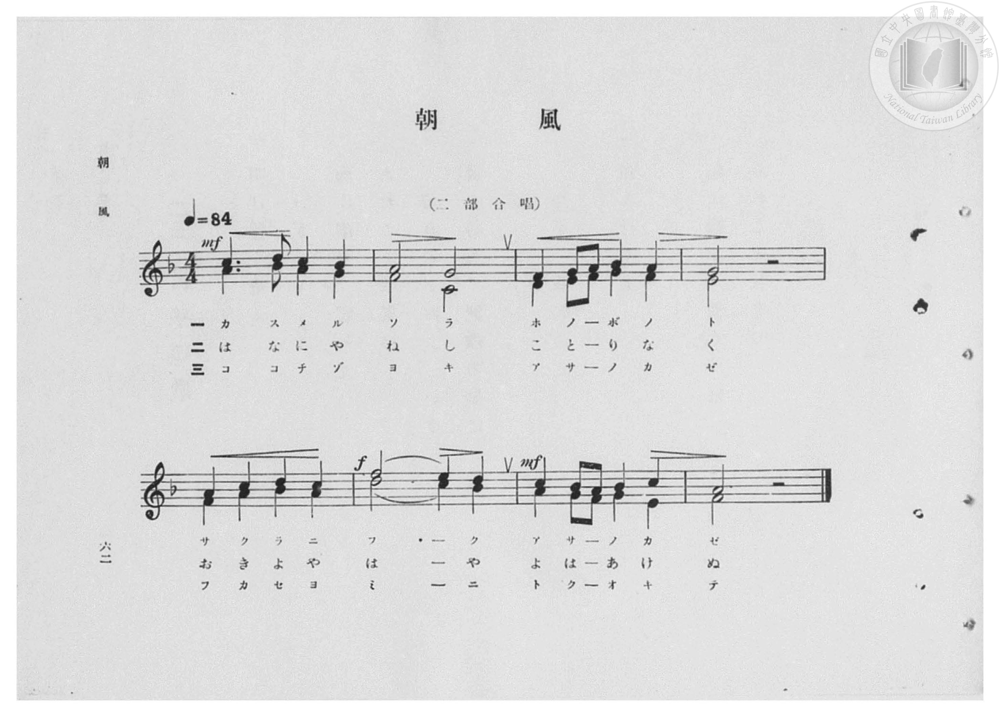
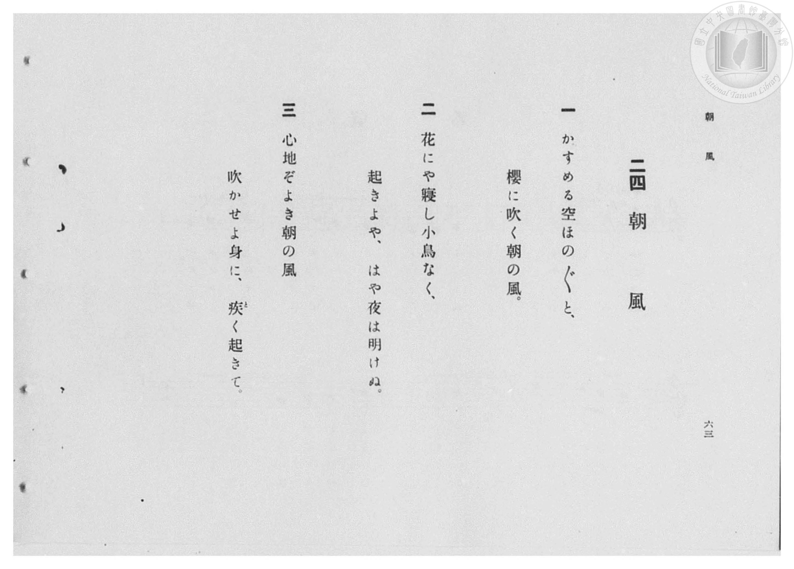

# 朝風

> Re:Shōka 使用 AI 協助辨識與重建樂譜，可能會有錯誤。歡迎回報。

- **鋼琴伴奏版**：<br><audio controls src="asakaze.mp3"></audio>

- 臺灣總督府《公學校高等科唱歌》第一學年用（昭和十一年，索書號 0729 74）

## 說明

原書資訊與歌詞全文（對應 P064.jpg–P065.jpg，原書 pp. 62–63，第 24 首）：
調性與拍號：ヘ長調（F 大調，1 降記號）4/4 拍（二部合唱），速度 ♩=84
詞曲考證：桑田春風作詞，採用 Friedrich Silcher（シルヘル）作曲之德國歌曲旋律。


## 歌詞

```text
一
かすめる空ほの／″＼と、
櫻に吹く朝の風。

二
花にや寢し小鳥なく、
起きよや、はや夜は明けぬ。

三
心地ぞよき朝の風
吹かせよ身に、疾（と）く起きて。
```

## ABC

<div class="abc-score" data-abc-src="asakaze.abc" aria-label="五線譜載入中"></div>

[下載 ABC 原始檔](asakaze.abc)

## TMD 檔案連結

- [主旋律 TMD 檔案](asakaze.tmd) [[在 TMD Studio 編輯](https://tmdlang.github.io/Tmd-TS/#tmd=s7IKdvYPcrWy4qpTUCpJTLdSSM7PyUlNLsnMz7PKzk9PzM7Ojy_OyM9OVIKrKMvPKc1NBcqW5McbIoSL80uLklOtipMz8vNz4ktSK0qS8vOz0eXjCxLTU60CDMxMcMqYImQKivLLUvMS84DmFhRl5pWkpoANRihILctMSQVJFycn5sWXpRZlpmWmpiC5NbWoGOQVqBUlRYl5xclFmQUg_yFU5ReVZOSnFyUWZFRaZWQWl-QXZSYn5sRnJ-YhebskIxXo6_LURCCjCF04L7GktCgV2cTM9Mw8q9zUzKxMLGEBlS5PLS5JLcqLz03NyU-pxJAuScwEBj0o-MsT43MTM_NyEvOAftPSUng2Z-7LRSsUtLS4FG0VLEy47G0V3LhsTPRN7EBmvGjf9bxx8fMde5_PXfx015zHDV1PW9c8Xbvj2YKFL1fPeL628_nyiU-nbHy2tudxQ_fzNWue7GgAyj7dueX5lBXv93Q8m7H26aSep72NIPGdW97v6Xm-ZdGz2TtezJyvYGBuZKlgbvJ-T6cSF5e-loIttQCXgoLC0775IGs2t79Y0fWiox3ovhcr5z1tXfFsWjvQWU839D5r71QAJR29rIL0Rw2TQWkFxAS6EKJVoaBAT8HMCChlZgxy9po1CkYmCi-XTQO69_2eWSA7Xqza_6xhOcj07l6gh4Cij5tnvJy6HSgOtMNN4emS5WBmj6HCy5m9L1bMACvqBAatAlAHUMmTXT0vm1c8ndABDEGwsT0vG-Y_3bVM4dHMlbbAqADZsXLes9mbXjQ0v1gLsvbZwonPp2x4NmMpMMqe7J0DlAVqeta3EBjaCm5FwOQKTG0ZCsGZOcnAhAW04XHT9sfNq4HOApJAG4BagKY92dn9dN_2p3O6gaEC5D6bDuR2P25o4gJZCIwoEPW4sftx48zHTY2Pm7qfr9z1uHH348Z17_f0P2rY_H7PnseNKx43NILUPVsNlFj9dMLOx439wJQEVAR0GdysXT1gP3RtBKp53NTydP2ix43Tn27of7l56ePGVUAtUFNebN3-uLH3cRPQvS1AoceN60Gql8wBMp7N6HvcOPFx4xqEAzvBEby_-emcDY8b54F0NfbC7QbLgZwDdP9soNyLXatBljc0Pp-2DxQgjcBk2Qm0GWpl4zKQuUA9lCc7KFDQ0uficixOzE6sAhZBmYl5-YYONQY11SBLFGwstOzADGzpXQGSf14s7Hmyo-tF4yZg2lDQMFEAhtfz9Q068NSqiUUn0E6QqTUK1blptQqmCrpAaAamTYC4RsEYLKKrYASlaxQMwTxjsDxItgYuZwDFNWAjfQxrFB43rQbLPG7aqfC4eSGI1QwSAcnshep63LwSbvbj5tlgkT4g3gPEc6A8iFwHVF08FEPtMQLKNa6HmNW4CohBNgCTAURX41qYPY3TEfY0TgaLrIDY09QF1QuR68dujzHI1Zuh_tkM1NkIZu2Dum4FzJ4mmI0g9YvAIluh_gH5BBImILk9GPbgj-FdPRTFMCjiQBGGiLhqYJSbQR2BiHJwSgApMAJqAcUtRDFIO65Y3gr2FygOILH5uLkbGipTYaEC9D9MDenhgohnSEz1gtWD0gMiniEpAGETVByiCigLtqmxCcybCNWzBrtNoJgGuxzipsdNu8HmgmIYJDMf1Sa4XyHugdrUBEpNkLQAkmvDsKkWLbMbkZHZuynJ7JCsbQKNauQoNgW5EJKCzUBM83hoSgApqAFxRzM8HTM8ubEMjjtIcQ2LOlCOB-VyEETEOzg5gBQAYxaoCRy_4DQwmutpkOt17RSgGV8ByFTmAgA)]
- [鋼琴伴奏 TMD 檔案](asakaze_piano.tmd) [[在 TMD Studio 編輯](https://tmdlang.github.io/Tmd-TS/#tmd=s7IKdvYPcrWy4qpTUCpJTLdSSM7PyUlNLsnMz7PKzk9PzM7Ojy_OyM9OVIKrKMvPKc1NBcqW5McbIoSL80uLklOtipMz8vNz4ktSK0qS8vOz0eXjCxLTU60CDMxMcMqYImQKivLLUvMS84DmFhRl5pWkpoANRihILctMSQVJFycn5sWXpRZlpmWmpiC5NbWoGOSVgszEvPz4xKKixLz01NzUPCQjkAStEjPjE5OT83MLEvMyUVXlF5Vk5KcXJRZkVFplZBaX5BdlJifmxGcn5iGFTEkG0Bir8tREIKMIXTgvsaS0KBXZxMz0zDyr3NTMrEwswQWVLk8tLkktyovPTc3JT6nEkC5JzATGDiiGyhPjcxMz83IS84De19JSeDZn7stFK97v6XjZvef5hC1P9mx5urT_eWfH-z2dClpaXIq2ChYmXPa2Cm5cNib6JnYgg1-073reuPj5jr3P5y5-umvO44aup61rnq7d8WzBwperZzxf2_l8-cSnUzY-W9vzuKH7-Zo1T3Y0AGWf7tzyfArIomcz1j6d1PO0txEkvnPL-z09z7csejZ7x4uZ8xUMzI0sFcxNgJYrcXE5FidmJ1YB4xoUKYYONQY11VwKQGBjoWUHZuhrKdiiAwWIhS8W9jzZ0fWicdPL5hUKGiYKTzf0P1_foKMASlF6WQXpmlh0aumDTa1RqM5Nq1UwVdAFQjMwbQLENQrGYBFdBSMoXaNgCOYZg-VBsjVwOQMorgEb6WNYo_C4aTVY5nHTToXHzQtBrGaQCEhmL1TX4-aVcLMfN88Gi_QB8R4gngPlQeQ6oOrioRhqjxFQrnE9xKzGVUAMsuFxUwtEV-NamD2N0xH2NE4Gi6yA2NPUBdULkevHbo8xyNWbof7ZDNTZCGbtg7puBcyeJpiNIPWLwCJbof4B-QQSJiC5PRj24I_hXT0UxTAo4kARhoi4amCUm0EdgYhycEoAKTACagHFLUQxSDuuWN4K9hcoDiCx-bi5GxoqU2GhAvQ_TA3p4YKIZ0hM9YLVg9IDIp4hKQBhE1QcogooC7apsQnMmwjVswa7TaCYBrsc4qbHTbvB5oJiGCQzH9UmuF8h7oHa1ARKTZC0AJJrw7CpFi2zG5GR2bspyeyQrG0CjWrkKDYFuRCSgs1ATPN4aEoAKagBcUczPB0zPLmxDI47SHENizpQjgflchBExDs4OYAUAGMWqAkcv-A0MJrraZ3rfTyQsr0JNNsDgz0eGAHAXAehwHwoG8I3QnCA4jVwjgEQQrwDVoMwBsxFiIBNRDIEZgNEP9CRunYKUHdG-xjGKiBzjVC5xmCuMhcA)]

## 分析

```text
================================================================================
📊 TMD Song Profile: [ 朝風 ]
================================================================================
⏱  Duration:       0:22 (22.9s), 8 measures total
🎼 Key & Tempo:    首調基準 F, != 84.0 BPM, <4/4>
   - 分析範圍：      由實際發聲的音符與和弦推測調性；播放脈絡另行呈現
🎤 人聲音域:    F4 (MIDI 65) – D5 (MIDI 74) [跨度: 9 個半音 / 0.8 個八度, 難度: easy]
   - 最低音:  F4 in [Asakaze #1 @ m.3, 0:05]
   - 最高音: D5 in [Asakaze #1 @ m.1, 0:01]
   - 適合: soprano, mezzo-soprano, contralto, tenor, baritone, bass
🏛  結構:      Asakaze (22.9s)
⚡ 編曲密度:        Peak 2 軌道同時演奏
🗝  調性診斷：       F 大調（純淨自然大調，未偵測到可信轉調）
   - 風格氣質:    純淨自然大調（陽光明朗、易唱易記，無明顯調外色彩）
   - 轉調歷程:    全曲維持單一推測調性（未偵測到可信轉調）
   - 核心骨幹音:  F, A, G, C, A#
   - 調性數值:    F 大調 [相關度: 0.87, 穩定度: High, 自然音純度: 100.0%]
   - 候選調性 (K-S): F 大調 (0.87), D 小調 (0.68), C 大調 (0.59)
   - 五度圈歷程:   -1
   - 各段落調性細節:
     • [Asakaze #1]: F 大調 (r: 0.87, 自然音純度: 100.0%)

  [ 五度圈游移軌跡 ]
               C  
        [F ]*          G  
      Bb               D  
      Eb               A  
         Ab           E  
            Db       B  
               F# 
     (* = active key center)

  [ 十二半音累積音高分佈 ]
     C  : ████████████              11.6%
     C# :                            0.0%
     D  : █████████                  8.9%
     D# :                            0.0%
     E  : ███████                    7.1%
     F  : ████████████████████████  23.2%
     F# :                            0.0%
     G  : ██████████████████        17.9%
     G# :                            0.0%
     A  : ████████████████████      19.6%
     A# : ████████████              11.6%
     B  :                            0.0%
--------------------------------------------------------------------------------
Assignment 軌道音域：
  - Piano1        : F4 – D5 (9 個半音 / 0.8 個八度, 25 個音符)
  - Piano2        : C4 – A#4 (10 個半音 / 0.8 個八度, 25 個音符)
================================================================================
```


## 原書掃描頁






