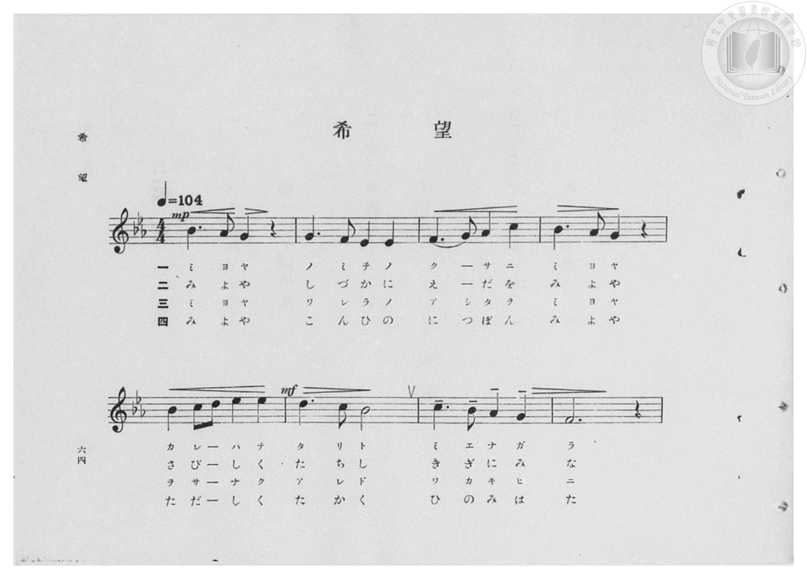
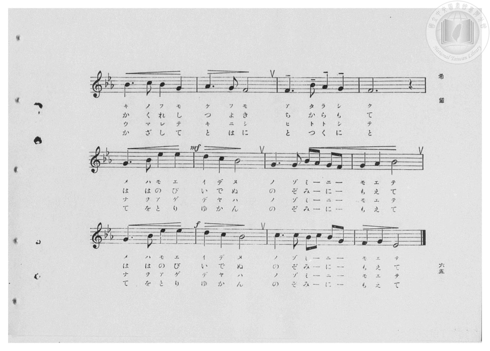
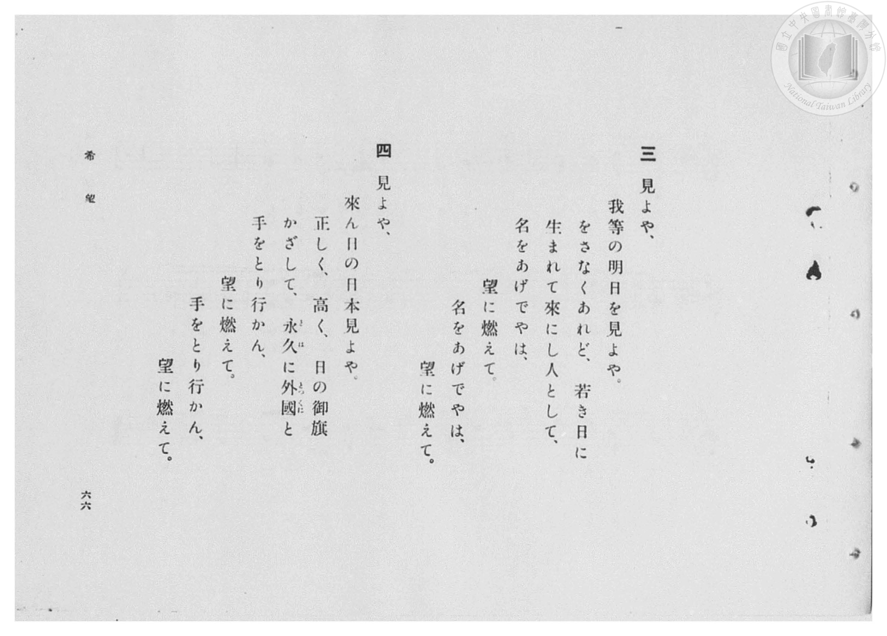
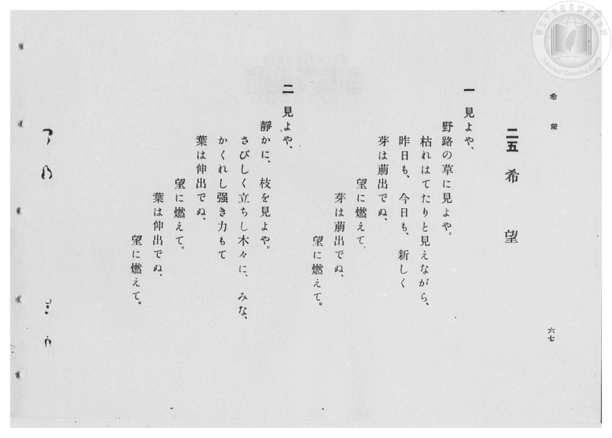

# 希望

> Re:Shōka 使用 AI 協助辨識與重建樂譜，可能會有錯誤。歡迎回報。

- **鋼琴伴奏版**：<br><audio controls src="kibo.mp3"></audio>

- 臺灣總督府《公學校高等科唱歌》第一學年用（昭和十一年，索書號 0729 74）

## 說明

原書資訊與歌詞全文（對應 P066.jpg–P069.jpg，原書 pp. 64–67，第 25 首）：
調性與拍號：2 降記號（變ロ調／ト小調系統）4/4 拍，速度 ♩=104
頁序說明：原書為右翻直排，P069.jpg 為第 67 頁（第一、二段歌詞），P068.jpg 為第 66 頁（第三、四段歌詞）。


## 歌詞

```text
一
見よや、
野路の草に見よや。
枯れはてたりと見えながら、
昨日も、今日も、新しく
芽は萌出でぬ、
望に燃えて。
芽は萌出でぬ、
望に燃えて。

二
見よや、
靜かに、枝を見よや。
さびしく立ちし木々に、みな、
かくれし強き力もて
葉は伸出でぬ、
望に燃えて。
葉は伸出でぬ、
望に燃えて。

三
見よや、
我等の明日を見よや。
をさなくあれど、若き日に
生まれて來にし人として、
名をあげでやは、
望に燃えて。
名をあげでやは、
望に燃えて。

四
見よや、
來ん日の日本見よや。
正しく、高く、日の御旗
かざして、永久（とは）に外國（とつくに）と
手をとり行かん、
望に燃えて。
手をとり行かん、
望に燃えて。
```

## ABC

<div class="abc-score" data-abc-src="kibo.abc" aria-label="五線譜載入中"></div>

[下載 ABC 原始檔](kibo.abc)

## TMD 檔案連結

- [主旋律 TMD 檔案](kibo.tmd) [[在 TMD Studio 編輯](https://tmdlang.github.io/Tmd-TS/#tmd=s7IKdvYPcrWy4qpTUCpJTLdSSM7PyUlNLsnMz7PKzk9PzM7Ojy_OyM9OVIKrKMvPKc1NBcqW5McbIoSL80uLklOtipMz8vNz4ktSK0qS8vOz0eXjCxLTU60CDMzMcMqY45SxwCljiZApKMovS81LzAO6paAoM68kNQXsGISC1LLMlFSQdHFyYl58WWpRZlpmagqS_1KLikHeh1pRUpSYV5xclFkAChOEqvyikoz89KLEgoxKq4zM4pL8oszkxJz47MQ8pKAqyUgFhlReYklpUSq6aGpuPrqJmemZeVYliZnlQHflp6VlJmcm5mCTB0YIKFLKE-NzEzPzchLzgK7X0lJ4uqPn2ZzZClpaXIq2CoYGJlz2tgpOOlw2JvomdiBTXrTvet64-PmOvc_nLn66a87jhq6nrWuert3xbMHCl6tnPF_b-Xz5xKdTNj5b2_O4ofv5mjVPdjQAZZ_u3PJ8yor3ezqezVj7dFLP095GkPjOLe_39DzfsujZ7B0vZs5XMDA3slQwN3m_p1OJi0tfS8GWWoBLQUHhad98kDWb21-s6HrR0Q5034uV8562rng2rR3orKcbep-1dyqAkpReVkH6o4bJoPQAYgJdCNGqUFCgp2BmApQyMwc5e80aBSNThZfLpgHd-37PLJAdL1btf9awHGR6dy_QQ0BRI4WXM3tfrJgB5nW8WNf1uHktUNX7Pf2Pm4GW9gPZzzfvfr51I9AQYAgrADUCzX7ZMP_prmUKj2autAXFANDklwsan-4Cql71bEYf0FiIi5437Xrav_n5_t3PZ2951jcJqBHmaAWgFMiBZuYgnUCbIRHxuKHxya6eZ-u2QnwPdjhIjwWKHjNkPZ1APU9nz0bW87ihiQvkJqCBYE8v637c1PG4qQWoEuzU9r4X29c_blz3orfzceNqJOkmkPSzeesfN_U8bgSqWPa4cf7jpq7HjStAiho7HjeuetzY87gJZCdY6YwVz6YvfdzUBHL37i44-9m0DY8bpz9u7Adb37UXaNiLCT1P23c9blz-uHENTPec2UDrn7c3g01eBrWeFOVgT-7qwerJuXMeNwLdvBrknHlzHzdNQvfn48apjxs3Q9z5fDVQ6UIg-9mcFY8bWiHaHjfuB3kYYh7YsH5wwEx_umf748bep12zQb5tXAa2fiIwKNc_2bODSE-SoBwSk53YPPmsYyIwPwNjEpjowIGP6cmmSWB_AuOt_3FjE9j9K4G6X3QvBXoBpKdxNUjd8ynzHzfuA0sve7KvDRQAjdOf7AI6bgU4hIAuAdv4dEIv2Eigv4HkcpBFwISCz6sk6gBrmT0bm29B7mqaDHbzOiD5bM4ajKS7djEkPoE6gGUdhAHR8HTfwmfTp8NjchrcV8827HiysxWYm8BeXQ_KPo2rny6Z9nRON0xwCTjwVoOlVoDt6QTaC_TNCmDmeLEQGGZA7mS8oUC6DsoLVShQ0NLn4vLOTMq3CshMzMt3qDGoqQZZoGBjoWUHZmAryRUgBRLQrQoaJgrAgvD5-gYdePGriUUD0BqQYTUK1bkFtQqGCrpAaB6vYBYPpA2AuAbC1FUwjVcwAbHARA2ICxIFSgJV6yoYgQWxaAeb7mNYo_C4eT5Y9nHzCiBeAmRBDHrc3AcVnw_EjWAWSAQo07QeKrMHyN4KZnVD9WA1C2KXEVC-cT9EvqkDiFsQdjVOh4g3LgUlKDBrNVSmA2FX4wKw3klQGaxmQewyxucvmOvXAPFKFH8tgpq4HYhBpj9u3kTYXyb4_DUZKj4ZyAaZBcw7UBmQ_0D8JUC8F6oGn7_wp61dPeSkLVC6MFIwVjAB0iAMSm1ptUABkAOMoMkGJAxKRrpAPjhNgRMRPKVBIFqaagL5DhLCwHhr7gfz2qChDPVf8yoghsQuShg3gcK4C8xaA5UBxRIMoqeoqeBQ3AxNIaB0BCxfoCEJNbFxITyFQcR7oeJ90HiAhDlIZhV2m8DpCRx_wPQO8RPEhaC0hJRywD7uRPITNK0Bw-Nx01qwCmjqBecYLDaBUxPI3aDUjs9P3VAxmJ9AroOkL4hvgKUvig5kmwiUU52YacmcqLQESzTQFAJOLWAePK3Akw0JaQkUbpBc-rgZHNvNoNAGyWyEykyFikHDAp6P98NyODBHI5dc2FMSJEZAoQqsucEsUMiDZEA5HpojoWkHIr4QERdNoFgHtmCgMsuw2wNKR00QucfN88DpBTlnwHwKMg_kYlgqAqUZkDjQfnCOgfsHrBNXKoL5Zxo8DYFsBsmsgMqsh5dDqOKgMgmcZ-GlMESG6DQEbHOQk4agVZohtgIJVAQhCiSoSiAFTkiQJAYVBicsuFKkig4aXcDiCJJcQEUNJOBBEfy4uR1MgqIeFvDQKrBpH7QaBGV8YOQAaZAswgxERCAnKGjmBwczqNgHFVOQ4AQV68DmG5gEJQFYBIBUgcSASQOYiSHZH1h0QOwDJy5IhYhIYMgFFKhIglRakCzwuAlWfUF8BvElUqFBvv_ACQyakIEVMiSBAFtj0PAEqYZW5OBqjRL_Eaj4plAroWFNZ5CKD1SqgTBQG7SsAhsAbnKNJrLhkMhqubh07RRA7XoFIK3MBQA)]
- [鋼琴伴奏 TMD 檔案](kibo_piano.tmd) [[在 TMD Studio 編輯](https://tmdlang.github.io/Tmd-TS/#tmd=s7IKdvYPcrWy4qpTUCpJTLdSSM7PyUlNLsnMz7PKzk9PzM7Ojy_OyM9OVIKrKMvPKc1NBcqW5McbIoSL80uLklOtipMz8vNz4ktSK0qS8vOz0eXjCxLTU60CDMzMcMqY45SxwCljiZApKMovS81LzAO6paAoM68kNQXsGISC1LLMlFSQdHFyYl58WWpRZlpmagqS_1KLikHeL8hMzMuPTywqSsxLT81NzUMyAknQKjEzPjE5OT-3IDEvE1VVflFJRn56UWJBRqVVRmZxSX5RZnJiTnx2Yh5SaJZkAI2xykssKS1KRRdNzc0HRQSyiZnpmXlWJYmZ5UCn56elZSZnJuZgkwfGGSjeyhPjcxMz83IS84Ae1NJSeLqj59mc2e_3dLzs3vN8wpYne7Y8Xdr_vLPj_Z5OBS0tLkVbBUMDEy57WwUnHS4bE30TO5DRL9p3PW9c_HzH3udzFz_dNedxQ9fT1jVP1-54tmDhy9Uznq_tfL584tMpG5-t7Xnc0P18zZonOxqAsk93bnk-ZQXQqmcz1j6d1PO0txEkvnPL-z09z7csejZ7x4uZ8xUMzI0sFcxNgNYrcXF5ZyblWwWAQj3Iw6HGoKaaSwEIbCy07MAMfS0FW3SgALHuxcIeBQ0Thacb-p-vb9BRACUvvayCdE0sGrT0wYbVKFTnFtQqGCroAqF5vIJZPJA2AOIaCFNXwTRewQTEAhM1IC5IFCgJVK2rYAQWxKIdbLqPYY3C4-b5YNnHzSuAeAmQBTHocXMfVHw-EDeCWSARoEzTeqjMHiB7K5jVDdWD1SyIXUZA-cb9EPmmDiBuQdjVOB0i3rgUiEFmPW5cDZXpQNjVuACsdxJUBqtZELuM8fkL5vo1QLwSxV-LoCZuB2KQ6Y-bNxH2lwk-f02Gik8GskFmPW5cB5UB-Q_EXwLEe6Fq8PkLf9ra1UNO2gKlCyMFYwUTIA3CoNSWVgsUADnACJpsQMKgZKQL5IPTFDgRwVMaBKKlqSaQ7yAhDIy35n4wrw0aylD_Na8CYkjsooRxEyiMu8CsNVAZUCzBIHqKmgoOxc3QFAJKR48bQfaB5KAmNi6EpzCIeC9UvA8aD5AwB8mswm4TOD2B4w-Y3iF-grgQlJaQUg7Yx51IfoKmNWB4PG5aC1YBTb3gHIPFJnBqArkblNrx-akbKgbzE8h1kPQF8c3jRqjboDqQbSJQTnVipiVzotISLNFAUwg4tYB58LQCTzYkpCVQuEFy6eNmcGw3g0IbJLMRKjMVKgYNC3g-3g_L4cAcjVxyYU9JkBgBherjph4wCxTyIBlQjofmSGjagYgvRMRFEyjWHzc1QWWWYbcHlI6aIHKPm-eB0wtyzoD5FGQeyMWwVARKMyBxoP3gHAP3D1gnrlQE8880eBoC2QySWQGVWQ8vh1DFQWUSOM_CS2GIDNFp6Ons2eSkIWiVZoitQAIVQYgCCaoSSIETEiSJQYXBCQuuFKmig0YXsDiCJBdQUQMJeFAEP25uB5OgqIcFPLQKbNoHrQZBGR8YOUAaJIswAxERyAkKmvnBwQwq9kHFFCQ4QcX648blYBKUBGARAFIFEgMmDWAmhmR_YNEBsQ-cuCAVIiKBIRdQoCIJUmlBssDjJlj1BfEZxJdIhQb5_gMnMGhCBlbIkATyuAnkApBLQaqhFTm4WqPEfwQqvinUSmhY0xmk4gOVaiAM1AYtq8AGgJtco4lsOCSyWuRmvQ9ys94E0axHNOKRElK8gjEQg2gDJL4JEBtCUku8ghGodIJgDB3w5I1oxSGqVIgeuFlQPpQCJk6IKSAOiEaxDN1oSKWObjRIG4ZWIIXCJ2Q2tLBHCROg-TidDQsBuF0wT8BUoIYJOIMTbTjUiUA-wtkgFkgDCIOjWtdOARTb0T6GsQpwthES2xiJbQJmK3MBAA)]

## 分析

```text
================================================================================
📊 TMD Song Profile: [ 希望 ]
================================================================================
⏱  Duration:       0:46 (46.2s), 20 measures total
🎼 Key & Tempo:    首調基準 B,, != 104.0 BPM, <4/4>
   - 分析範圍：      由實際發聲的音符與和弦推測調性；播放脈絡另行呈現
🎤 人聲音域:    D#4 (MIDI 63) – D#5 (MIDI 75) [跨度: 12 個半音 / 1.0 個八度, 難度: easy]
   - 最低音:  D#4 in [Kibo #1 @ m.2, 0:03]
   - 最高音: D#5 in [Kibo #1 @ m.5, 0:10]
   - 適合: soprano, mezzo-soprano, contralto, tenor, baritone, bass
🏛  結構:      Kibo (46.2s)
⚡ 編曲密度:        Peak 1 軌道同時演奏
🗝  調性診斷：       A# 大調（純淨自然大調，未偵測到可信轉調）
   - 風格氣質:    純淨自然大調（陽光明朗、易唱易記，無明顯調外色彩）
   - 轉調歷程:    全曲維持單一推測調性（未偵測到可信轉調）
   - 核心骨幹音:  A#, G, F, D#, C
   - 調性數值:    A# 大調 [相關度: 0.85, 穩定度: Moderate, 自然音純度: 100.0%]
   - 候選調性 (K-S): A# 大調 (0.85), G 小調 (0.79), D# 大調 (0.68)
   - 五度圈歷程:   -2
   - 各段落調性細節:
     • [Kibo #1]: A# 大調 (r: 0.85, 自然音純度: 100.0%)

  [ 五度圈游移軌跡 ]
               C  
         F            G  
     [Bb]*              D  
      Eb               A  
         Ab           E  
            Db       B  
               F# 
     (* = active key center)

  [ 十二半音累積音高分佈 ]
     C  : ███████████               11.2%
     C# :                            0.0%
     D  : █████                      5.3%
     D# : █████████████             13.2%
     E  :                            0.0%
     F  : █████████████████         17.1%
     F# :                            0.0%
     G  : █████████████████████     20.4%
     G# :                            0.0%
     A  : █████████                  9.2%
     A# : ████████████████████████  23.7%
     B  :                            0.0%
--------------------------------------------------------------------------------
Assignment 軌道音域：
  - Piano         : D#4 – D#5 (12 個半音 / 1.0 個八度, 71 個音符)
================================================================================
```


## 原書掃描頁










