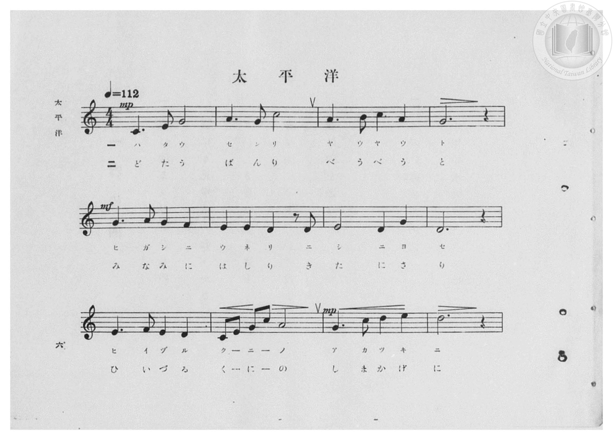
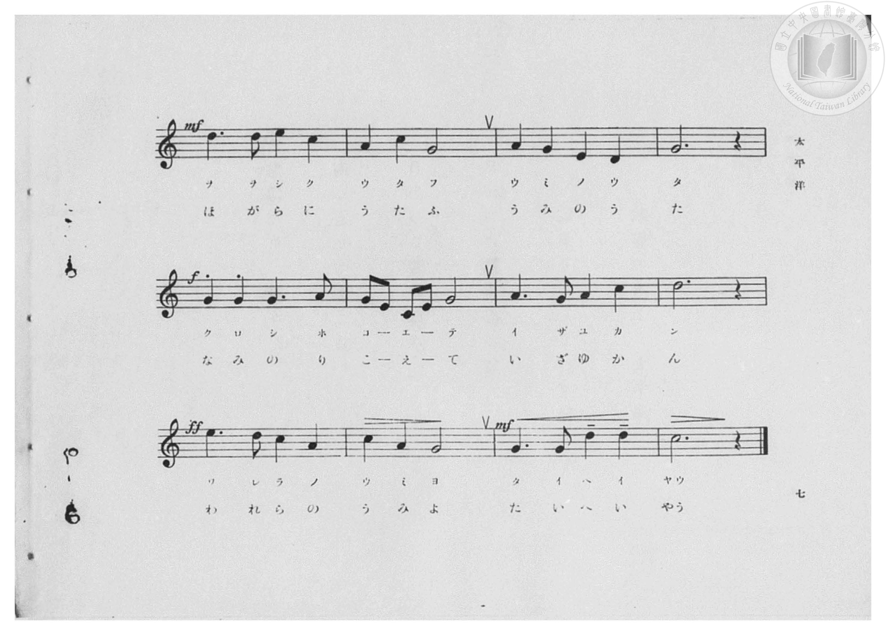
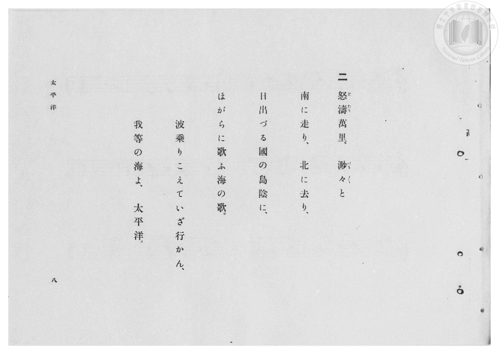
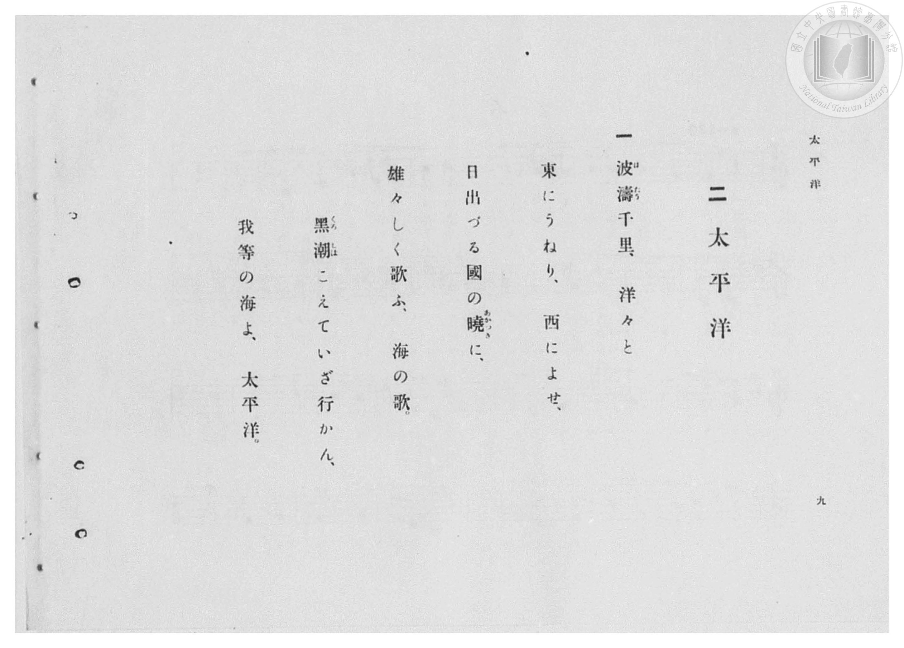

# 太平洋

> Re:Shōka 使用 AI 協助辨識與重建樂譜，可能會有錯誤。歡迎[回報](https://github.com/TMDLang/reshoka/issues)。

- **鋼琴伴奏版**：<br><audio controls src="taiheiyo.mp3"></audio>
- **NEUTRINO 歌聲合成版**：<br><audio controls src="taiheiyo_neutrino.mp3"></audio>

- 臺灣總督府《公學校高等科唱歌》第一學年用（昭和十一年，索書號 0729 74）

## 說明

原書資訊與歌詞全文（對應 P008.jpg–P011.jpg，原書 pp. 6–9）：
調性與拍號：ハ長調（C 大調）4/4 拍，速度 ♩=112
歌詞頁採由右至左裝訂：P011.jpg（原書 p. 九）載有第一段，P010.jpg（原書 p. 八）載有第二段。


## 歌詞

```text
一
波濤（はたう）千里、洋々と
東にうねり、西によせ、
日出づる國の曉（あかつき）に、
雄々しく歌ふ、海の歌。
黑潮（くろしほ）こえていざ行かん、
我等の海よ、太平洋。

二
怒濤（どたう）萬里、渺々（べう〱）と
南に走り、北に去り、
日出づる國の島陰に、
ほがらに歌ふ海の歌。
波乗りこえていざ行かん、
我等の海よ、太平洋。
```

## ABC

<div class="abc-score" data-abc-src="taiheiyo.abc" aria-label="五線譜載入中"></div>

[下載 ABC 原始檔](taiheiyo.abc)

## TMD 檔案連結

- [主旋律 TMD 檔案](taiheiyo.tmd) [[在 TMD Studio 編輯](https://tmdlang.github.io/Tmd-TS/#tmd=s7IKdvYPcrWy4qpTUCpJTLdSSM7PyUlNLsnMz7PKzk9PzM7Ojy_OyM9OVIKrKMvPKc1NBcqW5McbIoSL80uLklOtipMz8vNz4ktSK0qS8vOz0eXjCxLTU60CDAwsEDIFRfllqXmJeUDdBUWZeSWpKWDtCAWpZZkpqSDp4uTEvPiy1KLMtMzUFCQXpRYVgxwMtaKkKDGvOLkoswDkC4Sq_KKSjPz0osSCjEqrjMzikvyizOTEnPjsxDwkz5VkpAL9Vp5YklqELpiXWFJalIoumpOYlwJ0VgGSBNDg9Mw8q9I8kKtLoG7V0lJ4umTV052bn23pVtDS4lK0VTA0NOKyt1Vw5rIx0TexA2l_0b7reePi5zv2Pp-7-OmuOY8bup62rnm6dsezBQtfrp7xfG3n8-UTn07Z-Gxtz-OG7udr1jzZ0QCUfbpzy_MpK97v6Xg2Y-3TST1PextB4ju3vN_T83zLomezd7yYOV_BwNzIUsHc5P2eTiUuLn0tBVtqAS4FBYWnffNB1mxuf7Gi60VHO9B9L1bOe9q64tm0dqCznm7ofdbeqQCKdL2sgvRHDZMDDAwNQUygCyFaFQoK9BTMgDKWQAe-3zMLZOiLVfufNSwHGdfdC_QBUPRxc__LqduB4kBDnYHBuRzM7ASGngJQDdCwlw3zn-5apvBo5kpbUOACDYE45eWCxmd9C59P2fi0f_OL9s1Pty97sXjuixVNQDMRTumAOUVP4cnOuUBzX-zpfDanExLMz9ZtBZoPVGyAofhp62oUxbt6gIofNzRxgewHagU7Y_OiZ_uXALU9blz_uHH-48Y2oJanvc0v24Ex2QhMEo8bWh83rgArnbvxceNqoIrHjWsfN3UBpV8s3Q8SaQJqng3kghVNX_q0fdfjxqWPm7qfzul-3Lju2WxguAFVND1uBHKXPG4EhkcnSBtEw8vZLWArpj9u7Acln0agCxufbd0O0glKTU1gRbsnPtu7DmxM_-OmXrDq3WBjJj9uBAoue9zY8rhx2ouFQP3dj5smwxzTMRGYNEEmAc0DurKhEZ7S4cGwqwessmESLBhWwoPhxYQ10GDYsQvoRrDsTpD_GzaC7QaHytNeoFtWv9i6ARIkT3tA3Kd9uyFc7EHydPO2lzM3IMIA6JnHjT2Pm0DBAgkD9AAARtOTndNBZlLkY6AKyvMVFCho6XNxhSRmZqRmVuZbBWQm5uU71BjUVIMsUbCx0LIDM7BlaAVIygW6XUHDROHphv7n6xt04LlQE4sGoFUgw2oUqnMLahUMFXSB0FjBFEzrAoXNwLSpgmEcmpA5RAjEqYGrB0EDkAjYUB_DGgVg_gWLPm7aD8TL4IY8btoNEW_eDMSrEOLNS6Dql0HZEF0gmQ4kW-IRthgB5RpXQnQ1zgfiNoRpjRugpk0G4i4k8Z1Q9W1QNkQXSGYFhi34g3tXD3nBnVYLDTYzMG0Ctt4YHPy6CkbggDSCioAgSASkrgbMwhXYk6DeXQPE28HB2w0NblAgPm7uBZOg4I4Hy4FkQOogUQFS-7gZFACICMIe3PuhwbcKygZmL2jwrQfzpoNdAQpwoD2NvWCZ-TB7wGofN06F2gOLFmIDfEcnOQEOCUcTeOjWABM7KKEDUzEkQYOEwJkAEitAcSNQAjcGEcBAh6V_fKG-BMhuBYchNDSa1gPZe8AhC6H74FY9bloE1bUaKN4CZq2FyIDjAVfIb4KGYQsQLwXrgsZwYz_EDmDoQuh1CLvA8QHStQ-IwbHcCHIzSAbkUhJC_-ns2Zihb0lccoeGIZACByq4_IAUJ2AmaqED4iHiCl8BAw0RIA1N88BQR0rzwIIHJAtKbbCQh-QFUHqExAi8iAGrxRXy0AKrsQeorhPMgqV5UNEBSd_ACgYp1CHikPwBig1EIQPLC8Sm-V1TyAp1aBkDw6CyBhSWxtC0jxzeIBXwqMCf3sHh-7gZlFphpcfj5tng8AMV5sC017QCmt6RimJg7oCk921AcUjMQMMPWAXgDnVQWYUchpByBSQDLNLB6bwDSiNVLsDcAYmraUDVkFiAlYOTSQv5p61ryQt5YNCDUzk4vSNVlXAmIviR6gJTSMCDCahaXMkeFAmggAcW9c2g2g-SlNGTN6w2QyRuSDE1A8qC1rmIqhlLHDTBqnBEygfFBFoKb4JVz4j0DSmldkBZEEcA21awRIGwqpaLS9dOAdbkUQCylbkA)]
- [鋼琴伴奏 TMD 檔案](taiheiyo_piano.tmd) [[在 TMD Studio 編輯](https://tmdlang.github.io/Tmd-TS/#tmd=s7IKdvYPcrWy4qpTUCpJTLdSSM7PyUlNLsnMz7PKzk9PzM7Ojy_OyM9OVIKrKMvPKc1NBcqW5McbIoSL80uLklOtipMz8vNz4ktSK0qS8vOz0eXjCxLTU60CDAwsEDIFRfllqXmJeUDdBUWZeSWpKWDtCAWpZZkpqSDp4uTEvPiy1KLMtMzUFCQXpRYVgxxckJmYlx-fWFSUmJeempuah2QEkqBVYmZ8YnJyfm5BYl4mqqr8opKM_PSixIKMSquMzOKS_KLM5MSc-OzEPCT_l2QAjbEqTyxJLUIXzEssKS1KRRfNScxLAbq8AEkCaHB6Zp5VSWJmOdBH-WlpmcmZiTlKXFpaCk-XrHq6c_OzLd3v93S87N7zfMKWJ3u2PF3a_7yz4_2eTgUtLS5FWwVDQyMue1sFZy4bE30TO5CxL9p3PW9c_HzH3udzFz_dNedxQ9fT1jVP1-54tmDhy9Uznq_tfL584tMpG5-t7Xnc0P18zZonOxqAsk93bnk-ZQXQpmcz1j6d1PO0txEkvnPL-z09z7csejZ7x4uZ8xUMzI0sFcxNgLYrcXF55pUU5VsFgEI6yMOhxqCmmksBCGwstOzAjBqF6rS0WgXjOAVdIDSKUzAEscyAuAbBNAVLgoSqc4GKIVxTkGqwFrhaGDQACXHVotjug2y7CarthvEK0YaxCiZAyiQWKAhlQIVhtsYDuabxsQgG0FaICiBlALEwJDEzIzWzkoCPcwuAdoJdaozkN5BPQd6CewUmZI4cKDD1CH-CDPUxrFF43NwPFn3ctB-Il8ENedy0GyLevBmIVyHEm5dA1S-DsiG6QDIdSLbEI2wxAso1roToapwPxG0I0xo3QE2bDMRdSOI7oerboGyILpDMCgxb4CEEj2YzMG0C1mEMDjFgnIP9bgQVAScccMiB1IBYuMJnEtSFa4B4OzhEuqEhBPL34-ZeMAkKoXiwHEgGpA4SeiC1j5tBbkaEKfYQ2g_18Soo-3HjaqiP14N508GuAIUR0J7GXrDMfJg9YLWPG6dC7YGFJEYYQbxuAg8QYGoEJydgWoEkG0h-ASY1SEACxcF5BZzVgOGEmWEwA2oJEO8Cexvqgab1QPYecGBA6D64VY-bFkF1rQaKt4BZayEy4KDDFViboN5uAeJZYF3QSGnsh9gBDBAIvQ5hFzgIQbr2ATE4YhpBbgbJgFyKO1FBvQ2kwOEAzliQfAZmouZGEA8RvPhyHtQTQBqasoABhZSygDkSJAuKU1hgQVIcKNYhgQjPe2C1uAILmpMbe4DqOsEsWMoC5SlIKnrcuBUpoCDikFQICkBE7oOlOMyAgmY-GAZlQpD3jaEpDDmIQCrgoYc_VYGD5HEzKE3AstXj5tlgL4MKJmAMN62ApiqkYgWYBiGpahtQHBKYUC8DizPcAQXKxMjehmQ4kAyweAKnpg4ojVRQAtMgJHinAVVDAg5WQEzGHVg0qr4QiQsUbqCwAhZbzaDCF5Jg0BMRrDBFJCFw_m2eAWVBi3xEzYAl2JpgNQgifYECDy0dNcFqB0QqgmTfHVAWxBEtiOoBYRVGHYmrXgbXkfDqFVIPo9fLQD4QAblAEphAkStoUH2MlO0RJhmBlEK5mDU5kggO44AKIQgkDNcHbzoguxukAsjE7zK4HD5fYrER2uZA5Fj0wMISeJCQgjgUl5uo2x7StVMAt8EUgAxYvEf7AJWg8I3AfGUuAA)]

## 分析

```text
================================================================================
📊 TMD Song Profile: [ 太平洋 ]
================================================================================
⏱  Duration:       0:51 (51.4s), 24 measures total
🎼 Key & Tempo:    首調基準 C, != 112.0 BPM, <4/4>
   - 分析範圍：      由實際發聲的音符與和弦推測調性；播放脈絡另行呈現
🎤 人聲音域:    C4 (MIDI 60) – E5 (MIDI 76) [跨度: 16 個半音 / 1.3 個八度, 難度: moderate]
   - 最低音:  C4 in [Taiheiyo #1 @ m.1, 0:00]
   - 最高音: E5 in [Taiheiyo #1 @ m.11, 0:23]
   - 適合: soprano, mezzo-soprano, contralto, tenor, baritone, bass
🏛  結構:      Taiheiyo (51.4s)
⚡ 編曲密度:        Peak 1 軌道同時演奏
🗝  調性診斷：       G 大調（純淨自然大調，未偵測到可信轉調）
   - 風格氣質:    純淨自然大調（陽光明朗、易唱易記，無明顯調外色彩）
   - 轉調歷程:    全曲維持單一推測調性（未偵測到可信轉調）
   - 核心骨幹音:  G, D, C, A, E
   - 調性數值:    G 大調 [相關度: 0.87, 穩定度: High, 自然音純度: 98.3%]
   - 候選調性 (K-S): G 大調 (0.87), C 大調 (0.74), E 小調 (0.58)
   - 五度圈歷程:   +1
   - 各段落調性細節:
     • [Taiheiyo #1]: G 大調 (r: 0.87, 自然音純度: 98.3%, 調外音: F)

  [ 五度圈游移軌跡 ]
               C  
         F           [G ]*
      Bb               D  
      Eb               A  
         Ab           E  
            Db       B  
               F# 
     (* = active key center)

  [ 十二半音累積音高分佈 ]
     C  : █████████████             16.2%
     C# :                            0.0%
     D  : █████████████████         21.2%
     D# :                            0.0%
     E  : ███████████               14.5%
     F  : █                          1.7%
     F# :                            0.0%
     G  : ████████████████████████  30.7%
     G# :                            0.0%
     A  : ████████████              15.1%
     A# :                            0.0%
     B  :                            0.6%
--------------------------------------------------------------------------------
Assignment 軌道音域：
  - Piano         : C4 – E5 (16 個半音 / 1.3 個八度, 75 個音符)
================================================================================
```


## 原書掃描頁










