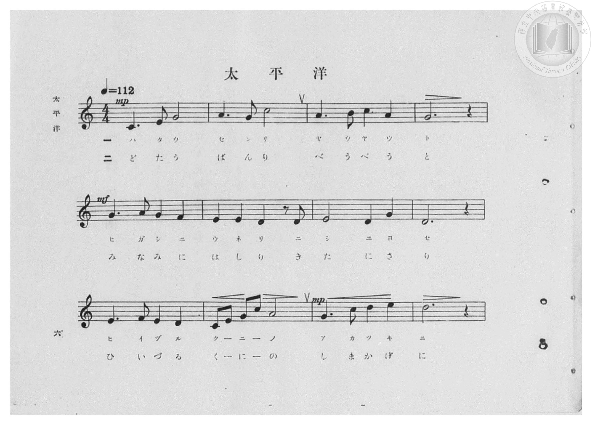
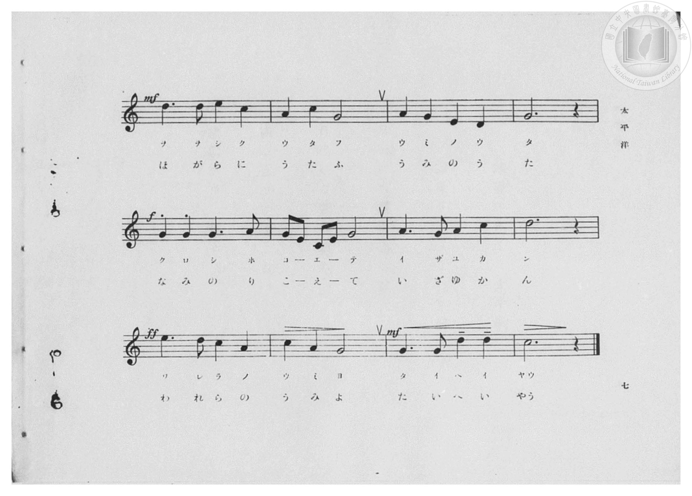
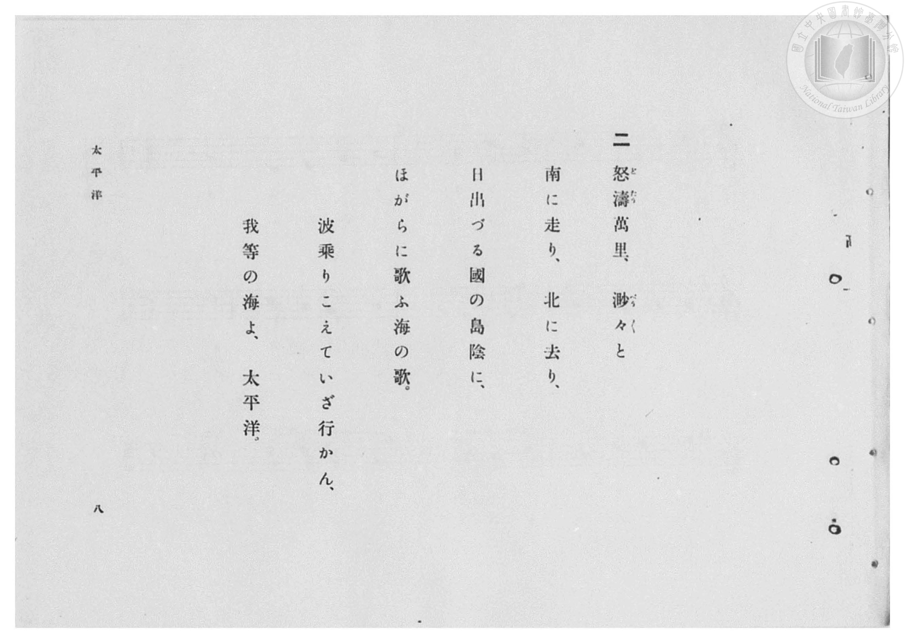
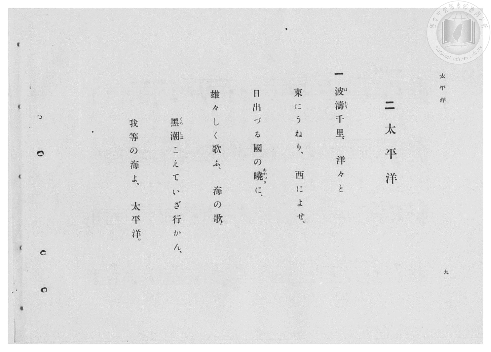

# 太平洋

> Re:Shōka 使用 AI 協助辨識與重建樂譜，可能會有錯誤。歡迎回報。

- **鋼琴伴奏版**：<br><audio controls src="taiheiyo.mp3"></audio>
- **NEUTRINO 歌聲合成版**：<br><audio controls src="taiheiyo_neutrino.mp3"></audio>

- 臺灣總督府《公學校高等科唱歌》第一學年用（昭和十一年，索書號 0729 74）

## 說明

原書資訊與歌詞全文（對應 P008.jpg–P011.jpg，原書 pp. 6–9）：
調性與拍號：ハ長調（C 大調）4/4 拍，速度 ♩=112
歌詞頁採由右至左裝訂：P011.jpg（原書 p. 九）載有第一段，P010.jpg（原書 p. 八）載有第二段。


## 歌詞

```text
一
波濤（はたう）千里、洋々と
東にうねり、西によせ、
日出づる國の曉（あかつき）に、
雄々しく歌ふ、海の歌。
黑潮（くろしほ）こえていざ行かん、
我等の海よ、太平洋。

二
怒濤（どたう）萬里、渺々（べう〱）と
南に走り、北に去り、
日出づる國の島陰に、
ほがらに歌ふ海の歌。
波乗りこえていざ行かん、
我等の海よ、太平洋。
```

## ABC

<div class="abc-score" data-abc-src="taiheiyo.abc" aria-label="五線譜載入中"></div>

[下載 ABC 原始檔](taiheiyo.abc)

## TMD 檔案連結

- [主旋律 TMD 檔案](taiheiyo.tmd) [[在 TMD Studio 編輯](https://tmdlang.github.io/Tmd-TS/#tmd=s7IKdvYPcrWy4qpTUCpJTLdSSM7PyUlNLsnMz7PKzk9PzM7Ojy_OyM9OVIKrKMvPKc1NBcqW5McbIoSL80uLklOtipMz8vNz4ktSK0qS8vOz0eXjCxLTU60CDAwsEDIFRfllqXmJeUDdBUWZeSWpKWDtCAWpZZkpqSDp4uTEvPiy1KLMtMzUFCQXpRYVgxwMtaKkKDGvOLkoswDkC4Sq_KKSjPz0osSCjEqrjMzikvyizOTEnPjsxDwkz5VkpAL9Vp5YklqELpiXWFJalIoumpOYlwJ0VgGSBNDg9Mw8q5LEzHKgc_PT0jKTMxNzlLi0tBSeLln1dOfmZ1u6FbS0uBRtFQwNjbjsbRWcuWxM9E3sQCa8aN_1vHHx8x17n89d_HTXnMcNXU9b1zxdu-PZgoUvV894vrbz-fKJT6dsfLa253FD9_M1a57saADKPt255fmUFe_3dDybsfbppJ6nvY0g8Z1b3u_peb5l0bPZO17MnK9gYG5kqWBu8n5PpxIXl76Wgi21AJeCgsLTvvkgaza3v1jR9aKjHei-FyvnPW1d8WxaO9BZTzf0PmvvVADFu15WQfqjhskBBoaGICbQhRCtCgUFegpmQBlLoAPf75kFMvTFqv3PGpaDjOvuBfoAKPq4uf_l1O1AcaChzsDgXA5mdgJDTwGoBmjYy4b5T3ctU3g0c6UtKHCBhkCc8nJB47O-hc-nbHzav_lF--an25e9WDz3xYomoJkIp3TAnKKn8GTnXKC5L_Z0PpvTCQnmZ-u2As0HKjbAUPy0dTWK4l09QMWPG5q4QPYDtYKdsXnRs_1LgNoeN65_3Dj_cWMbUMvT3uaX7cCYbAQmiccNrY8bV4CVzt34uHE1UMXjxrWPm7qA0i-W7geJNAE1zwZywYqmL33avutx49LHTd1P53Q_blz3bDYw3IAqmh43ArlLHjcCw6MTpA2i4eXsFrAV0x839oOSTyPQhY3Ptm4H6QSlpiawot0Tn-1dBzam_3FTL1j1brAxkx83AgWXPW5sedw47cVCoP7ux02TYY7pmAhMmiCTgOYBXdnQCE_p8GDY1QNW2TAJFgwr4cHwYsIaaDDs2AV0I1h2J8j_DRvBdoND5Wkv0C2rX2zdAAmSpz0g7tO-3RAu9iB5unnby5kbEGEA9Mzjxp7HTaBggYQBegAAo-nJzukgMynyMVAF5fkKChS09Lm4QhIzM1IzK_OtAjIT8_IdagxqqkGWKNhYaNmBGdgytAIk5QLdrqBhovB0Q__z9Q068FyoiUUD0CqQYTUK1bkFtQqGCrpAaKxgCqZ1gcJmYNpUwTAOTcgcIgTi1MDVg6ABSARsqI9hjQIw_4JFHzftB-JlcEMeN-2GiDdvBuJVCPHmJVD1y6BsiC6QTAeSLfEIW4yAco0rIboa5wNxG8K0xg1Q0yYDcReS-E6o-jYoG6ILJLMCwxb8wb2rh7zgTquFBpsZmDYBW28MDn5dBSNwQBpBRUAQJAJSVwNm4QrsSVDvrgHi7eDg7YYGNygQHzf3gklQcMeD5UAyIHWQqACpfdwMCgBEBGEP7v3Q4FsFZQOzFzT41oN508GuAAU40J7GXrDMfJg9YLWPG6dC7YFFC7EBvqOTnACHhKMJPHRrgIkdlNCBqRiSoEFC4EwAiRWguBEogRuDCGCgw9I_vlBfAmS3gsMQGhpN64HsPeCQhdB9cKseNy2C6loNFG8Bs9ZCZMDxgCvkN0HDsAWIl4J1QWO4sR9iBzB0IfQ6hF3g-ADp2gfE4FhuBLkZJANyKQmh_3T2bMzQtyQuuUPDEEiBAxVcfkCKEzATtdAB8RBxha-AgYYIkIameWCoI6V5YMEDkgWlNljIQ_ICKD1CYgRexIDV4gp5aIHV2ANU1wlmwdI8qOiApG9gBYMU6hBxSP4AxQaikIHlBWLT_K4pZIU6tIyBYVBZAwpLY2jaRw5vkAp4VOBP7-DwfdwMSq2w0uNx82xw-IEKc2Daa1oBTe9IRTEwd0DS-zagOCRmoOEHrAJwhzqorEIOQ0i5ApIBFungdN4BpZEqF2DugMTVNKBqSCzAysHJpIX809a15IU8MOjBqRyc3pGqSjgTEfxIdYEpJODBBFQtrmQPigRQwAOL-mZQ7QdJyujJG1abIRI3pJiaAWVB61xE1YwlDppgVTgi5YNiAi2FN8GqZ0T6hpRSO6AsiCOAbStYokBYVcvFpWunAGvyKADZylwA)]
- [鋼琴伴奏 TMD 檔案](taiheiyo_piano.tmd) [[在 TMD Studio 編輯](https://tmdlang.github.io/Tmd-TS/#tmd=s7IKdvYPcrWy4qpTUCpJTLdSSM7PyUlNLsnMz7PKzk9PzM7Ojy_OyM9OVIKrKMvPKc1NBcqW5McbIoSL80uLklOtipMz8vNz4ktSK0qS8vOz0eXjCxLTU60CDAwsEDIFRfllqXmJeUDdBUWZeSWpKWDtCAWpZZkpqSDp4uTEvPiy1KLMtMzUFCQXpRYVgxxckJmYlx-fWFSUmJeempuah2QEkqBVYmZ8YnJyfm5BYl4mqqr8opKM_PSixIKMSquMzOKS_KLM5MSc-OzEPCT_l2QAjbEqTyxJLUIXzEssKS1KRRfNScxLAbq8AEkCaHB6Zp5VSWJmOdBH-WlpmcmZiTlKXFpaCk-XrHq6c_OzLd3v93S87N7zfMKWJ3u2PF3a_7yz4_2eTgUtLS5FWwVDQyMue1sFZy4bE30TO5CxL9p3PW9c_HzH3udzFz_dNedxQ9fT1jVP1-54tmDhy9Uznq_tfL584tMpG5-t7Xnc0P18zZonOxqAsk93bnk-ZQXQpmcz1j6d1PO0txEkvnPL-z09z7csejZ7x4uZ8xUMzI0sFcxNgLYrcXF55pUU5VsFgEI6yMOhxqCmmksBCGwstOzAjBqF6rS0WgXjOAVdIDSKUzAEscyAuAbBNAVLgoSqc4GKIVxTkGqwFrhaGDQACXHVotjug2y7CarthvEK0YaxCiZAyiQWKAhlQIVhtsYDuabxsQgG0FaICiBlALEwJDEzIzWzkoCPcwuAdoJdaozkN5BPQd6CewUmZI4cKDD1CH-CDPUxrFF43NwPFn3ctB-Il8ENedy0GyLevBmIVyHEm5dA1S-DsiG6QDIdSLbEI2wxAso1roToapwPxG0I0xo3QE2bDMRdSOI7oerboGyILpDMCgxb4CEEj2YzMG0C1mEMDjFgnIP9bgQVAScccMiB1IBYuMJnEtSFa4B4OzhEuqEhBPL34-ZeMAkKoXiwHEgGpA4SeiC1j5tBbkaEKfYQ2g_18Soo-3HjaqiP14N508GuAIUR0J7GXrDMfJg9YLWPG6dC7YGFJEYYQbxuAg8QYGoEJydgWoEkG0h-ASY1SEACxcF5BZzVgOGEmWEwA2oJkN0K9jbUA03rgew94MCA0H1wqx43LYLqWg0UbwGz1kJkwEGHK7A2Qb3dAsRLwbqgkdLYD7EDGCAQeh3CLnAQgnTtA2JwxDSC3AySAbkUd6KCehtIgcMBnLEg-QzMRM2NIB4iePHlPKgngDQ0ZQEDCillAXMkSBYUp7DAgqQ4UKxDAhGe98BqcQUWNCc39gDVdYJZsJQFylOQVPS4cStSQEHEIakQFICI3AdLcZgBBc18MAzKhCDvG0NTGHIQgVTAQw9_qgIHyeNmUJqAZavHzbPBXgYVTMAYbloBTVVIxQowDUJS1TagOCQwoV4GFme4AwqUiZG9DclwIBlg8QROTR1QGqmgBKZBSPBOA6qGBBysgJiMO7BoVH0hEhco3EBhBSy2mkGFLyTBoCciWGGKSEKQ_DsDyoIW-YiaAUuwNcFqEET6AgUeWjpqgtUOiFQEyb47oCyII1oQ1QPCKow6Ele9DK4j4dUrpB5Gr5eBfCACcoEkMIEiV9Cg-hgp2yNMMgIphXIxa3IkERzGARVCEEgYrg_edEB2N0gFkInfZXA5fL7EYiO0zYHIseiBhSXwICEFcSguN1G3PaRrpwBugykAGbB4j_YBKkHhG4H5ylwA)]

## 分析

```text
================================================================================
📊 TMD Song Profile: [ 太平洋 ]
================================================================================
⏱  Duration:       0:51 (51.4s), 24 measures total
🎼 Key & Tempo:    首調基準 C, != 112.0 BPM, <4/4>
   - 分析範圍：      由實際發聲的音符與和弦推測調性；播放脈絡另行呈現
🎤 人聲音域:    C4 (MIDI 60) – E5 (MIDI 76) [跨度: 16 個半音 / 1.3 個八度, 難度: moderate]
   - 最低音:  C4 in [Taiheiyo #1 @ m.1, 0:00]
   - 最高音: E5 in [Taiheiyo #1 @ m.11, 0:23]
   - 適合: soprano, mezzo-soprano, contralto, tenor, baritone, bass
🏛  結構:      Taiheiyo (51.4s)
⚡ 編曲密度:        Peak 1 軌道同時演奏
🗝  調性診斷：       G 大調（純淨自然大調，未偵測到可信轉調）
   - 風格氣質:    純淨自然大調（陽光明朗、易唱易記，無明顯調外色彩）
   - 轉調歷程:    全曲維持單一推測調性（未偵測到可信轉調）
   - 核心骨幹音:  G, D, C, A, E
   - 調性數值:    G 大調 [相關度: 0.87, 穩定度: High, 自然音純度: 98.3%]
   - 候選調性 (K-S): G 大調 (0.87), C 大調 (0.74), E 小調 (0.58)
   - 五度圈歷程:   +1
   - 各段落調性細節:
     • [Taiheiyo #1]: G 大調 (r: 0.87, 自然音純度: 98.3%, 調外音: F)

  [ 五度圈游移軌跡 ]
               C  
         F           [G ]*
      Bb               D  
      Eb               A  
         Ab           E  
            Db       B  
               F# 
     (* = active key center)

  [ 十二半音累積音高分佈 ]
     C  : █████████████             16.2%
     C# :                            0.0%
     D  : █████████████████         21.2%
     D# :                            0.0%
     E  : ███████████               14.5%
     F  : █                          1.7%
     F# :                            0.0%
     G  : ████████████████████████  30.7%
     G# :                            0.0%
     A  : ████████████              15.1%
     A# :                            0.0%
     B  :                            0.6%
--------------------------------------------------------------------------------
Assignment 軌道音域：
  - Piano         : C4 – E5 (16 個半音 / 1.3 個八度, 75 個音符)
================================================================================
```


## 原書掃描頁










