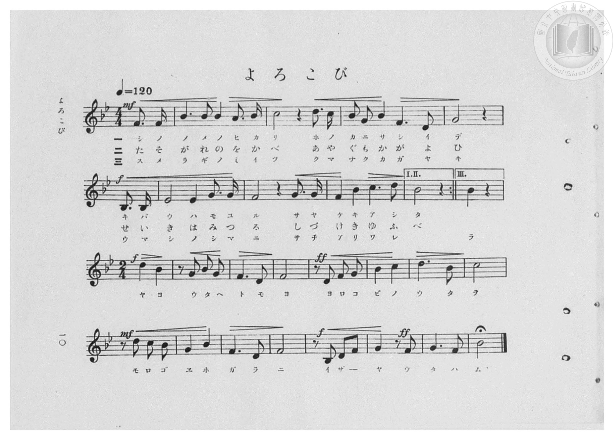
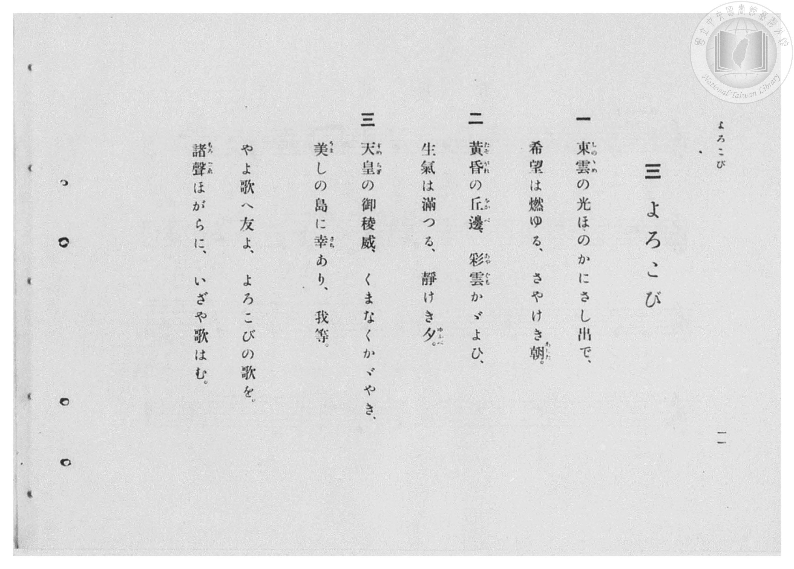

# よろこび

> Re:Shōka 使用 AI 協助辨識與重建樂譜，可能會有錯誤。歡迎回報。

- **鋼琴伴奏版**：<br><audio controls src="yorokobi.mp3"></audio>

- 臺灣總督府《公學校高等科唱歌》第一學年用（昭和十一年，索書號 0729 74）

## 說明

原書資訊與歌詞全文（對應 P012.jpg–P013.jpg，原書 pp. 10–11）：
調性與拍號：變ロ長調（Bb 大調，2 降記號），前段（第一、二行）4/4 拍（弱起 1 拍），
後段（第三、四行，第三段結尾頌歌）轉 2/4 拍，速度 ♩=120
樂譜結構說明：
- 第一、二段僅演唱第一、二行（4/4 拍），於第二行末「I.II.」一、二房子反覆記號 :| 處反覆。
- 第三段演唱第一、二行至「III.」三房子（「我等」），隨即轉入第三、四行之 2/4 拍樂段直至曲終（附延長記號 𝄐）。


## 歌詞

```text
一
東雲（しのゝめ）の光ほのかにさし出で、
希望は燃ゆる、さやけき朝（あした）。

二
黃昏（たそがれ）の丘邊（をかべ）、彩雲（あやぐも）かゞよひ、
生氣は滿つる、靜けき夕（ゆふべ）。

三
天皇（すめらぎ）の御稜威（みいつ）、くまなくかゞやき、
美（うま）しの島に幸（さち）あり、我等。
やよ歌へ友よ、よろこびの歌を。
諸聲（もろごゑ）ほがらに、いざや歌はむ。
```

## ABC

<div class="abc-score" data-abc-src="yorokobi.abc" aria-label="五線譜載入中"></div>

[下載 ABC 原始檔](yorokobi.abc)

## TMD 檔案連結

- [主旋律 TMD 檔案](yorokobi.tmd) [[在 TMD Studio 編輯](https://tmdlang.github.io/Tmd-TS/#tmd=s7IKdvYPcrWy4qpTUCpJTLdSSM7PyUlNLsnMz7PKzk9PzM7Ojy_OyM9OVIKrKMvPKc1NBcqW5McbIoSL80uLklOtipMz8vNz4ktSK0qS8vOz0eXjCxLTU60CDAyNEDIFRfllqXmJeUDdBUWZeSWpKWDtCAWpZZkpqSDp4uTEvPiy1KLMtMzUFCQXpRYVgxwMtaKkKDGvOLkoswDkC4Sq_KKSjPz0osSCjEqrjMzikvyizOTEnPjsxDwkz5VkpAL9lpdYUlqUii6amVsAtDoxB108NTcf1SaIcG5pcWYysvWZ6Zl5ViWJmeVAT-SnpWUmg83S0lJ43NTxuKn3cePkx42bFbS0uBRtFQyNDLjsbRWcdLhsTPRN7ECmvGjf9bxx8fMde5_PXfx015zHDV1PW9c8Xbvj2YKFL1fPeL628_nyiU-nbHy2tudxQ_fzNWue7GgAyj7dueX5lBXv93Q8m7H26aSep72NIPGdW97v6Xm-ZdGz2TtezJyvYGBuZKlgbvJ-T6cSF5e-loIttQCXgoLC0775IGs2t79Y0fWiox3ovhcr5z1tXfFsWjvQWU839D5r71QApQi9rIL0Rw2TgUxjEBPoQohWhYICPQVDA6CUoSHQie_3zAIZ-2LV_mcNy0EGdvcC_QAUfbGu63Hz2pdTtwOlgCY7JSk8XbIczO4xUng5s_fFihlghUATep529j5btxWoChJQjxsan-zqebGwBygLDG8FoJkgt-3Z-GLrdgVDCBekDWQxMni6rwfJmE6gMU9nzwYb0wMRAco-3zrh6YZ9Lxf0AH0ONOXF3k4FI5gVPS8b5j_dtUzh0cyVtqAoBxr5bEXTi7VzgJqeLe9-sWrVsxl9UA_rKiC7FWjw0-bWZ3umAKMcww8dcD-AHP1s2h6QCrDcszmrHzf0eOp5euo9buhFmNax_-naCU_7e18sa4MEk4JVjcKLmVMhQo8bmpBcAPIUVotftG8GGQ4zuxNiKtA5QNFnHROBSRQoDnHTy1krnvZuBobF09alaGH3ZGc3LICAYQEKwNlbgCY_m73p-dYmoGEvZ7Y83b0NFM0Qh36Y2wK0A6i_iQvkSKCDwME4d-PL2ZtAdjdOf9y47nHT3MdNjSBljeuetgLJ3SDBxu7HjasfN04Fqnnavutx43KgI8BJdgcwoGY_blz_vL35cVPb46ZuoARIXVPL48aJjxt7n82ZCza6CWw6KE3Brd8FTiQvdzc_m9EPVjP_cePcx409j5tAsQ-09cmOGS-bukBSTZPALtgJ1t74dO9KmIubwBZNeNwE9C9QS_fjpnmgMqJxE9R9z6fMf7ZhMdB9z3bvf9y4BOK-l3PnQBz3dMlUsOltjxu3wkyHhU0n2HtLVj6fBcp8jxtnAkPlcRPQDmAqA4fNvoXPV8x5ugIYVEBZoOFAdyyBuO9xY__jxn2PG1eBGRA3AWV7YW7aBzQCqAdo6z6wWaBgf7p5GzCEn-7cAZYChvNCsBTQf11AbbA0AU5cIMOaOkClV-OOp_1A44GpBug0RMkINA4kCww0iIYXq3e8aASHVxPQPKCiKY-bJoKNB8YtUB2QAUzrQGcDHTkNaDrY6PWPm4DpFayf8tINChS09Lm4IvOL8rPzkzKtAjIT8_IdanQNa6rBpYWNoZmWHZiFrWCF5mlgslfQgGfaHuSCR0FbwUTh6Yb-5-sbQDITVsPzMrIqHXgJqonFEqADQQ6oUTAA5mEQRKerc9NqFUzjwWwgVQM0FCIBgiA2jG8OUWMIVGKEpATZLGMwaQQ1xAykAaYbagNUHYhTgyqG4iagkwyh1gGdBPaBj2GNAkw9Ov24aTuEbu4DGgsiEWY-bl4IlYHxJ0H1rAarXYXmBriZzbORzQSqBrG7wTq3otkL4y0Be-txczsuM5vWQs2cAPOVER5fNc6H0nNBpjb2oNgF4gHzBZwP9VVjN1jtTlwuaGyCqm8Bq5sAZoPEQDphalBt6oD4qnETTjOhIdUINBPiK2N8cQVxGyheQGG1EsUukH-Q4woaAsCQBaltweWCpvVQ9fPA6rrgYpB4g6hZg2xTMzSuoDGCzcxlCDPBRSjuXAzOk8i5GDXbKoArXQVgg0UBVEMqQJoFROZbE_RMAhcA5y8whScrYVUEy5TI-RiUd1EzP7IxMBqRF2Hhgxym_XDWIii9DBwfsDjADGNITgLFBsjEjXDxtXAWxCQYD5TfQCr34zARRiNyF7CaQndnIyS1gFgQc4AVHdhUWA7AcGfjdCi9FJwTJsLFYWYDq1wUG0D-wpcP0dwJzC-oZQkkVOD5AF6-QdI3TnfCw7MR7B9Y2CFKucfNML9DeKA8gZ4LsbuTQD3WCc4BqC1cC0QugLcegc3mp71dRKb9ahugYXa14PoAUrcg0i6kRoPXMWAGWj7AVc0ADU4DmgjSD1YCVgA1AD1r1MAthlmOWf3hrqAgIsgYoQamDlWEkC5UkwmYg7OKGRTuAiV6cDEMgo-bV6CYACleIBn9cfMMsPjjZlBVBIOQQgYkCtOJ6k6IOLBbCDZnM1TtZLhuWOZCL8ogdoLUold4BDIBpA-joIE_A5BU-IMbZ-B0CsSgZAdJgNBCHTkzEJ3wIeaBW1eIxI9kJEgWnD3QJUAQKoZeS6BmACokEALmEJ1gUTLAoHMXtJUESciwhLoFrONxM7wuhLZDIQkVtQ0DKrWx1QewLATKXI-btoHV7oGqhWU4RCZDr08h9ThI7QIMd9dycenaKcB6PApAtjIXAA)]
- [鋼琴伴奏 TMD 檔案](yorokobi_piano.tmd) [[在 TMD Studio 編輯](https://tmdlang.github.io/Tmd-TS/#tmd=s7IKdvYPcrWy4qpTUCpJTLdSSM7PyUlNLsnMz7PKzk9PzM7Ojy_OyM9OVIKrKMvPKc1NBcqW5McbIoSL80uLklOtipMz8vNz4ktSK0qS8vOz0eXjCxLTU60CDAyNEDIFRfllqXmJeUDdBUWZeSWpKWDtCAWpZZkpqSDp4uTEvPiy1KLMtMzUFCQXpRYVgxxckJmYlx-fWFSUmJeempuah2QEkqBVYmZ8YnJyfm5BYl4mqqr8opKM_PSixIKMSquMzOKS_KLM5MSc-OzEPCT_l2QAjbHKSywpLUpFF83MLQC6LjEHXTw1Nx8UpOjCuaXFmcnI1memZ-ZZlSRmlgP9mZ-WlpkMNktLS-FxU8fjpt7HjZMfN25-v6fjZfee5xO2PNmz5enS_uedHe_3dCpoaXEp2ioYGhlw2dsqOOlw2Zjom9iBjH7Rvut54-LnO_Y-n7v46a45jxu6nrauebp2x7MFC1-unvF8befz5ROfTtn4bG3P44bu52vWPNnRAJR9unPL8ykrgFY9m7H26aSep72NIPGdW97v6Xm-ZdGz2TtezJyvYGBuZKlgbgK0XomLyzOvpCjfKgAUB0EeDjUGNdVcCkBgY2imZQdm1ShU56bVKpjGK-iCoSGUNoLSIGgMxDVwGRg0QKNruGpR7PNBts8E1TrDeIVow1igrUDaND4WZDpEBEgZQEwKSCwqcUS4XNcQi9PRnQCjkb0EpFDdDmLD-OYQNYZAJcgeRjYL5HlQcEAMMQNpgOmGBxpYHYhTgyqG4iaIt8HWAZ0E9oGPYY0CTD06_bhpO4Ru7gMaCyIRZj5uXgiVgfEnQfWsBqtdheYGuJnNs5HNBKoGsbvBOrei2QvjLQF763FzOy4zm9ZCzZwA85URHl81zofSc0GmNvag2AXiPW5cB-dDfdXYDVa7E5cLGpug6lvA6iaA2SAxkE6YGlSbOiC-atyE00xoSDUCzYT4yhhfXEHcBooXUFitRLEL5B_kuIKGADBkQWpbcLmgaT1U_Tywui64GCTeIGrWINvUDI0raIxgM3MZwkwuaCYyQU-xcAFwYgdTeNI1VkWUlCKwjAFzLLIH--GsRVB6GThwYAGC6WFIsgYFDcjEjXDxtXAWxCQYD5T4QSr34zARRiOS-uPGXnR3NkKiDsSCmPO4EWI_LDliuLNxOpReCk6WE-HiMLMfN7Wh2ADyF75MgeZOYOJFzdiQUIEnSnhhA0lsON0JD89GsH9gYYcoch43w_wO4YESKHqWwO5O1DIfVHsgynxE9WEAhtACHly0wysOCB9epxggFEAlQeUusjy0SIYEESgjAGVMgDIgBgjDDTeAcqGGgCgUy0FOgnvAiUB1a2MEbAPUgi2H1C2I7AKp0eB1DJiBlvVwVTNAg9OAJoL0g5WAFUANQM-NNXCLYZZjVn_QdAOKOlCpAonMFXADQAZDMigkqzxungEWf9wMKlkR0Q9KICBRmE6Ec8EmgMUfN68Fm7MZqnYyXDcseaIXBhA7QWrRy294qQZOIeDQgHoc4k1oaYUc5EQHL8Q8cB2OCGIkI0Gy4EhAlwBBqBh68QcPZkhwgIILFhxboF6El1nQyhsSHKgFPyh3Ycu3sIgCReHjpm1gtXugamHRiohK9HIPUt6C1C7AcDZqYsfV1kNK69CsAslm8NyFmiWhiRgoCFeAks-QlaI1J8EGgXSBGVhNRlUHjSkYF5zxwRqhvtO1UwA3ZhWADHC5FO0DdAGCY4TMMYZznEAMZS4A)]

## 分析

```text
================================================================================
📊 TMD Song Profile: [ よろこび ]
================================================================================
⏱  Duration:       0:32 (32.0s), 23 measures total
🎼 Key & Tempo:    首調基準 B,, != 120.0 BPM, <4/4>
   - 分析範圍：      由實際發聲的音符與和弦推測調性；播放脈絡另行呈現
🎤 人聲音域:    A#3 (MIDI 58) – D5 (MIDI 74) [跨度: 16 個半音 / 1.3 個八度, 難度: moderate]
   - 最低音:  A#3 in [Yorokobi #1 @ m.5, 0:09]
   - 最高音: D5 in [Yorokobi #1 @ m.3, 0:05]
   - 適合: soprano, mezzo-soprano, contralto, tenor, baritone, bass
🏛  結構:      Yorokobi (32.0s)
⚡ 編曲密度:        Peak 1 軌道同時演奏
🗝  調性診斷：       A# 大調（純淨自然大調，未偵測到可信轉調）
   - 風格氣質:    純淨自然大調（陽光明朗、易唱易記，無明顯調外色彩）
   - 轉調歷程:    全曲維持單一推測調性（未偵測到可信轉調）
   - 核心骨幹音:  F, A#, G, C, D
   - 調性數值:    A# 大調 [相關度: 0.93, 穩定度: High, 自然音純度: 100.0%]
   - 候選調性 (K-S): A# 大調 (0.93), F 大調 (0.76), G 小調 (0.57)
   - 五度圈歷程:   -2
   - 各段落調性細節:
     • [Yorokobi #1]: A# 大調 (r: 0.92, 自然音純度: 100.0%)

  [ 五度圈游移軌跡 ]
               C  
         F            G  
     [Bb]*              D  
      Eb               A  
         Ab           E  
            Db       B  
               F# 
     (* = active key center)

  [ 十二半音累積音高分佈 ]
     C  : ███████████               12.6%
     C# :                            0.0%
     D  : ██████████                11.7%
     D# : ████                       5.2%
     E  :                            0.0%
     F  : ████████████████████████  28.7%
     F# :                            0.0%
     G  : ███████████               13.0%
     G# :                            0.0%
     A  : █                          1.3%
     A# : ███████████████████████   27.4%
     B  :                            0.0%
--------------------------------------------------------------------------------
Assignment 軌道音域：
  - Piano         : A#3 – D5 (16 個半音 / 1.3 個八度, 62 個音符)
================================================================================
```


## 原書掃描頁






