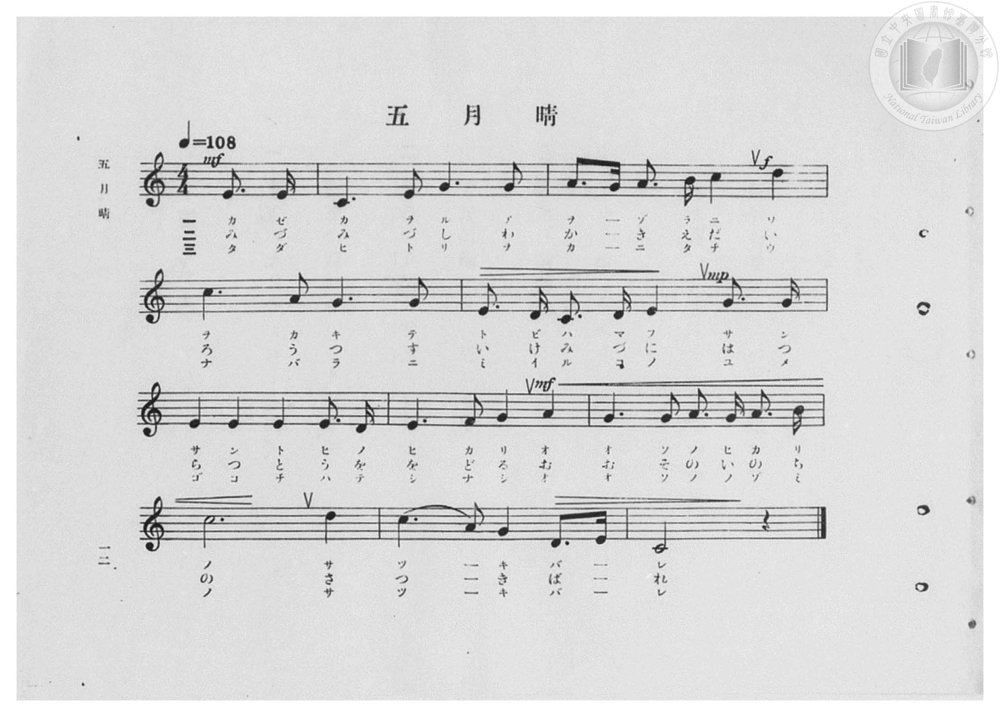
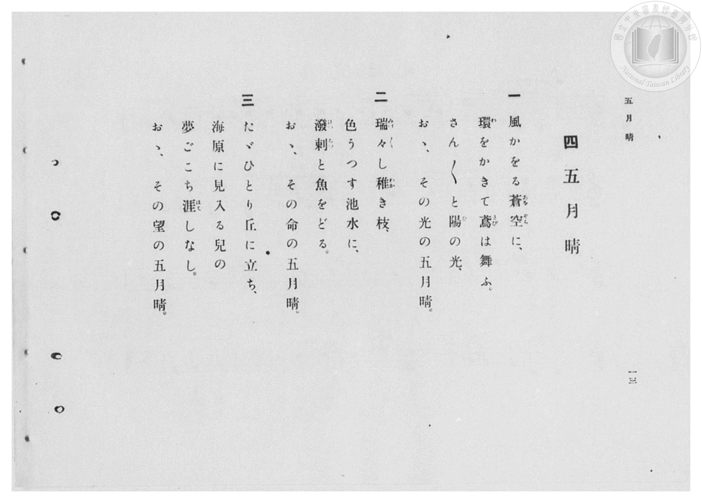

# 五月晴

> Re:Shōka 使用 AI 協助辨識與重建樂譜，可能會有錯誤。歡迎回報。

- **鋼琴伴奏版**：<br><audio controls src="satsukibare.mp3"></audio>

- 臺灣總督府《公學校高等科唱歌》第一學年用（昭和十一年，索書號 0729 74）

## 說明

原書資訊與歌詞全文（對應 P014.jpg–P015.jpg，原書 pp. 12–13）：
調性與拍號：ハ長調（C 大調）4/4 拍（弱起 1 拍），速度 ♩=108


## 歌詞

```text
一
風かをる蒼空（あをぞら）に、
環（わ）をかきて鳶（とび）は舞ふ。
さん〳〵と陽（ひ）の光、
おゝ、その光の五月晴。

二
瑞々（みづ〱）し稚（わか）き枝、
色うつす池水に、
潑剌（はつらつ）と魚をどる。
おゝ、その命の五月晴。

三
たゞひとり丘に立ち、
海原に見入る兒の
夢ごこち涯（はて）しなし。
おゝ、その望の五月晴。
```

## ABC

<div class="abc-score" data-abc-src="satsukibare.abc" aria-label="五線譜載入中"></div>

[下載 ABC 原始檔](satsukibare.abc)

## TMD 檔案連結

- [主旋律 TMD 檔案](satsukibare.tmd) [[在 TMD Studio 編輯](https://tmdlang.github.io/Tmd-TS/#tmd=s7IKdvYPcrWy4qpTUCpJTLdSSM7PyUlNLsnMz7PKzk9PzM7Ojy_OyM9OVIKrKMvPKc1NBcqW5McbIoSL80uLklOtipMz8vNz4ktSK0qS8vOz0eXjCxLTU60CDAxNEDIFRfllqXmJeUDdBUWZeSWpKWDtCAWpZZkpqSDp4uTEvPiy1KLMtMzUFCQXpRYVgxwMtaKkKDGvOLkoswDkC4Sq_KKSjPz0osSCjEqrjMzikvyizOTEnPjsxDwkz5VkpAL9lpdYUlqUii5anpoIZBShCxenJhbn5xUjW5SZnplnVZKYWQ50bn5aWmZyZmKOEpeWlsKTXVOezel4NnOLgpYWl6KtgqGBBZe9rYIzl42JvokdyIQX7bueNy5-vmPv87mLn-6a87ih62nrmqdrdzxbsPDl6hnP13Y-Xz7x6ZSNz9b2PG7ofr5mzZMdDUDZpzu3PJ-y4v2ejmcz1j6d1PO0txEkvnPL-z09z7csejZ7x4uZ8xUMzI0sFcxN3u_pVOLi0tdSsKUW4FJQUHjaNx9kzeb2Fyu6XnS0A933YuW8p60rnk1rBzrr6YbeZ-2dCqB418sqSH_UMBnINAUxgS6EaFUoKNBTMDQCShkaA534fs8skLEvVu1_1rAcZGB3L9APQNHHzf0vp24HigONdVZ4umQ5mNkJDD8FoBqQXXs2vti6XcEQwgUa1POyYf7TXcsUHs1caQsKcJC5wOABUS8XrXjc2P24adLjpu4Xk_Y8X7kLaMDjxiaQSOO8x01A3Z2PG1c_bmgEqX4-aQNIuqkfJApS0f24sfdx47KXm7eBtQHN2gzWsP5Fx7zHjVsfNzSBtD1unPq4afLjhs2PG7YCFb2cuResehNY6bqnrZ1Q4x83dj1umgvkPG6cC5VoXAdPMSDDwC7f1QN2y8R5jxtawQbtf9y49HHDRrBx05-vmAVxI9B1YJHeZ_NAZoIDs3PT48a2x41LHjfOfLZxwbMNWxB-e7Z34tPOHrB560EqmoBal4ANWPFy7Sywb1cCAwnuJVSnTtyL1ak7OiGK5z9uAoYH0PIVj5u6nuyYAbT2-Wpg4C2EWb51OzARAEVfLOt-2roUaM_TVqCF68AJa8mix41THjdOBip_tm09zIXLIN593LgKRGJ11bM5s9FdBVREeXKHAgUtfS6u4MSS4tLszKTEImCplpmYl-9Qo2tYUw2ySMHG0EzLDszCltkUIJn3xcIeBQ3kJKugrWCk8HRD__P1DTrwDKOJRT_QepDZNQoGCrpgiE5X56bVKhiDmcZAZYZQYQhfV8EUiQ9i1yiYQdkQ2lzBMA5mEtAgIxinBmytj2GNQjxUBJ1-3LQaSu8BmgrjQeWaN4FJFLGmRWD7IXIg2T1AsX1Q9kog7obrXo_qCiM8rmjcD6WXgsyG8mByS8HkdBRX9ENc0QixDeyKxl6o-g4gXgDX3YLqCmN8YQF1RXMD2IeTkG1s7gCTq1DEQGGACDWwK6D-B5n1uLkRbvIyuCvwp7JdPeBURmKygsc-CIKSBGaCgSQuI2jSMoLyQSmvoBaq3BQpvcDiF-Z-kA8fN61F8X0bxPfgkAHxJwMxKF5A7HlAPBWueytUdDNSWnjcBIkvWDyBTAOWYyhiMyE2QOPwceNElJQCLITgKiFpDaQfEc-Pm7tQ3DsBTK5EEQPFFkjlfKhLl8DT--OmzUB2H1wlJAYfNy8kGIc7OsFxaExaHMIiBDtthKQCBE2AGBbJ4MIDUhCAPIMe9-hFBVIkQyMGEjUwFiQ6QSxIBgAFAkZ2gCQIeHZ43ARjgUxFySRNe6FmwMxEZJdVKMmhE6YDngiAlRCcBUoeINMmgW1AcUsjKEqBFRGcD4t2UNJBSQKNc8HkOiivBYkNilZ4wmnaAnc9IlzgmRmeyNvAbtmObAM4ySHEiA-XPqRidD6hJPZ09mxykhhKMYEMERUG7qLECEyi104giF6ZIZcisPyDDhFJD6QKVkZDvL8HLL8WzgflW4g4SO0aNJPQS3GkJAWNXCy2N8LKJpAqlDIHYju0LgGxNiDb3tRDnO3g0mcg_F7LxaVrp4DU1FEAcpW5AA)]
- [鋼琴伴奏 TMD 檔案](satsukibare_piano.tmd) [[在 TMD Studio 編輯](https://tmdlang.github.io/Tmd-TS/#tmd=s7IKdvYPcrWy4qpTUCpJTLdSSM7PyUlNLsnMz7PKzk9PzM7Ojy_OyM9OVIKrKMvPKc1NBcqW5McbIoSL80uLklOtipMz8vNz4ktSK0qS8vOz0eXjCxLTU60CDAxNEDIFRfllqXmJeUDdBUWZeSWpKWDtCAWpZZkpqSDp4uTEvPiy1KLMtMzUFCQXpRYVgxxckJmYlx-fWFSUmJeempuah2QEkqBVYmZ8YnJyfm5BYl4mqqr8opKM_PSixIKMSquMzOKS_KLM5MSc-OzEPCT_l2QAjbHKSywpLUpFFy1PTQQyitCFi1MTi_PzipEtykzPzLMqScwsB_ooPy0tMzkzMUeJS0tL4cmuKc_mdDybueX9no6X3XueT9jyZM-Wp0v7n3d2vN_TqaClxaVoq2BoYMFlb6vgzGVjom9iBzL2Rfuu542Ln-_Y-3zu4qe75jxu6Hrauubp2h3PFix8uXrG87Wdz5dPfDpl47O1PY8bup-vWfNkRwNQ9unOLc-nrADa9GzG2qeTep72NoLEdwLt7nm-ZdGz2TtezJyvYGBuZKlgbgK0XYmLyzOvpCjfKgAU0kEeDjUGNdVcCkBgY2imZQdm1ShU56bVKhjGKehihUYwiRpUNWZAbApTAyaNQUrQdBug0TVctShu8kF2kwmak-IVog1jQZRpfDzI7HgFk3gULkjaAAjBpgYnlhSXZmcmJRYBEyzMv7qGWDyM7igYDbbVGKtfQKIw34IgiF0DDgMQG0KbIwKoGmgQIuDA1voY1ijEQ0XQ6cdNq6H0HqCpMB5UrnkTmEQRa1oEth8iB5LdAxTbB2WvBOJuuO71qK4wwuOKxv1QeinIbCgPJrcUTE5HcUU_xBWNENvArmjsharvAOIFcN0tqK4wxhcWUFc0N4B9OAnZxuYOMLkKRQwUBohQA7sC6n-QWY-bG-EmL4O7ApoScKZoEITEMSQ9GEFTgxGUD0osBbVQ5aZIUQyLEpiVIEc9blqL4uA2iIPBngHxJwMxKChB7HlAPBWueytUdDNS9D1uggQxLGhBpj1uXIIiNhNiAzTYHzdORIncx42wxPS4EZI8QPoRUfO4uQvFvRPA5EoUMVAAg1TOh7p0CTyJPm7aDGT3wVVCAv1x80JEsMPCEDtthKQCBE2AGBYv4CwKyW4g-9GjCz1DIsULNCwhoQljQWIAxIIkM5C7MRIdJA7hie5xE4wFMhUlKTbthZoBMxORKFehxGAnTAc83h43roCzQDEKMm0S2AYUtzSCYuFxEzx7N8JiChTbKLHWOBdMroPyWpDYoJiAx3XTFrjrEeECzzLwdNkGdst2ZBvAqQQhRny49CEVVvNxZEZkSO0qCJFXYakUHSJSC0gVrPCCuHgPWH4tnA_KHRBxkNo1aCahF29IqQAaH1hsb4SVACBVKDkbYju0kAWxNiDb3tRDnO3gPD4QfsdWTYOaAIhqGtEGAFXsBvCWALy-h1I1oLYApDkAqmzBTQJYOoJJQNQBGRAEKbFRFUJNhFkAUwg0EWgEXAXEKkxtRLVLdO0UwA0eBSADyfPRPkBF6EJGmELGYCFlLgA)]

## 分析

```text
================================================================================
📊 TMD Song Profile: [ 五月晴 ]
================================================================================
⏱  Duration:       0:22 (22.2s), 10 measures total
🎼 Key & Tempo:    首調基準 C, != 108.0 BPM, <4/4>
   - 分析範圍：      由實際發聲的音符與和弦推測調性；播放脈絡另行呈現
🎤 人聲音域:    C4 (MIDI 60) – D5 (MIDI 74) [跨度: 14 個半音 / 1.2 個八度, 難度: moderate]
   - 最低音:  C4 in [Satsukibare #1 @ m.2, 0:02]
   - 最高音: D5 in [Satsukibare #1 @ m.3, 0:06]
   - 適合: soprano, mezzo-soprano, contralto, tenor, baritone, bass
🏛  結構:      Satsukibare (22.2s)
⚡ 編曲密度:        Peak 1 軌道同時演奏
🗝  調性診斷：       C 大調（純淨自然大調，未偵測到可信轉調）
   - 風格氣質:    純淨自然大調（陽光明朗、易唱易記，無明顯調外色彩）
   - 轉調歷程:    全曲維持單一推測調性（未偵測到可信轉調）
   - 核心骨幹音:  C, G, E, A, D
   - 調性數值:    C 大調 [相關度: 0.91, 穩定度: High, 自然音純度: 100.0%]
   - 候選調性 (K-S): C 大調 (0.91), E 小調 (0.69), G 大調 (0.66)
   - 五度圈歷程:   +0
   - 各段落調性細節:
     • [Satsukibare #1]: C 大調 (r: 0.89, 自然音純度: 100.0%)

  [ 五度圈游移軌跡 ]
              [C ]*
         F            G  
      Bb               D  
      Eb               A  
         Ab           E  
            Db       B  
               F# 
     (* = active key center)

  [ 十二半音累積音高分佈 ]
     C  : ████████████████████████  28.8%
     C# :                            0.0%
     D  : ███████                    9.0%
     D# :                            0.0%
     E  : ███████████████████       22.4%
     F  : █                          1.3%
     F# :                            0.0%
     G  : ████████████████████      24.4%
     G# :                            0.0%
     A  : ███████████               12.8%
     A# :                            0.0%
     B  : █                          1.3%
--------------------------------------------------------------------------------
Assignment 軌道音域：
  - Piano         : C4 – D5 (14 個半音 / 1.2 個八度, 46 個音符)
================================================================================
```


## 原書掃描頁






