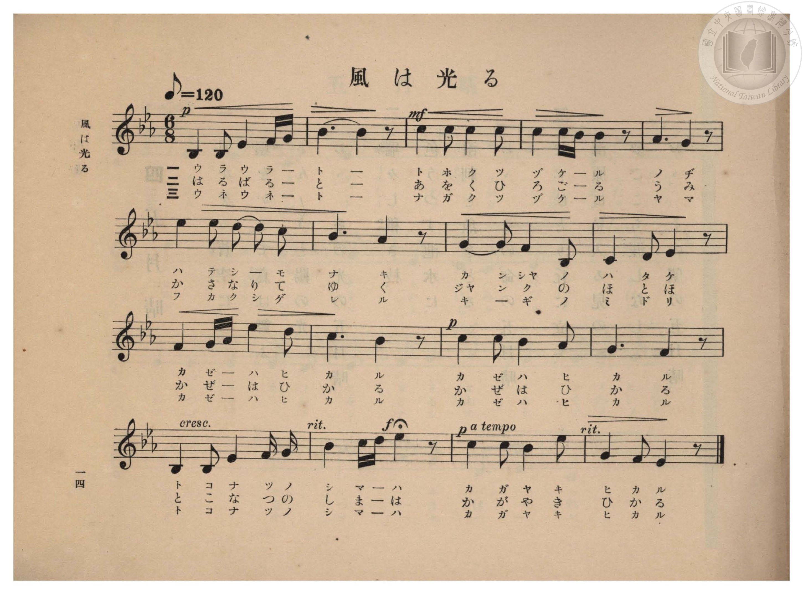
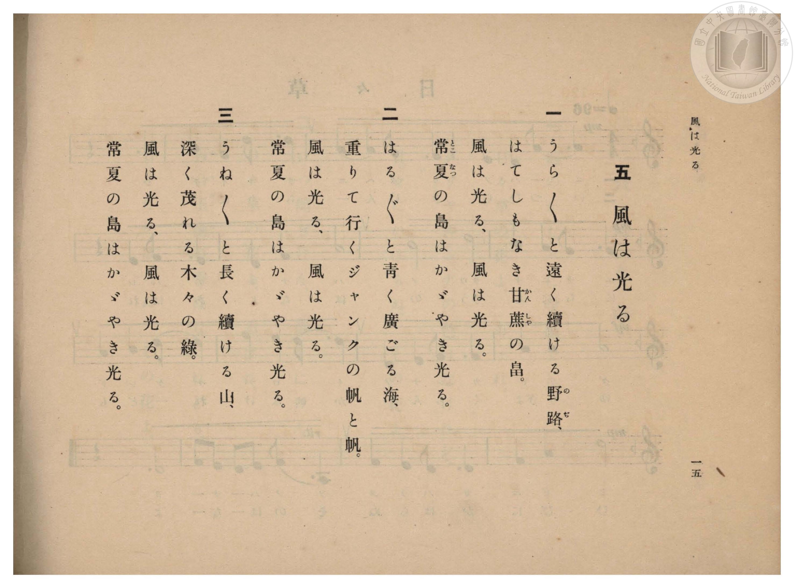

# 風は光る

> Re:Shōka 使用 AI 協助辨識與重建樂譜，可能會有錯誤。歡迎回報。

- **鋼琴伴奏版**：<br><audio controls src="kaze_wa_hikaru.mp3"></audio>

- 臺灣總督府《公學校高等科唱歌》第一學年用（昭和十一年，索書號 0729 74）

## 說明

原書資訊與歌詞全文（對應 P016.jpg–P017.jpg，原書 pp. 14–15）：
調性與拍號：變ホ長調（Eb 大調，3 降記號）6/8 拍，速度 ♪=120（♩.=60）
教材背景：臺灣地方風物教材，描繪「常夏の島」（臺灣）甘蔗田、戎克船（ジャンク）帆影與翠綠山巒間陽光閃耀的南國景致。


## 歌詞

```text
一
うら〳〵と遠く續ける野路（のぢ）、
はてしもなき甘蔗（かんしや）の畠。
風は光る、風は光る。
常夏（とこなつ）の島はかゞやき光る。

二
はる〳〵と青く廣ごる海、
重りて行くジャンクの帆と帆。
風は光る、風は光る。
常夏の島はかゞやき光る。

三
うね〳〵と長く續ける山、
深く茂れる木々の綠。
風は光る、風は光る。
常夏の島はかゞやき光る。
```

## ABC

<div class="abc-score" data-abc-src="kaze_wa_hikaru.abc" aria-label="五線譜載入中"></div>

[下載 ABC 原始檔](kaze_wa_hikaru.abc)

## TMD 檔案連結

- [主旋律 TMD 檔案](kaze_wa_hikaru.tmd) [[在 TMD Studio 編輯](https://tmdlang.github.io/Tmd-TS/#tmd=s7IKdvYPcrWy4qpTUCpJTLdSSM7PyUlNLsnMz7PKzk9PzM7Ojy_OyM9OVIKrKMvPKc1NBcqW5McbIoSL80uLklOtipMz8vNz4ktSK0qS8vOz0eXjCxLTU60CDAzNEDIFRfllqXmJeUDdBUWZeSWpKWDtCAWpZZkpqSDp4uTEvPiy1KLMtMzUFCQXpRYVgxwMtaKkKDGvOLkoswDkC4Sq_KKSjPz0osSCjEqrjMzikvyizOTEnPjsxDwkz5VkpAL9lpdYUlqUii6ak5iXAnRBAYZEeWoikFGELlyQk5iMpBZoX3pmnlVJYmY50Bf5aWmZyZmJOUpcWloKLxeteNy4_mlr5-OmbgUtLS5FWwUzAy57WwVXHS4bM30LO5AhL9p3PW9c_HzH3udzFz_dNedxQ9fT1jVP1-54tmDhy9Uznq_tfL584tMpG5-t7Xnc0P18zZonOxqAsk93bnk-ZcX7PR3PZqx9OqnnaW8jSHznlvd7ep5vWfRs9o4XM-crGJgbWSqYm7zf06nExaWvpWBLLcCloKDwtG8-yJrN7S9WdL3oaAe678XKeU9bVzyb1g501tMNvc_aOxVAKUIvqyD9UcNkINMcxAS6EKJVoaBAT8HQBChlaAp04vs9s0DGvli1_1nDcpCB3b1APwBFX6zretw8--XU7UApoMmuSQpPlywHs3uMFV7O7H2xYgZYYScwRBWAuoDiLxvmP921TOHRzFW2hkYGQE2PZq7UszUDsjpBdjybOvPZ3AkvmnuezVwPsgAcA0_nbHg2bScwyp53roQoABr0rL__-c5Vjxt6nu7Y8XRJ_-PGdU83b3vcALSjA6ILaOLzKTNeTJn-fMqGxw2Nzzr6nrZ2v-jYCVTwuGnH4-bFj5s3P24C2tL5dEfb070bgR57vn_B820Lnm7c-HT7pJfTJr-cuReYQl5Oa37R0PB8VsvT3ulP53QDHfaifcvjhiYukHuBUQuiHje2PW7qfNyw-XHD1seNK142Lnjc2P98V8_jxonABPayve_FdqBFHUBHPm5cBLQR6B6ItvWPG5c9bpz-uKnpceOqx429EBeDlXY_bpoMlmoBaWhc93zqApCtQG3IiRdoEioXrAISJmBjgHJAY4BmL4EYAwolkLVA4-cBzQbaidAJ9tGuHpjTQIIwH82dBPTR092LHzdOAYo_27od6oWX7b2Pm7qAvnixEOjbfuSQBVm2ow2oGUSS5nJi3LkDnGBAId-4FuHOqduRQx4YlVB3Ptu-ESjxoqfpcVMPyANzVjxuaAWF6jZSQ5WA24DqKM_FUKCgpc_F5Z1YlRqe6JGZnVhUahWQmZiX71BjUFMNskjBxtBMyw7MwlaGKEDKJGDMKGiYKjzd0P98fYMOPONrYtEAtA9kWI1CdUGtgmm8gi4YghmGUI6RgjFQ3hTKA0tDaQMgBurMTatVMIMKgWhkdg0SzxRNowmSkcbIMmAn-RjWKDxuWgYVf9y8EkSi8B837wGa8ri5A8kckBiEBfICsiyw3AKbsB7Ob4GqaIWJNG0E63_cvBrNjD4UG5qQZSFuNQKqaoSbDKxhgGTjBiQ-1K2NK_C5tRFm8uOmSWAT-mH8xk0QFU29cJEpELeC7UI2ow3Zhsb9mG41Rg1XkImofOLCtQvu1jVgkpxwXYJiwzwUt-JP5Lt6wInchLREbhgHtQLMMIdiSDpFTuCwlAlJp7C0CaKNoGxwDgEmbliOMUfOMWiJuBkejc2gyHnctB3MBgXo4-ZFaMEJCbC1qAHVBAs4YDkLMQERdpDUiWJNEyjWQaGOEffgdApLMY8bp4LJVWDVIAcAS3WohaipCGYyzDnAIh9hPcRF8OhvXAdR1LgbLgJK9Ag-WlJsBjkC4myQLyEmQcOoCZrsm0FJDJFQ0JIRPLSgYdoEcgFq0MyHi3SCSZCXEW4hUJ52kpPUYAnFGJiY4MkOlNoQJSI4HUFpaFEKLISRS0-YLCg9ItIhCMKMRy8v4QmlCZTfQBiR-EBlCrIa7IGJbAJIniT9WFPZHIhLEOUjrDSDq4HYh16SIZsAIknSj1TWDXSY4E1eT2fPJid5EVNVmwHTWzWwboYnP_yJDKwMkcpAKQxXgQavU5vAmR9RFwDLflCmA4UIKANDxOahhTpmqIJrEESRAs7QIHtAoQsRARcNONMarFYFtnzBJCx7A9vA4AIJpGY6XGwfWnrETG89YDtB9RiE3wtVAUp3EBFwDY8rxQ2S8Knl4tK1U0BuTSoA-cpcAA)]
- [鋼琴伴奏 TMD 檔案](kaze_wa_hikaru_piano.tmd) [[在 TMD Studio 編輯](https://tmdlang.github.io/Tmd-TS/#tmd=s7IKdvYPcrWy4qpTUCpJTLdSSM7PyUlNLsnMz7PKzk9PzM7Ojy_OyM9OVIKrKMvPKc1NBcqW5McbIoSL80uLklOtipMz8vNz4ktSK0qS8vOz0eXjCxLTU60CDAzNEDIFRfllqXmJeUDdBUWZeSWpKWDtCAWpZZkpqSDp4uTEvPiy1KLMtMzUFCQXpRYVgxxckJmYlx-fWFSUmJeempuah2QEkqBVYmZ8YnJyfm5BYl4mqqr8opKM_PSixIKMSquMzOKS_KLM5MSc-OzEPCT_l2QAjbHKSywpLUpFF81JzEsBOrIAQ6I8NRHIKEIXLshJTEZSC7QvPTPPqiQxsxzo0fy0tMzkzMQcJS4tLYWXi1Y8blz_tLXzcVP3-z0dL7v3PJ-w5cmeLU-X9j_v7Hi_p1NBS4tL0VbBzIDL3lbBVYfLxkzfwg5k8ov2Xc8bFz_fsff53MVPd8153ND1tHXN07U7ni1Y-HL1jOdrO58vn_h0ysZna3seN3Q_X7PmyY4GoOzTnVueT1kBtOnZjLVPJ_U87W0Eie_c8n5Pz_Mti57N3vFi5nwFA3MjSwVzE6DtSlxcnnklRflWAaA4CPJwqDGoqeZSAAIbQzMtOzCrRqE6t6BWwTReQRcMwQxDKMdIwRiowBTKM1MwV6hOq1UwjIMKGAAxUD9QuxlcCdAEKBusrAZoAswshLlgjVy1KM7zQXaeBarrDCGug1JAF8VDWGDXgJgGUHeY4FAIUwSy0zuxKjU80SMzO7GolEDIEBkwYGnUMMkFugw5UJDZNUg8UzSNJkhGwkIOElogJ_kY1ig8bloGFX_cvBJEovAfN-8BmvK4uQPJHJAYhAXyArLs4-bZYBPWw_ktUBWtMJGmjWD9j5tXo5nRh2JDE7IsxK1GQFWNcJObukFk4wYkPtStjSvwubURZvLjpklgE_ph_MZNEBVNvXCRKRC3gu1CNqMN2YbG_ZhuNUYNV5CJqHziwrUL7tY1YJKccF2CYsM8FLdC0yU8A4IZ5lAMSVrIaRKWmCBJC5acQDQoM4IgOFED0yMskZsjJ3K0dNcMD_lmUHg-btoOZoPC4HHzIrQQgPhxLarfmmB-fdy8GWICwruQBIViTRMookABhRFd4KQFi-THjVPB5CqwapADHjeCog5kIWrEw0yGOWcHsvUQF8FjrHEdRFHjbrgIKJ0i-GippxnkCIizQb6EmAQNoyZoSm0GpQpE3KLFPDy0oGHaBHIBatDMh4t0gkmQlxFugaYOWNwaA-MfnlJACQRR7oCjHkrjL8RBSQiRdEAQZjx6qQSP2yZQqgZhRHoB5VxkNdj9j2wCSJ4k_VgTxhyISxClEKzMgKuB2IdeXiCbACJJ0o9Uogx0mEBTxEBU7ohiA17ZNIGzGKKQBBaKoKQN8gQom0DE5qEFFGZAgItWRMYFZxuQPaAAgYiAMyDO5AGrbh43TgaTsEz0uHEJONuD1EyHi-1DS0KYSaQHbCeogIfwe6EqQEkFIgKu-nAlkkESPlgbRrjaZHiaZBAa3B4DtYGgDTIoBWzfoLbH0PmwCg7ZLKAShPFGMI0oSiAmg1ggPpphKG1AEAfTFehNR7CVKDZguI06bVFdOwVwE1gByEAO_mgfw1hMMSMsYsZgMWUuAA)]

## 分析

```text
================================================================================
📊 TMD Song Profile: [ 風は光る ]
================================================================================
⏱  Duration:       0:51 (51.0s), 17 measures total
🎼 Key & Tempo:    首調基準 E,, != 60.0 BPM, <6/8>
   - 分析範圍：      由實際發聲的音符與和弦推測調性；播放脈絡另行呈現
🎤 人聲音域:    A#3 (MIDI 58) – D#5 (MIDI 75) [跨度: 17 個半音 / 1.4 個八度, 難度: challenging]
   - 最低音:  A#3 in [KazeWaHikaru #1 @ m.1, 0:00]
   - 最高音: D#5 in [KazeWaHikaru #1 @ m.6, 0:15]
   - 適合: soprano, mezzo-soprano, contralto, tenor, baritone, bass
🏛  結構:      KazeWaHikaru (51.0s)
⚡ 編曲密度:        Peak 1 軌道同時演奏
🗝  調性診斷：       D# 大調（純淨自然大調，未偵測到可信轉調）
   - 風格氣質:    純淨自然大調（陽光明朗、易唱易記，無明顯調外色彩）
   - 轉調歷程:    全曲維持單一推測調性（未偵測到可信轉調）
   - 核心骨幹音:  A#, C, D#, G, F
   - 調性數值:    D# 大調 [相關度: 0.80, 穩定度: Moderate, 自然音純度: 100.0%]
   - 候選調性 (K-S): D# 大調 (0.80), A# 大調 (0.73), C 小調 (0.70)
   - 五度圈歷程:   -3
   - 各段落調性細節:
     • [KazeWaHikaru #1]: D# 大調 (r: 0.80, 自然音純度: 100.0%)

  [ 五度圈游移軌跡 ]
               C  
         F            G  
      Bb               D  
     [Eb]*              A  
         Ab           E  
            Db       B  
               F# 
     (* = active key center)

  [ 十二半音累積音高分佈 ]
     C  : ████████████████████      22.6%
     C# :                            0.0%
     D  : ████                       4.8%
     D# : ███████████████           17.2%
     E  :                            0.0%
     F  : ████████                   8.6%
     F# :                            0.0%
     G  : ███████████               12.4%
     G# : ██████                     7.0%
     A  :                            0.0%
     A# : ████████████████████████  27.4%
     B  :                            0.0%
--------------------------------------------------------------------------------
Assignment 軌道音域：
  - Piano         : A#3 – D#5 (17 個半音 / 1.4 個八度, 60 個音符)
================================================================================
```


## 原書掃描頁






