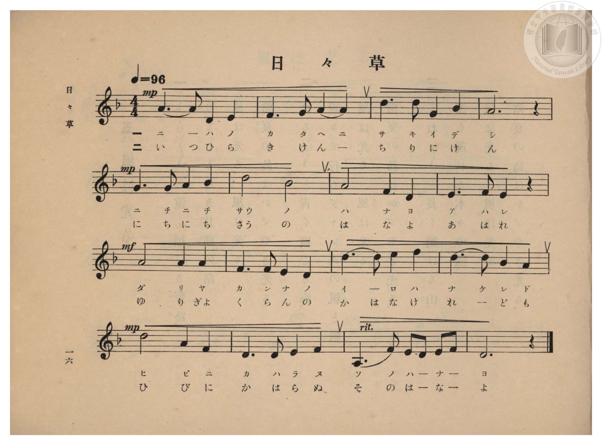
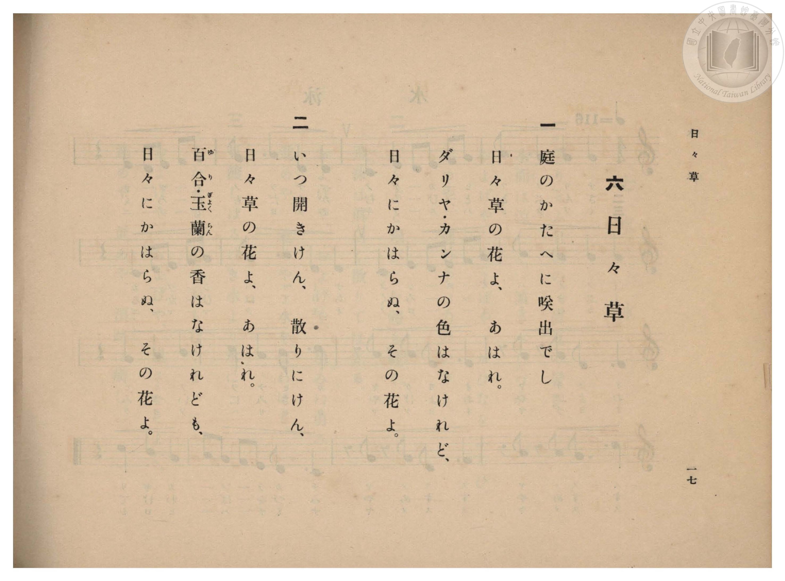

# 日々草

> Re:Shōka 使用 AI 協助辨識與重建樂譜，可能會有錯誤。歡迎回報。

- **鋼琴伴奏版**：<br><audio controls src="nichinichiso.mp3"></audio>

- 臺灣總督府《公學校高等科唱歌》第一學年用（昭和十一年，索書號 0729 74）

## 說明

原書資訊與歌詞全文（對應 P018.jpg–P019.jpg，原書 pp. 16–17）：
調性與拍號：ニ短調（d 小調，1 降記號，關係大調 ?= F）4/4 拍，速度 ♩=96
教材背景：臺灣鄉土植物教材，歌詠臺灣庭院隨處可見、日日綻放不輟的「日々草」（日日春／長春花），並與大理花（ダリヤ）、美人蕉（カンナ）、百合、玉蘭對比。


## 歌詞

```text
一
庭のかたへに咲出でし
日々草の花よ、あはれ。
ダリヤ・カンナの色はなけれど、
日々にかはらぬ、その花よ。

二
いつ開きけん、散りにけん、
日々草の花よ、あはれ。
百合（ゆり）・玉蘭（ぎよくらん）の香はなけれども、
日々にかはらぬ、その花よ。
```

## ABC

<div class="abc-score" data-abc-src="nichinichiso.abc" aria-label="五線譜載入中"></div>

[下載 ABC 原始檔](nichinichiso.abc)

## TMD 檔案連結

- [主旋律 TMD 檔案](nichinichiso.tmd) [[在 TMD Studio 編輯](https://tmdlang.github.io/Tmd-TS/#tmd=s7IKdvYPcrWy4qpTUCpJTLdSSM7PyUlNLsnMz7PKzk9PzM7Ojy_OyM9OVIKrKMvPKc1NBcqW5McbIoSL80uLklOtipMz8vNz4ktSK0qS8vOz0eXjCxLTU60CDAwtEDIFRfllqXmJeUDdBUWZeSWpKWDtCAWpZZkpqSDp4uTEvPiy1KLMtMzUFCQXpRYVgxwMtaKkKDGvOLkoswDkC4Sq_KKSjPz0osSCjEqrjMzikvyizOTEnPjsxDwkz5VkpAL9lpdYUlqUii5akJOYh-QqoP70zDyrksTMcqCr8tPSMpMzE3OUuLS0FJ5NX_q4ofVFb6eClhaXoq2CpRmXva2CG1d2aqWtgksul42JvokdyKAX7bueNy5-vmPv87mLn-6a87ih62nrmqdrdzxbsPDl6hnP13Y-Xz7x6ZSNz9b2PG7ofr5mzZMdDUDZpzu3PJ-y4v2ejmcz1j6d1PO0txEkvnPL-z09z7csejZ7x4uZ8xUMzI0sFcxN3u_pVOLi0tdSsKUW4FJQUHjaNx9kzeb2Fyu6XnS0A933YuW8p60rnk1rBzrr6YbeZ-2dCqBY1ssqSH_UMBnItAQxgS6EaFUoKNBTMDQDShmaA534fs8skLEvVu1_1rAcZGB3L9APQNHHzd3P568FigONTVF4uqEfzOwxVHg5s_fFihlgRT0vp895sr_p6ZLlQEkFUEADTQSGsALQFJBsw_ynu5YpPJq50hYYD0Bbnk2d-WzuhBfNPc9mrgdaAYmDly2dT-fMf7ak93nnSogCoFawvxZAFDzdtfblzEUvZ614MXPq0_71L5Z1P25oBEY0ED3ftvvZlH1PdvS-2DP_-ayWxw098ATwuAHohA6Ismczlr7f0_9y6nYg40XXRrC3e57sWAb0L9Dtzye0gQU7Hjc3PG5e9bh5CVAB0Irn-_qe7Nr1YipQccfjptWPmzc_bu6CSs3c93RCB4jR1_kCmBSAwb5-yuOGJi6QL4FJAhxTu9Y-blz3uLH7ceP8x407Hjeufjpp09P2XY8blz9unA4ODrhbG9cBXfC4CWTi48amx43rHzcB010TSBHcUY-bd8NdAdLQuQmkrnHV48aJINWNK4GaEaYCrQNbDTQJaPwasMFzkeyBOnVXD9iOxpbHjUteTgOq7wUbNxkUwlMXP24C2gQ0BypCtJshwQMOtjagGaAwa94NCSqQYGMfSFtjP8hpTZNBso3rXi6bie6dpiYSfQRUSnkmgwIFLX0uLr_M5IzMPBBRnG8VkJmYl-9QY1BTDbJIwcZCyw7MwJbDFSAlxouFPQoaJqDM83x9gw48W2pi0QC0DmRYjUJ1bkGtgrGCLhAaK5jFAylzEFGjYAgWMwLLgXCNghlYxAwopqtgAhaB6INAA5AI2FAfwxpgMuoGiz5u3gPE_WBWH1gPMFFBZJr2A8VmgGVAakEyW6Eya4F4CVimHSqzHckmsPsgNhkB5RpbILoalwDxJrD-Toiuxl6ozESg2GSoayAyC6E2dQHZIPeA1EBsAqlDtQl_sO_qITvYQQEJC2JIgEKCGMIDQUQQg6IDHD01kAgCiYAZuMK9EcoGsaCh-7hpGdQ0SGRAbIBED0S0C0yugGpYBBXtB-I1WAIeGpHAwIQFIihYQTJTHze2wQxtXIewqnE9XHQVOPw7oOJNUNH1QLEeIkN-Ryd5IZ8GS_CQhA1J3JDkDg1TaEDDErw5SCYORQgUQWCNSCHfAA9GsN-aQSkYKb03b4YHMCwngFTA8shaaFBDogSkDhQ-G6FB_7gZnKYRgd8ED19gGgaFHKiQgwYmJD5B2QCa7MFRAJKBJg5QMEMiAJ7sQYEOdUrjSrBuUJQQiIKns2eTnfhhSR0UiqDAB4YtJF0DKXAkQASNkRI7RMYQoRR7yTMJHg-QPA8rXWDxAErOYC82gzwNktkLlemDyoLiA1gyAGmQeaDsgKvsAZU3kCDdDCZBdqAFNLg0AtYgUJm5UJl1EFlwgK-C2QWOQlS7arm4dO0UkKsGBSBfmQsA)]
- [鋼琴伴奏 TMD 檔案](nichinichiso_piano.tmd) [[在 TMD Studio 編輯](https://tmdlang.github.io/Tmd-TS/#tmd=s7IKdvYPcrWy4qpTUCpJTLdSSM7PyUlNLsnMz7PKzk9PzM7Ojy_OyM9OVIKrKMvPKc1NBcqW5McbIoSL80uLklOtipMz8vNz4ktSK0qS8vOz0eXjCxLTU60CDAwtEDIFRfllqXmJeUDdBUWZeSWpKWDtCAWpZZkpqSDp4uTEvPiy1KLMtMzUFCQXpRYVgxxckJmYlx-fWFSUmJeempuah2QEkqBVYmZ8YnJyfm5BYl4mqqr8opKM_PSixIKMSquMzOKS_KLM5MSc-OzEPCT_l2QAjbHKSywpLUpFFy3ISUQ1LzM9M8-qJDGzHOjw_LS0zOTMxBwlLi0thWfTlz5uaH3R2_l-T8fL7j3PJ2x5smfL06X9zzs73u_pVNDS4lK0VbA047K3VXDjyk6ttFVwyeWyMdE3sQOZ_qJ91_PGxc937H0-d_HTXXMeN3Q9bV3zdO2OZwsWvlw94_nazufLJz6dsvHZ2p7HDd3P16x5sqMBKPt055bnU1YALXw2Y-3TST1PextB4ju3vN_T83zLomezd7yYOV_BwNzIUsHcBOgIJS4uz7ySonyrAFC4Bnk41BjUVHMpAIGNhZYdmFGjUJ1bUKtgpqALhsZAbAjENQpm8WABIGUOYkEEjSGChiAxiIwhQikEGoAUctWi2OyDbLMJms3x8QrRZvG5sUgskJEgC-KBFkJoXCIInQYQW_0ykzMy80BEMRHeBnkX5GmwD8D-rAH7VFfBCCwHwkCLICEBFNNVMIGEA4aHQYb6GNYoPG7uBos-bt4DxP1gVh9Yz-Om1RCZpv1AsRlgGZBakMxWqMxaIF4ClmmHymxHsgnsPohNRkC5xhaIrsYlQLwJrL8ToquxFyozESg2GeoaiMxCqE1dQDbIPSA1EJtA6lBtQg4pkN9hoQIJA1iSAfFAEBEqoBAEh2gNJEyhCQZ3UDVC2SAWNEAeNy2DmgYJP4gNkBCFiHaByRVQDYugov1AvAZLWEHDHuh_mL9BIQGSmfq4sQ1maOM6hFWN6-Giq8BB1gEVb4KKrgeK9WAGVhosWUGSDyQJQRIVNBigYQNLVuYgmTgUIVCYgjUiBVYD3Odg5zSD0glSqmreDA8TWHoDqYClxLXQ0IGEIkgdyEsboaH1uBmcchDh1QQPEmBKAXm2D-F_SBSAEhs0cYFDDSQDjU9QyEDCDJ64QOEEdUrjSrBuUCiiJjFql0GIoJsEDzpIZoBlO1jQgRIN2FXNIHeCZPZCZfqgsqAgBGYZIA0yD5TocGVKUEaEhMJmMAmyAy1swNn0cSMo4EEyc6Ey6yCy4DBaBbMLHOqodmEt5YgvYkEFKKI4RS50jUBsIxAbwcJWzCIXC3CFIEkQD1kDbmNgVoIcA8PIRgMzEakVgykQm6CIgKwHq6FhfaNrpwCu6BSADORYifYxjMUUMwKLKXMBAA)]

## 分析

```text
================================================================================
📊 TMD Song Profile: [ 日々草 ]
================================================================================
⏱  Duration:       0:40 (40.0s), 16 measures total
🎼 Key & Tempo:    首調基準 F, != 96.0 BPM, <4/4>
   - 分析範圍：      由實際發聲的音符與和弦推測調性；播放脈絡另行呈現
🎤 人聲音域:    A3 (MIDI 57) – F5 (MIDI 77) [跨度: 20 個半音 / 1.7 個八度, 難度: challenging]
   - 最低音:  A3 in [Nichinichiso #1 @ m.15, 0:35]
   - 最高音: F5 in [Nichinichiso #1 @ m.11, 0:26]
   - 適合: soprano, mezzo-soprano, contralto, tenor, baritone, bass
🏛  結構:      Nichinichiso (40.0s)
⚡ 編曲密度:        Peak 1 軌道同時演奏
🗝  調性診斷：       D 小調（純淨自然小調，未偵測到可信轉調）
   - 風格氣質:    純淨自然小調（陰鬱抒情、旋律集中，無明顯調外色彩）
   - 轉調歷程:    全曲維持單一推測調性（未偵測到可信轉調）
   - 核心骨幹音:  D, A, F, E, A#
   - 調性數值:    D 小調 [相關度: 0.89, 穩定度: High, 自然音純度: 100.0%]
   - 候選調性 (K-S): D 小調 (0.89), D 大調 (0.70), A 大調 (0.54)
   - 五度圈歷程:   +2
   - 各段落調性細節:
     • [Nichinichiso #1]: D 小調 (r: 0.89, 自然音純度: 100.0%)

  [ 五度圈游移軌跡 ]
               C  
         F            G  
      Bb              [D ]*
      Eb               A  
         Ab           E  
            Db       B  
               F# 
     (* = active key center)

  [ 十二半音累積音高分佈 ]
     C  :                            0.0%
     C# :                            0.0%
     D  : ████████████████████████  30.3%
     D# :                            0.0%
     E  : ██████████                12.3%
     F  : ████████████              14.8%
     F# :                            0.0%
     G  : █████                      5.7%
     G# :                            0.0%
     A  : ███████████████████████   28.7%
     A# : ██████                     8.2%
     B  :                            0.0%
--------------------------------------------------------------------------------
Assignment 軌道音域：
  - Piano         : A3 – F5 (20 個半音 / 1.7 個八度, 54 個音符)
================================================================================
```


## 原書掃描頁






