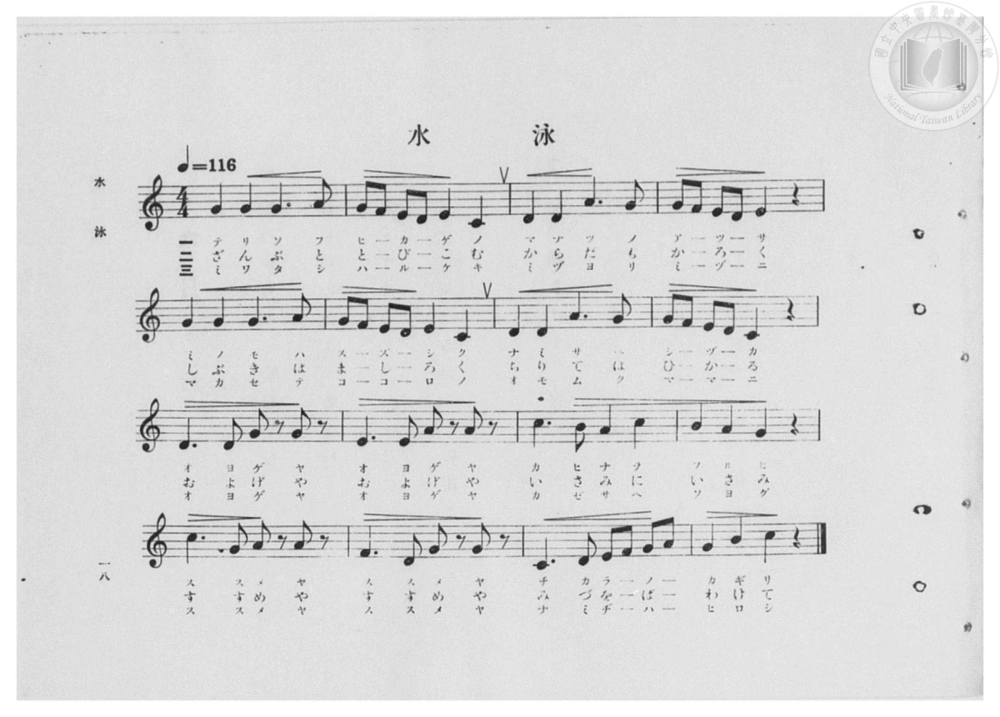
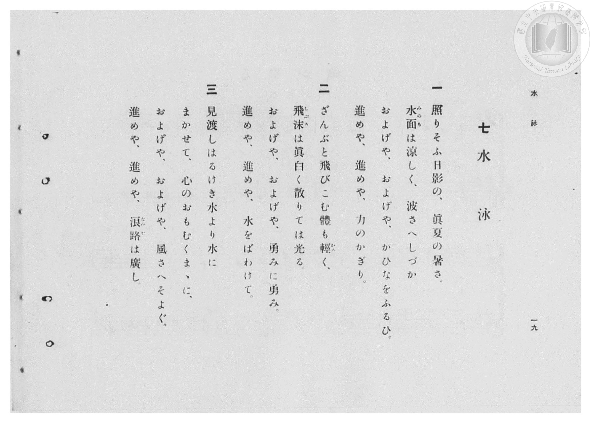

# 水泳

> Re:Shōka 使用 AI 協助辨識與重建樂譜，可能會有錯誤。歡迎[回報](https://github.com/TMDLang/reshoka/issues)。

- **鋼琴伴奏版**：<br><audio controls src="suiei.mp3"></audio>
- **NEUTRINO 歌聲合成版**：<br><audio controls src="suiei_neutrino.mp3"></audio>

- 臺灣總督府《公學校高等科唱歌》第一學年用（昭和十一年，索書號 0729 74）

## 說明

原書資訊與歌詞全文（對應 P020.jpg–P021.jpg，原書 pp. 18–19）：
調性與拍號：ハ長調（C 大調）4/4 拍，速度 ♩=116


## 歌詞

```text
一
照りそふ日影の、眞夏の暑さ。
水面（みのも）は涼しく、波さへしづか
およげや、およげや、かひなをふるひ。
進めや、進めや、力のかぎり。

二
ざんぶと飛びこむ體も輕（かる）く、
飛沫（しぶき）は眞白く散りては光る。
およげや、およげや、勇みに勇み。
進めや、進めや、水をばわけて。

三
見渡しはるけき水より水に
まかせて、心のおもむくまゝに、
およげや、およげや、風さへそよぐ。
進めや、進めや、浪路（なみぢ）は廣し。
```

## ABC

<div class="abc-score" data-abc-src="suiei.abc" aria-label="五線譜載入中"></div>

[下載 ABC 原始檔](suiei.abc)

## TMD 檔案連結

- [主旋律 TMD 檔案](suiei.tmd) [[在 TMD Studio 編輯](https://tmdlang.github.io/Tmd-TS/#tmd=s7IKdvYPcrWy4qpTUCpJTLdSSM7PyUlNLsnMz7PKzk9PzM7Ojy_OyM9OVIKrKMvPKc1NBcqW5McbIoSL80uLklOtipMz8vNz4ktSK0qS8vOz0eXjCxLTU60CDIwMEDIFRfllqXmJeUDdBUWZeSWpKWDtCAWpZZkpqSDp4uTEvPiy1KLMtMzUFCQXpRYVgxwMtaKkKDGvOLkoswDkC4Sq_KKSjPz0osSCjEqrjMzikvyizOTEnPjsxDwkz5VkpAL9VlwAVIwuWJ5YklqEoTI1sTg_rxjZlsz0zDyr0jyQk0ugDtXSUni2YcuzzZsVtLS4FG0VDA3NuOxtFZy5bEz0TexAel-073reuPj5jr3P5y5-umvO44aup61rnq7d8WzBwperZzxf2_l8-cSnUzY-W9vzuKH7-Zo1T3Y0AGWf7tzyfMqK93s6ns1Y-3RSz9PeRpD4zi3v9_Q837Lo2ewdL2bOVzAwN7JUMDd5v6dTiYtLX0vBllqAS0FB4WnffJA1m9tfrOh60dEOdN-LlfOetq54Nq0d6KynG3qftXcqgKJbL6sg_VHDZCDTEMQEuhCiVaGgQE_B0AIoZWgJdOL7PbNAxr5Ytf9Zw3KQgd29QD8ARR8397-cuh0oDjTWWeHpkuVgZicw_BSAaoDGvWyY_3TXMoVHM1fagoIXZAowMEDU89blj5u6HjfOfdy49dn0pU_3bnzcuO5xQ-PzOfOeLukHsp_Nmvi4cerjhiaQamBEvZy7CGjL48b9IHVNTUBrHjeuf7Ztz-PG6Y8b-4E6n21eBNLQuAMssvRxYzdI5-PGrsdNQG2THje1ABVhcLsfN2563LjqcdMkoEMeN4G5EDtfNmx63NQIUYfMfto1G-QEkM4-kBeAqsH-2tUDsW_a46bJjxu3PW5c8XIxUOXmx42THzc1vFw9BejqF3umgj3RDbQJ7AOQw8GWLZ79bNNqsBzQ8UDNwNADeRAYHM9n7gWqezZ1MTi8lgEFn7Z2glwKcSZ-Dz7tbgcH2WooA7_XgMEMDogNj5uAUQAM_2Vw3-3oBCeBZd3PdiwEu3E9OLCAanrBujqArgMxGldDHLUPHEBA_wONaHy6vxkcZECnNQHDAuRtoIImYNyvhvofvy9eLloBi9q5YPEJhDyyddWL7evBwbkK7H9g2gEF59Pdi0GOh2imPLNBgYKWPhdXcGlmaqZVQGZiXr5DjUFNNcgGBRsLLTswA1sWV4AUGS8W9ihomCg83dD_fH2DDjxfamLRALQHapgGUKOmlcLj5jYgXqXwuGkvkJ6qUAMkJwHxHqDIaii9CUj3gWXmAXEXELfARJoWQdSARUBqt6JYsasHZEXjNKDEZCC9DYhXgLQBSbDyxs1QGijb1ACW6QayOoH0AiDdBBMBGw2lG_tRfdEJ9sV8IF4PVLQfiLeD3doPdRnMFxuBeC1YBqS2FYhBjlgFFwGpBYmC6G6YFTUK1blptQqmCrpwrKtgBhQ2VTBRMFYwAmJdBUMgrgGydcHYDKzGFE2NAUgN2EgfQ5CNbUA-yHYgCQx5kA7coQ-S6wPbAYoBEK8LTLZA9eGKCV2FeIStRqCgnAa2bzKIBEYGWDfOCAGpbIDYCowCEK8TrH4BRB_OyEGx1RgSuiBXrgfr2g_VjSuOQHJroX6F6GsFkyugfsUVXzBb8eeVXT2U5RWQvX1ADArrfnCo74S6fBeU3g7E68FuBOUToHpgPDxungFWC5RDdjUwhrHklenQfNILxGCDGvdBgxYoA9YGkgFb3rgQyANa07gMrhaUVUFqEdGCJa8AczEodTXtBqdDkMugsQ6jm9fCUxWwZAD7FpQdIf4ClQEgNTAaKa9Qlk1A8ujZBJIEQIkf5AxIEsAV8KCkA0pkkMAHqQTrBmcEEA9XJGBmk-nwDAKKB0g2wRUXIDlQoofEB8g-sN3AOEHWhxkvmNkEnLXB7gFFDcTNuKIHqUgARhEsdEDRBMleuKKKuGyyo5OibAJONMACBVxxLIEnI1QRUJYHFXWgbLIJ7NqpQAwRxZItgMqaOoA0UEtTCzhIMUWAJV8j0JBGYB3QuBpNBDMbEOvKJlDIIzIxqJoEqdmASPag5AxK1KbA5AvCNeDkrgskzYA8EAZWI8BaxDAOLGwOTvtgTg2QA8kKoCyDlvjBEQsp-0BOigc7Kh4e5dhlQMkHJAMJWhALVH9AghfEAycvoCxmogepBiUdSJgCzQSGKthMPDLQGggaxiAWyHyYDEgcRIJk0BI7JX6DRggkS0OyAKgGhdQRoIghKpE_nT2bskQOLIDAhRCwEIYmFgyR5kZoQl8JzYCgumMPPGGtA_JWYUvsMyG4CaQdkrQxRUCJfCmQB20uNG6AGw2sVBsngksgLImeGFdDa67mJqirIbU0SAZkGbBuABai8MQPTdSmSGndBCM_gIp2kIgxUA6kElJVgNI-WDt6wt8JjWiIs5CTAE4ZYFBDZHAFN0huHTiZgBIYeuKfCU3IkDBGTuK4ZaBNGZyxAJKbCCZBdQF6BiDHj9CMiDNyQHLgugFcG0JsrOXi0rVTAPctFIAMZS4A)]
- [鋼琴伴奏 TMD 檔案](suiei_piano.tmd) [[在 TMD Studio 編輯](https://tmdlang.github.io/Tmd-TS/#tmd=s7IKdvYPcrWy4qpTUCpJTLdSSM7PyUlNLsnMz7PKzk9PzM7Ojy_OyM9OVIKrKMvPKc1NBcqW5McbIoSL80uLklOtipMz8vNz4ktSK0qS8vOz0eXjCxLTU60CDIwMEDIFRfllqXmJeUDdBUWZeSWpKWDtCAWpZZkpqSDp4uTEvPiy1KLMtMzUFCQXpRYVgxxckJmYlx-fWFSUmJeempuah2QEkqBVYmZ8YnJyfm5BYl4mqqr8opKM_PSixIKMSquMzOKS_KLM5MSc-OzEPCT_l2QAjbEqLgAqRhcsTyxJLcJQmZpYnJ9XjGxLZnpmnlVJYmY50Dv5aWmZyZmJOUpcWloKzzZsebZ58_s9HS-79zyfsOXJni1Pl_Y_7-x4v6dTQUuLS9FWwdDQjMveVsGZy8ZE38QOZOaL9l3PGxc_37H3-dzFT3fNedzQ9bR1zdO1O54tWPhy9YznazufL5_4dMrGZ2t7Hjd0P1-z5smOBqDs051bnk9ZAbTp2Yy1Tyf1PO1tBInv3PJ-T8_zLYuezd7xYuZ8BQNzI0sFcxOg7UpcXJ55JUX5VgGgMA7ycKgxqKnmUgACGwstOzCjRqE6N61WwTBOQRcITRXMFAzAuEbBBCxiBBQzAOMaBUOoiDFQDqSyBkjqKpgDMVi7ARDXcNWi2OmDbKcJmp3xCtGGsQomQMokFihoBGQYxSqYxgNp03iQCFQFkAIqAtoGkwEKAN0Dsiq4NDM1k7D3QO6EYV2oy02A_gD5Beh6kMOBbJDfQLKQkEBVA_EcyEgfwxqFx81tQP7j5lUgsmkvWMfj5qlAPY-bJwHxHqDoaii9CSzXB7bjcfM8MK8LTLZA9fWBZJoWQdQDRSH6tgLl4hG2GgHVNE4D2zcZRDZug-huXAHSDSTBuho3Q2mwmqYGiK2N3WBeJ1j9Aoi-piaoDMQ2KN3Yj2qrMcjN88GuXA_WtR-qezvYN_1QN8P8uhEstxbqV7C-pl1g3Sugfl0FlYGo3wXVD3IfxFZorFEWYSB59AiDeAIUDY-bF0Ed0w8O-J2ojgF6DeRskHdB-iBRBfEKKEpAvBlgfdvR9K3GEmHT4VH1uLEXGmHrwQG_Dxrg06G6QbKQ4AfJLgTbB7a7cRmKvk1QfYiIw4wwcCIDu-dx026om9vAboYmDxjdDIoqeOJsAidncOg8boYlE7CtQBMh6mE0RoSBIgK1tABFlC6QRJQo1YiCxhwca2BODbgEAXFBkY0WbWAnQdIPKCfFA1lLgCR-GZDHQTKgnAiJPlAeBHljKpgHDhigLGZ0gVSDPN0BZE8CmdnUAjETjww0FzdOBWJQ7njcCDIfJgMSB5EgGbRoosRvTbASApQYIZEHKoUg-exx0wb06KFe-Y6Imp1Qp4Dyz0IUR-KUaW6EyoAKjJXQtNQHpmGee9y0DuwRUBCgR89MaFDPBKpqRIkE3DLQAqtxFlAMWjQ3boDbCMpvjxsngklQPkOPInL8CE0qoEKuaQfUj5CCEiQLSnbQfAcuaSA2olZlRNSaUAq1UkQTgdes6BUnNE1QzSS4KGbdbQYSMQOLgLI_iGsMrs4R5gHrfRCF4TCKGga6dgrgZogCkAEO2WgfoAYEB2gegmMM5ihzAQA)]

## 分析

```text
================================================================================
📊 TMD Song Profile: [ 水泳 ]
================================================================================
⏱  Duration:       0:33 (33.1s), 16 measures total
🎼 Key & Tempo:    首調基準 C, != 116.0 BPM, <4/4>
   - 分析範圍：      由實際發聲的音符與和弦推測調性；播放脈絡另行呈現
🎤 人聲音域:    C4 (MIDI 60) – C5 (MIDI 72) [跨度: 12 個半音 / 1.0 個八度, 難度: easy]
   - 最低音:  C4 in [Suiei #1 @ m.2, 0:03]
   - 最高音: C5 in [Suiei #1 @ m.11, 0:20]
   - 適合: soprano, mezzo-soprano, contralto, tenor, baritone, bass
🏛  結構:      Suiei (33.1s)
⚡ 編曲密度:        Peak 1 軌道同時演奏
🗝  調性診斷：       G 調性不明確（流行色彩大調，未偵測到可信轉調）
   - 風格氣質:    流行大調（略帶和弦色彩音與裝飾副屬和弦）
   - 轉調歷程:    全曲維持單一推測調性（未偵測到可信轉調）
   - 核心骨幹音:  G, C, D, A, E
   - 調性數值:    G 調性不明確 [相關度: 0.85, 穩定度: Ambiguous, 自然音純度: 92.9%]
   - 候選調性 (K-S): G 大調 (0.85), C 大調 (0.84), E 小調 (0.61)
   - 五度圈歷程:   +1
   - 各段落調性細節:
     • [Suiei #1]: G 調性不明確 (r: 0.85, 自然音純度: 92.9%, 調外音: F)

  [ 五度圈游移軌跡 ]
               C  
         F           [G ]*
      Bb               D  
      Eb               A  
         Ab           E  
            Db       B  
               F# 
     (* = active key center)

  [ 十二半音累積音高分佈 ]
     C  : ███████████████           17.0%
     C# :                            0.0%
     D  : ██████████████            16.1%
     D# :                            0.0%
     E  : ████████████              13.4%
     F  : ██████                     7.1%
     F# :                            0.0%
     G  : ████████████████████████  26.8%
     G# :                            0.0%
     A  : ██████████████            15.2%
     A# :                            0.0%
     B  : ████                       4.5%
--------------------------------------------------------------------------------
Assignment 軌道音域：
  - Piano         : C4 – C5 (12 個半音 / 1.0 個八度, 70 個音符)
================================================================================
```


## 原書掃描頁






