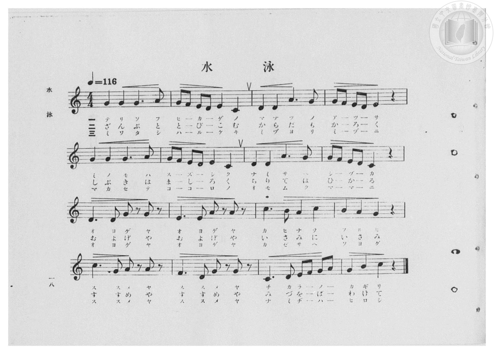
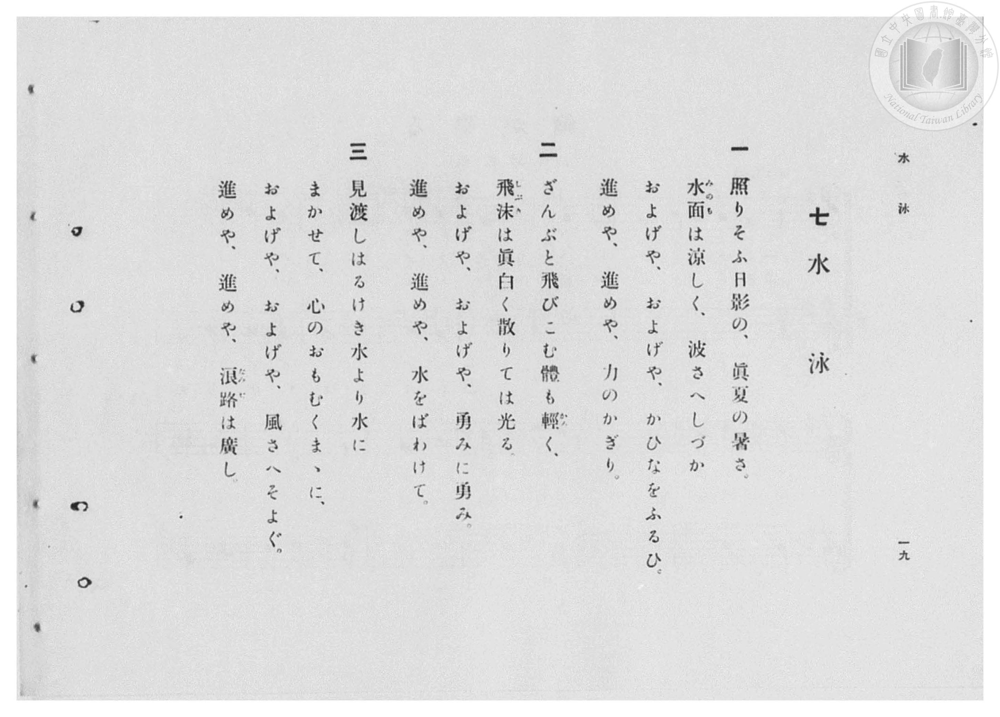

# 水泳

> Re:Shōka 使用 AI 協助辨識與重建樂譜，可能會有錯誤。歡迎回報。

- **鋼琴伴奏版**：<br><audio controls src="suiei.mp3"></audio>
- **NEUTRINO 歌聲合成版**：<br><audio controls src="suiei_neutrino.mp3"></audio>

- 臺灣總督府《公學校高等科唱歌》第一學年用（昭和十一年，索書號 0729 74）

## 說明

原書資訊與歌詞全文（對應 P020.jpg–P021.jpg，原書 pp. 18–19）：
調性與拍號：ハ長調（C 大調）4/4 拍，速度 ♩=116


## 歌詞

```text
一
照りそふ日影の、眞夏の暑さ。
水面（みのも）は涼しく、波さへしづか
およげや、およげや、かひなをふるひ。
進めや、進めや、力のかぎり。

二
ざんぶと飛びこむ體も輕（かる）く、
飛沫（しぶき）は眞白く散りては光る。
およげや、およげや、勇みに勇み。
進めや、進めや、水をばわけて。

三
見渡しはるけき水より水に
まかせて、心のおもむくまゝに、
およげや、およげや、風さへそよぐ。
進めや、進めや、浪路（なみぢ）は廣し。
```

## ABC

<div class="abc-score" data-abc-src="suiei.abc" aria-label="五線譜載入中"></div>

[下載 ABC 原始檔](suiei.abc)

## TMD 檔案連結

- [主旋律 TMD 檔案](suiei.tmd) [[在 TMD Studio 編輯](https://tmdlang.github.io/Tmd-TS/#tmd=s7IKdvYPcrWy4qpTUCpJTLdSSM7PyUlNLsnMz7PKzk9PzM7Ojy_OyM9OVIKrKMvPKc1NBcqW5McbIoSL80uLklOtipMz8vNz4ktSK0qS8vOz0eXjCxLTU60CDIwMEDIFRfllqXmJeUDdBUWZeSWpKWDtCAWpZZkpqSDp4uTEvPiy1KLMtMzUFCQXpRYVgxwMtaKkKDGvOLkoswDkC4Sq_KKSjPz0osSCjEqrjMzikvyizOTEnPjsxDwkz5VkpAL9VlwAVIwuWJ5YklqEoTI1sTg_rxjZlsz0zDyrksTMcqBb89PSMpMzE3OUuLS0FJ5t2PJs82YFLS0uRVsFQ0MzLntbBWcuGxN9EzuQ9hftu543Ln6-Y-_zuYuf7przuKHraeuap2t3PFuw8OXqGc_Xdj5fPvHplI3P1vY8buh-vmbNkx0NQNmnO7c8n7Li_Z6OZzPWPp3U87S3ESS-c8v7PT3Ptyx6NnvHi5nzFQzMjSwVzE3e7-lU4uLS11KwpRbgUlBQeNo3H2TN5vYXK7pedLQD3fdi5bynrSueTWsHOuvpht5n7Z0KoBjXyypIf9QwGcg0BDGBLoRoVSgo0FMwtABKGVoCnfh-zyyQsS9W7X_WsBxkYHcv0A9A0cfN_S-nbgeKA411Vni6ZDmY2QkMPwWgGqBxLxvmP921TOHRzJW2oOAFmQIMDBD1vHX546aux41zHzdufTZ96dO9Gx83rnvc0Ph8zrynS_qB7GezJj5unPq4oQmkGhhRL-cuAtryuHE_SF1TE9Cax43rn23b87hx-uPGfqDOZ5sXgTQ07gCLLH3c2A3S-bix63ETUNukx00tQEUY3O7HjZseN6563DQJ6JDHTWAuxM6XDZseNzVC1CGzn3bNBjkBpLMP5AWgarC_dvVA7Jv2uGny48ZtjxtXvFwMVLn5cePkx00NL1dPAbr6xZ6pYE90A20C-wDkcLBli2c_27QaLAd0PFAzMPRAHgQGx_OZe4Hqnk1dDA6vZUDBp62dIJdCnInfg0-728FBthrKwO81YDCDA2LD4yZgFADDfxncdzs6wUlgWfezHQvBblwPDiygml6wrg6g60CMxtUQR-0DBxDQ_0AjGp_ubwYHGdBpTcCwAHkbqKAJGPerof7H74uXi1bAonYuWHwCIY9sXfVi-3pwcK4C-x-YdkDB-XT3YpDjIZopz2xQoKClz8UVXJqZmmkVkJmYl-9QY1BTDbJBwcZCyw7MwJbFFSBFxouFPQoaJgpPN_Q_X9-gA8-Xmlg0AO2BGqYB1KhppfC4uQ2IVyk8btoLpKcq1ADJSUC8ByiyGkpvAtJ9YJl5QNwFxC0wkaZFEDVgEZDarShW7OoBWdE4DSgxGUhvA-IVIG1AEqy8cTOUBso2NYBluoGsTiC9AEg3wUTARkPpxn5UX3SCfTEfiNcDFe0H4u1gt_ZDXQbzxUYgXguWAaltBWKQI1bBRUBqQaIguhtmRY1CdW5arYKpgi4c6yqYAYVNFUwUjBWMgFhXwRCIa4BsXTA2A6sxRVNjAFIDNtLHEGRjG5APsh1IAkMepAN36IPk-sB2gGIAxOsCky1QfbhiQlchHmGrESgop4HtmwwigZEB1o0zQkAqGyC2AqMAxOsEq18A0YczclBsNYaELsiV68G69kN144ojkNxaqF8h-lrB5AqoX3HFF8xW_HllVw9leQVkbx8Qg8K6HxzqO6Eu3wWltwPxerAbQfkEqB4YD4-bZ4DVAuWQXQ2MYSx5ZTo0n_QCMdigxn3QoAXKgLWBZMCWNy4E8oDWNC6DqwVlVZBaRLRgySvAXAxKXU27wekQ5DJorMPo5rXwVAUsGcC-BWVHiL9AZQBIDYxGyiuUZROQPHo2gSQBUOIHOQOSBHAFPCjpgBIZJPBBKsG6wRkBxMMVCZjZZDo8g4DiAZJNcMUFSA6U6CHxAbIPbDcwTpD1YcYLZjYBZ22we0BRA3EzruhBKhKAUQQLHVA0QbIXrqgiLpvs6KQom4ATDbBAAVccS-DJCFUElOVBRR0om2wCu3YqEENEsWQLoLKmDiAN1NLUAg5STBFgydcINKQRWAc0rkYTwcwGxLqyCRTyiEwMqiZBajYgkj0oOYMStSkw-YJwDTi56wJJMyAPhIHVCLAWMYwDC5uD0z6YUwPkQLICKMugJX5wxELKPpCT4sGOiodHOXYZUPIByUCCFsQC1R-Q4AXxwMkLKIuZ6EGqQUkHEqZAM4GhCjYTjwy0BoKGMYgFMh8mAxIHkSAZtMROid-gEQLJ0pAsAKpBIXUEKGKISuRPZ8-mLJEDCyBwIQQshKGJBUOkuRGa0FdCMyCo7tgDT1jrgLxV2BL7TAhuAmmHJG1MEVAiXwrkQZsLjRvgRgMr1caJ4BIIS6InxtXQmqu5CepqSC0NkgFZBqwbgIUoPPFDE7UpUlo3wcgPoKIdJGIMlAOphFQVoLQP1o6e8HdCIxriLOQkgFMGGNQQGVzBDZJbB04moASGnvhnQhMyJIyRkzhuGWhTBmcsgOQmgklQXYCeAcjxIzQj4owckBy4bgDXhhAba7m4dO0UwH0LBSBDmQsA)]
- [鋼琴伴奏 TMD 檔案](suiei_piano.tmd) [[在 TMD Studio 編輯](https://tmdlang.github.io/Tmd-TS/#tmd=s7IKdvYPcrWy4qpTUCpJTLdSSM7PyUlNLsnMz7PKzk9PzM7Ojy_OyM9OVIKrKMvPKc1NBcqW5McbIoSL80uLklOtipMz8vNz4ktSK0qS8vOz0eXjCxLTU60CDIwMEDIFRfllqXmJeUDdBUWZeSWpKWDtCAWpZZkpqSDp4uTEvPiy1KLMtMzUFCQXpRYVgxxckJmYlx-fWFSUmJeempuah2QEkqBVYmZ8YnJyfm5BYl4mqqr8opKM_PSixIKMSquMzOKS_KLM5MSc-OzEPCT_l2QAjbEqLgAqRhcsTyxJLcJQmZpYnJ9XjGxLZnpmnlVJYmY50Dv5aWmZyZmJOUpcWloKzzZsebZ58_s9HS-79zyfsOXJni1Pl_Y_7-x4v6dTQUuLS9FWwdDQjMveVsGZy8ZE38QOZOaL9l3PGxc_37H3-dzFT3fNedzQ9bR1zdO1O54tWPhy9YznazufL5_4dMrGZ2t7Hjd0P1-z5smOBqDs051bnk9ZAbTp2Yy1Tyf1PO1tBInv3PJ-T8_zLYuezd7xYuZ8BQNzI0sFcxOg7UpcXJ55JUX5VgGgMA7ycKgxqKnmUgACGwstOzCjRqE6N61WwTBOQRcITRXMFAzAuEbBBCxiBBQzAOMaBUOoiDFQDqSyBkjqKpgDMVi7ARDXcNWi2OmDbKcJmp3xCtGGsQomQMokFihoBGQYxSqYxgNp03iQCFQFkAIqAtoGkwEKAN0Dsiq4NDM1k7D3QO6EYV2oy02A_gD5Beh6kMOBbJDfQLKQkEBVA_EcyEgfwxqFx81tQP7j5lUgsmkvWMfj5qlAPY-bJwHxHqDoaii9CSzXB7bjcfM8MK8LTLZA9fWBZJoWQdQDRSH6tgLl4hG2GgHVNE4D2zcZRDZug-huXAHSDSTBuho3Q2mwmqYGiK2N3WBeJ1j9Aoi-piaoDMQ2KN3Yj2qrMcjN88GuXA_WtR-qezvYN_1QN8P8uhEstxbqV4i-VjC5AurXVVAZiL5WKA1yH8RWaKxRFmEgefQIgzgGFA2PmxdBHdMPDvidUMfvgtLbwZ4AeRekDxJVYN3gKAHxZoD1bUf1BDDCMSNsOjyqHjf2QiNsPTjg90EDfDpUN0gWEvwg2YVg-8B2Ny5D0bcJqg8RcZgRBk5kYPc8btoNdXMb2M3Q5AGjm0FRBU-cTeDkDA6dx82wZAK2FWgiRD2MxogwUESglhagiNIFkogSpRpR0JiDYw3MqQGXICAuKLLRog3sJEj6AeWkeCBrCZDELwPyOEgGlBMh0QfKgyBvTAXzwAEDlMWMLpBqkKc7gOxJIDObWiBm4pGB5uLGqUAMyh2PG0Hmw2RA4iASJIMWTZT4rQlWQoASIyTyQKUQJJ89btqAHj3UK98RUbMT6hRQ_lmI4kicMs2NUBlQgbESmpb6wDTMc4-b1oE9AgoC9OiZCQ3qmUBVjSiRgFsGWmA1LgWKQYvmxg1wG0H57XHjRDAJymfoUUSOH6FJBVzINUH9CCkoQbKgZAfNd-CSBmIjalVGRK0JpVArRTQReM2KXnFC0wTVTIKLYtbdZiARM7AIKPuDuMbg6hxhHrDeB1EYDqOoYaBrpwBuhigAGeCQjfYBakBwgOYhOMZgjjIXAA)]

## 分析

```text
================================================================================
📊 TMD Song Profile: [ 水泳 ]
================================================================================
⏱  Duration:       0:33 (33.1s), 16 measures total
🎼 Key & Tempo:    首調基準 C, != 116.0 BPM, <4/4>
   - 分析範圍：      由實際發聲的音符與和弦推測調性；播放脈絡另行呈現
🎤 人聲音域:    C4 (MIDI 60) – C5 (MIDI 72) [跨度: 12 個半音 / 1.0 個八度, 難度: easy]
   - 最低音:  C4 in [Suiei #1 @ m.2, 0:03]
   - 最高音: C5 in [Suiei #1 @ m.11, 0:20]
   - 適合: soprano, mezzo-soprano, contralto, tenor, baritone, bass
🏛  結構:      Suiei (33.1s)
⚡ 編曲密度:        Peak 1 軌道同時演奏
🗝  調性診斷：       G 調性不明確（流行色彩大調，未偵測到可信轉調）
   - 風格氣質:    流行大調（略帶和弦色彩音與裝飾副屬和弦）
   - 轉調歷程:    全曲維持單一推測調性（未偵測到可信轉調）
   - 核心骨幹音:  G, C, D, A, E
   - 調性數值:    G 調性不明確 [相關度: 0.85, 穩定度: Ambiguous, 自然音純度: 92.9%]
   - 候選調性 (K-S): G 大調 (0.85), C 大調 (0.84), E 小調 (0.61)
   - 五度圈歷程:   +1
   - 各段落調性細節:
     • [Suiei #1]: G 調性不明確 (r: 0.85, 自然音純度: 92.9%, 調外音: F)

  [ 五度圈游移軌跡 ]
               C  
         F           [G ]*
      Bb               D  
      Eb               A  
         Ab           E  
            Db       B  
               F# 
     (* = active key center)

  [ 十二半音累積音高分佈 ]
     C  : ███████████████           17.0%
     C# :                            0.0%
     D  : ██████████████            16.1%
     D# :                            0.0%
     E  : ████████████              13.4%
     F  : ██████                     7.1%
     F# :                            0.0%
     G  : ████████████████████████  26.8%
     G# :                            0.0%
     A  : ██████████████            15.2%
     A# :                            0.0%
     B  : ████                       4.5%
--------------------------------------------------------------------------------
Assignment 軌道音域：
  - Piano         : C4 – C5 (12 個半音 / 1.0 個八度, 70 個音符)
================================================================================
```


## 原書掃描頁






