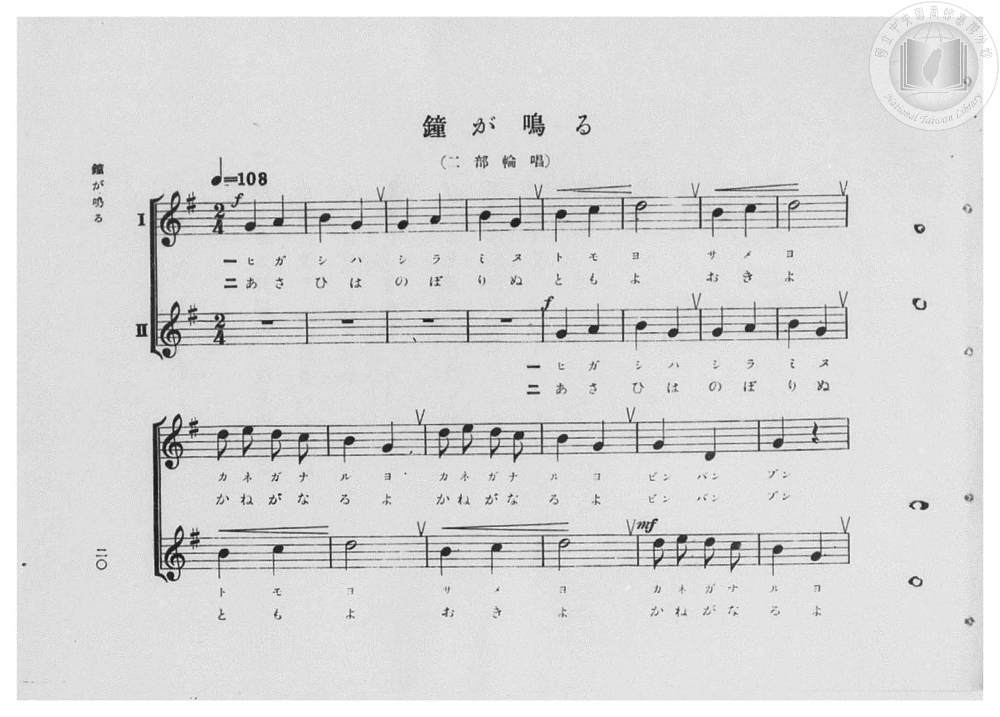
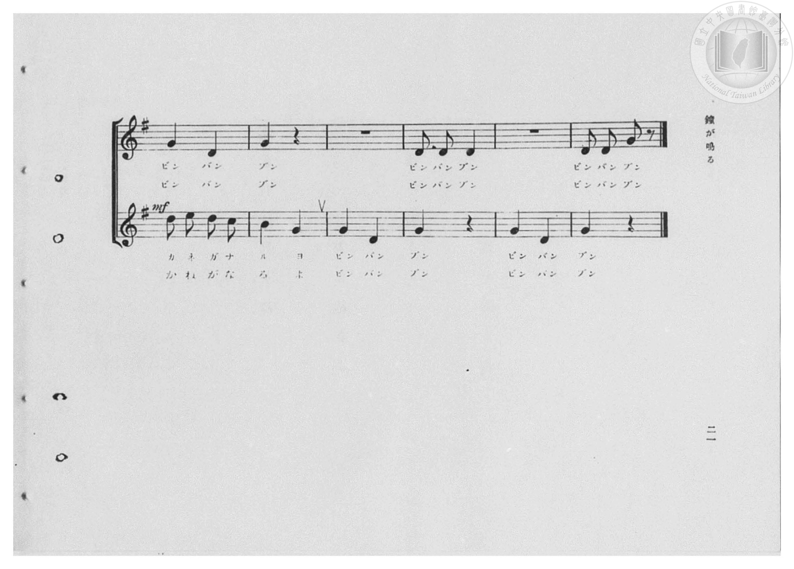
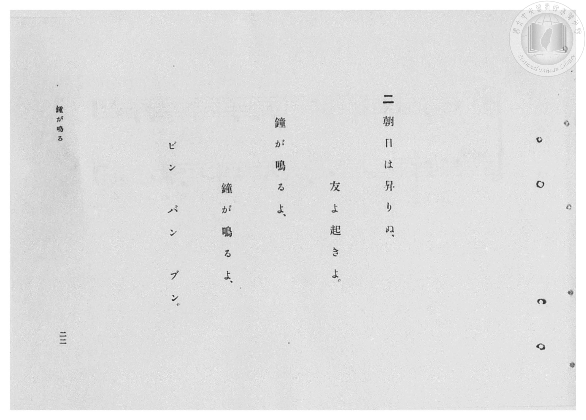
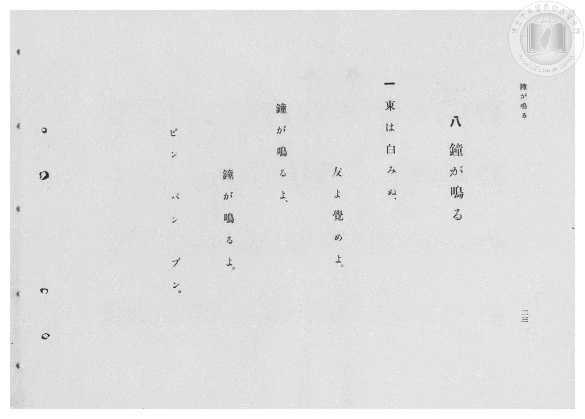

# 鐘が鳴る

> Re:Shōka 使用 AI 協助辨識與重建樂譜，可能會有錯誤。歡迎回報。

- **鋼琴伴奏版**：<br><audio controls src="kane_ga_naru.mp3"></audio>
- **NEUTRINO 歌聲合成版**：<br><audio controls src="kane_ga_naru_neutrino.mp3"></audio>

- 臺灣總督府《公學校高等科唱歌》第一學年用（昭和十一年，索書號 0729 74）

## 說明

原書資訊與歌詞全文（對應 P022.jpg–P025.jpg，原書 pp. 20–23，二部輪唱）：
調性與拍號：ト長調（G 大調，1 升記號）2/4 拍，速度 ♩=108
曲式與原曲考證：
- 旋律採自法國傳統卡農輪唱曲〈Frère Jacques〉（德語版〈Bruder Jakob〉結尾擬聲詞為「Bim, bam, bum」），
編為全曲 20 小節之二部輪唱（第 I 部先行，第 II 部於第 5 小節進入，第 17–20 小節兩部交錯應答「ビン バン ブン」結束）。
- 歌詞頁採由右至左裝訂：P025.jpg（原書 p. 二三）載有第一段，P024.jpg（原書 p. 二二）載有第二段。


## 歌詞

```text
一
東は白みぬ、
友よ覺めよ。
鐘が鳴るよ、
鐘が鳴るよ。
ビン　バン　ブン。

二
朝日は昇りぬ、
友よ起きよ。
鐘が鳴るよ、
鐘が鳴るよ。
ビン　バン　ブン。
```

## ABC

<div class="abc-score" data-abc-src="kane_ga_naru.abc" aria-label="五線譜載入中"></div>

[下載 ABC 原始檔](kane_ga_naru.abc)

## TMD 檔案連結

- [主旋律 TMD 檔案](kane_ga_naru.tmd) [[在 TMD Studio 編輯](https://tmdlang.github.io/Tmd-TS/#tmd=s7IKdvYPcrWy4qpTUCpJTLdSSM7PyUlNLsnMz7PKzk9PzM7Ojy_OyM9OVIKrKMvPKc1NBcqW5McbIoSL80uLklOtipMz8vNz4ktSK0qS8vOz0eXjCxLTU60CDIyMEDIFRfllqXmJeUDdBUWZeSWpKWDtCAWpZZkpqSDp4uTEvPiy1KLMtMzUFCQXpRYVgxwMtaKkKDGvOLkoswDkC4Sq_KKSjPz0osSCjEqrjMzikvyizOTEnPjsxDwkz5VkpAL9VpKZmxqfnxafkliJLpVWlJmal1KckVmALpNbWpyZjGxdZnpmnlV5anFJalFefG5qTn4KkmlQ6ZLEzHKgn_LT0jKTMxNzlLi0tBReTpjxuLHn5eYtj5u6FbS0uBRtFQwNLLjsbRXcuWyM9E3sQIa8aN_1vHHx8x17n89d_HTXnMcNXU9b1zxdu-PZgoUvV894vrbz-fKJT6dsfLa253FD9_M1a57saADKPt255fmUFe_3dDybsfbppJ6nvY0g8Z1b3u_peb5l0bPZO17MnK9gYG5kqWBu8n5PpxIXl76Wgi21AJeCgsLTvvkgaza3v1jR9aKjHei-FyvnPW1d8WxaO9BZTzf0PmvvVAClD72sgvRHDZOBTFMQE-hCiFaFggI9BSMDoJSRMVDwya6el80rXuxZBfQs0MXv98wC2fJi1f5nDctB5nf3Ar0EFH3c3PFy6nagONAWd4WnS5aDmT2GCk97gU6ZAVbUCQxcBaAOoPjLhvlPdy1TeDRzpS0o7IFGPpu96emefqCRYGdsetHQ_GItzDpdhWfTu5_u637Wt_BF-6pnm6c-ndP9tGnz860bn_YufLFvE8R5QF2PGzrcig6vKEpV8EpMLixNLX7cADSj4-k-oMvmPe_sAMo7FZWmpBYB5bPzk4Cyz7dOeLph37PJa140bgKG1POmXY8bepwyc3UUkhJBRGnu4wagg4Gm9IBcoqDwfPsKoCJQiM7eBAwnhacb-p-vb3iysxs1pDqAaULBUwEo8rS148XCHlAKAImAhZ5N2wPimEI1v2zY9LR1KVSFoTko6GHmPm1dCVT_ZNeSlz3rgTH3fO0UoPMeN09-3LxZ4XHzBAg1DUgBXQn0yrO5oGB-3NAEDTVw7L9c0AgMuOdTNj7t3_yiffPT7cteLJ77YkUTMHARsd8Bi309BaBHnuwAerjzxZ7OZ3M6IYn72bqtQAcC1ZtgVb8L6EEk9bt6gOpBzgC5A6gbHMFzNz5uXP985t7HjfsfN6553NAIEn3c0ABBT_u7Hzd1vFi263FTI5AB9QNyXgWLomrCkAZrAsmBgwjMAAUSmAEJJqibdoGj89mcuc-mLwU669mM9sdNXbidtXX748Ze2joLqILyIgAKFLT0ubi8E_NS3RP9EotKrQISi0oMHWoMaqrBidjGQssOzMBW-iggRfgseCpW0LCAJkkdePEBVQlM3U92dAHzD1CZJhbzgG4B2VWjUJ1Wq2AITJZGQFyjYAwkQbwarGIglgmYZQokQRCrGNhkH8MaYC6YBOQ_bloDln_ctB3Ea-5H4a2E8Jrng3k9UF4HmLcIylsBt-1x01awzEJ0GYidRkCxxiaQisapEBWNm8C89VDeOjBvD9SsLjAP6rpGkFmPm0C6QXIgF0DtbISo60WXASda3NEFzm-o0WWGPbp29RAdXaYKZkBsghIt2MRApGk8nGmAGi9Nq4Fh1wuOmcfNXeCQXA0OV1AYECEPKetAAuDSDiIGyjNAJthSpOjoBuK1QNwDxKvAhneDAxoUjETIE7aKQKbpxB8LxuBYIC7wsQUqmISwgFIQhE3YEMhDzhmEvAUmISxsVQsxSuKR44FeFtZilHFGZJdxRBVy3UREHCIy8LNIKAzhUYkIE_wsMgtDeAwSbQ95BSAphRlRpRkx8UJkhaJQnQuMGCzFHFJ-IrnGIFTKIRVhJNcMhIo1UsosfIUWMWGMK-ywl2aU1RuECxlqVh1UsQ1YXunaKSCKLAUgT5kLAA)]
- [鋼琴伴奏 TMD 檔案](kane_ga_naru_piano.tmd) [[在 TMD Studio 編輯](https://tmdlang.github.io/Tmd-TS/#tmd=s7IKdvYPcrWy4qpTUCpJTLdSSM7PyUlNLsnMz7PKzk9PzM7Ojy_OyM9OVIKrKMvPKc1NBcqW5McbIoSL80uLklOtipMz8vNz4ktSK0qS8vOz0eXjCxLTU60CDIyMEDIFRfllqXmJeUDdBUWZeSWpKWDtCAWpZZkpqSDp4uTEvPiy1KLMtMzUFCQXpRYVgxxckJmYlx-fWFSUmJeempuah2QEkqBVYmZ8YnJyfm5BYl4mqqr8opKM_PSixIKMSquMzOKS_KLM5MSc-OzEPCT_l2QAjbEqAWqNz0-LT0msRJdKK8pMzUspzsgsQJfJLS3OTEa2LjM9M8-qPLW4JLUoLz43NSc_Bck0qHRJYmY50Nv5aWmZyZmJOUpcWloKLyfMeNzY83LzlsdN3e_3dLzs3vN8wpYne7Y8Xdr_vLPj_Z5OBS0tLkVbBUMDCy57WwV3LhsjfRM7kMkv2nc9b1z8fMfe53MXP90153FD19PWNU_X7ni2YOHL1TOer-18vnzi0ykbn63tedzQ_XzNmic7GoCyT3dueT5lBdCmZzPWPp3U87S3ESS-c8v7PT3Ptyx6NnvHi5nzFQzMjSwVzE2AtitxcXnmlRTlWwWAYiTIw6HGoKaaSwEIbCy07MCMGoXq3IJaBVMFMyA2AXKNFXQVDIG4BkyaxsOZBiAWVy2KkT7IRpqgGmkYD9QdD9IcrxBtGAthwEUMIGZ5J-aluif6JRaV4ndjGtA8oP1GYNegOhFdDMQyAbNMgSQIYhUDm-xjWKPwuHkSkP-4aQ1Y_nHTdhCvuR-FtxLCa54P5vVAeR1g3iIobwXctsdNW8EyC9FlIHYaAcUam0AqGqdCVDRuAvPWQ3nrwLw9ULO6wDyo6xpBZj1uAukGyYFcALWzEaKuF12GCxqE2GKY6FiHh1XTaqB_esGh9bi5C-y71WC_gtxFhHzz5MfNm8ECEyAMkNg0CBNsKVIQdQPxWiDuAeJVYMO7wZ4HeY0IecJWQUMGm4_BJIQFlIIgbMKG4ISMSEqE7ASTEBZUMVQpXBlBJcAMhAgkelmIJasaYc2piADCzyIhR0NNJjJfAwsfoNFYUja8bMIujT0Z4CoD0QMDZ0EI8ibeghAuEm0abw5j4hKDpVjiVGPag9CPx0WYDGhhrWunAC77FYAMRABE-wBNQBMxAosocwEA)]

## 分析

```text
================================================================================
📊 TMD Song Profile: [ 鐘が鳴る ]
================================================================================
⏱  Duration:       0:22 (22.2s), 20 measures total
🎼 Key & Tempo:    首調基準 G, != 108.0 BPM, <2/4>
   - 分析範圍：      由實際發聲的音符與和弦推測調性；播放脈絡另行呈現
🎤 人聲音域:    D4 (MIDI 62) – E5 (MIDI 76) [跨度: 14 個半音 / 1.2 個八度, 難度: moderate]
   - 最低音:  D4 in [KaneGaNaru #1 @ m.13, 0:13]
   - 最高音: E5 in [KaneGaNaru #1 @ m.9, 0:09]
   - 適合: soprano, mezzo-soprano, contralto, tenor, baritone, bass
🏛  結構:      KaneGaNaru (22.2s)
⚡ 編曲密度:        Peak 2 軌道同時演奏
🗝  調性診斷：       G 大調（純淨自然大調，未偵測到可信轉調）
   - 風格氣質:    純淨自然大調（陽光明朗、易唱易記，無明顯調外色彩）
   - 轉調歷程:    全曲維持單一推測調性（未偵測到可信轉調）
   - 核心骨幹音:  G, D, B, C, A
   - 調性數值:    G 大調 [相關度: 0.95, 穩定度: High, 自然音純度: 100.0%]
   - 候選調性 (K-S): G 大調 (0.95), D 大調 (0.62), B 小調 (0.60)
   - 五度圈歷程:   +1
   - 各段落調性細節:
     • [KaneGaNaru #1]: G 大調 (r: 0.95, 自然音純度: 100.0%)

  [ 五度圈游移軌跡 ]
               C  
         F           [G ]*
      Bb               D  
      Eb               A  
         Ab           E  
            Db       B  
               F# 
     (* = active key center)

  [ 十二半音累積音高分佈 ]
     C  : ███████                    9.4%
     C# :                            0.0%
     D  : ██████████████████████    29.9%
     D# :                            0.0%
     E  : ██                         3.1%
     F  :                            0.0%
     F# :                            0.0%
     G  : ████████████████████████  32.3%
     G# :                            0.0%
     A  : █████                      6.3%
     A# :                            0.0%
     B  : ██████████████            18.9%
--------------------------------------------------------------------------------
Assignment 軌道音域：
  - Part1         : D4 – E5 (14 個半音 / 1.2 個八度, 38 個音符)
  - Part2         : D4 – E5 (14 個半音 / 1.2 個八度, 32 個音符)
================================================================================
```


## 原書掃描頁










