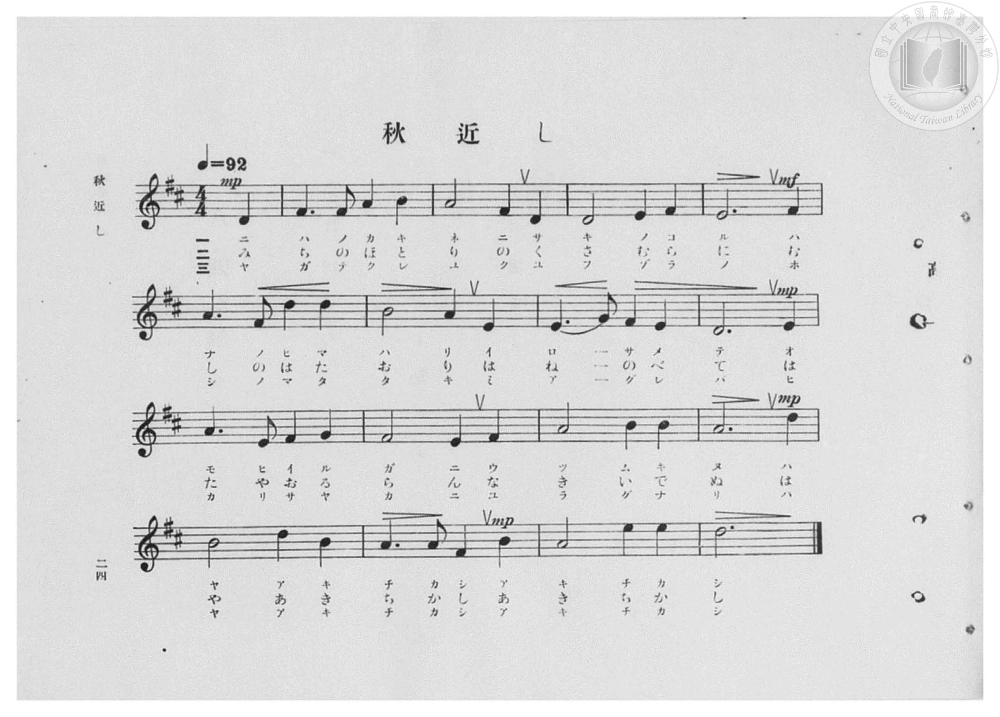
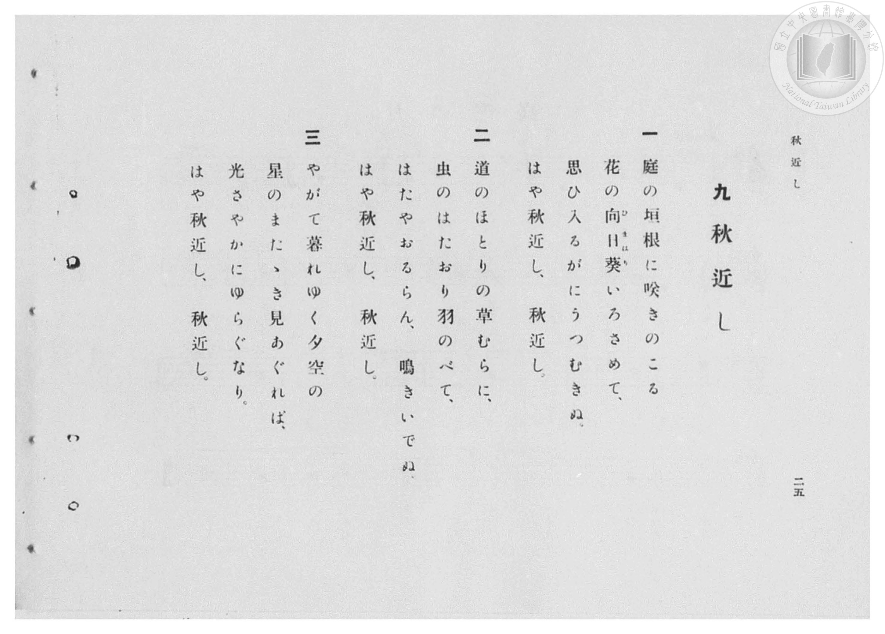

# 秋近し

> Re:Shōka 使用 AI 協助辨識與重建樂譜，可能會有錯誤。歡迎回報。

- **鋼琴伴奏版**：<br><audio controls src="aki_chikashi.mp3"></audio>

- 臺灣總督府《公學校高等科唱歌》第一學年用（昭和十一年，索書號 0729 74）

## 說明

原書資訊與歌詞全文（對應 P026.jpg–P027.jpg，原書 pp. 24–25）：
調性與拍號：ニ長調（D 大調，2 升記號）4/4 拍（弱起 1 拍），速度 ♩=92
原曲出處：文部省《新訂高等小學唱歌（第一學年用）》（昭和十年／1935 年 3 月發行，第 13 曲）。


## 歌詞

```text
一
庭の垣根に咲きのこる
花の向日葵（ひまはり）いろさめて、
思ひ入るがにうつむきぬ。
はや秋近し、秋近し。

二
道のほとりの草むらに、
虫のはたおり羽のべて、
はたやおるらん、鳴きいでぬ。
はや秋近し、秋近し。

三
やがて暮れゆく夕空の
星のまたゝき見あぐれば、
光さやかにゆらぐなり。
はや秋近し、秋近し。
```

## ABC

<div class="abc-score" data-abc-src="aki_chikashi.abc" aria-label="五線譜載入中"></div>

[下載 ABC 原始檔](aki_chikashi.abc)

## TMD 檔案連結

- [主旋律 TMD 檔案](aki_chikashi.tmd) [[在 TMD Studio 編輯](https://tmdlang.github.io/Tmd-TS/#tmd=s7IKdvYPcrWy4qpTUCpJTLdSSM7PyUlNLsnMz7PKzk9PzM7Ojy_OyM9OVIKrKMvPKc1NBcqW5McbIoSL80uLklOtipMz8vNz4ktSK0qS8vOz0eXjCxLTU60CDIzMEDIFRfllqXmJeUDdBUWZeSWpKWDtCAWpZZkpqSDp4uTEvPiy1KLMtMzUFCQXpRYVgxwMtaKkKDGvOLkoswDkC4Sq_KKSjPz0osSCjEqrjMzikvyizOTEnPjsxDwkz5VkpAL9VpyaWJyfV4wunJdYUlqUii5akJOYh-RYiGBiXmZuYg6y5ZnpmXlWufl5SaXA8MSQKEnMLAf6LT8tLTM5E6RRS0vh-fLuF_snPm6crqClxaVoq2BpxGVvq-DCZWOib2IHMuBF-67njYuf79j7fO7ip7vmPG7oetq65unaHc8WLHy5esbztZ3Pl098OmXjs7U9jxu6n69Z82RHA1D26c4tz6eseL-n49mMtU8n9TztbQSJ79zyfk_P8y2Lns3e8WLmfAUDcyNLBXOT93s6lbi49LUUbKkFuBQUFJ72zQdZs7n9xYquFx3tQPe9WDnvaeuKZ9Pagc56uqH3WXunAiiN6GUVpD9qmAxkmoOYQBdCtCoUFOgpGJkApYxMgU58v2cWyNgXq_Y_a1gOMrC7F-gHoOjj5u6XU7cDxYHGuig8XbIczOwxUnjaC7R7BlhRJzA0FYA6QDbv2fhi63YFQwgXaGzPy4b5T3ctU3g0c6UtMPRhTt_0tH3Xi5lTgRYAXfyyecXzOY3AsH82bcOLFU2QgH-6oR8U0uCwBxqMEfadwAhBjgFw8PcbWhqbKgCZCsYKz-Z0PJ-558VCoO4eoG4FQ6DQ7E1gjU1cIIcAzQO7Z9fax43rns5b_GzBzseNq59O2vS4sRco8rhx8uOmbnCodG0EqZgw8dn0pS8mbgXa-rgRqGjf48b1j5u6QCY2tjxuAuqZ-rip8XHjsscNjSBtzxrmAtU9bV0KNOZxYw_Q7MeNbY8blzxuagDbsAbkEKA6sDEt8KQK1I3Ehjp1Vw-Iegl0Eshhux83rgDaDGS_6O0EGdcEdMJqqLUvZgLtASpa_7hx_uPGLqC65_v2gkWA3oO5DSrd1AJW0Q0yoGkyUO7l5i1gtwHFl5Pmwh2dYJUgE4FeXfZs1rrHTT2Pm4Ae7n-6ZOrzlbuATgCHygygq4COAYYe0H5gCPW-WAYMnqbHjRNAGho3QF34tBXoJ2CAAs0DSq8GmQTy5YTHjatAXifKYUAVlGc3KFDQ0uficszOdM7IzE4szsi0CshMzMt3qNE1rKkGWaRgY6FlB2Zgy-sKkPQLTI0KGsh5REFbwUQBmNSfr2_QgedXTSz6gbaDzK5RMFDQhePq3IJaoDm6QGFjIKkLJE2BpBlYBMSCiOlC1YBIEDSCitaAWTBYnZtWCxEG2-RjWKMQD-TBMLAgAGt53NwPVv64uQ8Y26tBrKa1UJleqFEQtY-btkLEwfIwPSDxzVD1IN0wCDEXarcRmt2N-yE6GhdC1DauA-LdYNYKqB1dMHOAciASbBqQngoTb2oAk51QcRS7wXJQu43R_b0EasMaqDvbgOz1YBZIBOSPZXBzIOIgPkgcYfc-sPhKqDgoFBD-ng22G3_S2dUDTjokphVIEjBWMIwDUmCiBpw4QBAkB4p-WCIwAcc9RASWUCDJApjGwMLwZPG4GRLY4CTQPAnMmgf1GiRxgERWgT0ODbxmSBJ43LwHmiweN4OiEiTThhIRIF2IRACquRERDg7cxvkQfY3wCAdHPUQWJI5kEzQp7ITKwKIJYiJYPTzKHzdtR_ITyDePm6CJDkxDbAKZ_bgZ6oKmRUh-2gBmwRLEBGSbwCFEKIJ3dJIfwUbgqDMB2w0pB5DzOKwcAEU8askAj15I0kCKX5jPJkFjEJJVEZkAkcVhSb0FLr4AHlIg8R6UkEDN4pC4BKlugcYnsCqC2gPKphC5ySCyEZwugHQvTLwRZCOwloKKw9yFPW4hmR2UJmGpD5apYcUA1D_wrAvKqhD7ITELch1IHOQOdP_gjdmns2eTE7OwbAqOGuRoMwVHKzjaUGPTCKQSTAAzMIiCQVBNgRy5IK9DvAaKZkRUNUJFV0MzA0QetfwGqYEEGiLLQCCorESKWmCUwiKjCUyCIg65BO-GZm6IPGrUgtSAVEDEIUUAhi2giKWpX2q5uHTtFJCqfAUgV5kLAA)]
- [鋼琴伴奏 TMD 檔案](aki_chikashi_piano.tmd) [[在 TMD Studio 編輯](https://tmdlang.github.io/Tmd-TS/#tmd=s7IKdvYPcrWy4qpTUCpJTLdSSM7PyUlNLsnMz7PKzk9PzM7Ojy_OyM9OVIKrKMvPKc1NBcqW5McbIoSL80uLklOtipMz8vNz4ktSK0qS8vOz0eXjCxLTU60CDIzMEDIFRfllqXmJeUDdBUWZeSWpKWDtCAWpZZkpqSDp4uTEvPiy1KLMtMzUFCQXpRYVgxxckJmYlx-fWFSUmJeempuah2QEkqBVYmZ8YnJyfm5BYl4mqqr8opKM_PSixIKMSquMzOKS_KLM5MSc-OzEPCT_l2QAjbEqTk0szs8rRhfOSywpLUpFFy3ISUS2BiIIsj0xB9nyzPTMPKvc_LykUmCQY0iUJGaWA72fn5aWmZwJ0qilpfB8efeL_RMfN05_v6fjZfee5xO2PNmz5enS_uedHe_3dCpoaXEp2ipYGnHZ2yq4cNmY6JvYgUx90b7reePi5zv2Pp-7-OmuOY8bup62rnm6dsezBQtfrp7xfG3n8-UTn07Z-Gxtz-OG7udr1jzZ0QCUfbpzy_MpK4AWPZux9umknqe9jSDxnVve7-l5vmXRs9k7Xsycr2BgbmSpYG4CtFyJi8szr6Qo3yoAFCtBHg41uoY11VwKQGBjoWUHZtQoGCjownF1bkGtgmEckFWjYAYkQRDMBXFqFEzBAqYKxmgiugpGIEVgogaiAQZBptZw1aK4xAfFJSZILoHAGog7TOIVok1iYRTQXCDDMBZEAYXgXNN4IG0aj6oAaAbITsfsTOeMzOzE4oxMUsMA7BOQP3WBJMiXqP4FyUDUgEhwCEBFa8AsGKzOTauFCINt8jGsUYgH8mD4cXM3WMvj5n6w8sfNfQqPm1aDWE1roTK9UKMgah83bYWIg-VhekDim6HqQbphEGIu1G4jNLsb90N0NC6EqG1cB8S7wawVUDu6YOYA5UAk2DQgPRUm3tQAJjuh4ih2g-Wgdhuj-3sJ1IY1UHe2AdnrwSyQCMgfy-DmQMRBfJA4wu59YPGVUHFQKCD8PRtsNzR6IbFmDEmZaMkbJAeKMVi8mYCjCyICi1tITAKTBVgYHpOPmyHhA4615klg1jyoayDxCRJZBXYr1L_NkFh73LwHGpOPm0GhD5JpQwk7kC5EvAGLF4g4OI7A4dE4H6KvER5H4NiCyILEkWyCxt5OqAwsZCEmgtXDY-lx03YkP4F887gJmk7ANMQmkNmPm6EuaFqE5KcNYBYsDicg2wQOIbQ4MQKHtglYOSS3IeckWG4DxRVq_oPHCCQ2kaIE5phJ0ECHZAhEUkNkJFiCaoGLL4B7DiTeg-J41IwECX6Q6hZoFDxugmZlcGaAyE0GkY3gqATSvTDxRpCNjxuXQ8Vh7sIeHZAsBUpGsAQDyzqwzAb1DzyDgDIExH5IZIBcBxIHuQPdP9DIIFDWg0OapAIfER8g10JcA4oZROg2QkVXQ5McRB61YAOpgfgTkTAhEFSIIMUGMBZg4dcEJkFhjVy0dUOzEEQeNTZAakAqIOKQjIZhCyguaOoXbNUVkRUl9ooRSqFUlEAmMAphNSaIAa6gQMJQo9E1Q2tfIB-kGkkzXAShA-wYsCDCMKit6DU22CFQPpYKHuYtmEG4mwKwlgJR7QFdOwVwM0QByEAK7GgfoCp0ISNMIWOwkDIXAA)]

## 分析

```text
================================================================================
📊 TMD Song Profile: [ 秋近し ]
================================================================================
⏱  Duration:       0:41 (41.7s), 16 measures total
🎼 Key & Tempo:    首調基準 D, != 92.0 BPM, <4/4>
   - 分析範圍：      由實際發聲的音符與和弦推測調性；播放脈絡另行呈現
🎤 人聲音域:    D4 (MIDI 62) – E5 (MIDI 76) [跨度: 14 個半音 / 1.2 個八度, 難度: moderate]
   - 最低音:  D4 in [AkiChikashi #1 @ m.1, 0:01]
   - 最高音: E5 in [AkiChikashi #1 @ m.16, 0:40]
   - 適合: soprano, mezzo-soprano, contralto, tenor, baritone, bass
🏛  結構:      AkiChikashi (41.7s)
⚡ 編曲密度:        Peak 1 軌道同時演奏
🗝  調性診斷：       D 大調（純淨自然大調，未偵測到可信轉調）
   - 風格氣質:    純淨自然大調（陽光明朗、易唱易記，無明顯調外色彩）
   - 轉調歷程:    全曲維持單一推測調性（未偵測到可信轉調）
   - 核心骨幹音:  A, D, E, F#, B
   - 調性數值:    D 大調 [相關度: 0.85, 穩定度: Moderate, 自然音純度: 100.0%]
   - 候選調性 (K-S): D 大調 (0.85), A 大調 (0.79), F# 小調 (0.61)
   - 五度圈歷程:   +3
   - 各段落調性細節:
     • [AkiChikashi #1]: A 調性不明確 (r: 0.81, 自然音純度: 97.5%, 調外音: G)

  [ 五度圈游移軌跡 ]
               C  
         F            G  
      Bb               D  
      Eb              [A ]*
         Ab           E  
            Db       B  
               F# 
     (* = active key center)

  [ 十二半音累積音高分佈 ]
     C  :                            0.0%
     C# :                            0.0%
     D  : █████████████████████     21.9%
     D# :                            0.0%
     E  : ██████████████████        18.7%
     F  :                            0.0%
     F# : █████████████████         18.0%
     G  : ██                         2.3%
     G# :                            0.0%
     A  : ████████████████████████  25.0%
     A# :                            0.0%
     B  : ██████████████            14.1%
--------------------------------------------------------------------------------
Assignment 軌道音域：
  - Piano         : D4 – E5 (14 個半音 / 1.2 個八度, 49 個音符)
================================================================================
```


## 原書掃描頁






