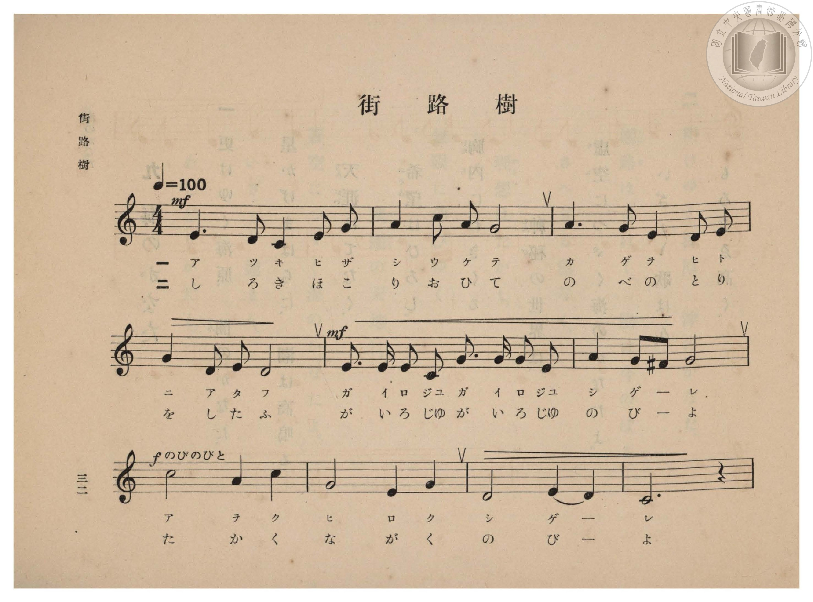
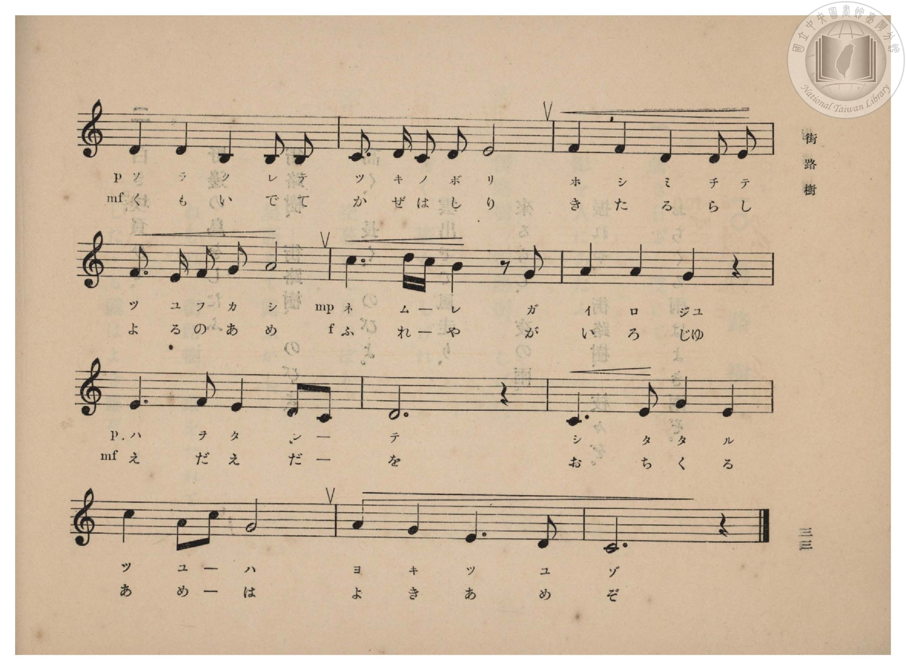
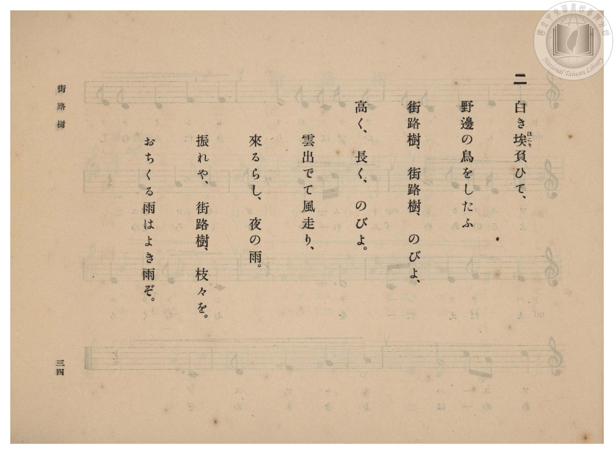
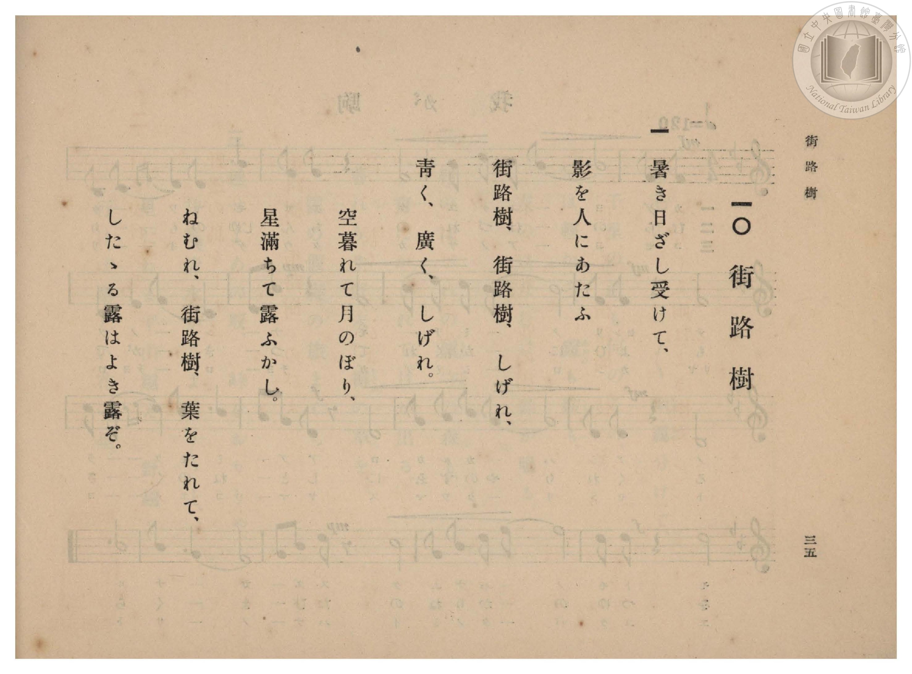

# 街路樹

> Re:Shōka 使用 AI 協助辨識與重建樂譜，可能會有錯誤。歡迎[回報](https://github.com/TMDLang/reshoka/issues)。

- **鋼琴伴奏版**：<br><audio controls src="gairoju.mp3"></audio>
- **NEUTRINO 歌聲合成版**：<br><audio controls src="gairoju_neutrino.mp3"></audio>

- 臺灣總督府《公學校高等科唱歌》第二學年用（昭和十一年，索書號 0729 74）

## 說明

原書資訊與歌詞全文（對應 P034.jpg–P037.jpg，原書 pp. 32–35，第 10 首）：
調性與拍號：ハ長調（C 大調，無升降記號）4/4 拍，速度 ♩=100


## 歌詞

```text
一
暑き日ざし受けて、
影を人にあたふ
街路樹、街路樹、しげれ、
青く、廣く、しげれ。
空暮れて月のぼり、
星滿ちて露ふかし。
ねむれ、街路樹、葉をたれて、
したゝる露はよき露ぞ。

二
白き埃（ほこり）負ひて、
野邊の鳥をしたふ
街路樹、街路樹、のびよ、
高く、長く、のびよ。
雲出でて風走り、
來るらし、夜の雨。
振れや、街路樹、枝々を。
おちくる雨はよき雨ぞ。
```

## ABC

<div class="abc-score" data-abc-src="gairoju.abc" aria-label="五線譜載入中"></div>

[下載 ABC 原始檔](gairoju.abc)

## TMD 檔案連結

- [主旋律 TMD 檔案](gairoju.tmd) [[在 TMD Studio 編輯](https://tmdlang.github.io/Tmd-TS/#tmd=s7IKdvYPcrWy4qpTUCpJTLdSSM7PyUlNLsnMz7PKzk9PzM7Ojy_OyM9OVIKrKMvPKc1NBcqW5McbIYSL80uLklOtipMz8vNz4ktSK0qS8vOz0eXjCxLTU60CDIxNcMqY4pQxQ8gUFOWXpeYl5gFtLCjKzCtJTQFbiVCQWpaZkgqSLk5OzIsvSy3KTMtMTUHyRWpRMciTUCtKihLzipOLMgtAPkeoyi8qychPL0osyKi0ysgsLskvykxOzInPTsxDCpCSjFRgeBTkJOaVFKOL5iWWlBalIhuYmZ6ZZ1WaB3JdCdRNWloKLxZOf7F9_bMVOxW0tLgUbRUMDQy47G0VnLlsTPRN7EDaX7Tvet64-PmOvc_nLn66a87jhq6nrWuert3xbMHCl6tnPF_b-Xz5xKdTNj5b2_O4ofv5mjVPdvUAZZ_u3PJ8yor3ezqezVj7dFLP097GJzsagILv9_Q837Lo2ewdL2bOVzAwN7JUMDd5v6dTiYtLX0vBllqAS0FB4WnffJA1m9tfrOh60dEOdN-LlfOetq54Nq0d6KynG3qftXcqgBKEXlZB-qOGyUCmOYgJdCFEq0JBgZ6CsRFQytgU5Ow1a4Cho_By2TSge9_vmQWy48Wq_c8aloNM7-4Feggo-ri5_-XU7UBxoB3OCk-XLAcze563LHza2_5yZu-LFTPACjuBwasA1AWUe9kw_-muZQqPZq60BYU-yFxgWIGoZ7MmPm7sfTZ96ePGaY8bpz_tn_64ESiy7HFDI9iHezc-bpr0ZNeux42rHzc2PW6c_7hxK9hZsEgFKkRmA8143DjpcRMwpsAGvJw76XFjP5DzdPdiCANJRRNIxfOVu57NWgfiNy57NqfjceO6x417Hjd1QQ14NmP-s937HzcuBEq_nLMJaP3jxm6QGRDdjxvXPm5qgNiH4qaJnUCHg9wLNhhqGNhuoNDcx03dYMPWP24C2tgLZs8DGQkOml09YIfN3AuUejq_GRjOjxt3P26cDHQVMFhfbFrwuBGoHmboy_a-l0DnNq57uXkp2E6wHYSCCejLzSDLoWasngEJHWDMwoIJrgLs0ZezNz1tB0bDclA4LFrxYusGRBg92dcG9NDjpk5wuDQ-XTIH5JrZK6Ban_UAvdnzuKkFzRHP5s193NAKcjIsLIG-AIZzPyh0gLrhoQNig0MHqIjynAMFClr6XFzuiZlF-VmlVgGZiXn5DjUGNdUgOxRsDM207MAsbFlWAVQE7Gh4sbBHQcNY4emG_ufrG3Tg-Qwhq4lFK9BSkLE1CtW5abUKxgq6cGgExIZQNkjcFIhrFMygIoZxQALEAQkjQ4QSEATJwgwFGQhi14Bt9DGsUXjctAhJ7ePmFhDZtBbOnwTmbwOb-rhpO0y8aRmY3AhW04Zh_-Om1cimNm0CqwORSKY2dyBcYgTU0zgdRU8viGwEkWB-424wORlqfhdcHMQCJn4wCXIVmksa1yGb2rgTTMLEHjeuANsFMqMGnNFwx-6uHnyxC5bFG7uwWILFAYhGdStS_BuDaVDcQ7SZwqMREbkgERN1uBIkkxCx29wND09QPD9u2g8im6dihlPTGqi6JUD5tWDWjsfNkGjGKYWaJiCxvAdMQrRguAkUz02g2IeEPijGgSUTmNyK6abGHqi6Fnh6mPG4CZTc8EghxzmwuEK4qQmU3lDdRCA_d4Jj3ARHfgbJ4s_PwOgEZ1JkiJJ7If5Ejz9YboWJ12CkFeT8DFEBKybQoQHcr9hzPDiUEDmzaT3cREguRVW3Fps6eAqAqwOnBIgOUMjDzENPEzAYj-pGcFkAShMoZjbCU3JjP8LMxlUY6iAJA10dcikAkQWlDAw3YqQRTDfiTTNPZ8_GLCVMSakDCmrhsQqjzWGWgxlgAhbhRmAaVqQgwxoFEygLRiMbi14J7IUHxkoYCx7FkIiDFPOgaARVEZBK4nFzH1hmDphEjwqQ2tlw0-DFRDMsah83NyLMRYp6WLQ9bmqCsYC5HMZaDiahhQ80UTxunAPEIPdCixR49YDkFqSqBO6CJkTx2AnXTbAimIIviglXBJD4MAbToCyOXFlD3FqdC0wFKCWHURyIbw7lgTI1alsAuU6AqQCbhVQVQOMNWHBDKgBIJY2ZfUFqYWEF0bEAnEkQGRiUAiG1AijtLIGrWwsPTWj9AFOM5BRwDQDJZaDgh-RMYDsezAclCPRoQ64XgG1GiFOaYAkC7BRwngephScTcJUAZsGqBVSn4M_ErWvxZmLCBT8w-pDzIyimkYtsUJ7FLNRhEB53KIU6rP0HYyMFKTh2YbkGEhPgqhhc2UP4kBwMKuhAatEbbDAIDx-0VAFtNiCZB2veIedb5KLzceMCMAkTg_JhLoA3AfC4ANywQ5i3EEwiygZYziVYiTfjiUtIcY03LuHZEJTFwBzczW2YDKzEBUFQLJNUPUPzKSSnwsIMNX6hIdQMarxCQmMtXA9MN8IEUHjvw2E_tqoXXuqCsyPUfnDpimY_vLJELlthuhEmgMycR9D-Wi4uXTsFaOdLAchU5gIA)]
- [鋼琴伴奏 TMD 檔案](gairoju_piano.tmd) [[在 TMD Studio 編輯](https://tmdlang.github.io/Tmd-TS/#tmd=s7IKdvYPcrWy4qpTUCpJTLdSSM7PyUlNLsnMz7PKzk9PzM7Ojy_OyM9OVIKrKMvPKc1NBcqW5McbIYSL80uLklOtipMz8vNz4ktSK0qS8vOz0eXjCxLTU60CDIxNcMqY4pQxQ8gUFOWXpeYl5gFtLCjKzCtJTQFbiVCQWpaZkgqSLk5OzIsvSy3KTMtMTUHyRWpRMciTBZmJefnxiUVFiXnpqbmpeUhGIAlaJWbGJyYn5-cWJOZloqrKLyrJyE8vSizIqLTKyCwuyS_KTE7Mic9OzEMKs5IMoDFWBTmJeSXF6KJ5iSWlRanIBmamZ-ZZlSRmlgNdnp-WlpmcmZijxKWlpfBi4fQX29c_W7Hz_Z6Ol917nk_Y8mTPlqdL-593drzf06mgpcWlaKtgaGDAZW-r4MxlY6JvYgcy9kX7rueNi5_v2Pt87uKnu-Y8buh62rrm6dodzxYsfLl6xvO1nc-XT3w6ZeOztT2PG7qfr1nzZFcPUPbpzi3Pp6wA2vRsxtqnk3qe9jY-2dEAFHy_p-f5lkXPZu94MXO-goG5kaWCuQnQdiUuLs-8kqJ8qwBQiAZ5ONQY1FRzKQCBjaGZlh2YVaNQnVtQq2CsoAuExmDaEIhNwXxTMA0Sq1EwA4tAZEzU4Up0FQygdA1XLYp9PrjsA1oHswJkNIhG59coGMUDKTMQYQRjmIIIDBvdEzOL8rNKCfkxDeZHCAQZCrIU4muYpTA_GsaB7ETyIwwilMCCAmYoyEBwQIFt9DGsUXjctAhJ7ePmFhDZtBbOnwTmbwOb-rhpO0y8aRmY3AhW04Zh_-Om1cimNm0CqwORSKY2dyBcYgTU0zgdRU8viGwEkWB-424wORlqfhdcHMR63Ai2oRHkKjSXNK5DNrVxJ5iEiT1uXAG2C2RGDRc0GmDBCQssEI1qKFJEkZUY4SYhoqG5G-5xUIQ8btoPIpunYnqoaQ1U3RKg_Fowa8fj5qVgBk4p1MiDRMceMAnRguEmUIQ0gaIJEkygqHncOB9MbsV0U2MPVF0LPOJmPG5qBTNwSiFHzuPGzQg3NYESBqqbYDkEGO7gZI8MUfIDxEHoAQ1L_zBxYM7FoQImXgPPeOgQka-x5yGwdxBpvWk93ERIukdVtxabOnhUwdWBowyiAxREMPPQIw8GYWUQcu4CRR6KmY3wJNfYjzCzcRWGOkgMoqtDzlcQWVAUYrgRIzIx3YhU5MKCH0abw1SBGWACFjNGYBqWSZFhjYIJlAWjkY1FL__2wl29EsaCxwUkhCElHCi8QaUjpHx83NwHlpkDJtHDDKR2Ntw0eMZrhsXB4-ZGhLlIcQQL38dNTTAWMN_AWMvBJKiMA6mFxN7jxjlADHIvNJPCS0YktyCVonAXNCEKnE64bnhcQALOGEyDMg1yhQIxFFwho-RFozgQ3xzKA2UT1PoKuTiEqQCbhVQKQgO4eRm07INUJJgZAqQW5imIjgXgZIfIEqCkAikQQZG8BK5uLdzb0KIRphjJKeDCD5JuQeEESeuPG0Fx8rgJFHPo4YtcJD5u6oE4pQkWc2CngHMRSC08PsGlIZgFKxFRnYKULZBTOChKkEsrUC7ALM9gEB7IKOUZrDEBYyP5HRwNsHQICTJwdQGukCB8SJ4A5XGQWvTaHwbhHkGLPmjVhmQerK2AnBOQS43HjQvAJEwMyoe5AF5N4XEBuJWAMG8hmETkNlhegAc6PGGDEi2Yg7uRBZOBFTYgCIoOkqoQaMqHpH2Y51AjAuqVZlCTBeLstXA9MN0IE0ABsw-H_diqB3iBA07gUPvBBQua_fACHblYgelGmAAycx5B-9GbxpQ1x01ABoOEQVEBovEogUnBaHC7HRxtsGYgTACTATIeEcPkdRFQzEHuAKAbgeEpYmzFsALTE9iNwUyekMDHbSBmYKDTeCIIi7NgNRBcKSYDZ0DATUEUezjTBLovyQ1UlBAjbAqG99CchSepYgnyaENtY23TWKj16BClC6prpwDu9yoAGdA8F-1jCNSKxDUCc5W5AA)]

## 分析

```text
================================================================================
📊 TMD Song Profile: [ 街路樹 ]
================================================================================
⏱  Duration:       0:52 (52.8s), 22 measures total
🎼 Key & Tempo:    首調基準 C, != 100.0 BPM, <4/4>
   - 分析範圍：      由實際發聲的音符與和弦推測調性；播放脈絡另行呈現
🎤 人聲音域:    B3 (MIDI 59) – D5 (MIDI 74) [跨度: 15 個半音 / 1.2 個八度, 難度: moderate]
   - 最低音:  B3 in [Gairoju #1 @ m.11, 0:25]
   - 最高音: D5 in [Gairoju #1 @ m.15, 0:34]
   - 適合: soprano, mezzo-soprano, contralto, tenor, baritone, bass
🏛  結構:      Gairoju (52.8s)
⚡ 編曲密度:        Peak 1 軌道同時演奏
🗝  調性診斷：       C 大調（純淨自然大調，未偵測到可信轉調）
   - 風格氣質:    純淨自然大調（陽光明朗、易唱易記，無明顯調外色彩）
   - 轉調歷程:    全曲維持單一推測調性（未偵測到可信轉調）
   - 核心骨幹音:  C, G, D, E, A
   - 調性數值:    C 大調 [相關度: 0.89, 穩定度: Moderate, 自然音純度: 99.4%]
   - 候選調性 (K-S): C 大調 (0.89), G 大調 (0.78), A 小調 (0.65)
   - 五度圈歷程:   +0
   - 各段落調性細節:
     • [Gairoju #1]: C 大調 (r: 0.89, 自然音純度: 99.4%, 調外音: F#)

  [ 五度圈游移軌跡 ]
              [C ]*
         F            G  
      Bb               D  
      Eb               A  
         Ab           E  
            Db       B  
               F# 
     (* = active key center)

  [ 十二半音累積音高分佈 ]
     C  : ████████████████████████  21.0%
     C# :                            0.0%
     D  : █████████████████████     18.0%
     D# :                            0.0%
     E  : ████████████████████      17.7%
     F  : ███████                    6.3%
     F# : █                          0.6%
     G  : ███████████████████████   20.4%
     G# :                            0.0%
     A  : ██████████████            12.6%
     A# :                            0.0%
     B  : ████                       3.6%
--------------------------------------------------------------------------------
Assignment 軌道音域：
  - Piano         : B3 – D5 (15 個半音 / 1.2 個八度, 87 個音符)
================================================================================
```


## 原書掃描頁










