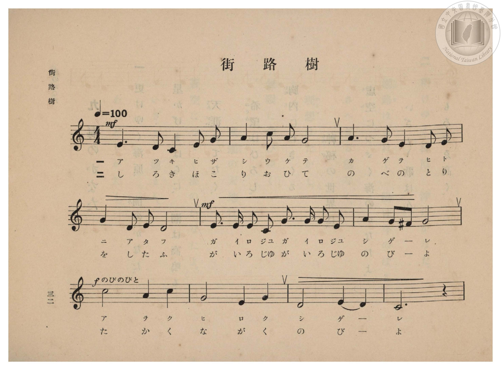
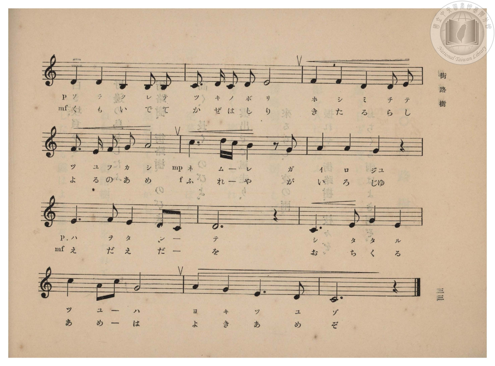
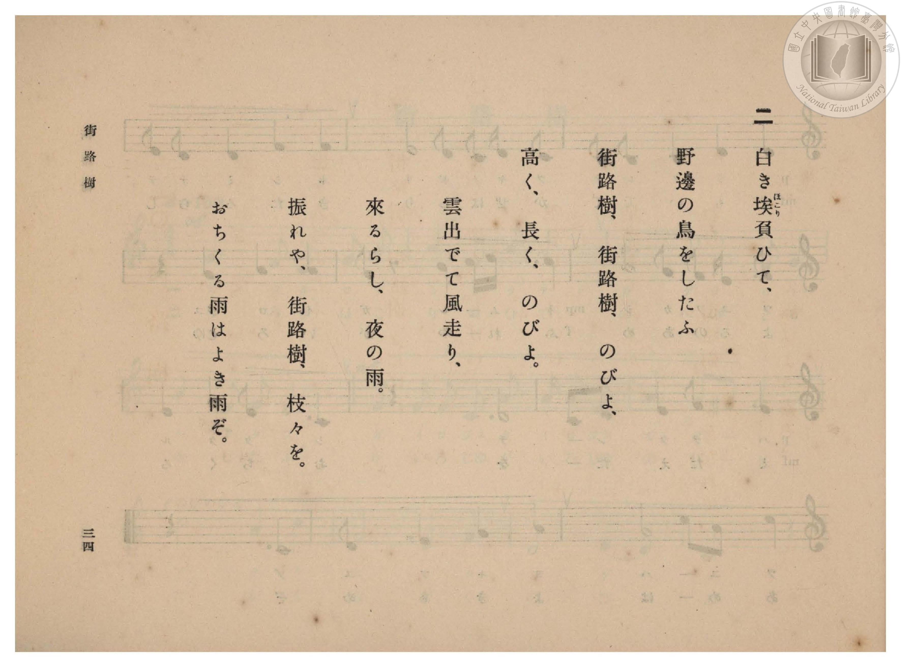
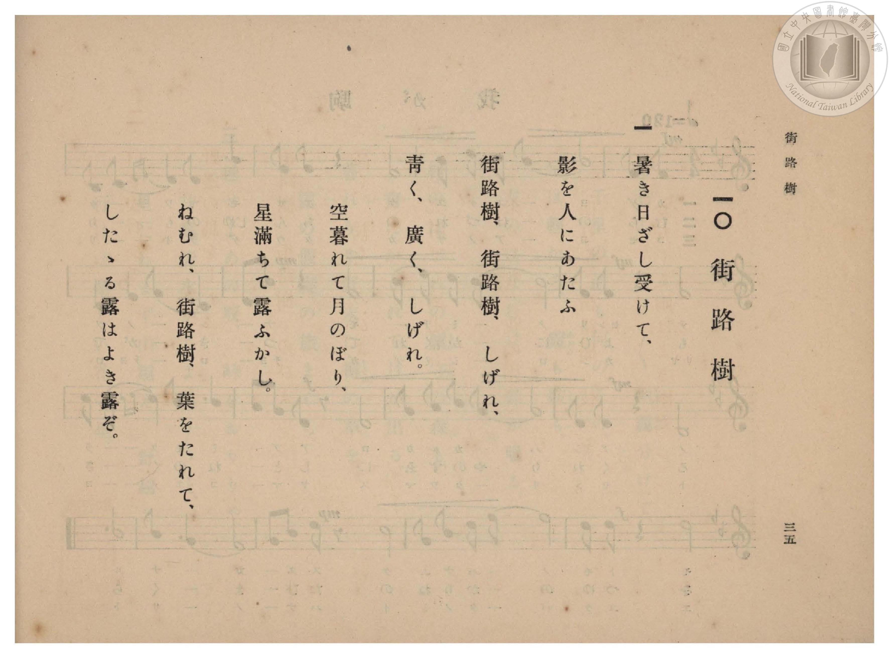

# 街路樹

> Re:Shōka 使用 AI 協助辨識與重建樂譜，可能會有錯誤。歡迎回報。

- **鋼琴伴奏版**：<br><audio controls src="gairoju.mp3"></audio>

- 臺灣總督府《公學校高等科唱歌》第二學年用（昭和十一年，索書號 0729 74）

## 說明

原書資訊與歌詞全文（對應 P034.jpg–P037.jpg，原書 pp. 32–35，第 10 首）：
調性與拍號：ハ長調（C 大調，無升降記號）4/4 拍，速度 ♩=100


## 歌詞

```text
一
暑き日ざし受けて、
影を人にあたふ
街路樹、街路樹、しげれ、
青く、廣く、しげれ。
空暮れて月のぼり、
星滿ちて露ふかし。
ねむれ、街路樹、葉をたれて、
したゝる露はよき露ぞ。

二
白き埃（ほこり）負ひて、
野邊の鳥をしたふ
街路樹、街路樹、のびよ、
高く、長く、のびよ。
雲出でて風走り、
來るらし、夜の雨。
振れや、街路樹、枝々を。
おちくる雨はよき雨ぞ。
```

## ABC

<div class="abc-score" data-abc-src="gairoju.abc" aria-label="五線譜載入中"></div>

[下載 ABC 原始檔](gairoju.abc)

## TMD 檔案連結

- [主旋律 TMD 檔案](gairoju.tmd) [[在 TMD Studio 編輯](https://tmdlang.github.io/Tmd-TS/#tmd=s7IKdvYPcrWy4qpTUCpJTLdSSM7PyUlNLsnMz7PKzk9PzM7Ojy_OyM9OVIKrKMvPKc1NBcqW5McbIYSL80uLklOtipMz8vNz4ktSK0qS8vOz0eXjCxLTU60CDIxNcMqY4pQxQ8gUFOWXpeYl5gFtLCjKzCtJTQFbiVCQWpaZkgqSLk5OzIsvSy3KTMtMTUHyRWpRMciTUCtKihLzipOLMgtAPkeoyi8qychPL0osyKi0ysgsLskvykxOzInPTsxDCpCSjFRgeBTkJOaVFKOL5iWWlBalIhuYmZ6ZZ1WSmFkOdFZ-WlpmcmZijhKXlpbCi4XTX2xf_2zFTgUtLS5FWwVDAwMue1sFZy4bE30TO5AJL9p3PW9c_HzH3udzFz_dNedxQ9fT1jVP1-54tmDhy9Uznq_tfL584tMpG5-t7Xnc0P18zZonu3qAsk93bnk-ZcX7PR3PZqx9OqnnaW_jkx0NQMH3e3qeb1n0bPaOFzPnKxiYG1kqmJu839OpxMWlr6VgSy3ApaCg8LRvPsiaze0vVnS96GgHuu_FynlPW1c8m9YOdNbTDb3P2jsVQGlCL6sg_VHDZCDTHMQEuhCiVaGgQE_B2AgoZWwKcvaaNcDQUXi5bBrQve_3zALZ8WLV_mcNy0Gmd_cCPQQUfdzc_3LqdqA40A5nhadLloOZPc9bFj7tbX85s_fFihlghZ3A4FUA6gLKvWyY_3TXMoVHM1fagkIfZC4wrEDUs1kTHzf2Ppu-9HHjtMeN05_2T3_cCBRZ9rihEezDvRsfN016smvX48bVjxubHjfOf9y4FewsWKQCFSKzgWY8bpz0uAkYU2ADXs6d9LixH8h5unsxhIGkogmk4vnKXc9mrQPxG5c9m9PxuHHd48Y9j5u6oAY8mzH_2e79jxsXAqVfztkEtP5xYzfIDIjux41rHzc1QOxDcdPETqDDQe4FGww1DGw3UGju46ZusGHrHzcBbewFs-eBjAQHza4esMNm7gVKPZ3fDAznx427HzdOBroKGKwvNi143AhUDzP0ZXvfS6BzG9e93LwUbCfYDkLBBPTlZpDlUDNWz4CEDjBmYcEEVwH26MvZm562A6NhOSgcFq14sXUDIoye7GsDeuhxUyc4XBqfLpkDcs3sFVCtz3qA3ux53NSC5ohn8-Y-bmgFORkWlkBfAMO5HxQ6QN3w0AGxwaEDVER5zoECBS19Li73xMyi_KxSq4DMxLx8hxqDmmqQHQo2hmZadmAWtiyrACoCdjS8WNijoGGs8HRD__P1DTrwfIaQ1cSiFWgpyNgaherctFoFYwVdODQCYkMoGyRuCsQ1CmZQEcM4IAHigISRIUIJCIJkYYaCDASxa8A2-hjWKDxuWoSk9nFzC4hsWgvnTwLzt4FNfdy0HSbetAxMbgSracOw_3HTamRTmzaB1YFIJFObOxAuMQLqaZyOoqcXRDaCSDC_cTeYnAw1vwsuDmIBEz-YBLkKzSWN65BNbdwJJmFijxtXgO0CmVEDzmi4Y3dXD77YBcvijV1YLMHiAESjuhUp_o3BNCjuIdpM4dGIiFyQiIk6XAmSSYjYbe6Ghyconh837QeRzVMxw6lpDVTdEqD8WjBrx-NmSDTjlEJNE5BY3gMmIVow3ASK5yZQ7ENCHxTjwJIJTG7FdFNjD1RdCzw9zHjcBEpueKSQ4xxYXCHc1ARKb6huIpCfO8ExboIjP4Nk8ednYHSCMykyRMm9EH-ixx8st8LEazDSCnJ-hqiAFRPo0ADuV-w5HhxKiJzZtB5uIiSXoqpbi00dPAXA1YFTAkQHKORh5qGnCRiMR3UjuCwApQkUMxvhKbmxH2Fm4yoMdZCEga4OuRSAyIJSBoYbMdIIphvxppmns2djlhKmpNQBBbXwWIXR5jDLwQwwAYtwIzANK1KQYY2CCZQFo5GNRa8E9sIDYyWMBY9iSMRBinlQNIKqCEgl8bi5DywzB0yiRwVI7Wy4afBiohkWtY-bGxHmIkU9LNoeNzXBWMBcDmMtB5PQwgeaKB43zgFikHuhRQq8ekByC1JVAndBE6J47ITrJlgRTMEXxYQrAkh8GINpUBZHrqwhbq3OBaYClJLDKA7EN4fyQJkatS2AXCfAVIDNQqoKoPEGLLghFQCkksbMviC1sLCC6FgAziSIDAxKgZBaAZR2lsDVrYWHJrR-gClGcgq4BoDkMlDwQ3ImsB0P5oMSBHq0IdcLwDYjxClNsAQBdgo4z4PUwpMJuEoAs2DVAqpT8Gfi1rV4MzHhgh8Yfcj5ERTTyEU2KM9iFuowCI87lEId1v6DsZGCFBy7sFwDiQlwVQyu7CF8SA4GFXQgtegNNhiEhw9aqoA2G5DMgzXvkPMtctH5uHEBmISJQfkwF8CbAHhcAG7YIcxbCCYRZQMs5xKsxJvxxCWkuMYbl_BsCMpiYA7u5jZMBlbigiAolkmqnqH5FJJTYWGGGr_QEGoGNV4hobEWrgemG2ECKLz34bAfW9ULL3XB2RFqP7h0RbMfXlkil60w3QgTQGbOI2h_LReXrp0CtPMV7WMYq4DMNQJzlbkA)]
- [鋼琴伴奏 TMD 檔案](gairoju_piano.tmd) [[在 TMD Studio 編輯](https://tmdlang.github.io/Tmd-TS/#tmd=s7IKdvYPcrWy4qpTUCpJTLdSSM7PyUlNLsnMz7PKzk9PzM7Ojy_OyM9OVIKrKMvPKc1NBcqW5McbIYSL80uLklOtipMz8vNz4ktSK0qS8vOz0eXjCxLTU60CDIxNcMqY4pQxQ8gUFOWXpeYl5gFtLCjKzCtJTQFbiVCQWpaZkgqSLk5OzIsvSy3KTMtMTUHyRWpRMciTBZmJefnxiUVFiXnpqbmpeUhGIAlaJWbGJyYn5-cWJOZloqrKLyrJyE8vSizIqLTKyCwuyS_KTE7Mic9OzEMKs5IMoDFWBTmJeSXF6KJ5iSWlRanIBmamZ-ZZlSRmlgNdnp-WlpmcmZijxKWlpfBi4fQX29c_W7Hz_Z6Ol917nk_Y8mTPlqdL-593drzf06mgpcWlaKtgaGDAZW-r4MxlY6JvYgcy9kX7rueNi5_v2Pt87uKnu-Y8buh62rrm6dodzxYsfLl6xvO1nc-XT3w6ZeOztT2PG7qfr1nzZFcPUPbpzi3Pp6wA2vRsxtqnk3qe9jY-2dEAFHy_p-f5lkXPZu94MXO-goG5kaWCuQnQdiUuLs-8kqJ8qwBQiAZ5ONQY1FRzKQCBjaGZlh2YVaNQnVtQq2CsoAuExmDaEIhNwXxTMA0Sq1EwA4tAZEzU4Up0FQygdA1XLYp9PrjsA1oHswJkNIhG59coGMUDKTMQYQRjmIIIDBvdEzOL8rNKCfkxDeZHCAQZCrIU4muYpTA_GsaB7ETyIwwilMCCAmYoyEBwQIFt9DGsUXjctAhJ7ePmFhDZtBbOnwTmbwOb-rhpO0y8aRmY3AhW04Zh_-Om1cimNm0CqwORSKY2dyBcYgTU0zgdRU8viGwEkWB-424wORlqfhdcHMR63Ai2oRHkKjSXNK5DNrVxJ5iEiT1uXAG2C2RGDRc0GmDBCQssEI1qKFJEkZUY4SYhoqG5G-5xUIQ8btoPIpunYnqoaQ1U3RKg_Fowa8fjZkh84JRCjTxIdOwBkxAtGG4CRUgTKJogwQSKmseN88HkVkw3NfZA1bXAI27G4yZQusAjhRw5jxs3I9zUBEoYqG6C5RBguIOTPTJEyQ8QB6EHNCz9w8SBOReHCph4DTzjoUNEvsaeh8DeQaT1pvVwEyHpHlXdWmzq4FEFVweOMogOUBDBzEOPPBiElUHIuQsUeShmNsKTXGM_wszGVRjqIDGIrg45X0FkQVGI4UaMyMR0I1KRCwt-GG0OUwVmgAlYzBiBaVgmRYY1CiZQFoxGNha9_NsLd_VKGAseF5AQhpRwoPAGlY6Q8vFxcx9YZg6YRA8zkNrZcNPgGa8ZFgePmxsR5iLFESx8Hzc1wVjAfANjLQeT0OwMjb3HjXOAGOReaCaFl4xIbkEqReEuaEIUOJ1w3fC4gAScMZgGZRrkCgViKLhCRsmLRnEgvjmUB8omqPUVcnEIUwE2C6kUhAYwsMyClH2QigQzQ4DUwjwF0bEAnOwQWQKUVCAFIiiSl8DVrYV7G1o0whQjOQVc-EHSLSicIGn9cSMoTh43gWIOPXyRi8THTT0QpzTBYg7sFHAuAqmFxye4NASzYCUiqlOQsgVyCgdFCXJpBcoFmOUZDMIDGaU8gzUmYGwkv4OjAZYOIUEGri7AFRKED8kToDwOUote-8Mg3CNo0Qet2pDMg7UVkHMCcqnxuHEBmISJQfkwF8CrKTwuALcSEOYtBJOI3AbLC_BAhydsUKIFc3A3smAysMIGBEHRQVIVAk35kLQP8xxqREC90gxqskCcvRauB6YbYQIoYPbhsB9b9QAvcMAJHGo_uGBBsx9eoCMXKzDdCBNAZs4jaD9605iy5rgJyGCQMCgqQDQeJTApGA1ut4OjDdYMhAlgMkDGI2KYvC4CijnIHQB0IzA8RYytGFZgegK7MZjJExL4uA3EDAx0Gk8EYXEWrAaCK8Vk4AwIuCmIYg9nmkD3JbmBihJihE3B8B6as_AkVSxBHm2obaxtGgu1Hh2idEF17RTA_V4FIAOa56J9DIFakbhGYK4yFwA)]

## 分析

```text
================================================================================
📊 TMD Song Profile: [ 街路樹 ]
================================================================================
⏱  Duration:       1:45 (105.6s), 44 measures total
🎼 Key & Tempo:    首調基準 C, != 100.0 BPM, <4/4>
   - 分析範圍：      由實際發聲的音符與和弦推測調性；播放脈絡另行呈現
🎤 人聲音域:    B3 (MIDI 59) – D5 (MIDI 74) [跨度: 15 個半音 / 1.2 個八度, 難度: moderate]
   - 最低音:  B3 in [Gairoju[L1] #1 @ m.11, 0:25]
   - 最高音: D5 in [Gairoju[L1] #1 @ m.15, 0:34]
   - 適合: soprano, mezzo-soprano, contralto, tenor, baritone, bass
🏛  結構:      Gairoju[L1] (52.8s) -> Gairoju[L2] (52.8s)
⚡ 編曲密度:        Peak 1 軌道同時演奏
🗝  調性診斷：       C 大調（純淨自然大調，未偵測到可信轉調）
   - 風格氣質:    純淨自然大調（陽光明朗、易唱易記，無明顯調外色彩）
   - 轉調歷程:    全曲維持單一推測調性（未偵測到可信轉調）
   - 核心骨幹音:  C, G, D, E, A
   - 調性數值:    C 大調 [相關度: 0.89, 穩定度: Moderate, 自然音純度: 99.4%]
   - 候選調性 (K-S): C 大調 (0.89), G 大調 (0.78), A 小調 (0.65)
   - 五度圈歷程:   +0 -> +0
   - 各段落調性細節:
     • [Gairoju[L1] #1]: C 大調 (r: 0.89, 自然音純度: 99.4%, 調外音: F#)
     • [Gairoju[L2] #1]: C 大調 (r: 0.89, 自然音純度: 99.4%, 調外音: F#)

  [ 五度圈游移軌跡 ]
              [C ]*
         F            G  
      Bb               D  
      Eb               A  
         Ab           E  
            Db       B  
               F# 
     (* = active key center)

  [ 十二半音累積音高分佈 ]
     C  : ████████████████████████  21.0%
     C# :                            0.0%
     D  : █████████████████████     18.0%
     D# :                            0.0%
     E  : ████████████████████      17.7%
     F  : ███████                    6.3%
     F# : █                          0.6%
     G  : ███████████████████████   20.4%
     G# :                            0.0%
     A  : ██████████████            12.6%
     A# :                            0.0%
     B  : ████                       3.6%
--------------------------------------------------------------------------------
Assignment 軌道音域：
  - Piano         : B3 – D5 (15 個半音 / 1.2 個八度, 174 個音符)
================================================================================
```


## 原書掃描頁










