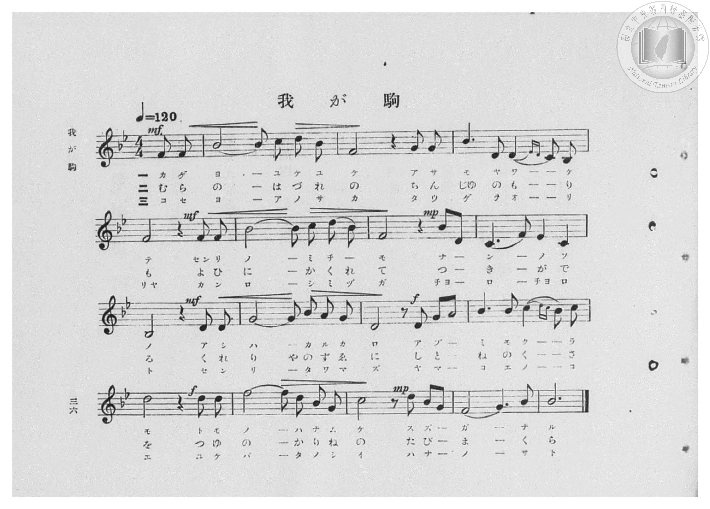
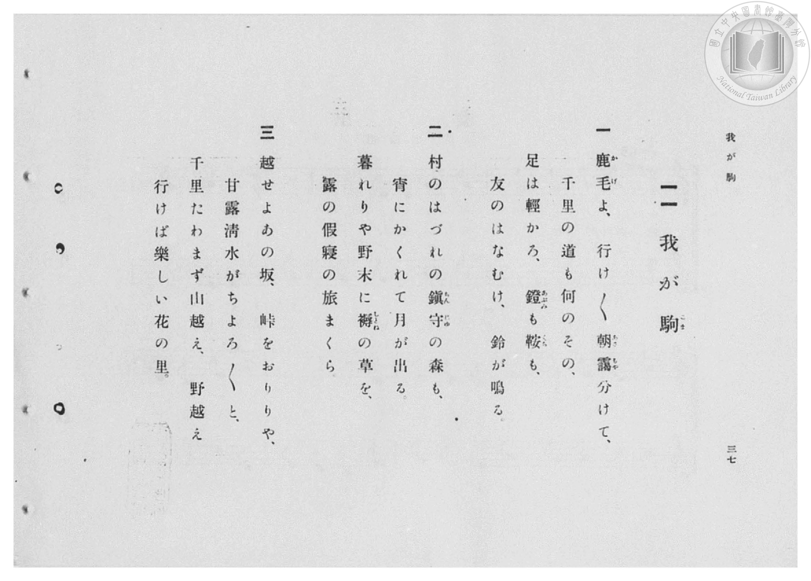

# 我が駒

> Re:Shōka 使用 AI 協助辨識與重建樂譜，可能會有錯誤。歡迎回報。

- **鋼琴伴奏版**：<br><audio controls src="waga_koma.mp3"></audio>

- 詞：安東正郎
- 曲：田中銀之助
- 臺灣總督府《公學校高等科唱歌》第二學年用（昭和十一年，索書號 0729 74）

## 說明

原書資訊與歌詞全文（對應 P086–P087.jpg，書頁 pp. 9–10，高二第一學期第 7 首）：
調性與拍號：變ロ長調（2 降記號）、4/4 拍（弱起第 4 拍進入）


## 歌詞

```text
一
鹿毛よ行け行け朝靄分けて
千里の道も何のその
足は輕かろ　鐙（あぶみ）も鞍（くら）も
友のはなむけ鈴が鳴る

二
村のはづれの鎮守の森も
宵（よひ）にかくれて月が出る
暮れりや野末に褥（しとね）の草を
露の假寢（かりね）の旅まくら

三
越せよあの坂峠（たふげ）をおりりや
甘露清水（かんろしみづ）がチョロチョロと
千里撓（たわ）まず山越え野越え
行けば樂しい　花の里
```

## ABC

<div class="abc-score" data-abc-src="waga_koma.abc" aria-label="五線譜載入中"></div>

[下載 ABC 原始檔](waga_koma.abc)

## TMD 檔案連結

- [主旋律 TMD 檔案](waga_koma.tmd) [[在 TMD Studio 編輯](https://tmdlang.github.io/Tmd-TS/#tmd=s7IKdvYPcrWy4qpTUCpJTLdSSM7PyUlNLsnMz7PKzk9PzM7Ojy_OyM9OVIKrKMvPKc1NBcqW5McbIYSL80uLklOtipMz8vNz4ktSK0qS8vOz0eXjCxLTU60CDIwtEDIFRfllqXmJeUDdBUWZeSWpKWDtCAWpZZkpqSDp4uTEvPiy1KLMtMzUFCQXpRYVgxwMtaKkKDGvOLkoswDkC4Sq_KKSjPz0osSCjEqrjMzikvyizOTEnPjsxDwkz5VkpAL9lpiXmZuYg6w1Mz0zzyo3NTMrE8lrWloKzzomPm7sebl8koKWFpeirYKhkQGXva2Ckw6XjYm-iR3IhBcr573fM-vpus5nczc-W7v4ZXMf2OBnszcBhZ9P2fBkx9qXXQ1PdnY_7VoJlnnRvut54-LnO_Y-n7v46a45jxu6nrauebp2x7MFC1-unvF8befz5ROfTgGa1fO4ofv5mjVPdvUAZZ_u3PJ8yor3ezqezVj7dFLP097GJzsagILv9_Q837Lo2ewdL2bOVzAwN7JUMDd5v6dTiYtLX0vBllqAS0FB4WnffJA1m9tfrOh60dEOdB_Q609bVzyb1g501tMNvc_aOxUCDCzMHjVMBlLmelkF6UDXAfW8XNCoUFCgp2AJlDE0AIoB_Qn0FchvQD8AfT5nPpCtYK7wctk0oNuB4Qay78Wq_c8aloNs6u4Feg4o-mJd1-PmtS-nbgdKAa00Ung5s_fFihlgyc7HDY3AKFEAKga5Zs_GF1u3gwwFi7xs2PS0dSlQERfIYKClIOrlzv3P1s9-3NTxYmHP48aJEPLZnLkv57Y87WgDsh83LgP7u7f5ZTtQbt3LxsmPm5qe7J0KZD9unAskwc7ctvlx4_oXe4Ci3Y-beh83NLycMBPohMeNTY8btz1uBLq0E6jt5TyQux439j9uAnoQJAI2u78bbNj6x42rHjc1AC192bEFlOI2b3nc1A1x7a4eEPVsLtA9EJVLHzeBndO37uk6oInrni1eBzNu3VaQJU1AUWDq63zcuBrkKJCdQA3Lns0Bivc8bd8FMhpk5Cygvp7HTV2Pm1petvc9mwNUvfrFEmA4AdVNf9y44nHjWrAp6170Ah08CRxoczYB-U8b25-uXwRWB_RzF1zds-mtjxv3QTwJDepOSBgB1YCCGhwo657ObXq6eQFY-_zHjVsfN04Ch8ikx41Ap0BQC0jb8ykzgPY929H6bAMwnUMsA0ZBL9h1-4EBAba153Fz4-Pm5cCUgWA0rkDE3LNJk6FWNfWDNQAdOOvpxo1gR3UAPQ5hgN0JTgOPGzc8WwF0J9CSFmB0vujaCArtdnA0UJ6VoEBBS5-LKzwxPdE7PzfRKiAzMS_focagphpkiYKNoZmWHZiFLRMrQDIO0LEKGpCErmAISuUK2grGCk839D9f36ADzIjGFqAcqIlFP9BqkNk1CgYKumCITlfnptUqmMYDWWYgogas3MewRgHEA0F0-nHTajC5CaHaCI_q5gVgciVCtTE-szeDyd1g1VCXG0IlYRDEB7sV7GpjsKshbGQI8x-S11BMArGhJhkiGYfw_-PmFWhGPm7eAyaXgd24Ec4GqgXzkCHCR4vA5FaIumYQD2HeEjC5HslsMAk2DRG2j5v7cLikH0y2gsk1UBvQ1SJiohFMgkIY5OIdj5uXohgJ0ghxIIpjmlchHAOMOpzBAvEoxBSYd8FJBXuw7AerngpVB0pMCPNAvMdNIHuxuQR_ZtnVA84sJqTlDpzJBz17YE2NRkBsDKUxVSCMKqgFKwEpRlWGSH9gWRgDOTG2oZmKCElQZoFHKziMUGMHEq-QEJwPJkEJAT0xopjZ3AWl94DVgcxGmAcxCZbMHjftRXUtOMHiNhmUeh43T4K6oBvDtZC0BCliIBkDlrBxhkBzC7Jrm9ZiMQ9kBoTfjupacIpe9bh5MS7DIU6BBy-y4cgWbAezIcELyo8gh8AsxXQwqO5CdjOKsbAQhisCcWAKCCX_HZ3g5E9i5WCIN_mD0yOuchaRN0AJGlKGIlIwsnnVMKOw1TZ4yi1oCQoKYZA6UJmHLQYg8QRJOCASW2yBzIQVVNPgepETLu4CCzUxYkkyyDnjcdMuMBtckGNJ5xCHQBJNB7pDwGkSJIrdIYTyOyQ4IOUrxNHzIGrBbsJwBbQSAqmBuQJvEns6ezZZSQzJXljdawSrekGcGmjZiIDwRAhMOCA5SPEKKmiRIazghTcLkBMVKEMiQgaSkDCqW0jjBG-pBYkjkDzh6hhUdkKaPcgJqxdFPSSNYFb8sGYCcn2I6hJQWQdvduByCTQzQGpQkM1IKQvcxIKrb4KUx8h1BMQEWDMBvbZHuATRDAK5ZAIOl0DSIcS_4CxMqP6eQmnqAkFweQOrbxEpA0fxBYM4qnhkQ0EQKYFhbfc9btoJJiFFADhLYakNIDIIHijZYCuB0AMeX7sQYjskyCcj2w7O3nhsBydFkDpQViDCdnBCAhUcGLajZAKY7diTKcJ2WLJHL_Qwba_l4tK1U4B1pqJ9DGMVUPhGaHxjMF-ZCwA)]
- [鋼琴伴奏 TMD 檔案](waga_koma_piano.tmd) [[在 TMD Studio 編輯](https://tmdlang.github.io/Tmd-TS/#tmd=s7IKdvYPcrWy4qpTUCpJTLdSSM7PyUlNLsnMz7PKzk9PzM7Ojy_OyM9OVIKrKMvPKc1NBcqW5McbIYSL80uLklOtipMz8vNz4ktSK0qS8vOz0eXjCxLTU60CDIwtEDIFRfllqXmJeUDdBUWZeSWpKWDtCAWpZZkpqSDp4uTEvPiy1KLMtMzUFCQXpRYVgxwMtaKkKDGvOLkoswDkC4Sq_KKSjPz0osSCjEqrjMzikvyizOTEnPjsxDwkzyUWATWnp-am5pVYFWQm5uXHJyYn5-cWJOZlgsQQCksygIqsQMKJOch2ZKZn5lnlpmZmZSKFgZaWwrOOiY8be14un_R-T8fL7j3PJ2x5smfL06X9zzs73u_pVNDS4lK0VTA0MuCyt1Vw0uGyMdE3sQMZ-2LlvPd7Zj1d1_ls7sZnaxe_bO4D2_Zs9iag8PMpG57sWPuyq-HJzu6nXSvBMi_adz1vXPx8x97ncxc_3TXncUPX09Y1T9fueLZg4cvVM56v7Xy-fOLTKUCzeh43dD9fs-bJrh6g7NOdW55PWQF027MZa59O6nna2_hkRwNQ8P2enudbFj2bvePFzPkKBuZGlgrmJkD3KnFxhSemJ3rn5yZaBYCCKcjDocagpppLAQhsDM207MAsfS0FW3SgALJzR8OLhT0KGk_3bHyxdbuCocKz7l4FbQVjhacb-p-vb9BRACUQvayCdE0s-rX0wWbXKBgo6IIhOl2dm1arYBoPZJmBiBqwch_DGgUQDwTR6cdNq8HkJoRqIzyqmxeAyZUI1cb4zN4MJneDVUNdbgiVhEEQH-xWsKuNwa6GsJEhzH9IXkMxCcSGmmSIZBzC_4-bV6AZ-bh5D5hcBnbjRjgbqBbMQ4YIHy0Ck1sh6ppBPIR5S8DkeiSzwSTYNETYPm7uw-GSfjDZCibXQG1AV4uIiUYwCQphkIt3PG5eimIkSCPEgSiOaV6FcAww6nAGC8SjEFNg3gUnFezBsh-seipUHSgxIcwD8R43gezF5hL8mWVXDzizmJCWO3AmH_TsgTU1GgGxMZTGVIEwqqAWrASkGFUZIv2BZWEM5MTYhmYqIiRBmQUereAwQo0dSLxCQnA-mAQlBPTEiGJmcxeU3gNWBzIbYR7EJFgye9y0F9W14ASL22RQ6nncPAnqgm4M10LSEqSIgWQMWMLGGQLNLciubVqLxTyQGRB-O6prwSl61ePmxbgMhzgFHrzIhiNbsB3MhgQvKD-CHAKzFNPBjY-blyO7GcVYWAjDFYE4MAWEkv-OTnDyJ7FyMMSb_MHpEVc5i8gboAQNKUMRKRjZvGqYUdhqGzzlFrQEBYUwSB2ozMMWA5B4giQcEIkttkBmwgqqaXC9yAkXd4GFmhixJBnknPG4aReYDS7IsaRziEMgiaYD3SHgNAkSxe4QQvkdEhyQ8hXi6HkQtWA3YbgCWgmB1MBcgTeJPZ09m6wkhmQvrO41glW9IE4NtGxEQHgiBCYckBykeAUVtMgQVvDCmwXIiQqUIREhA0lIGNUtpHGCt9SCxBFInnB1DCo7Ic0e5ITVi6IekkYwK35YMwG5PkR1Caisgzc7cLkEmhkgNSjIZqSUBW5iwdU3Qcpj5DoCYgKsmYBe2yNcgmgGgVwyAYdLIOkQ4l9wFiZUf0-hNHWBILi8gdW3iJSBo_iCQRxVPLKhIIiUwLC2-x437QSTkCIAnKWw1AYQGQQPlGywlUDoAY-vXQixHRLkk5FtB2dvPLaDkyJIHSgrEGE7OCGBCg4M21EyAcx27MkUYTss2aMXepi216L3pXyQ-1IW0K4UpLuDjCHuroEkCmB1B4x3YF0EJJHZoPQRr2AEZoNJkL1g3bi1wBuQpGpElyHWJhzaMBwA5-DSgt08agQG2U6Et0MgDgRGtq6dAiy-o30MYxVQ-EZofGMwX5kLAA)]

## 分析

```text
================================================================================
📊 TMD Song Profile: [ 我が駒 ]
================================================================================
⏱  Duration:       1:42 (102.0s), 51 measures total
🎼 Key & Tempo:    首調基準 B,, != 120.0 BPM, <4/4>
   - 分析範圍：      由實際發聲的音符與和弦推測調性；播放脈絡另行呈現
🎤 人聲音域:    A#3 (MIDI 58) – D5 (MIDI 74) [跨度: 16 個半音 / 1.3 個八度, 難度: moderate]
   - 最低音:  A#3 in [WagaKoma[L1] #1 @ m.9, 0:16]
   - 最高音: D5 in [WagaKoma[L1] #1 @ m.6, 0:11]
   - 適合: soprano, mezzo-soprano, contralto, tenor, baritone, bass
🏛  結構:      WagaKoma[L1] (34.0s) -> WagaKoma[L2] (34.0s) -> WagaKoma[L3] (34.0s)
⚡ 編曲密度:        Peak 1 軌道同時演奏
🗝  調性診斷：       A# 大調（純淨自然大調，未偵測到可信轉調）
   - 風格氣質:    純淨自然大調（陽光明朗、易唱易記，無明顯調外色彩）
   - 轉調歷程:    全曲維持單一推測調性（未偵測到可信轉調）
   - 核心骨幹音:  A#, F, D, G, C
   - 調性數值:    A# 大調 [相關度: 0.92, 穩定度: High, 自然音純度: 100.0%]
   - 候選調性 (K-S): A# 大調 (0.92), F 大調 (0.63), A# 小調 (0.60)
   - 五度圈歷程:   -2 -> -2 -> -2
   - 各段落調性細節:
     • [WagaKoma[L1] #1]: A# 大調 (r: 0.92, 自然音純度: 100.0%)
     • [WagaKoma[L2] #1]: A# 大調 (r: 0.92, 自然音純度: 100.0%)
     • [WagaKoma[L3] #1]: A# 大調 (r: 0.92, 自然音純度: 100.0%)

  [ 五度圈游移軌跡 ]
               C  
         F            G  
     [Bb]*              D  
      Eb               A  
         Ab           E  
            Db       B  
               F# 
     (* = active key center)

  [ 十二半音累積音高分佈 ]
     C  : ██████                    10.3%
     C# :                            0.0%
     D  : █████████                 14.2%
     D# :                            0.0%
     E  :                            0.0%
     F  : ███████████████           25.0%
     F# :                            0.0%
     G  : ███████                   10.8%
     G# :                            0.0%
     A  :                            0.0%
     A# : ████████████████████████  39.7%
     B  :                            0.0%
--------------------------------------------------------------------------------
Assignment 軌道音域：
  - Piano         : A#3 – D5 (16 個半音 / 1.3 個八度, 201 個音符)
================================================================================
```


## 原書掃描頁






