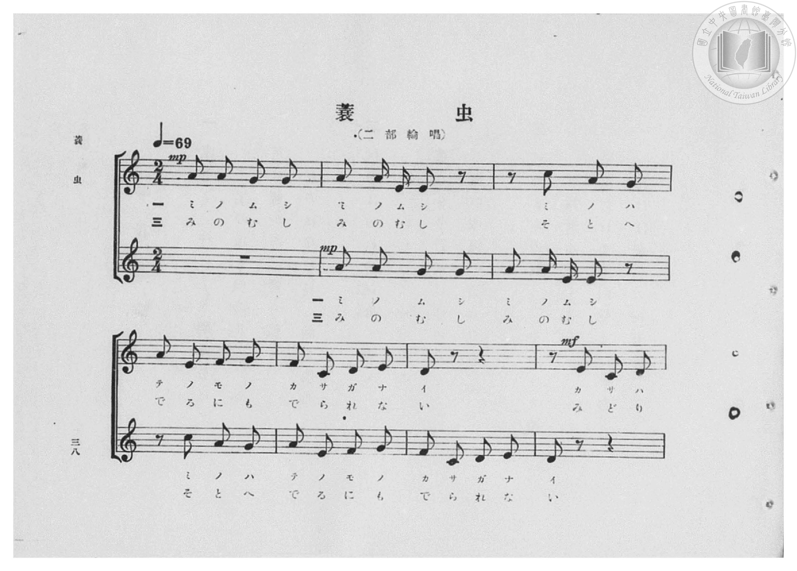
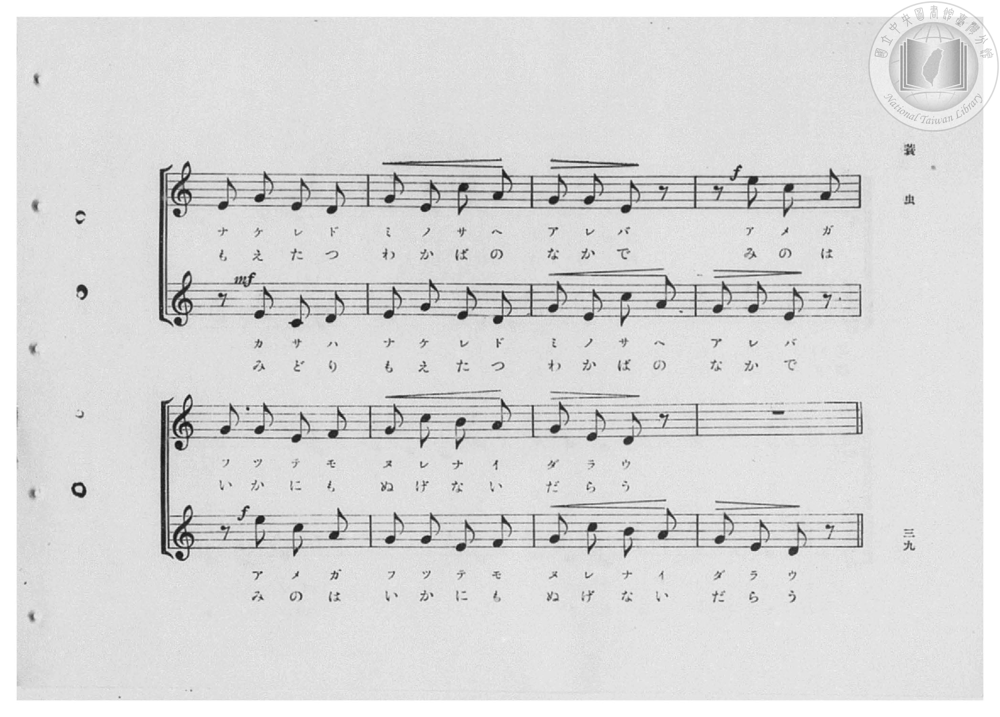
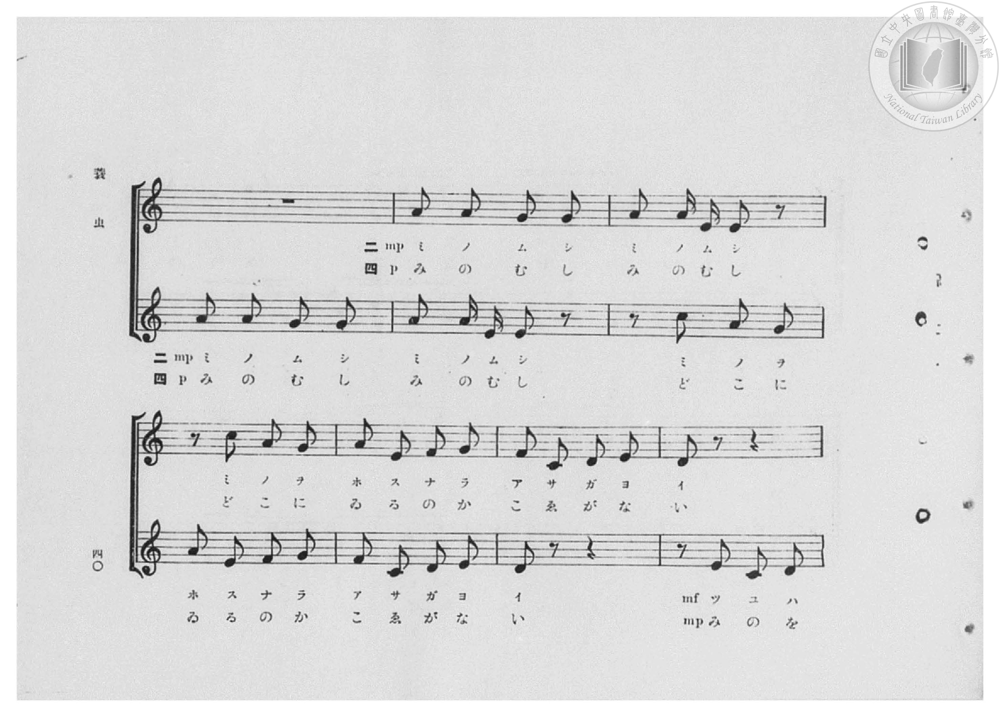
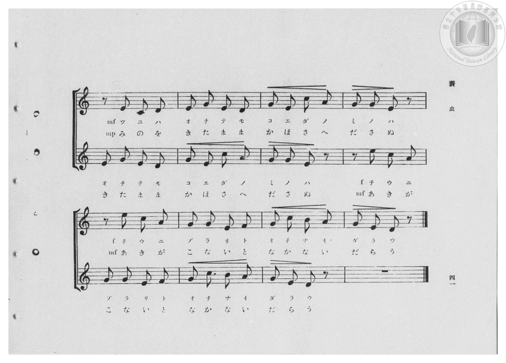
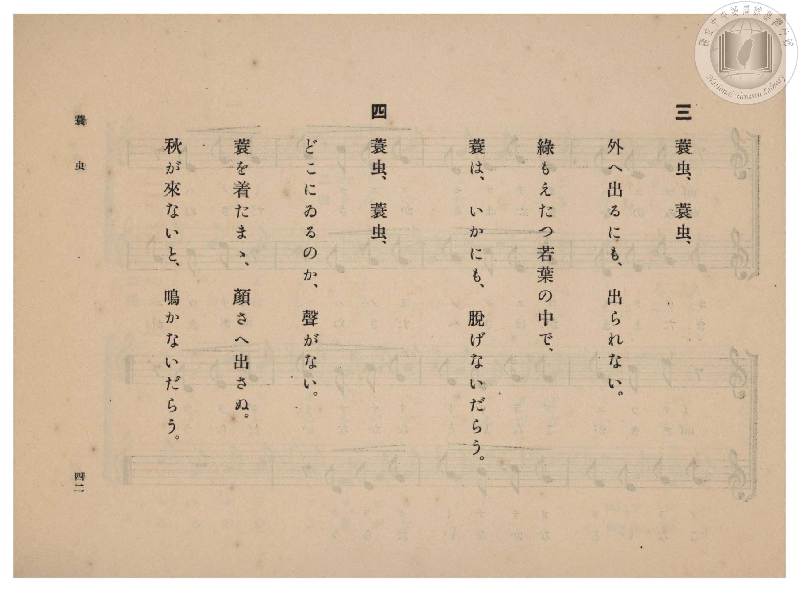
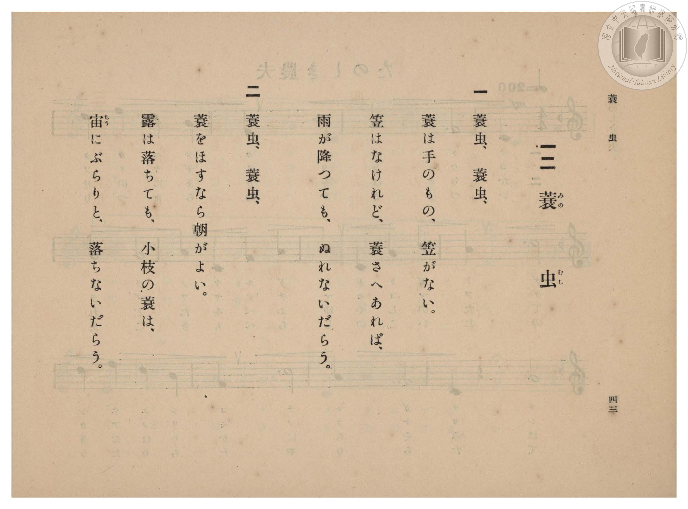

# 蓑虫

> Re:Shōka 使用 AI 協助辨識與重建樂譜，可能會有錯誤。歡迎回報。

- **鋼琴伴奏版**：<br><audio controls src="minomushi.mp3"></audio>

- 臺灣總督府《公學校高等科唱歌》第二學年用（昭和十一年，索書號 0729 74）

## 說明

原書資訊與歌詞全文（對應 P040.jpg–P045.jpg，原書 pp. 38–43，第 12 首）：
調性與拍號：ハ長調（C 大調，無升降記號）2/4 拍，速度 ♩=69（二部輪唱）


## 歌詞

```text
一
蓑（みの）虫（むし）、蓑虫、
蓑は手のもの、笠がない。
笠はなけれど、蓑さへあれば、
雨が降つても、ぬれないだらう。

二
蓑虫、蓑虫、
蓑をほすなら朝がよい。
露は落ちても、小枝の蓑は、
宙（ちう）にぶらりと、落ちないだらう。

三
蓑虫、蓑虫、
外へ出るにも、出られない。
綠もえたつ若葉の中で、
蓑は、いかにも、脫げないだらう。

四
蓑虫、蓑虫、
どこにゐるのか、聲がない。
蓑を着たまゝ、顏さへ出さぬ。
秋が來ないと、鳴かないだらう。
```

## ABC

<div class="abc-score" data-abc-src="minomushi.abc" aria-label="五線譜載入中"></div>

[下載 ABC 原始檔](minomushi.abc)

## TMD 檔案連結

- [主旋律 TMD 檔案](minomushi.tmd) [[在 TMD Studio 編輯](https://tmdlang.github.io/Tmd-TS/#tmd=s7IKdvYPcrWy4qpTUCpJTLdSSM7PyUlNLsnMz7PKzk9PzM7Ojy_OyM9OVIKrKMvPKc1NBcqW5McbIYSL80uLklOtipMz8vNz4ktSK0qS8vOz0eXjCxLTU60CDEwMcMoY4pTBsA0uY4yQKSjKL0vNS8wDuqWgKDOvJDUF7BiEgtSyzJRUkHRxcmJefFlqUWZaZmoKkv9Si4pB3odaUVKUmFecXJRZAAoThKr8opKM_PSixIKMSquMzOKS_KLM5MSc-OzEPKSgKslIBYZUYl5mbmIOumheYklpUSqygZnpmXlWJYmZ5UBn5aelZSZngnRpaSm8mDzxxczVClpaXIq2CmaWXPa2Cs5cNkb6JnYg3S_adz1vXPx8x97ncxc_3TXncUPX09Y1T9fueLZg4cvVM56v7Xy-fOLTKRufre153ND9fM2aJ7t6gLJPd255PmXF-z0dz2asfTqp52lv45MdDUDB93t6nm9Z9Gz2jhcz5ysYmBtZKpibvN_TqcTFpa-lYEstwKWgoPC0bz7Ims3tL1Z0vehoB7rvxcp5T1tXPJvWDnTW0w29z9o7FUApRS-rIP1Rw2Qg0xTEBLoQolWhoEBPwdgCKGViDHL2mjUKhkYKL5dNA7r3_Z5ZIDterNr_rGE5yPTuXqCHgKKPm_tfTt0OFAfa4azwdMlyMLPnecvCp73tL2f2vlgxA6ywExi8CkBdQLmXDfOf7lqm8GjmSlszS6A2YAC-bF7xYs8qYKgCFXKBLAIGHti-yROBCh437n_cuA4oBYw1ELep4XHjdCD3cUMjJCqBDKjqx43rn3V2A1U_bmoCkQ2Nz9cseNzY87hx1ePGlscNTSB1YKH1YKGJj5uAcishJj1unPq4ccfjxiaw4AaoqS9nrwAaAPTK48YljxuXgQxuaHzcuAasCGxq44LHTZ2PG9tAxoMdv6sH6hyI2zAc2TTpcePux40zQfqbOp_NmQtyYRPQnzAXvpyzCejCFxP2Pm5cCLfz6Yb-Z_OAStdB_Ak17-m6meAgAqprA4VJ4-rHjdtA7mnqety4AmQ71BTsTt3RidupT5dMA4bH0_Zdj5uAQboa6goQF2g6WpBuAxoMDHGgQ-YDw-lF99IXE4H2rHuyY-3jxuUo8QMOPaBLEEa-aAG6GRgkWF34dPZs3C4ERV3jZLBBE8COXAcyF6ioERh-qC6EhPvzucC0A3ThvsdNc4HqXi7sh0Q6yFcgxhqYf5YDDet5sq8N5ipQSL7cvAXsbAx3AjVQnoehQEFLn4vLNzMvP7e0OCPTKiAzMS_f0KHGoKYaZI2CjaGZlh2Yha38UHja2gHMRUDvA3OUgoahiQIw0Txf36CgrWAIZT7ZM_HZ2kWaWPQCLQaZW6NQnVtQq2CmoAvGplBcAxUxBkJdBQOwCIg0jENSCFEEUmACEwGb6WNYo_C4eT6Q_7i5D0wuAJFN28F6EDIgcYhoPFgGRKLq64fqaEMSWwRnQ20zopZtm6A6ZoP17wSLdYHJlQjbjIEqGveDRBvXgdU1gNnTIXrhMiBxiCiSbY1zweQKMLkDqmM52JRusNhqMLsJYZsJJbaBXA3MMHCTgTqaJiDZBjaxEcSuAWc-oAJQRBoCsREQgyK2BswCxTwIgyAkHVTnptWCFcAU14B5oDQAosEiiLTQBPHXVjC5Bh6uIJklUDeDMMR4sNuRdcBTATgumjaCxSCmdCLsAaWCJnDaQLEHFNZ47GluAZPLkO1pWgXmNYJJSMoDmYsc_5A4A9kOLBrBoQjSA5IBmYfFHmhMgWOkCeZ3UDwDC1EwCU6HjSBXIsc8OO6aJoLlSLEHklYmQdX2ItmwD07C4xwWafC8DRGCCSMyfzUozkGKcKgEJR4cJQA0JmdAfQ7Jw5AYAqVIpFQLlVsIZoNUgEyaChaDxBVGjIBjfjNYPThnNYPzCKSEwFKeIOd-cBw3QWIfnA-A9DQwDxxTzZCUAIohpNhvApkCyTfAdgM8vEEhDVYPlQGlEeTciBQzjeuh6sE-gqrHnvchcrvBJDgU4OUGuJSDioHCCdkuSMqCxDso3cDTEtSFEHvBeQM5FYDj1RyIEXELy82IVIAMkWMbnD6hcQrJqeDUDI8PSNoHhTXCpVjMAscmcg6kwCxwXgW7qBGUF5B9Dw9BSC5uBKUqvGaBYwM5fskzqxajujciurp_sX8vUnUPqdrhNT2o0oc1ACCta7y1PkZMUtIOgJqJ0RqgoDqBGolRqVBUWiEldZQyi6jED4o6XTsFeOxF-xjGKqAKGKELGKMLmIAFlLkA)]
- [鋼琴伴奏 TMD 檔案](minomushi_piano.tmd) [[在 TMD Studio 編輯](https://tmdlang.github.io/Tmd-TS/#tmd=s7IKdvYPcrWy4qpTUCpJTLdSSM7PyUlNLsnMz7PKzk9PzM7Ojy_OyM9OVIKrKMvPKc1NBcqW5McbIYSL80uLklOtipMz8vNz4ktSK0qS8vOz0eXjCxLTU60CDEwMcMoY4pTBsA0uY4yQKSjKL0vNS8wDuqWgKDOvJDUF7BiEgtSyzJRUkHRxcmJefFlqUWZaZmoKkv9Si4pB3i_ITMzLj08sKkrMS0_NTc1DMgJJ0CoxMz4xOTk_tyAxLxNVVX5RSUZ-elFiQUalVUZmcUl-UWZyYk58dmIeUmiWZACNsQLpTcxBF81LLCktSkU2MDM9M8-qJDGzHOjy_LS0zORMkC4tLYUXkye-mLn6_Z6Ol917nk_Y8mTPlqdL-593drzf06mgpcWlaKtgZsllb6vgzGVjpG9iBzLyRfuu542Ln-_Y-3zu4qe75jxu6Hrauubp2h3PFix8uXrG87Wdz5dPfDpl47O1PY8bup-vWfNkVw9Q9unOLc-nrABa9GzG2qeTep72Nj7Z0QAUfL-n5_mWRc9m73gxc76CgbmRpYK5CdByJS4uz7ySonyrAFBoBnk41BjUVHMpAIGNoZmWHZhVo1CdW1CrYKagC8amUFwDFTEGQl0FA5AIVy2KcT64jAOZFg_UANJoCmMAzYMxwQy4ib6Zefm5pcUZmRBTDSlzI5g0jENSCFEEUmACEwGb6WNYo_C4eT6Q_7i5D0wuAJFN28F6EDIgcYgoyNk1YBJVXz9URxuS2CI4G2qbEbVs2wTVMRusfydYrAtMrkTYZgxU0bgfJNq4DqyuAcyeDtELlwGJQ0SRbGucCyZXgMkdUB3LwaZ0g8VWg9lNCNtMKLEN5OrHjZPhJgN1NE1Asg1sYiOIXcMFTQygiDQEYiMghqQtEAsU8yAMgpB0UJ2bVgtWAFNcA0mTUG1gEURaaIL4ayuYXAMPV5DMEqibQRhiPNjtyDrgqQAcF00bwWIQUzoR9oBSQRM4baDYAwprPPY0t4DJZcj2NK0C8xrBJCTlgcxFjn9InIFsf9zUAw5FkB6QDMg8LPZAYwocI00wv4Pi-XFjB5gEp8NGkCuRYx4cd00TwXKk2ANJK5OganuRbNgHJ-FxDos0eN6GCMGEEZm_GhTnIEU4VIISD44SABqTM6A-h-RhSAyBUiRSqoXKLQSzQSpAJk0Fi0HiCiNGwDG_GawenLOawXkEUkJgKU-Qcz84jpsgsQ_OB0B6GpgHjqlmSEoAxRBS7DeBTIHkm8eNG-DhDQppsHqoDCiNIOdGpJhpXA9VD_YRVD32vA-R2w0mwaEALzfApRxUDBROyHZBUhYk3kHpBp6WoC6E2AvOG8ipAByv5kCMiFtYbkakAmSIHNvg9AmNU0hOBadmeHxA0j4orBEuxWIWODaRcyAFZoHzKthFjaC8gOx7eAhCcnEjKFXhNQscG8jxS55ZmNWyEfZqGSOoKamooWZiVNcUlPdQIzFKfYqKE6S0iFKoEJU6sYQt2Q0pnI0rNDETEAMUJjCnwwXAJkBCBC4GFoc4HiYLZkDCBCYL1w0zE1MCLoTkJmRVqAYiFGExEOw4hBDYfLAGiBjcTngQ69opgJuqCkAGPLijfQxj0QSM0AWM0QVMwALKXAA)]

## 分析

```text
================================================================================
📊 TMD Song Profile: [ 蓑虫 ]
================================================================================
⏱  Duration:       1:44 (104.3s), 60 measures total
🎼 Key & Tempo:    首調基準 C, != 69.0 BPM, <2/4>
   - 分析範圍：      由實際發聲的音符與和弦推測調性；播放脈絡另行呈現
🎤 人聲音域:    C4 (MIDI 60) – E5 (MIDI 76) [跨度: 16 個半音 / 1.3 個八度, 難度: moderate]
   - 最低音:  C4 in [Minomushi[L1] #1 @ m.5, 0:07]
   - 最高音: E5 in [Minomushi[L1] #1 @ m.11, 0:17]
   - 適合: soprano, mezzo-soprano, contralto, tenor, baritone, bass
🏛  結構:      Minomushi[L1] (26.1s) -> Minomushi[L2] (26.1s) -> Minomushi[L3] (26.1s) -> Minomushi[L4] (26.1s)
⚡ 編曲密度:        Peak 2 軌道同時演奏
🗝  調性診斷：       E 調性不明確（流行色彩大調，未偵測到可信轉調）
   - 風格氣質:    流行大調（略帶和弦色彩音與裝飾副屬和弦）
   - 轉調歷程:    全曲維持單一推測調性（未偵測到可信轉調）
   - 核心骨幹音:  G, E, A, C, D
   - 調性數值:    E 調性不明確 [相關度: 0.76, 穩定度: Ambiguous, 自然音純度: 93.6%]
   - 候選調性 (K-S): E 小調 (0.76), C 大調 (0.76), G 大調 (0.68)
   - 五度圈歷程:   +4 -> +4 -> +4 -> +4
   - 各段落調性細節:
     • [Minomushi[L1] #1]: E 調性不明確 (r: 0.76, 自然音純度: 93.6%, 調外音: F)
     • [Minomushi[L2] #1]: E 調性不明確 (r: 0.76, 自然音純度: 93.6%, 調外音: F)
     • [Minomushi[L3] #1]: E 調性不明確 (r: 0.76, 自然音純度: 93.6%, 調外音: F)
     • [Minomushi[L4] #1]: E 調性不明確 (r: 0.76, 自然音純度: 93.6%, 調外音: F)

  [ 五度圈游移軌跡 ]
               C  
         F            G  
      Bb               D  
      Eb               A  
         Ab          [E ]*
            Db       B  
               F# 
     (* = active key center)

  [ 十二半音累積音高分佈 ]
     C  : ████████████              12.8%
     C# :                            0.0%
     D  : ██████████                10.6%
     D# :                            0.0%
     E  : ███████████████████████   24.5%
     F  : ██████                     6.4%
     F# :                            0.0%
     G  : ████████████████████████  25.5%
     G# :                            0.0%
     A  : █████████████████         18.1%
     A# :                            0.0%
     B  : ██                         2.1%
--------------------------------------------------------------------------------
Assignment 軌道音域：
  - Piano1        : C4 – E5 (16 個半音 / 1.3 個八度, 192 個音符)
  - Piano2        : C4 – E5 (16 個半音 / 1.3 個八度, 192 個音符)
================================================================================
```


## 原書掃描頁














