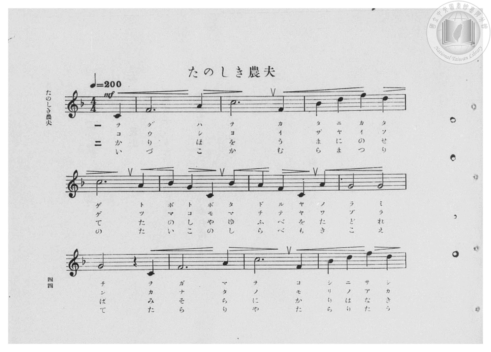
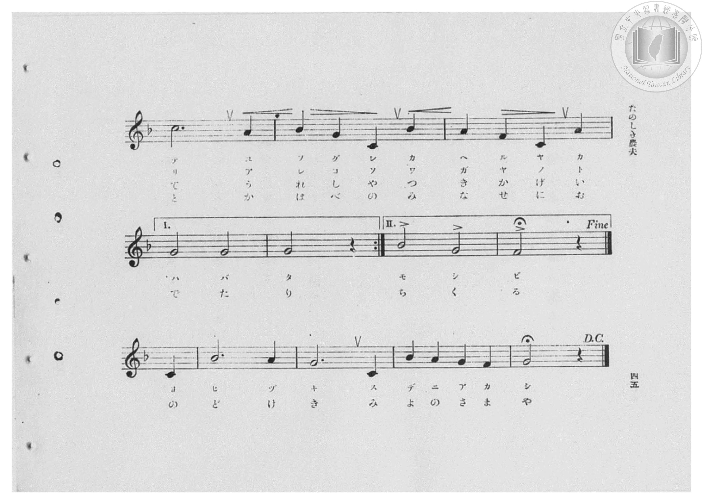
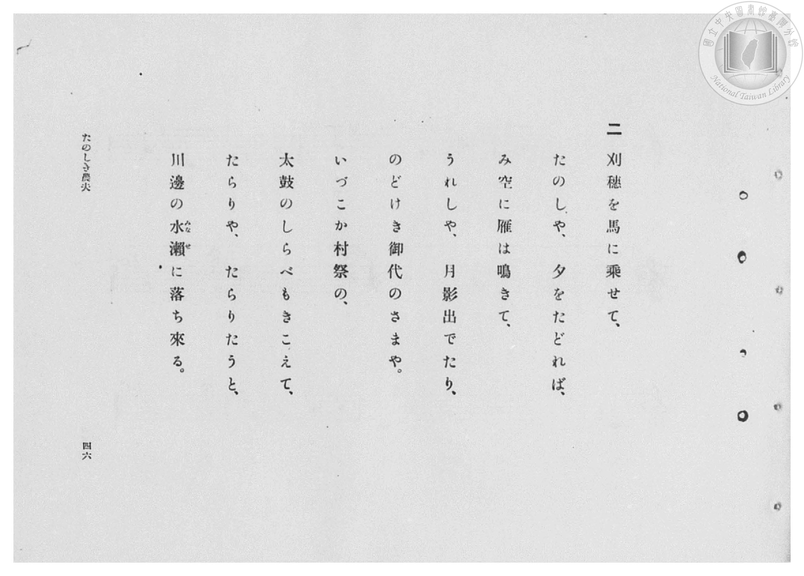
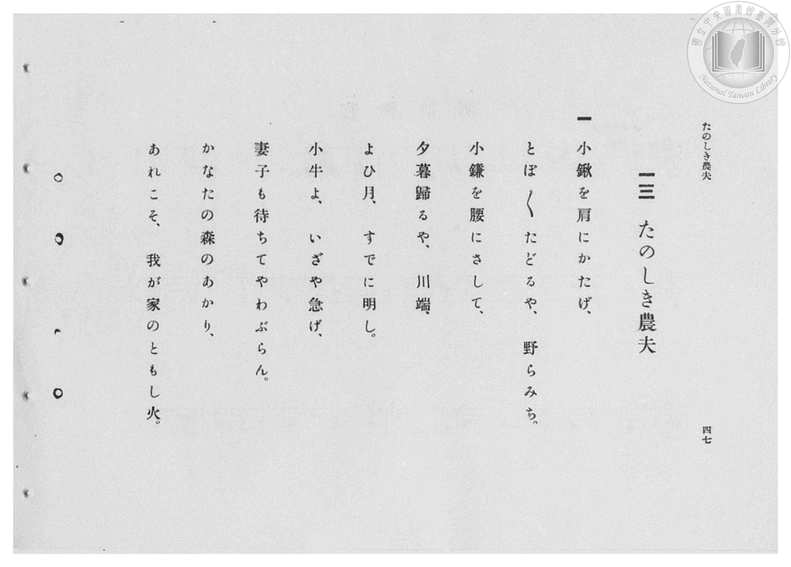

# たのしき農夫

> Re:Shōka 使用 AI 協助辨識與重建樂譜，可能會有錯誤。歡迎回報。

- **鋼琴伴奏版**：<br><audio controls src="tanoshiki_nofu.mp3"></audio>

- 臺灣總督府《公學校高等科唱歌》第二學年用（昭和十一年，索書號 0729 74）

## 說明

原書資訊與歌詞全文（對應 P046.jpg–P049.jpg，原書 pp. 44–47，第 13 首）：
調性與拍號：ヘ長調（F 大調，1 降記號）4/4 拍（弱起 1 拍），速度 ♩=200
原曲：舒曼（Robert Schumann）《少年鋼琴曲集》（Album für die Jugend, Op. 68, No. 10）〈快樂的農夫〉（Fröhlicher Landmann）


## 歌詞

```text
一
小鍬を肩にかたげ、
とぼ〳〵たどるや、野らみち。
小鎌を腰にさして、
夕暮歸るや、川端。
よひ月、すでに明し。
小牛よ、いざや急げ、
妻子も待ちてやわぶらん。
かなたの森のあかり、
あれこそ、我が家のともし火。

二
刈穗を馬に乗せて、
たのしや、夕をたどれば、
み空に雁は鳴きて、
うれしや、月影出でたり。
のどけき御代のさまや。
いづこか村祭の、
太鼓のしらべもきこえて、
たらりや、たらりたうと、
川邊の水瀨（みなせ）に落ち來る。
```

## ABC

<div class="abc-score" data-abc-src="tanoshiki_nofu.abc" aria-label="五線譜載入中"></div>

[下載 ABC 原始檔](tanoshiki_nofu.abc)

## TMD 檔案連結

- [主旋律 TMD 檔案](tanoshiki_nofu.tmd) [[在 TMD Studio 編輯](https://tmdlang.github.io/Tmd-TS/#tmd=s7IKdvYPcrWy4qpTUCpJTLdSSM7PyUlNLsnMz7PKzk9PzM7Ojy_OyM9OVIKrKMvPKc1NBcqW5McbIYSL80uLklOtipMz8vNz4ktSK0qS8vOz0eXjCxLTU60CDEzMcMqY45SxQMgUFOWXpeYl5gFtLCjKzCtJTQFbiVCQWpaZkgqSLk5OzIsvSy3KTMtMTUHyRWpRMciTUCtKihLzipOLMgtAPkeoyi8qychPL0osyKi0ysgsLskvykxOzInPTsxDCpCSjFRgeCSmA-VKc0pKi1LRpVISM3Mq43My05BkgCalZ-ZZlacWl6QW5cXnpubkp1QqcWlpKTxunP-4cd3jxumPG3tf7Nv0dMlqBS0tLkVbBSMDAy57WwU3LhsTfRM7kEkv2nc9b1z8fMfe53MXP90153FD19PWNU_X7ni2YOHL1TOer-18vnzi0ykbn63tedzQ_XzNmie7eoCyT3dueT5lxfs9Hc9mrH06qedpb-OTHQ1Awfd7ep5vWfRs9o4XM-crGJgbWSqYm7zf06nExaWvpWBLLcCloKDwtG8-yJrN7S9WdL3oaAe678XKeU9bVzyb1g501tMNvc_aOxVAiUQvqyD9UcNkINMSxAS6EKJVoaBAT8HEBChlYg5y9po1CobGCi-XTQO69_2eWSA7Xqza_6xhOcj07l6gh4Cij5tnvJy6HSgOtMNN4emS5WBmj6HCy5m9L1bMACvqBAatAlAHyBl7Nr7Yul3BEMIFGtvzsmH-013LFB7NXGkLiguYRzYBzX7RMenZ7D1AXUH5SalFJQrByRmluYl5eUCNoFjZMBEYvi-79zyfsAWo_uXsNmB8ABU75iSV5iqkHd5TpJCSmargVZqempeio-AP9JyZhY6CX76egqEB2IiOp_tXP1vR9HxWCyRJPG4AOqjDrejwtoyczOSM1CIFn8S8FKiNXCCnAeMU7MIN_S971zxumvSiaeXjxtWPG7vB6WvS44ZGkPTjxhWPG_c8btj8uGErWGLl46bux00tQOmX7X2PmzofN-5_3LjwcUMTzLC-HpBhrRvAhk0FJ9NlUMOeLpn6bNa6Z2t3wM14un3u89XrobofN3U8btz0bE4HUOJx48zHjcuBZjyb0QcyA27-887ZIHUgFS2PG6cBjXnWsBTh3qfLdj9dO-FxU9PTfa0gdwHtBlrU1P-4cRvIsU2TYXaB_LkKkpWeLQbmJiBqAgk2dcF93vS4qedx4-THjXOBQs86Jj5u7Hm6bhtY6QqgDUBnPQf6EWgeODh39YDt7-h4vnI6MAReLlsDdP2TnUDvz0aEACLvQry_ZCpQKSxcgZZtgKvb_3zlLqABL2cDPbr-5eYtwMyObEwbWDnUGGCQPd278Wk7UAMwyOaD_QD1JdAuYLQCnd77dN_CJ7sXg0WAsbIPrBOqCBiQwCAEerT72dyJz5euBSmCxdiql3uAEhAnAyN7J9jjQKcABYGxhewvUPB2QRyE4IK81gYKL6h52-e-BImue7Zhy_MGUBkDTj_AiJgNSsaNq19M2AuMtif7gP7rhrqP8iIFChS09Lm4QhLz8oszMrMz_fLTSq0CMoFchxqDmmqQTQo2Flp2YAa2Ak3BUeHZuq2gUnJHw8vGXgUNaAGgrWBoBk6Z6xt00AolcxBTwRNYQqwBlh6aWMwEOglkX42CgYIuHFfnptUqmMYDWTXA4kUXDo3BIqZIIiDZGgUTIGkG4sVBGTVgQ30MaxRAhsDw4-ZNYOWPmzYgGfG4uR8iCpaFizathqrdD1bTDReDiEBtMEKzoRGkDqSrC9msxt1Q0Ukoom0Q0cZ9YB7Y7MZ1YHI22AZoyCD7FxICIP8aATE4iECcGrAEKDDAQhBVIBUgCKMRIqAwhgQvPJweN6H4vrkDGiZz4DwoG-J7IK8TLAZ2dfMSMNkHlVkJN2U-3OrHzY1QNlJMwMMQmJFQQgakDyQKCY3pYHtbwCQszLaCZXaCxUChitADt72pB2F7IyzGIbEEiUFo-JKXwjCjBSks1yD7pnkeNARQ09dmiGjTdrAaSPoC-wosAlIP8ivCFFAIIYfYXBTTQLEBEgXFByIckVMjsBgFk6vAZC9UPWq4g0MXFi60SGXNU8GuBcXG42ZQKMHzWfMMsBhSeoLLgPInJAwmwC2BpENEelqBGjrguEdJOY0gM0E-BvkcEjLAWhNMguRBMsvh4YCUbuE5GZJyQCkSGkJYy0gnUBmpoGGCXCBCSkFwwdn5YmEP3mIQM7PDghMEoWUiKDJAkiApSPpEDnOk0hMp4FGKnuZWqOfWIos2gbITSG07WA0kSS4Ck7DCEJQ04YEBScJISRKW9SCBOBEpwBGi0OKjCVykQDM4OFGAi0GQDCg6EAEOjhw8AQ6ulBRc9Jz1FF60b1Zwy8xLVdAgVCERVSPRoFxAyW3wfA5KuwhRaDpt2gaOBEhOgJB7oTKoJTUkgBCRsBQluCdD9IDTO8KOBqhJ4DIcWv9A7ACldljJizAFXLbStFwAlZGPmyGJDZSsIGyEDKj2gJSIkDAByYDKM0gYTINbAqx9HjeDDECkUnDaRQogSHEAChjkCgYRHJBKpQnMBqVdkB6QakhQgNIt1Cp44QlJqSiBRP3E04zSpIBXw6BKF5EYYIEGLuTBcmg5GCyDMAWsHqnYBIUAQhaaGOA5EikxwEILWrWAxBANGpQEDamESEs8IAnUxAMLT1gTETlgIPUIONWA8wgkZcDqYeTWCaJdA_I4xJOwIg0kCotmWHsOOdlAak9w4oAmG2gUQGtUUJsN1oqD5aKF8ECA1WEgV8HyIsKWWi4uXTsFlKZ5tI9hrAKmoBFYUJkLAA)]
- [鋼琴伴奏 TMD 檔案](tanoshiki_nofu_piano.tmd) [[在 TMD Studio 編輯](https://tmdlang.github.io/Tmd-TS/#tmd=s7IKdvYPcrWy4qpTUCpJTLdSSM7PyUlNLsnMz7PKzk9PzM7Ojy_OyM9OVIKrKMvPKc1NBcqW5McbIYSL80uLklOtipMz8vNz4ktSK0qS8vOz0eXjCxLTU60CDEzMcMqY45SxQMgUFOWXpeYl5gFtLCjKzCtJTQFbiVCQWpaZkgqSLk5OzIsvSy3KTMtMTUHyRWpRMciTBZmJefnxiUVFiXnpqbmpeUhGIAlaJWbGJyYn5-cWJOZloqrKLyrJyE8vSizIqLTKyCwuyS_KTE7Mic9OzEMKs5IMoDFWielAudKcktKiVHSplMTMnMr4nMw0JBmgSemZeVblqcUlqUV58bmpOfkplUpcWloKjxvnP25c97hx-uPG3hf7Nj1dsvr9no6X3XueT9jyZM-Wp0v7n3d2vN_TqaClxaVoq2BkYMBlb6vgxmVjom9iBzL-Rfuu542Ln-_Y-3zu4qe75jxu6Hrauubp2h3PFix8uXrG87Wdz5dPfDpl47O1PY8bup-vWfNkVw9Q9unOLc-nrADa9GzG2qeTep72Nj7Z0QAUfL-n5_mWRc9m73gxc76CgbmRpYK5CdB2JS4uz7ySonyrAFAQB3k41BjUVHMpAIGNhZYdmFGjUJ2bVqtgoqCrYATEpvFAAsSpUTAGkoZQbAAS4apFMc4Hh3EFtQpG8SBjTKEkyGgQUaMQbRivbRqvbRgL5MEg3OgQoJnFGZnZmX75aaV4XQzSAsNg14PtqAG7FAZBrq9RMEUSAcnWgP1mBuLFQRk1YEN9DGsUQIbA8OPmTWDlj5s2IBnxuLkfIgqWhYs2rYaq3Q9W0w0Xg4hAbTBCs6ERpA6kqwvZrMbdUNFJKKJtENHGfWAe2OzGdWByNtgGaMgg-xcSAngiFiwEUQVSAYIwGiECCmNI8MLD6XETiu-bO6BhMgfOg7IhvgfyOsFiYFc3LwGTfVCZlXBT5sOtftzcCGUjxQQ8DB83LkMJGZA-kCgkNKaD7W0Bk7Aw2wqW2QkWA4UqQg_c9qYehO2NsBiHxBIkBqHhS14Kw4wWpLBcg-yb5nnQEEBNX5shok3bwWog6QvsK7AISD3IrwhTQCGEHGJzUUwDxQZIFBQfiHBETo2PG9eDyVVgsheqHjXcwaELCxdapLLmqWDXgmLjcTMolOD5rHkGWAwpPcFlQPkTEgYT4JZA0iEiPa1ADR1w3KOknEaQmSAfg3wOCZnHjZCUA5IHySyHhwNSuoXnZEjKAaVIPDkT5ncQhBZgoJADSYKkIIkJOYCQijqkUEIpJ5pboS5ZiyzaBEr7ILXtYDWQ9LMITMJKLlA6grsckt6Q0g8sn0B8PBEpdBCi0LzeBM7_0NwIjkFwmQWSAYUdInTAIUnDfIWSWuH5BBT3CFFoPDdtA4cLJCVByL1QGdSSDuJmRLgsRQmByRA94PSCsKMBahK4DISW3xA7QKkFVnIhTAGXTTTNV6Ay5nEzJP5BMQ1hI2RApS-kRIGECUgGVB5AwmAa3BJg6f24GWQAIuGAkxNSAEGyEyhgkAtoRHBACuUmMBuUnEB6QKohQQFKSlCr4IUPJPGgBBL1E08zSpUMr8ZAlRYiMcACDVxIguXQMhVYBmEKWD1SsQMKAYQsNDHAMwlSYoCFFrRoBokhGgQoCRpSiJOWeEASqIkHFp6wJhZywEDKYXCqAecRSMqA1WPItTuiXQDyOMSTsFIGJAqLZlh7CDnZQGofcOKAJhtoFEBrJFCbB9YKguWihfBAgNUBIFfB8iLCFuwtTRyNWeSWJjgowM1bQ3i7Fh6WwFDDJmgCbgKDpUzgLIhPcejA1XTGqhiiDKwCWS1EGDMKcZhCgsuxqoWaPQAux2EKktshKqCOHzHhMhAuxwh0HH0-hAeAOVHXTgHco1QAMlByZbQPSAOGoBFYUJkLAA)]

## 分析

```text
================================================================================
📊 TMD Song Profile: [ たのしき農夫 ]
================================================================================
⏱  Duration:       1:28 (88.8s), 74 measures total
🎼 Key & Tempo:    首調基準 F, != 200.0 BPM, <4/4>
   - 分析範圍：      由實際發聲的音符與和弦推測調性；播放脈絡另行呈現
🎤 人聲音域:    C4 (MIDI 60) – F5 (MIDI 77) [跨度: 17 個半音 / 1.4 個八度, 難度: challenging]
   - 最低音:  C4 in [TanoshikiNofu[L1] #1 @ m.1, 0:00]
   - 最高音: F5 in [TanoshikiNofu[L1] #1 @ m.4, 0:04]
   - 適合: soprano, mezzo-soprano, contralto, tenor, baritone, bass
🏛  結構:      TanoshikiNofu[L1] (44.4s) -> TanoshikiNofu[L2] (44.4s)
⚡ 編曲密度:        Peak 1 軌道同時演奏
🗝  調性診斷：       F 調性不明確（純淨自然大調，未偵測到可信轉調）
   - 風格氣質:    純淨自然大調（陽光明朗、易唱易記，無明顯調外色彩）
   - 轉調歷程:    全曲維持單一推測調性（未偵測到可信轉調）
   - 核心骨幹音:  C, G, F, A, A#
   - 調性數值:    F 調性不明確 [相關度: 0.83, 穩定度: Ambiguous, 自然音純度: 100.0%]
   - 候選調性 (K-S): F 大調 (0.83), C 大調 (0.81), C 小調 (0.56)
   - 五度圈歷程:   -1 -> -1
   - 各段落調性細節:
     • [TanoshikiNofu[L1] #1]: F 調性不明確 (r: 0.83, 自然音純度: 100.0%)
     • [TanoshikiNofu[L2] #1]: F 調性不明確 (r: 0.83, 自然音純度: 100.0%)

  [ 五度圈游移軌跡 ]
               C  
        [F ]*          G  
      Bb               D  
      Eb               A  
         Ab           E  
            Db       B  
               F# 
     (* = active key center)

  [ 十二半音累積音高分佈 ]
     C  : ████████████████████████  29.5%
     C# :                            0.0%
     D  : █████                      5.8%
     D# :                            0.0%
     E  :                            0.0%
     F  : ████████████████          19.4%
     F# :                            0.0%
     G  : ██████████████████        21.6%
     G# :                            0.0%
     A  : ███████████               12.9%
     A# : █████████                 10.8%
     B  :                            0.0%
--------------------------------------------------------------------------------
Assignment 軌道音域：
  - Piano         : C4 – F5 (17 個半音 / 1.4 個八度, 196 個音符)
================================================================================
```


## 原書掃描頁










