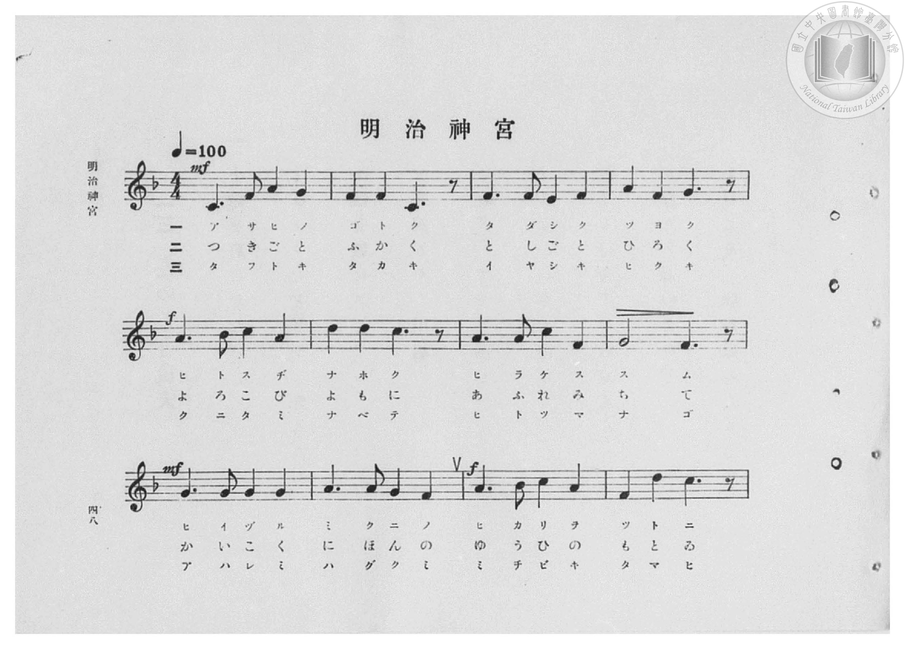
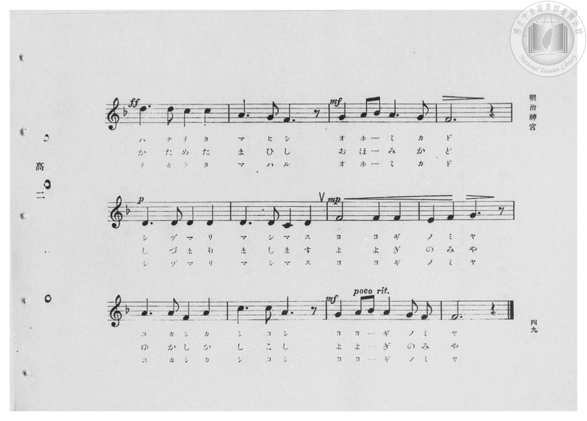
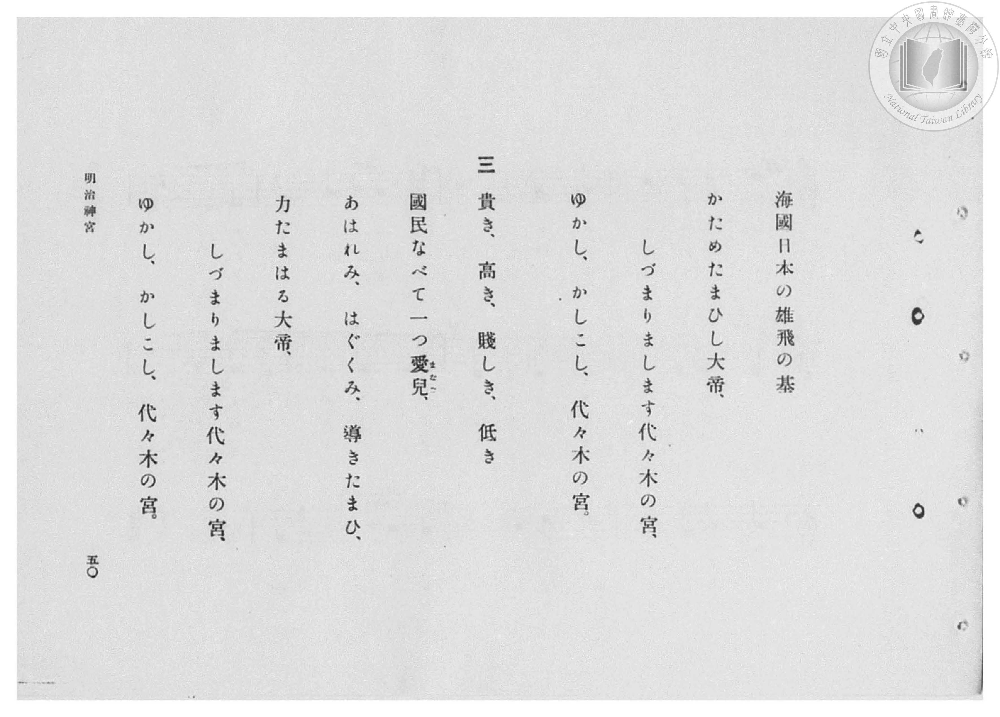
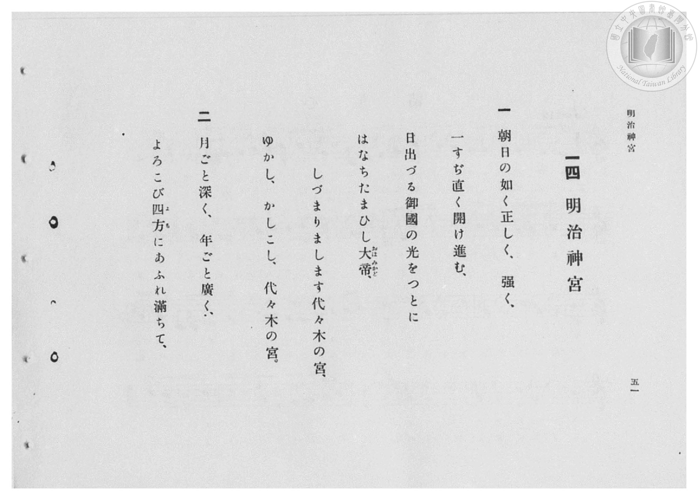

# 明治神宮

> Re:Shōka 使用 AI 協助辨識與重建樂譜，可能會有錯誤。歡迎回報。

- **鋼琴伴奏版**：<br><audio controls src="meiji_jingu.mp3"></audio>
- **NEUTRINO 歌聲合成版**：<br><audio controls src="meiji_jingu_neutrino.mp3"></audio>

- 臺灣總督府《公學校高等科唱歌》第二學年用（昭和十一年，索書號 0729 74）

## 說明

原書資訊與歌詞全文（對應 P050.jpg–P053.jpg，原書 pp. 48–51，第 14 首）：
調性與拍號：ヘ長調（F 大調，1 降記號）4/4 拍，速度 ♩=100


## 歌詞

```text
一
朝日の如く正しく、強く、
一すぢ直く開け進む、
日出づる御國の光をつとに
はなちたまひし大帝（おほみかど）、
しづまりまします代々木の宮、
ゆかし、かしこし、代々木の宮。

二
月ごと深く、年ごと廣く、
よろこび四方（よも）にあふれ滿ちて、
海國日本の雄飛の基
かためたまひし大帝、
しづまりまします代々木の宮、
ゆかし、かしこし、代々木の宮。

三
貴き、高き、賤しき、低き
國民なべて一つ愛兒（まなご）、
あはれみ、はぐくみ、導きたまひ、
力たまはる大帝、
しづまりまします代々木の宮、
ゆかし、かしこし、代々木の宮。
```

## ABC

<div class="abc-score" data-abc-src="meiji_jingu.abc" aria-label="五線譜載入中"></div>

[下載 ABC 原始檔](meiji_jingu.abc)

## TMD 檔案連結

- [主旋律 TMD 檔案](meiji_jingu.tmd) [[在 TMD Studio 編輯](https://tmdlang.github.io/Tmd-TS/#tmd=s7IKdvYPcrWy4qpTUCpJTLdSSM7PyUlNLsnMz7PKzk9PzM7Ojy_OyM9OVIKrKMvPKc1NBcqW5McbIYSL80uLklOtipMz8vNz4ktSK0qS8vOz0eXjCxLTU60CDEwNcMoY4pRBsq2gKL8sNS8xD2hjQVFmXklqCthKhILUssyUVJB0cXJiXnxZalFmWmZqCpIvUouKQZ6EWlFSlJhXnFyUWQDyOUJVflFJRn56UWJBRqVVRmZxSX5RZnJiTnx2Yh5SgJRkpALDIzO3AGhJYg66eEFOYnIqsomZ6Zl5VqV5IOeVQB2lpaXwbEbfs027ny-d93TdOgUtLS5FWwVDAwMue1sFNy4bE30TO5AJL9p3PW9c_HzH3udzFz_dNedxQ9fT1jVP1-54tmDhy9Uznq_tfL584tMpG5-t7Xnc0P18zZonu3qAsk93bnk-ZcX7PR3PZqx9OqnnaW_jkx0NQMH3e3qeb1n0bPaOFzPnKxiYG1kqmJu839OpxMWlr6VgSy3ApaCg8LRvPsiaze0vVnS96GgHuu_FynlPW1c8m9YOdNbTDb3P2jsVQIlCL6sg_VHDZCDTGMQEuhCiVaGgQE_BxAIoZWoIcvaaNQqGJgovl00Duvf9nlkgO16s2v-sYTnI9O5eoIeAoo-bZ7ycuh0oDrTDTeHpkuVgZo-hwsuZvS9WzAAr6gQGrQJQB1D8ZcP8p7uWKTyaudIWFPIgM4HhBKKezZn7bPrSx43rni5retzY_2zt4seN04GMxw2NT_dshzCgyh83znzcuOj57C1A0ZfTuh83TnzZsOlxUwNUBdCYp-27HjcufdzU_XTfwqdzgCrWPW3tfNw06XHjkseNKx43rgape9y4_nHjqseNCx83zn_cuO9x4yagjUAfPN0xF-iZx41djxt3P27c_7gRqH8l0BdQ48HOAjp03-MmoAqgNiAXSM58snvx44bWZ3OAxq8Dpi-Y6qY2sAHTgXwoo3EyhIuhoQkSHrt6IOEBdMIUoGufbd8IDYadQA-DRJ4CNcLD43FTx-OmXrChm5_Onv1s2k6Q40GCTSA3N65-3AgMz62Pm3qe7Qb6BejZZbBw2rodGDbA0Ho2Zw3QCS9nt7xcPBvklvm7IP4Eunb-4yags9GDh14hsaMTnOg2Af3dC1QGzH4QxovNwGgEagexn-ztAzLAGQDomQ0TwVG6E-hLcEJZ8qxl9tPWSeD4BDoNKDUFOSaBIbMeGDKgWAY5CpgeJoBCFsx9ugFkMMLzED1Pu4BBBBEC6uymW3gANVBeTECBgpY-F5dvamZWpldmXnqpVUBmYl6-Q41BTTXIGgUbCy07MANbCaUAKvF2NLxY2KOgYaLwdEP_8_UNOvBiBSGriUUr0FqQsTUK1blptQqm8Qq6QGioYAQmdYHiIBKEoVIGUCGQoBlICKIKph5EgxWBTfUxrAEG6SKw2OOmrQqPmyeBWM19YD2Pm7aAeR1g2fVgVfFg8f0QHc0NQPZ2uCxQprkFLL4CVQfELiOgfOMSiM7GXiCeAmaB1IJktoJ53WCyH2EXWB4kNh1DxyawLb2oOiB2GSO7circD2uh_gLJPG5aDReD-QvquuYlcH9BdUDCBewjJB3gDIc7xnf14ItxsCz-GAdFONguEzBtDHaLGZAEYYgMKLpB4iBZkAgitiFJACO2wT6BxOrjpp1gVhPUj11g3mzUuEPSsRIovhEsC9IHCi8QDZFbgBr-oLhuAoU5JIaAmRQcS5uh-iCxAbIXWNYibGoEiYDEgCmxqQfMAsUUSGYhzKbGZag2gWMa4trHzd2wuG2ej-KnmWCyDYufgKEATbPzkHRA3A1K_cTE845OvDkbJEs4Z-PIs6AcC8_dRCcJzOgGJu3Hza1gj4ICHCQDCiJIVIMCDinbw_WsBrJXgWVAWQ2RvcHRB9aDnr0hYo8bW-BRDsqYIBlINANbB0BzITLrIDJNkGh53NgGy9JwGUgCgRQmE1BtA0c7tOBq7gfiNWAWLNohxcHjpg2wTAuXgfq6uRGIwe5ALRTAyQAWAgSjHth2wIx6Q1IK9TRQ1MdB4j5OwRxIgTAsT0PiHpLLwakElCSMgXEPk4aV9RBoANKKFPfQUAAmaZB_QX6FZiewLyH-hBR0sAIQEtuzgXgPUgpZDdbTiWQTODViiff5QNVgm4AsSLzvg8psAhfhiKwOzpig1ACyCZzNQfxusNxK7DaB4hzsD1jaBKnD9BMoNSAVKiT6iUCRPgVffBNRpBfUQnI4MMPGQ1hgApiH4aLgrA4Vrc4FaoBFMaymhyrGVZ1D4hOU22GpGRQCSCEEVAGVgRXk4AoboguS26A5EFwiQMIMVCli5ndIjAIbcNCYBjbiIDrh8Q6qtsEyjaBCGFEtgNSCy5FGaKkDzvWQlPC4CVTOoOd22vsLf15vXYs3rxMs5mHVNCjeIOU2pLw2hcpgzeSgEgB_JofUh-AMAW2zQAt4WIA1bUbN5JCgAJLgDAEOElCAgIIDJAsJDqzZHF5UA-tZcNRDMj5yQpiMms2hNT2olgVlc3CwAyMaFM0gWUg0Y8_otPdXLReXrp0Cok2vAOQpcwEA)]
- [鋼琴伴奏 TMD 檔案](meiji_jingu_piano.tmd) [[在 TMD Studio 編輯](https://tmdlang.github.io/Tmd-TS/#tmd=s7IKdvYPcrWy4qpTUCpJTLdSSM7PyUlNLsnMz7PKzk9PzM7Ojy_OyM9OVIKrKMvPKc1NBcqW5McbIYSL80uLklOtipMz8vNz4ktSK0qS8vOz0eXjCxLTU60CDEwNcMoY4pRBsq2gKL8sNS8xD2hjQVFmXklqCthKhILUssyUVJB0cXJiXnxZalFmWmZqCpIvUouKQZ4syEzMy49PLCpKzEtPzU3NQzICSdAqMTM-MTk5P7cgMS8TVVV-UUlGfnpRYkFGpVVGZnFJflFmcmJOfHZiHlKYlWQAjbHKzC0AuiMxB128ICcxORXZxMz0zDyrksTMcqDT89PSMpPBmrS0FJ7N6Hu2affzpfOerlv3fk_Hy-49zydsebJny9Ol_c87O97v6VTQ0uJStFUwNDDgsrdVcOOyMdE3sQOZ_KJ91_PGxc937H0-d_HTXXMeN3Q9bV3zdO2OZwsWvlw94_nazufLJz6dsvHZ2p7HDd3P16x5sqsHKPt055bnU1YAbXo2Y-3TST1Pexuf7GgACr7f0_N8y6Jns3e8mDlfwcDcyFLB3ARouxIXl2deSVG-VQAoVIM8HGoMaqq5FIDAxkLLDsyoUajOTatVMFLQVTBWMAFiXSDbEChsCGTBoAEQ13DVopjmg8O0gloF0_h4kDEgAolZoxBtGK9tGq9tGIvNaN_UzKxMr8y89FLCrjUFmacLdCLI2SCHQpwLwlApA7gPDBXMQEIQVTD1IBqsCGyqj2GNwuOmRWCxx01bFR43TwKxmvvAeh43bQHzOsCy68Gq4sHi-yE6mhuA7O1wWaBMcwtYfAWqDohdRkD5xiUQnY29QDwFzAKpBclsBfO6wWQ_wi6wPEhsOoaOTWBbelF1QOwyRnblVLgf1kL9BZJ53LQaLgbzF9R1zUvg_oLqgIQL2EdIOrhgUQOKGbCgCZgGpaUaBTMgCcIQGVC8gMRBsiARRLRA4gojWsBWQoL_cdNOMKsJ6pguMG82aiAj6VgJFN8IlgXpA3kMREPkFqAGFChSmkCBAwnKx42TwcG5GaoPEmwgex83goILFikgEZAYMMk09YBZoCAFySyE2dS4DNUmcJRAXPu4uRsWCc3zUfw0E0y2YfETMBSgiWsekg6Iu0HJFDVCQHkFRy6AZHNofiE67jDjBZhYHje3gl0EChmQDMgvkDgB-RApI8H1rAayV4FlQIkXkWHA4QzWg55hIGKPG1vgcQNK6iAZSHw8btwNNBcisw4i0wQJv8eNbbBMApeBxCQke05AtQ0cP9CioLkfiNeAWbD4gWSwx00bYNkALgP1dXMjEIPdgZrNwPEFCwGUTAOKozhIJMUpmAMpEIblEkgkQfINRkENksZWUCMiCepcYCIBOQzkKGgCBTsH4iBIHoflfUi0zAbiPUhRuRqspxPJJnCywRJB84GqwTYBWZAI2geV2QQuvRCZB5zUQdEGsgmccUD8brDcSuw2gSIH7A9YIgKpw_QTKNqQsimJfkKqyMB5BpgF4iEsMAHMFXBRcOaBilbnAjXA4gJWG0EV46pyIAEPyj-w9AFyKpJXgCqgMrAyDFypQHRB0i80TYPzGMRzoIIbMwdBgv5x41JolDxuAkUAcgSBqhawTCOo_EGUiCC14JzZCM3H4HwEibLHTaCci55_aO8vaCTBqhJQAEOKLEhRZQqVwZptcLVvENkGUmaDkxi0AoSWbTCfNW1GzTYQNwNJcBIDux3kcpC7QbIQd2PNOPBSClgXgOMIkpWQY2wyasaB1kagmgCUccDhA4wRUHyAZCHxgT3r0N5fWBpyeBqKhpAmIpgA5xNIVkIIg1nQ1hxc0AxZLZJGCBORx2AVIKpp0ArPBKEPqyXIapEasQi1WL2BxWkIbRA-6a5Cal4hyaO0rJFEkHwDLpJwuQLNAYgsACv6QKLGCE-BmaDyDM6BmAQRwBV0SAGCGT3YtWCNfVy-wNul0LVTAHdYFIAMRKqM9gGpRhUxwhAxBosocwEA)]

## 分析

```text
================================================================================
📊 TMD Song Profile: [ 明治神宮 ]
================================================================================
⏱  Duration:       0:57 (57.6s), 24 measures total
🎼 Key & Tempo:    首調基準 F, != 100.0 BPM, <4/4>
   - 分析範圍：      由實際發聲的音符與和弦推測調性；播放脈絡另行呈現
🎤 人聲音域:    C4 (MIDI 60) – F5 (MIDI 77) [跨度: 17 個半音 / 1.4 個八度, 難度: challenging]
   - 最低音:  C4 in [MeijiJingu #1 @ m.1, 0:00]
   - 最高音: F5 in [MeijiJingu #1 @ m.13, 0:28]
   - 適合: soprano, mezzo-soprano, contralto, tenor, baritone, bass
🏛  結構:      MeijiJingu (57.6s)
⚡ 編曲密度:        Peak 1 軌道同時演奏
🗝  調性診斷：       F 大調（純淨自然大調，未偵測到可信轉調）
   - 風格氣質:    純淨自然大調（陽光明朗、易唱易記，無明顯調外色彩）
   - 轉調歷程:    全曲維持單一推測調性（未偵測到可信轉調）
   - 核心骨幹音:  F, C, D, A, G
   - 調性數值:    F 大調 [相關度: 0.91, 穩定度: High, 自然音純度: 100.0%]
   - 候選調性 (K-S): F 大調 (0.91), D 小調 (0.73), C 大調 (0.62)
   - 五度圈歷程:   -1
   - 各段落調性細節:
     • [MeijiJingu #1]: F 大調 (r: 0.91, 自然音純度: 100.0%)

  [ 五度圈游移軌跡 ]
               C  
        [F ]*          G  
      Bb               D  
      Eb               A  
         Ab           E  
            Db       B  
               F# 
     (* = active key center)

  [ 十二半音累積音高分佈 ]
     C  : █████████████             17.8%
     C# :                            0.0%
     D  : ███████████               15.6%
     D# :                            0.0%
     E  : ██                         2.2%
     F  : ████████████████████████  33.3%
     F# :                            0.0%
     G  : ██████████                13.9%
     G# :                            0.0%
     A  : ███████████               15.0%
     A# : ██                         2.2%
     B  :                            0.0%
--------------------------------------------------------------------------------
Assignment 軌道音域：
  - Piano         : C4 – F5 (17 個半音 / 1.4 個八度, 83 個音符)
================================================================================
```


## 原書掃描頁










