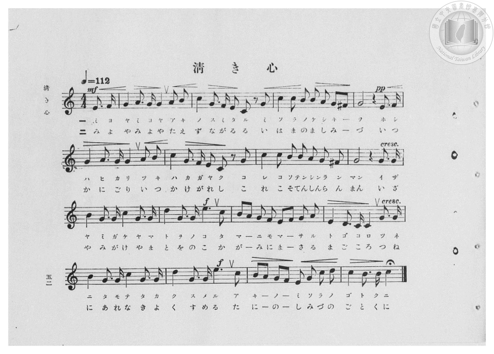
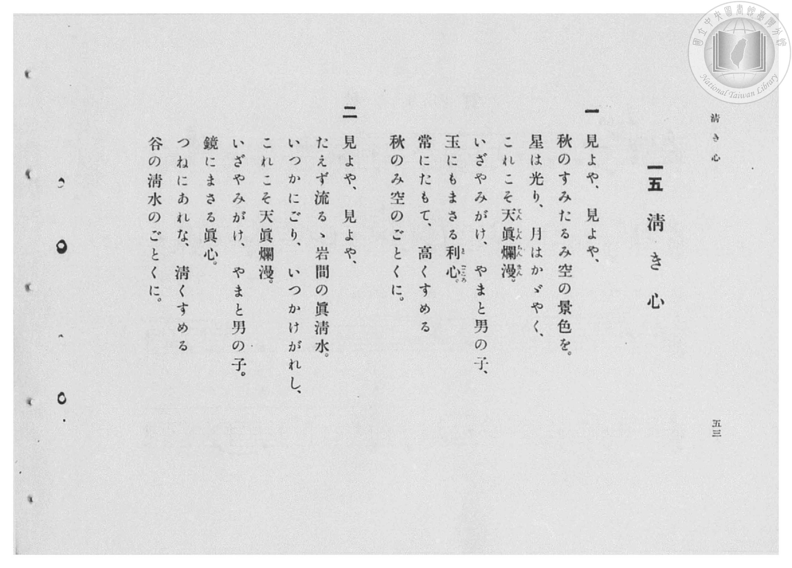

# 清き心

> Re:Shōka 使用 AI 協助辨識與重建樂譜，可能會有錯誤。歡迎回報。

- **鋼琴伴奏版**：<br><audio controls src="kiyoki_kokoro.mp3"></audio>

- 臺灣總督府《公學校高等科唱歌》第二學年用（昭和十一年，索書號 0729 74）

## 說明

原書資訊與歌詞全文（對應 P054.jpg–P055.jpg，原書 pp. 52–53，第 15 首）：
調性與拍號：ハ長調（C 大調，無升降記號）4/4 拍（弱起 1 拍），速度 ♩=112


## 歌詞

```text
一
見よや、見よや、
秋のすみたるみ空の景色を。
星は光り、月はかゞやく、
これこそ天眞爛漫（てんしんらんまん）。
いざやみがけ、やまと男の子、
玉にもまさる利心（とごころ）。
常にたもて、高くすめる
秋のみ空のごとくに。

二
見よや、見よや、
たえず流るゝ岩間の眞清水。
いつかにごり、いつかけがれし、
これこそ天眞爛漫。
いざやみがけ、やまと男の子。
鏡にまさる眞心。
つねにあれな、清くすめる
谷の清水のごとくに。
```

## ABC

<div class="abc-score" data-abc-src="kiyoki_kokoro.abc" aria-label="五線譜載入中"></div>

[下載 ABC 原始檔](kiyoki_kokoro.abc)

## TMD 檔案連結

- [主旋律 TMD 檔案](kiyoki_kokoro.tmd) [[在 TMD Studio 編輯](https://tmdlang.github.io/Tmd-TS/#tmd=s7IKdvYPcrWy4qpTUCpJTLdSSM7PyUlNLsnMz7PKzk9PzM7Ojy_OyM9OVIKrKMvPKc1NBcqW5McbIYSL80uLklOtipMz8vNz4ktSK0qS8vOz0eXjCxLTU60CDExNEDIFRfllqXmJeUDdBUWZeSWpKWDtCAWpZZkpqSDp4uTEvPiy1KLMtMzUFCQXpRYVgxwMtaKkKDGvOLkoswDkC4Sq_KKSjPz0osSCjEqrjMzikvyizOTEnPjsxDwkz5VkpAL9lptflJiDLpiXWFJalIpsXmZ6Zp5VSWJmOdBV-WlpmcmZIF1aWgrPdrQ-bux9ur9ZQUuLS9FWwdDQiMveVsGZy8ZE38QOZMKL9l3PGxc_37H3-dzFT3fNedzQ9bR1zdO1O54tWPhy9YznazufL5_4dMrGZ2t7Hjd0P1-z5smuHqDs051bnk9Z8X5Px7MZa59O6nna2_hkRwNQ8P2enudbFj2bvePFzPkKBuZGlgrmJu_3dCpxcelrKdhSC3ApKCg87ZsPsmZz-4sVXS862oHue7Fy3tPWFc-mtQOd9XRD77P2TgVQ9OplFaQ_apgMZJqCmEAXQrQqFBToKZgaAaVMjUHOXrNGwdBU4eWyaUD3vt8zC2THi1X7nzUsB5ne3Qv0EFD0cXP_y6nbgeJAO5wVni5ZDmb2PG9Z-LS3_eXM3hcrZoAVdgKDVwGoC-SUPRtfbN2uYAjhAo3uedkw_-muZQqPZq60BcUHyCZg6IEtXNb9uKnjcVPL44ZGZDZI7vny7seN6x43znzcuP9x4_zHTUDu_ucrdwEFn81c_6Jz0-OmSY8bmkBKn82Y_7hx_dPWzsdNXUDdz-Z0ALmPG4HmzQOZ19gPNfJx4-THTT0gsnHu0yUrn8-Z97xj9rM9q4Gufty47HETUHw6iGwCGgRk7wOSQB9ALXncCDRpGtg8oHuApkwEmgrm7nvcuOL5lO1Ahz1dOwHm-r7Ox42rHzc1gaWnAl3_tGMlMF2CrVrxuHEK2C2gAIIa_3THDpAGkEeBepYBjQEmR5DTgQHQBLSnGzlMoOEANgZoGFDRapAx4JDd1UMoZEGWNAKdMevZVpDBj5vmPt208uU0oI_XAYMEmIWebdiC7OkloKAEuW0KJHyRBCeCQgIUpNMJBDGpgQhW_bJ_IdheaAgCDQOGINwkoAvWgqWbwDauAsU8KPujBtmLDSAzoZ7CDDKgCsrzJxQoaOlzcXlnVuZnZ3rnZ-cX5VsFZCbm5TvUGNRUgyxSsDE007IDs7CVDgqg0mZHw4uFPQoa0EykrWCi8HRD__P1DTrwvI1QponFDKATQObXKBgo6IIhOl2dm1arYApmmgKVQVi6CmZQEWS-ORDXKBjGQYUgUiYKxkDSEGoiSKwGbKOPYY1CPFQlOv24eT6UXgE08HHzEiziSKJNi8DkWrD1j5v74OI74boeN-0Hs1ZDbYGYBHWJER6XNIL0gczqAJnd1IJFHFkUZCowr0Bc0jgLLr4KSvcAVXeD9YFIsEsaQbprwHkRFnpgAhSaIAwKWVCwmahDTUNEAgzC46qgACmu4MH8uGkv2MsrwSQoeB43bQST28EkKOAeN--BBtYmoAUw78MgImJmQ729HSnwgIUn2CP7wOQ6JPZ0eFDBzW9cis98cGCA6CWwIMGZ8nf1gFM-jgQPlsWb4KmRkimLLiwx1dwPC4nmSRC6aTWQDUk-IFFQ-CCSOlw1UBWEXgPNGI-bQHECTmBNm6Gq18B5sBTR9rgZwt0OZUDTCIgNcfvj5nkILkZ0NUHy4OOmbSjJAZS2IdEIdVbjFKCaLrgo2BPAKIbkEoTqiVAalEt6wCxQAoLkkskQ1VBxEA9YY4BJUEUMUQxlNHWCSRAb6glw1YzLE_A0N41gmtvRiS_NgWXxpjlQAkGOebQUBipgjdCFqoHlrzFMEATBmiBmwRMbEIMSJ4gG8UHiNWAREDSCaAMnXVzpDqOIBaUkcCkBEYVGdPM8cJoAFXAQ_iYo3QdNWTAIKXDB6QcsD8r9j5vBRV8zuLhGFm_aCmaDEguK6U1boPRmoOhauJ3Q-GruRU50mEUzKBlBkxTIDFgs7wMniBVwcWg-A5ZbkGQF9wE4YYLUgpMcxKWQsgycrKFlHFR8KtgsmA6QDMSMKVB6MlC2Fy4KDc3GtYRS3NPZs_GkOIjsgKY4EBssDTYFqcyEWGyOEICVesipDp71wakFkjaApRK6KLB0A8UwqESD8GEV-0JoqkGkOlDaAqkFpRZYqgPXeFA2uILGqA9BOiBpDSQCSX8g-xAuhJUWyMUczGZgixKqA5Ti4GV1IyS-oU2HRnhZ3TgTKt4ITTGIFAdulMDSFzRlgetTKBupPgXWozBZkA5IOgOJQFI2yD6ECxGur-Xi0rVTQG50RvsYxipgiBmBxZS5AA)]
- [鋼琴伴奏 TMD 檔案](kiyoki_kokoro_piano.tmd) [[在 TMD Studio 編輯](https://tmdlang.github.io/Tmd-TS/#tmd=s7IKdvYPcrWy4qpTUCpJTLdSSM7PyUlNLsnMz7PKzk9PzM7Ojy_OyM9OVIKrKMvPKc1NBcqW5McbIYSL80uLklOtipMz8vNz4ktSK0qS8vOz0eXjCxLTU60CDExNEDIFRfllqXmJeUDdBUWZeSWpKWDtCAWpZZkpqSDp4uTEvPiy1KLMtMzUFCQXpRYVgxxckJmYlx-fWFSUmJeempuah2QEkqBVYmZ8YnJyfm5BYl4mqqr8opKM_PSixIKMSquMzOKS_KLM5MSc-OzEPCT_l2QAjbHKzS9KzEEXzEssKS1KRTYvMz0zz6okMbMc6PD8tLTM5EyQLi0thWc7Wh839j7d3_x-T8fL7j3PJ2x5smfL06X9zzs73u_pVNDS4lK0VTA0NOKyt1Vw5rIx0TexAxn7on3X88bFz3fsfT538dNdcx43dD1tXfN07Y5nCxa-XD3j-drO58snPp2y8dnanscN3c_XrHmyqwco-3TnludTVgBtejZj7dNJPU97G5_saAAKvt_T83zLomezd7yYOV_BwNzIUsHcBGi7EheXZ15JUb5VAChAgzwcagxqqrkUgMDG0EzLDsyqUajOTatVMFfQVTADYlMgNgFiYyjbMA5IGIGIGggbBEGKQSRcwABK13DVoljpg8vKgloF03iQyVDrQLQh1EqY1TUIJXBGtKG2sbZpLDZrvTMr87MzvfOz8wl5GKYNnQYHBMhmkP1A26HCoGABiSDzQSGAFCAQKROw00HeAJkI9gLYRh_DGgWQB0AQnX7cPB9KrwAa-Lh5CRZxJNGmRWByLdj6x819cPGdcF2Pm_aDWauhtkBMgrrECI9LGkH6QGZ1gMxuasEijiwKMvVxYwfEJY2z4OKroHQPUHU3WB-IBLukEaS7hgsaDeDQAxOg0ERJgOpQ0xCRAIPwuCoAJSEwExhX8GB-3LQX7OWVYBIUPI-bNoLJ7WASFHCPm_dAA2sT0AKY92EQETGzod7ejhR4jxvXgz2yD0yuQ2JPhwcV3PzGpfjMBwcGiF6CCBJqJDnKwhVLkDb3w5zcPAlCN60GsiHxDBIFeQSRJuGqgaog9BpoCn7cBAo8cEpo2gxVvQbOg0Vd2-NmCHc7lAGNTBAb4vbHzfMQXIxwbYJklsdN21DiDZQIIeENdVbjFKCaLrgo2BPAuIAkZ4TqiVAalJx7wCxQTEOS82SIaqg4iPe4cS6YXPa4CcKdDmU0dYJJEBvqicZ9CC7uxDENkTggpS4iitCSAqjIAhfUyELVwBLNGCYIgmBNELPQi3sQDeKDxGvAIiAIKnVBKQyUxnAlEIxCCxTl4HwHEYXGSPM8cOSBigwIfxOU7oMmARiEFGHgiAbLg_LT42ZwYdIMLgCRxZu2gtmgWEUxvWkLlN4MFF0LtxMasM29yKkDs7ADxTc07kFmwKJjHzjmVsDFoRkCWBJA4h_uA3AKAqkFpw2ISyGlAzj9QUsNqPhUsFkwHSAZiBlToPRkoGwvXBQamo1r6Zc0yGkJIJIHPDOBoxUSicB8ji4KLC9AUQEqIyB8WJ22EBq9iOQBSgQgtaBohSUPcGEPZYPrJoyqAKQDkihAIpCEArIP4UJY_kMuOGA2P25sguoAJQ146dcIiRhordkIL_0aZ0LFG6FRi0ga4PoYlhCgSQBclUDZSFUJsAqByYJ0QBIESASSBEH2IVyIcD3W5hCuxhiu5hA8KsHNNVjrzARkC4gDE4C3zYDJAioETzJQGjVR1CiYgbSAFcHbgDBTjUAMsDxS8w_WQgQLYKYyhMUUOY76ziKliUuGErjrsLWUcYU9jd1EZuNd104B3G1QADKQU260jyFQPbqYEVhMmQsA)]

## 分析

```text
================================================================================
📊 TMD Song Profile: [ 清き心 ]
================================================================================
⏱  Duration:       1:12 (72.9s), 34 measures total
🎼 Key & Tempo:    首調基準 C, != 112.0 BPM, <4/4>
   - 分析範圍：      由實際發聲的音符與和弦推測調性；播放脈絡另行呈現
🎤 人聲音域:    C4 (MIDI 60) – E5 (MIDI 76) [跨度: 16 個半音 / 1.3 個八度, 難度: moderate]
   - 最低音:  C4 in [KiyokiKokoro[L1] #1 @ m.3, 0:05]
   - 最高音: E5 in [KiyokiKokoro[L1] #1 @ m.11, 0:22]
   - 適合: soprano, mezzo-soprano, contralto, tenor, baritone, bass
🏛  結構:      KiyokiKokoro[L1] (36.4s) -> KiyokiKokoro[L2] (36.4s)
⚡ 編曲密度:        Peak 1 軌道同時演奏
🗝  調性診斷：       G 大調（純淨自然大調，未偵測到可信轉調）
   - 風格氣質:    純淨自然大調（陽光明朗、易唱易記，無明顯調外色彩）
   - 轉調歷程:    全曲維持單一推測調性（未偵測到可信轉調）
   - 核心骨幹音:  G, C, B, E, A
   - 調性數值:    G 大調 [相關度: 0.84, 穩定度: Moderate, 自然音純度: 96.7%]
   - 候選調性 (K-S): G 大調 (0.84), C 大調 (0.75), E 小調 (0.67)
   - 五度圈歷程:   +1 -> +1
   - 各段落調性細節:
     • [KiyokiKokoro[L1] #1]: G 大調 (r: 0.84, 自然音純度: 96.7%, 調外音: F)
     • [KiyokiKokoro[L2] #1]: G 大調 (r: 0.84, 自然音純度: 96.7%, 調外音: F)

  [ 五度圈游移軌跡 ]
               C  
         F           [G ]*
      Bb               D  
      Eb               A  
         Ab           E  
            Db       B  
               F# 
     (* = active key center)

  [ 十二半音累積音高分佈 ]
     C  : ████████████              19.3%
     C# :                            0.0%
     D  : ███                        5.3%
     D# :                            0.0%
     E  : ██████                     9.8%
     F  : ██                         3.3%
     F# : ██                         3.3%
     G  : ████████████████████████  39.3%
     G# :                            0.0%
     A  : █████                      8.2%
     A# :                            0.0%
     B  : ███████                   11.5%
--------------------------------------------------------------------------------
Assignment 軌道音域：
  - Piano         : C4 – E5 (16 個半音 / 1.3 個八度, 188 個音符)
================================================================================
```


## 原書掃描頁






