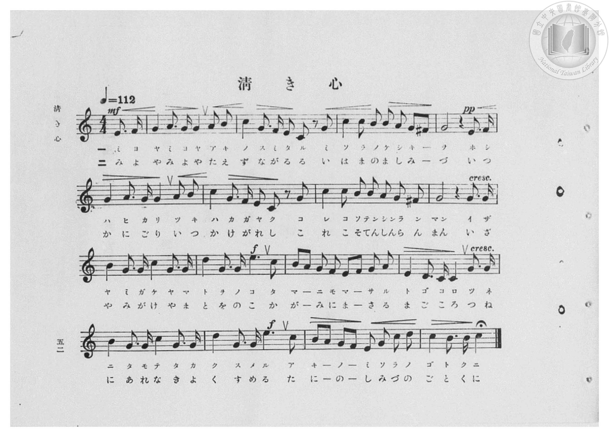
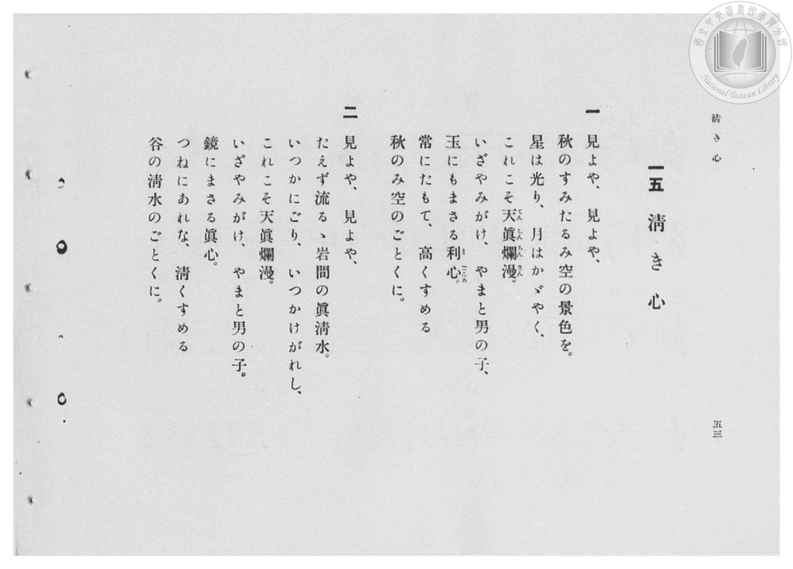

# 清き心

> Re:Shōka 使用 AI 協助辨識與重建樂譜，可能會有錯誤。歡迎回報。

- **鋼琴伴奏版**：<br><audio controls src="kiyoki_kokoro.mp3"></audio>
- **NEUTRINO 歌聲合成版**：<br><audio controls src="kiyoki_kokoro_neutrino.mp3"></audio>

- 臺灣總督府《公學校高等科唱歌》第二學年用（昭和十一年，索書號 0729 74）

## 說明

原書資訊與歌詞全文（對應 P054.jpg–P055.jpg，原書 pp. 52–53，第 15 首）：
調性與拍號：ハ長調（C 大調，無升降記號）4/4 拍（弱起 1 拍），速度 ♩=112


## 歌詞

```text
一
見よや、見よや、
秋のすみたるみ空の景色を。
星は光り、月はかゞやく、
これこそ天眞爛漫（てんしんらんまん）。
いざやみがけ、やまと男の子、
玉にもまさる利心（とごころ）。
常にたもて、高くすめる
秋のみ空のごとくに。

二
見よや、見よや、
たえず流るゝ岩間の眞清水。
いつかにごり、いつかけがれし、
これこそ天眞爛漫。
いざやみがけ、やまと男の子。
鏡にまさる眞心。
つねにあれな、清くすめる
谷の清水のごとくに。
```

## ABC

<div class="abc-score" data-abc-src="kiyoki_kokoro.abc" aria-label="五線譜載入中"></div>

[下載 ABC 原始檔](kiyoki_kokoro.abc)

## TMD 檔案連結

- [主旋律 TMD 檔案](kiyoki_kokoro.tmd) [[在 TMD Studio 編輯](https://tmdlang.github.io/Tmd-TS/#tmd=s7IKdvYPcrWy4qpTUCpJTLdSSM7PyUlNLsnMz7PKzk9PzM7Ojy_OyM9OVIKrKMvPKc1NBcqW5McbIYSL80uLklOtipMz8vNz4ktSK0qS8vOz0eXjCxLTU60CDExNEDIFRfllqXmJeUDdBUWZeSWpKWDtCAWpZZkpqSDp4uTEvPiy1KLMtMzUFCQXpRYVgxwMtaKkKDGvOLkoswDkC4Sq_KKSjPz0osSCjEqrjMzikvyizOTEnPjsxDwkz5VkpAL9lptflJiDLpiXWFJalIpsXmZ6Zp5VaR7IcSVQJ2lpKTzb0fq4sffp_mYFLS0uRVsFQ0MjLntbBWcuGxN9EzuQ9hftu543Ln6-Y-_zuYuf7przuKHraeuap2t3PFuw8OXqGc_Xdj5fPvHplI3P1vY8buh-vmbNk109QNmnO7c8n7Li_Z6OZzPWPp3U87S38cmOBqDg-z09z7csejZ7x4uZ8xUMzI0sFcxN3u_pVOLi0tdSsKUW4FJQUHjaNx9kzeb2Fyu6XnS0A933YuW8p60rnk1rBzrr6YbeZ-2dCqC41csqSH_UMBnINAUxgS6EaFUoKNBTMDUCSpkag5y9Zo2CoanCy2XTgO59v2cWyI4Xq_Y_a1gOMr27F-ghoOjj5v6XU7cDxYF2OCs8XbIczOx53rLwaW_7y5m9L1bMACvsBAavAlAXyCl7Nr7Yul3BEMIFGt3zsmH-013LFB7NXGkLig-QTcDQA1u4rPtxU8fjppbHDY3IbJDc8-XdjxvXPW6c-bhx_-PG-Y-bgNz9z1fuAgo-m7n-Reemx02THjc0gZQ-mzH_ceP6p62dj5u6gLqfzekAch83As2bBzKvsR9q5OPGyY-bekBk49ynS1Y-nzPvecfsZ3tWA139uHHZ4yag-HQQ2QQ0CMjeBySBPoBa8rgRaNI0sHlA9wBNmQg0Fczd97hxxfMp24EOe7p2Asz1fZ2PG1c_bmoCS08Fuv5px0pgugRbteJx4xSwW0ABBDX-6Y4dIA0gjwL1LAMaA0yOIKcDA6AJaE83cphAwwFsDNAwoKLVIGPAIburh1DIgixpBDpj1rOtIIMfN819umnly2lAH68DBgkwCz3bsAXZ00tAQQly2xRI-CIJTgSFBChIpxMIYlIDEaz6Zf9CsL3QEAQaBgxBuElAF6wFSzeBbVwFinlQ9kcNshcbQGZCPYUZZEAVlOdPKFDQ0ufi8s6szM_O9M7Pzi_KtwrITMzLd6jRNaypBtmkYGNopmUHZmErHhRAxc2OhhcLexQ0oLlIW8FE4emG_ufrG3TgmRuhTBOLGUA3gMyvUTBQ0AVDdLo6N61WwRTMNAUqg7B0FcygIsh8cyCuUTCMgwpBpEwUjIGkIdREkFgN2EYfwxqFeKhKdPpx83wovQJo4OPmJVjEkUSbFoHJtWDrHzf3wcV3wnU9btoPZq2G2gIxCeoSIzwuaQTpA5nVATK7qQWLOLIoyFRgZoG4pHEWXHwVlO4Bqu4G6wORYJc0gnTXgDMjLPTABCg0QRgUsqBgM1GHmoaIBBiEx1VBAVJcwYP5cdNesJdXgklQ8Dxu2ggmt4NJUMA9bt4DDaxNQAtg3odBRMTMhnp7O1LgAUtPsEf2gcl1SOzp8KCCm9-4FJ_54MAA0UtgQYIz5e_qAad8HAkeLIs3wVMjJVMWXVhiqrkfFhLNkyB002ogG5J8QKKg8EEkdbhqoCoIvQaaMR43geIEnMCaNkNVr4HzYCmi7XEzhLsdyoCmERAb4vbHzfMQXIzoaoLkwcdN21CSAyhtQ6IR6qzGKUA1XXBRsCeAUQzJJQjVE6E0KJf0gFmgBATJJZMhqqHiIB6wygCToJoYohjKaOoEkyA21BPguhmXJ-BpbhrBNLejE1-aA8viTXOgBIIc82gpDFTAGqELVQPLX2OYIAiCNUHMgic2IAYlThAN4oPEa8AiIGgE0QZOurjSHUYRC0pJ4FICIgqN6OZ54DQBKuAg_E1Qug-asmAQUuCC0w9YHpT7HzeDi75mcHGNLN60FcwGJRYU05u2QOnNQNG1cDuh8dXci5zoMItmUDKCJimQGbBY3gdOECvg4tB8Biy3IMkK7gNwwgSpBSc5iEshZRk4WUPLOKj4VLBZMB0gGYgZU6D0ZKBsL1wUGpqNawmluKezZ-NJcRDZAU1xIDZYGmwKUpkJsdgcIQAr9ZBTHTzrg1MLJG0ASyV0UWDpBophUIkG4cMq9oXQVINIdaC0BVILSi2wVAeu8aBscAWNUR-CdEDSGkgEkv5A9iFcCCstkIs5mM3AJiVUByjFwcvqRkh8Q5sOjfCyunEmVLwRmmIQKQ7cKIGlL2jKAtenUDZSfQqsR2GyIB2QdAYSgaRskH0IFyJcX8vFpWungNzqVADylbkA)]
- [鋼琴伴奏 TMD 檔案](kiyoki_kokoro_piano.tmd) [[在 TMD Studio 編輯](https://tmdlang.github.io/Tmd-TS/#tmd=s7IKdvYPcrWy4qpTUCpJTLdSSM7PyUlNLsnMz7PKzk9PzM7Ojy_OyM9OVIKrKMvPKc1NBcqW5McbIYSL80uLklOtipMz8vNz4ktSK0qS8vOz0eXjCxLTU60CDExNEDIFRfllqXmJeUDdBUWZeSWpKWDtCAWpZZkpqSDp4uTEvPiy1KLMtMzUFCQXpRYVgxxckJmYlx-fWFSUmJeempuah2QEkqBVYmZ8YnJyfm5BYl4mqqr8opKM_PSixIKMSquMzOKS_KLM5MSc-OzEPCT_l2QAjbHKzS9KzEEXzEssKS1KRTYvMz0zz6okMbMc6PD8tLTM5EyQLi0thWc7Wh839j7d3_x-T8fL7j3PJ2x5smfL06X9zzs73u_pVNDS4lK0VTA0NOKyt1Vw5rIx0TexAxn7on3X88bFz3fsfT538dNdcx43dD1tXfN07Y5nCxa-XD3j-drO58snPp2y8dnanscN3c_XrHmyqwco-3TnludTVgBtejZj7dNJPU97G5_saAAKvt_T83zLomezd7yYOV_BwNzIUsHcBGi7EheXZ15JUb5VAChAgzwcagxqqrkUgMDG0EzLDsyqUajOTatVMFfQVTADYlMgNgFiYyjbMA5IGIGIGggbBEGKQSRcwABK13DVoljpg8vKgloF03iQyVDrQLQh1EqY1TUIJXBGtKG2sbZpLDZrvTMr87MzvfOz85E9rGuIxXqYPnQaHBIgq0EOAFoPFQaFC0gEmQ8KAqQQgUiZgN0O8gfIRLAfwDb6GNYogHwAguj04-b5UHoF0MDHzUuwiCOJNi0Ck2vB1j9u7oOL74Trety0H8xaDbUFYhLUJUZ4XNII0gcyqwNkdlMLFnFkUZCpjxs7IC5pnAUXXwWle4Cqu8H6QCTYJY0g3TVc0GgAhx6YAIUmSgpUh5qGiAQYhMdVASgNgZnAuIIH8-OmvWAvrwSToOB53LQRTG4Hk6CAe9y8BxpYm4AWwLwPg4iImQ319nakwHvcuB7skX1gch0Sezo8qODmNy7FZz44MED0EkSQUCPJURauWIK0uR_m5OZJELppNZANiWeQKMgjiDQJVw1UBaHXQFPw4yZQ4IFTQtNmqOo1cB4s6toeN0O426EMaGSC2BC3P26eh-BihGsTJLM8btqGEm-gRAgJb6izGqcA1XTBRcGeAMYFJDkjVE-E0qDk3ANmgWIakpwnQ1RDxUG8x41zweSyx00Q7nQoo6kTTILYUE807kNwcSeOaYjEASl2EVGElhRARRa4pEYWqgaWaMYwQRAEa4KYhV7eg2gQHyReAxYBQVCxC0phoDSGK4FgFFqgKAfnO4goNEaa54EjD1RkQPiboHQfNAnAIKQIA0c0WB6Unx43gwuTZnABiCzetBXMBsUqiulNW6D0ZqDoWrid0IBt7kVOHZiFHSi-oXEPMgMWHfvAMbcCLg7NEMCSABL_cB-AUxBILThtQFwKKR3A6Q9aakDFp4LNgukAyUDMmAKlJwNle-Gi0NBsXEu_pEFOUwCRPOCZCRytkEgE5nN0UWB5AYoKUBkB4cPqtIXQ6EUkD1AiAKkFRSsseYALeygbXDdhVAUgHZBEARKBJBSQfQgXwvIfcsEBs_lxYxNUByhpwEu_RkjEQGvNRnjp1zgTKt4IjVpE0gDXx7CEAE0C4KoEykaqSoBVCEwWpAOSIEAikCQIsg_hQoTrsbaHQK0xktpD8LgEN9hg7TMTkDUgDkwA3joDpguoEDzNQGnUVFGjYAbSAlYEbwXCTDUCMcDySA1AWBsRLICZzBAWU-Q46juLlEYuGUrgrsPWVsYV9jR2E5nNd107BXDHQQHIQE660T6GQPXoYkZgMWUuAA)]

## 分析

```text
================================================================================
📊 TMD Song Profile: [ 清き心 ]
================================================================================
⏱  Duration:       0:34 (34.3s), 16 measures total
🎼 Key & Tempo:    首調基準 C, != 112.0 BPM, <4/4>
   - 分析範圍：      由實際發聲的音符與和弦推測調性；播放脈絡另行呈現
🎤 人聲音域:    C4 (MIDI 60) – E5 (MIDI 76) [跨度: 16 個半音 / 1.3 個八度, 難度: moderate]
   - 最低音:  C4 in [KiyokiKokoro #1 @ m.3, 0:05]
   - 最高音: E5 in [KiyokiKokoro #1 @ m.11, 0:22]
   - 適合: soprano, mezzo-soprano, contralto, tenor, baritone, bass
🏛  結構:      KiyokiKokoro (34.3s)
⚡ 編曲密度:        Peak 1 軌道同時演奏
🗝  調性診斷：       G 大調（純淨自然大調，未偵測到可信轉調）
   - 風格氣質:    純淨自然大調（陽光明朗、易唱易記，無明顯調外色彩）
   - 轉調歷程:    全曲維持單一推測調性（未偵測到可信轉調）
   - 核心骨幹音:  G, C, B, E, A
   - 調性數值:    G 大調 [相關度: 0.84, 穩定度: Moderate, 自然音純度: 96.7%]
   - 候選調性 (K-S): G 大調 (0.84), C 大調 (0.75), E 小調 (0.67)
   - 五度圈歷程:   +1
   - 各段落調性細節:
     • [KiyokiKokoro #1]: G 大調 (r: 0.84, 自然音純度: 96.6%, 調外音: F)

  [ 五度圈游移軌跡 ]
               C  
         F           [G ]*
      Bb               D  
      Eb               A  
         Ab           E  
            Db       B  
               F# 
     (* = active key center)

  [ 十二半音累積音高分佈 ]
     C  : ████████████              19.3%
     C# :                            0.0%
     D  : ███                        5.3%
     D# :                            0.0%
     E  : ██████                     9.8%
     F  : ██                         3.3%
     F# : ██                         3.3%
     G  : ████████████████████████  39.3%
     G# :                            0.0%
     A  : █████                      8.2%
     A# :                            0.0%
     B  : ███████                   11.5%
--------------------------------------------------------------------------------
Assignment 軌道音域：
  - Piano         : C4 – E5 (16 個半音 / 1.3 個八度, 94 個音符)
================================================================================
```


## 原書掃描頁






