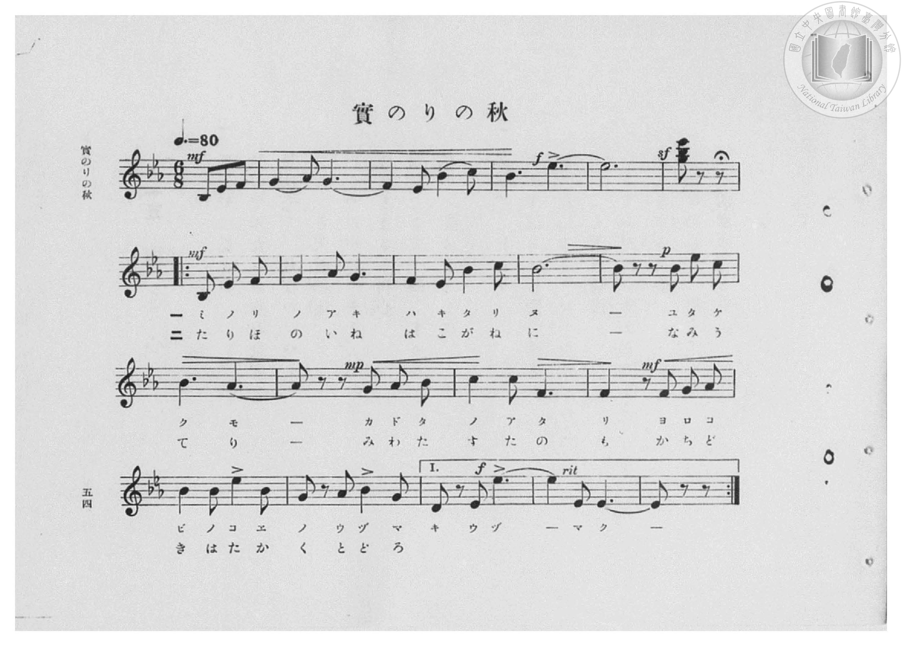
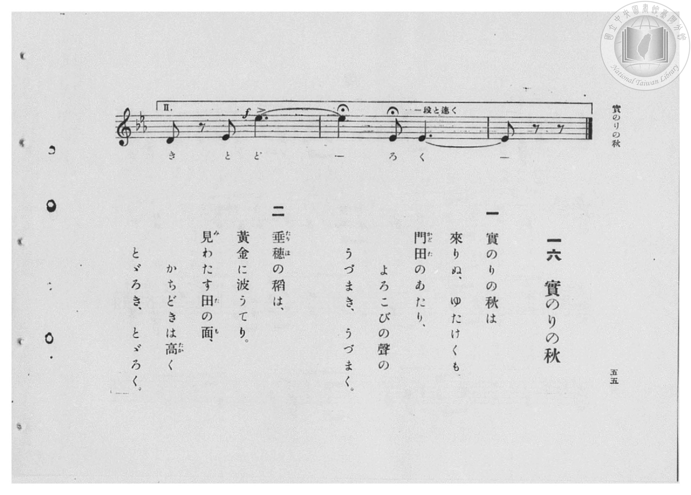

# 實のりの秋

> Re:Shōka 使用 AI 協助辨識與重建樂譜，可能會有錯誤。歡迎回報。

- **鋼琴伴奏版**：<br><audio controls src="minori_no_aki.mp3"></audio>

- 臺灣總督府《公學校高等科唱歌》第二學年用（昭和十一年，索書號 0729 74）

## 說明

原書資訊與歌詞全文（對應 P056.jpg–P057.jpg，原書 pp. 54–55，第 16 首）：
調性與拍號：變ホ長調（E♭ 大調，3 降記號）6/8 拍（弱起 3 拍），速度 ♩.=80


## 歌詞

```text
一
實のりの秋は來りぬ、
ゆたけくも門田（かどた）のあたり、
よろこびの聲のうづまき、うづまく。

二
垂穗（たりほ）の稻は黃金（こがね）に
波うてり。見わたす田の面（も）、
かちどきは高くとゞろき、とゞろく。
```

## ABC

<div class="abc-score" data-abc-src="minori_no_aki.abc" aria-label="五線譜載入中"></div>

[下載 ABC 原始檔](minori_no_aki.abc)

## TMD 檔案連結

- [主旋律 TMD 檔案](minori_no_aki.tmd) [[在 TMD Studio 編輯](https://tmdlang.github.io/Tmd-TS/#tmd=s7IKdvYPcrWy4qpTUCpJTLdSSM7PyUlNLsnMz7PKzk9PzM7Ojy_OyM9OVIKrKMvPKc1NBcqW5McbIYSL80uLklOtipMz8vNz4ktSK0qS8vOz0eXjCxLTU60CDEzNcMqYI2QKivLLUvMS84DmFhRl5pWkpoANRihILctMSQVJFycn5sWXpRZlpmWmpiC5NbWoGOQVqBUlRYl5xclFmQUg_yFU5ReVZOSnFyUWZFRaZWQWl-QXZSYn5sRnJ-YhebskIxXo68R0oFxpTklpUSq6VHFqYnF-XjGysZnpmXlWJYmZ5UDH5aelZSZnJuYocWlpKTxdv-xx47rHTV1A8vnybgUtLS5FWwVDIwMue1sFVx0uGzN9CzuQQS_adz1vXPx8x97ncxc_3TXncUPX09Y1T9fueLZg4cvVM56v7Xy-fOLTKRufre153ND9fM2aJ7t6gLJPd255PmXF-z0dz2asfTqp52lv45MdDUDB93t6nm9Z9Gz2jhcz5ysYmBtZKpibvN_TqcTFpa-lYEstwKWgoPC0bz7Ims3tL1Z0vehoB7rvxcp5T1tXPJvWDnTW0w29z9o7FUDJQC-rIP1Rw2RQvIOYQBdCtCoUFOgpmJoApUxNQc5es0bB0Ezh5bJpQPe-3zMLZMeLVfufNSwHmd7dC_QQUPTFuq7HzbNfTt0OlAJa4_po5lqFp0uWg3k9xgovZ_a-WDEDrLQTGMAKQH0gx-zZ-GLrdgVjCBdoeM_LhvlPdy1TeDRzpZ6thQEXyC5g-IG9hRpvjxvXP9nXBuauedzQCFLxuKntceP8x40THzf2P25qejmt4fmUDUBbHjcCVa8ESgGtABnR2ARSBtQJ09bxuKn3cePkx42bgdIvGjeBFQHNWvq4cd_jxl6gOiRu_-OGJoi7dvWA3TWv6fnK6WBrwIY27oZY83zFbqAbX-5uftk-ESwLNL_nceNasOxqkM5nmxeBzV0GdkvTi2Xdj5v6wT6YCXQ40IiXcxeBdDY1gfRAHQvyy0Kwd4BOXg9MiCAXNa543DQP7AmIY-FcsGOB2ihPWVCgoKXPxeWZV1KUbxWQmZiX71BjUFMNskHBxkLLDszAlp5BifLF2jlPO3ufLu1X0IDGu7aCqcLTDf3P1zfowBOkAign7Wh4sbBHE4sxQNtBVtQoGIBhdW5arYJpvIKhghFQzFhBV8EETOoCeUZA0hBoga6CGZAHonUVqoHKDeOgCkAkDNYApSByEIPBYly1XFy-mXnAssQv3zE7kzQPA7MdsHB42bwCybeGxti9u6vnRfvmp7NnAz0NjD5YfqSB_2GeNYXoLgBqBvkZqABsrI9hjUI8GD5ung_EfUC8CqgcxNIF5pNFQLwWasTj5n6w2Fog3g9iQVX2oFj0uHkP1LxlYHWPmzbC7DKC29UItKupC0jvBuloXAcyrbEFiOF2Na4Hi00GYpD5IBmQ6GrsdjWuAmKgXY1tQLug4QXxvwlUqQk09IABYAzkmAKFzMABBQo0WOBBg9cIrAQRQI-bQI4BeXgRusVNq4HsTrBHUQMNFEAQlauANCg4VgAxKOg2IwUHsCSAmAwMDHQvgYKuHxxUIHUzwYEADDZwYIFVNjVBTG7sBuKFQLwS1fPgiAZRoHRiAPa0LpBVA0wjBkA_ouQMMMMIHhggFYhMAQ-H5sngUAAmEqAvQCxg1IL5oJAARndzK1h0Hth1a1FEYX6DyMNCFOHfeGS7wCHTC_bxerCvQaxucDj0g30MDEugb0Hh1gsW7UURRbILKA_Sg90uYGbXtVMAF20KQAZSxo_2MYzFEDICCylzAQA)]
- [鋼琴伴奏 TMD 檔案](minori_no_aki_piano.tmd) [[在 TMD Studio 編輯](https://tmdlang.github.io/Tmd-TS/#tmd=s7IKdvYPcrWy4qpTUCpJTLdSSM7PyUlNLsnMz7PKzk9PzM7Ojy_OyM9OVIKrKMvPKc1NBcqW5McbIYSL80uLklOtipMz8vNz4ktSK0qS8vOz0eXjCxLTU60CDEzNcMqYI2QKivLLUvMS84DmFhRl5pWkpoANRihILctMSQVJFycn5sWXpRZlpmWmpiC5NbWoGOSVgszEvPz4xKKixLz01NzUPCQjkAStEjPjE5OT83MLEvMyUVXlF5Vk5KcXJRZkVFplZBaX5BdlJifmxGcn5iGFTEkG0BirxHSgXGlOSWlRKrpUcWpicX5eMbKxmemZeVYliZnlQPfnp6VlJmcm5ihxaWkpPF2_7HHjusdNXUDy-fLu93s6XnbveT5hy5M9W54u7X_e2fF-T6eClhaXoq2CoZEBl72tgqsOl42ZvoUdyPQX7bueNy5-vmPv87mLn-6a87ih62nrmqdrdzxbsPDl6hnP13Y-Xz7x6ZSNz9b2PG7ofr5mzZNdPUDZpzu3PJ-yAmjVsxlrn07qedrb-GRHA1Dw_Z6e51sWPZu948XM-QoG5kaWCuYmQOuVuLg880qK8q0CQMEb5OFQY1BTzaUABDYWWnZgRo2CARhW56bVKpjGKxgqGAHFjBV0FUzApC6QZwQkDRVMgaQZkAeidRWqgcoN46AKQCQM1gClgHLRxtqm2oZxsVDjwTJctSju8cHnHqgWheoCoD3xEJfBaKAb4oGOMoVRcD5CAaaWaMN4bdN4bUMMF_lm5gFj2S_fMTuTBuEECxRTiG6gb4DOjAMpABvrY1ijEA-Gj5vnA3EfEK8CKgexdBUeNy0C4rVQIx4394PF1gLxfhALqrIHxaLHzXug5i0Dq3vctBFmlxHcrkagXU1dQHo3SEfjOpBpjS1ADLercT1YbDIQg8wHyYBEV2O3q3EVEAPtamwD2gUNL4j_TaBKTaChBwwAYyAHFGlm4IACBRos8KDBawRWggigx00gx4A8vAjd4qbVQHYn2KOogQYKIIjKVUAaFBwrgBgUdJuRguNx4zKIycDAQPcSKOj6wUEFUjcTHAjAYAMHFlhlUxPE5MZuIF4IxCtRPQ-OaBAFSicGYE_rAlnAxAnkGaHmIDDDCB4YIBWIRAoPh-bJ4FAAJhKgL0AsYNSC-aCQAEZ3cytYdB7YdWtRRGF-g8jDQhTh33hku8Ah0wv28Xqwr0GsbnA49IN9DAxLoG9B4dYLFu1FEUWyCygP0oPdLmyZj_qFAjIfZARQA1gXxK_IysxBLEx1CiYgFjD6UAw2gFgL1AMzCNNFQBYw3oFsVBEQG1nEGMyBG4-zpNK1UwAXnwpABlLARfsAlaILGYGFlLkA)]

## 分析

```text
================================================================================
📊 TMD Song Profile: [ 實のりの秋 ]
================================================================================
⏱  Duration:       0:51 (51.0s), 34 measures total
🎼 Key & Tempo:    首調基準 E,, != 120.0 BPM, <6/8>
   - 分析範圍：      由實際發聲的音符與和弦推測調性；播放脈絡另行呈現
🎤 人聲音域:    A#3 (MIDI 58) – D#5 (MIDI 75) [跨度: 17 個半音 / 1.4 個八度, 難度: challenging]
   - 最低音:  A#3 in [Intro #1 @ m.1, 0:00]
   - 最高音: D#5 in [Intro #1 @ m.4, 0:05]
   - 適合: soprano, mezzo-soprano, contralto, tenor, baritone, bass
🏛  結構:      Intro (9.0s) -> MinoriNoAki[L1] (21.0s) -> MinoriNoAki[L2] (21.0s)
⚡ 編曲密度:        Peak 1 軌道同時演奏
🗝  調性診斷：       D# 大調（純淨自然大調，未偵測到可信轉調）
   - 風格氣質:    純淨自然大調（陽光明朗、易唱易記，無明顯調外色彩）
   - 轉調歷程:    全曲維持單一推測調性（未偵測到可信轉調）
   - 核心骨幹音:  A#, D#, F, G, G#
   - 調性數值:    D# 大調 [相關度: 0.88, 穩定度: Moderate, 自然音純度: 100.0%]
   - 候選調性 (K-S): D# 大調 (0.88), A# 大調 (0.79), A# 小調 (0.53)
   - 五度圈歷程:   -3 -> -3 -> -3
   - 各段落調性細節:
     • [Intro #1]: D# 大調 (r: 0.93, 自然音純度: 100.0%)
     • [MinoriNoAki[L1] #1]: D# 調性不明確 (r: 0.82, 自然音純度: 100.0%)
     • [MinoriNoAki[L2] #1]: D# 調性不明確 (r: 0.82, 自然音純度: 100.0%)

  [ 五度圈游移軌跡 ]
               C  
         F            G  
      Bb               D  
     [Eb]*              A  
         Ab           E  
            Db       B  
               F# 
     (* = active key center)

  [ 十二半音累積音高分佈 ]
     C  : ██████                     6.6%
     C# :                            0.0%
     D  :                            0.0%
     D# : ██████████████████        21.7%
     E  :                            0.0%
     F  : ████████████████          18.7%
     F# :                            0.0%
     G  : ████████████              13.9%
     G# : █████████                 10.2%
     A  :                            0.0%
     A# : ████████████████████████  28.9%
     B  :                            0.0%
--------------------------------------------------------------------------------
Assignment 軌道音域：
  - Piano         : A#3 – D#5 (17 個半音 / 1.4 個八度, 99 個音符)
================================================================================
```


## 原書掃描頁






